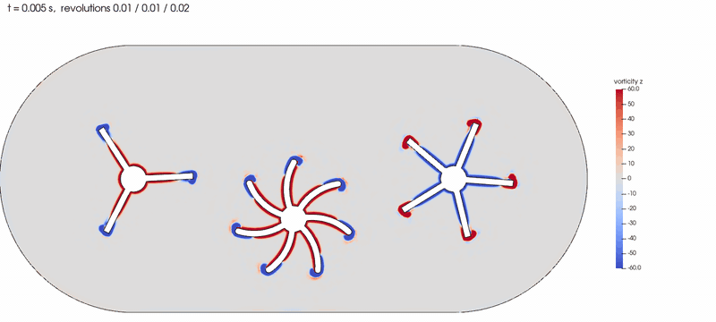

<p align="center">
  
</p>

<h1 align="center">Foehncraft</h1>

<p align="center">
  An open-source, industry-strength, general purpose CFD solver, written in Rust and built for modern GPUs.
</p>

---

> **Status: release 1.0.1, milestone 1.** Incompressible and low-Mach
> flow, laminar and RANS, the energy equation, conjugate heat transfer with
> several fluids and solids, buoyancy and rotating machinery, on CPUs and
> NVIDIA GPUs in one process. The stage plan and every decision are in
> [docs/requirements.md](docs/requirements.md);
> [What works today](#what-works-today) lists what is on `main` now.
> Multi-rank MPI and the natural-convection benchmarks follow in 1.1.

[](https://github.com/chiefenne/Foehncraft/actions/workflows/ci.yml)
[](https://github.com/chiefenne/Foehncraft/releases)
[](Cargo.toml)
[](LICENSE)

<table>
  <tr>
    <td colspan="3"><a href="docs/gallery/flow.md#cylinder"></a></td>
  </tr>
  <tr>
    <td><a href="docs/gallery/flow.md#cavity"></a></td>
    <td><a href="docs/gallery/meshes.md#tjunction"></a></td>
    <td><a href="docs/gallery/meshes.md"></a></td>
  </tr>
  <tr>
    <td><a href="docs/gallery/turbulence.md#impinging-jet"></a></td>
    <td><a href="docs/gallery/flow.md#turbulent-rotor"></a></td>
    <td><a href="docs/gallery/flow.md#several-rotors"></a></td>
  </tr>
  <tr>
    <td colspan="3"><a href="docs/applications/heat-exchangers.md#shell-tube-hx"></a></td>
  </tr>
</table>

<sub>Real results of Foehncraft, each linked to its gallery entry: the Kármán vortex street (Schäfer &amp; Turek benchmark); the lid-driven cavity on a million polyhedra; a T-junction and a pin-fin array on Gmsh tetrahedra; a turbulent jet on a heated plate (k-ε-ζ-f₀); a stirred vessel in water with k-ω SST and the moving reference frame; two rotors on a sliding mesh; a shell and tube heat exchanger with hot air, water and steel in one conjugate case.</sub>

## From one sentence to a moving rotor

> *"Make a 2D domain with three rotors (3, 5, 7 blades), each rotating with
> different speed, one turns in opposite direction and make an animation of
> the vorticity"*

One sentence in a chat with an AI coding assistant connected to
Foehncraft's MCP server (`foehn mcp`) started it. The assistant wrote the
Gmsh mesh script and the case file, checked the mesh, ran the transient
case with three sliding rotors through `foehn` (runs wait for the
engineer's approval in the chat), and rendered the vorticity into this
animation with ParaView. No GUI, no meshing by hand, no case file typed.

<p align="center">
  <a href="docs/gallery/flow.md#curved-blades"></a>
</p>

<sub>Three rotors on a sliding mesh by imprinting at +10, +20 and −15 rad/s,
started from rest: 26 060 cells, 800 time steps in about ten minutes on four
CPU cores. The seven curved blades and the movie script were refined in a
second chat ([gallery 225](docs/gallery/flow.md#curved-blades));
[MP4](assets/readme/three_rotors.mp4). Connect your own assistant:
[docs/agents.md](docs/agents.md).</sub>

## What works today

Everything below is in release 1.0.1 and on `main`, checked by the
verification cases of the [case catalogue](docs/cases.md) and shown in the
[gallery](docs/gallery.md). How well each feature is checked (verified,
partial or unverified, with the evidence and the known gaps) is on the
[verification status](docs/verification/status.md) page (the generated
[verification manual](docs/verification/manual.md) was last run on 0.6.0;
its regeneration is in v1.1), and every run
lists its limitations (a partial feature in use, a value outside the
validated range, one mesh only, …) in its report and its JSON result.

- **Meshes.** Arbitrary polyhedral cells in 2D and 3D; the Gmsh v4, SU2, CGNS (HDF5),
  OpenFOAM polyMesh, Fluent `.msh`, VTK (`.vtk`, `.vtu`) and VTKHDF (also
  blocked) readers behind one mesh-format interface (2D SU2 files extruded
  one layer), a VTU writer;
  a built-in test mesher (hexahedra, tetrahedra, prisms, polyhedra; graded
  segments, the cylinder O-grid, annuli for rotors); a quality report with
  automatic remediation of skewed cells (Gauss pressure gradient, limiter,
  bounded Rhie–Chow face velocity); an operator exactness check that flags
  the cells where the velocity gradient or Hessian is not exact for a
  quadratic field (D236); partitioning with METIS and halos;
  VTKHDF output for ParaView, in blocks that MurmelCraft reads in parts,
  written block by block.
- **Numerics.** Cell-centred finite volumes with weighted least-squares
  gradients, Venkatakrishnan(-Wang) limiters, for the scalars and the
  temperature also the vertex-based MLP limiter with Nishikawa's R3
  (bounded on tetrahedra and polyhedra, D237), linear upwind and bounded
  central convection, non-orthogonal correction, the time-step-independent
  Rhie–Chow interpolation; BDF2 and Crank–Nicolson; reproducible
  (gather-based) assembly in double precision; exact dot products, norms
  and sums on the CPU, bitwise the same for any thread count, cell order
  and number of ranks (MPI step W2); the steady scalar solver, multigrid
  included, and the flow solver (SIMPLEC, PISO and the coupled solver,
  k-ω SST and k-ε, passive scalars and the energy equation) run on several
  ranks with bitwise the result of one (MPI steps W3 to W5; `foehn run
  --ranks N` follows in 1.1).
- **Pressure–velocity coupling.** SIMPLEC and SIMPLE for steady flow, PISO
  with outer correctors for transient flow (SIMPLEC-type correctors with
  outer iterations, stable on thin wedge cells at an axis), a time step from the
  integration error, and a coupled pressure–velocity algorithm with
  pseudo-time steps and multigrid sweeps (the backward-facing step 6 times
  faster than SIMPLEC).
- **Linear solvers.** Aggregation multigrid with CG for the pressure (mixed
  precision, hypre as the reference), reduction multigrid for momentum and
  turbulence, BiCGStab.
- **Turbulence (RANS).** k-ω SST (2003), standard and realizable k-ε,
  k-ε-ζ-f (Hanjalić, Popovac & Hadžiabdić 2004), k-ε-ζ-f₀ (Popovac 2023)
  and the elliptic-blending k-ε; wall treatments `low-re`, `automatic`,
  `scalable`, `standard`, `compound` and `compound-2023`, rough walls; the
  exact wall distance; a sink of k for the ζ-f models that is ε at the
  wall, so their results converge with the mesh; the curvature and
  rotation correction of SST
  (Smirnov & Menter 2009), a whole domain in a turning frame, and the
  quadratic constitutive relation QCR2000/QCR2013 for the secondary flow
  of non-circular ducts; both converge on tetrahedra and perturbed cells
  through a quadratic least-squares velocity fit (gradient and Hessian)
  on the cells the operator check flags (D236).
  Second order verified with manufactured
  solutions of every model on hex, polyhedral and tetrahedral cells
  (the QCR stress is first order on tetrahedra); validated on the flat plate, the channel against DNS, the backward-facing step and
  the impinging jet.
- **Heat and mass transfer.** Passive scalars (temperature, concentration)
  carried by laminar and turbulent flow, with the turbulent Prandtl number
  (constant or Kays–Crawford) and thermal wall functions (Kader,
  Jayatilleke): the heated pipe, plate and channel against correlations and
  DNS, the Nusselt number of the impinging jet against the experiment.
  The energy equation of the fluid (stage 7): c_p(T), k(T) and μ(T) from
  the material database, viscous heating, temperature, heat-flux, heat-flow
  and convection walls, and a heat balance in the report; second order on
  manufactured and exact solutions. Conjugate heat transfer: solid regions
  of a mesh join the temperature equation, the flow runs on the fluid
  cells and the report gives the heat flow through every fluid–solid
  interface (a composite wall exact to round-off). With a turbulence model
  the thermal wall function sits in series with the solid's half cell at
  every interface, and the turbulent channel over a conducting wall gives
  the same heat flow as the independent wall-function path to 10⁻⁴. In
  time, the fluid and the solids heat up in one matrix with the time terms
  of both: two bodies brought into contact keep the exact contact
  temperature and follow the erf profiles at second order in space and
  time, and a heated wall switched on closes its heat balance (input,
  outflow, heat stored per region, written every step) to 10⁻¹¹ in every
  step. Contact resistances and thin walls sit in the faces between two
  regions, solids may conduct orthotropically (axes per region), a region
  can carry its own heat source, and with one-sided gradients at the
  interfaces a piecewise-linear temperature is exact on a skewed mesh (a
  rotated laminate, a fluid and a block behind a contact resistance, to
  3·10⁻¹¹ K); a chip on a thermal pad on a circuit board with copper
  planes is the gallery example. Thermal acceleration of the solids
  (`[energy.acceleration]`): ρ c_p of the solids is scaled down until they
  settle (the factor measured from each solid's time constant, or given),
  then the true ρ c_p comes back, at once or ramped over a few periods in a
  periodic flow; the heated wall reaches its steady state five times sooner,
  and the heat the true solid would have stored is booked in the balance.
  The cycle-averaged loop (`[energy.cycle]`) couples a periodic flow with
  slow solids: the flow runs a few cycles with the solids held, the solids
  are solved steady under the cycle-mean heat transfer (answering with the
  response of the cycle-mean flow), and the new wall temperatures go back,
  until they settle; a pulsating channel over a heated wall converges in 4
  updates to within 0.4 % of the fully coupled periodic state. With
  `skin = "effusivity"` the held wall swings like a thin skin of its
  effusivity, and `resolved_cycles` ends the loop with a few fully coupled
  cycles: a thin-skin wall ends at 1250 s within 0.016 K and 0.1 % on the
  swing of the periodic state the fully coupled run reaches after about
  5000 s; `solid = "transient"` gives the warm-up history instead, marched
  under the cycle-mean flow with the clock jumped by whole periods (within
  0.6 % of the rise, 780 steps against 6000). The frozen-flow march
  (`[energy.frozen_flow]`) holds a settled flow and marches only the
  temperatures with long steps, refreshing a flow that follows the
  temperature when the fluid has moved: a heated wall under a fluid whose
  viscosity halves over 17 K warms up in 557 steps instead of 6000, within
  0.06 K of the fully coupled run. Conjugate runs, the loop and the march
  restart bit-identically. Several fluids in one case (D194): any number
  of fluid regions, each with its own material (liquids and gases) and
  the temperature at which it is evaluated, beside any number of solids;
  fluids that touch only through solids are separate parts of the flow,
  each with its own pressure level; a water / oil counterflow exchanger
  across a steel plate meets ε–NTU to 0.07 %, and a shell and tube
  exchanger runs hot air, water and steel in one case on 0.48 M
  tetrahedra (application 203, a demonstration on one mesh).
- **Gravity and buoyancy.** `[gravity]` and the Boussinesq buoyancy
  (`[buoyancy] model = "boussinesq"`) in SIMPLEC and the coupled algorithm.
  The solver works with the reduced pressure p′ = p − ρ_ref g·(x − x_ref)
  and writes the static pressure beside it. Values of pressure boundaries
  are p′ by default, or the static pressure with
  `pressure_kind = "static"`. The buoyancy enters the faces like the
  pressure gradient (balanced force), so a stratified box at rest on a
  perturbed hex, tet, poly or mixed mesh stays at rest to 10⁻¹⁵ m/s; the
  buoyant slot meets its exact profile at second order, and a warm strip
  in a closed air enclosure drives a laminar plume (gallery 186).
- **Variable density.** The low-Mach density ρ(T, p₀) of an ideal gas or a
  liquid in every cell and face (`[energy] density = "variable"`, or
  `[buoyancy] model = "variable-density"` with the body force (ρ − ρ_ref)
  g), with SIMPLEC and the coupled algorithm, steady and transient,
  turbulent and in conjugate heat transfer. p₀ is the operating pressure
  of an open domain, or follows from the fixed mass of a closed volume,
  with the pressure work that makes a closed gas heat with c_v. A heated
  duct meets its exact balances, a closed box heated uniformly its exact
  p₀(t), a manufactured solution with ρ = 1/T converges at second order,
  and air between walls at 960 K and 240 K has a heat flow with GCI
  0.02 % (gallery 195).
- **Lagrangian sprays (L12, SP1).** Droplets as parcels in a transient flow run (`[spray]` with an included injector file): exact exponential integration of drag (Schiller and Naumann) and gravity, tracking on the mesh locator, stick, rebound, escape or mirror at boundaries, a mass book that stops the run when it does not close, parcel files and restart, results bitwise equal on 1 to 4 threads, one source for CPU and GPU kernels. One way, one process; coupling to the gas follows in SP2 ([gallery 242](docs/gallery/sprays.md#spray-duct)).
- **Datums and spray statistics (SP1b).** Rosin-Rammler and log-normal droplet sizes; `[[datum]]` planes (cut through the cells or moved to the faces, discs, rectangles), STL surfaces, boundaries, zone interfaces, boxes, cylinders and zones; the liquid through each datum bitwise equal on any thread count, the gas mass, volume and momentum flow and area averages; D10 to D43, Dv10/50/90, histograms, a Rosin-Rammler fit and the penetration, in `datums.csv`, `spray_hist_<datum>.csv` and `result.json`, also as the tools `post.datums`, `post.droplets` and `post.penetration`; `series.json` lists the files of a run for a viewer ([gallery 265](docs/gallery/sprays.md#spray-datums)).
- **Internal flows (D45).** Turbulent pipe flow against DNS, the
  asymmetric plane diffuser of Buice & Eaton, the U-bend of Monson et al.
  and a laminar T-junction mixing a passive scalar on polyhedra, each with
  a grid convergence study (GCI) on three meshes and, for the diffuser and
  the U-bend, also with sharp edges (gallery
  [193](docs/gallery/turbulence.md#pipe-turbulent), [196](docs/gallery/flow.md#tjunction-mixing),
  [199](docs/gallery/turbulence.md#diffuser), [204](docs/gallery/turbulence.md#ubend)).
- **Rotating machinery.** The moving reference frame (steady and transient
  frozen rotor), the sliding mesh by conformal stepping and by imprinting
  the interface in every step, several rotors at their own speeds,
  turbulence on all of them; torque per wall and rotor, shaft power in the
  energy balance, head and hydraulic efficiency; relative and frame
  velocities, flow angles and rothalpy as output.
- **Boundary conditions.** Velocity, mass-flow, static and total pressure
  inlets and outlets, freely combinable and checked; walls (moving,
  turning, with blowing or suction), slip walls and symmetry planes,
  axisymmetric wedges, periodic pairs driven by a mass flow or a pressure
  gradient, inlet profiles from tables, backflow handling, convective
  outlets. Pressure values are absolute static pressures (case format
  0.7, gauge optional): every fluid part takes its operating pressure
  from its own outlet, and the solver keeps the gauge pressure, so an
  absolute case and its gauge twin run the same bits (D239).
  Every region and fluid part starts on its own: start tables per
  region, `"inlet"` temperatures, and each part's start pressure from its
  own boundaries (a Laplace solve between two values, D238).
- **Cases and properties.** TOML case files with checks and guidance;
  boundary values, sources and viscosities as expressions; a material
  database (air, water, oils, glycols) with sources.
- **Runs and results.** Restart (a transient run may also start from a
  steady result), control files (`.stop`, `.result_N`, `.read_toml_N`),
  settings that change on a schedule (also the momentum scheme, from a
  first-order start to linear upwind), probes, forces,
  derived fields (vorticity, Q, λ₂, wall shear stress, y⁺, and the Reynolds stress, scales and wall values of the turbulence models),
  statistics of transient runs (time mean, RMS, covariance, phase averages,
  a confidence interval that says whether the window is long enough), mass and
  kinetic-energy ledgers (named terms per quantity, ready for further quantities), a divergence report, a log that can be
  circulated, JSON records for scripts and agents; an iteration budget
  shown before the run and a diagnosis of a steady run at 2000 iterations
  (trend of each residual, verdict, advice, optional stop), budgets
  per study (cell-hours, GPU-hours, output volume) beside the estimate, and
  the limitations of every run (LIM001 to LIM006, D199).
- **Tools for scripts and agents.** One registry of typed tools (D196):
  `foehn commands` prints the catalogue of every tool with its input and
  output schemas and action kind, `foehn call <id> --input file.json` runs
  any of them from JSON ([tools.md](docs/tools.md)): system, case check,
  estimate, resolve, schema and upgrade, diagnostic codes, materials,
  expressions, meshes, flow runs (streaming their run record, stoppable),
  results, derived fields and the scalar, Poisson and G1 studies. Every
  command and Python function goes through these tools, and `cargo xtask
  layering` checks that no front end reaches the engine past them. The
  Python package reaches the same tools (`foehncraft.call`,
  `foehncraft.commands`); [gallery 171](docs/gallery/runs.md#tool-registry).
  With `--journal FILE` every call goes into a journal with its typed
  input, a run keeps the call that started it in `run.jsonl`, and
  `foehn run --script` replays a journal or a run record without a window
  (D197).
- **An MCP server for assistants.** `foehn mcp` serves every tool to an
  assistant over the Model Context Protocol (L18): only inside the read and
  write roots it is started with, with an action table per project that
  allows, asks the person or refuses each kind of action (start a run,
  exceed the estimate, write outside the roots, overwrite results), run
  limits required, progress and cancellation, summaries with their
  limitations first and histories paged by `result.page`, and every call
  journaled for `foehn run --script`. A running case can be watched and
  steered through its live control port (L19): `run.status` with the live
  residuals, `run.set` for run-time settings (never limits), `run.stop`.
  [Connect an assistant](docs/agents.md), [gallery 175](docs/gallery/runs.md#mcp),
  [gallery 177](docs/gallery/runs.md#control-port). A recorded study of an
  assistant (four fin pitches of the heat sink under run limits and a study
  budget, with the refused calls) replays without a window:
  [gallery 181](docs/gallery/runs.md#heat-sink-study).
- **GPU and Python.** The flow loop on NVIDIA GPUs; its results agree
  with the CPU to rounding (bitwise until the exact CPU sums of W2; the
  GPU keeps block sums until v1.1); the Python package `foehncraft` that builds, runs and
  studies cases; the grid convergence index of every mesh sweep.

## Goal

Foehncraft aims to be a general purpose computational fluid dynamics solver of
industry strength: the class of tool that engineers rely on every day for
fluid flow, heat and mass transfer, species transport and reacting flows, on real
geometries and at real problem sizes. It is free and open source under the MIT
licence.

The guiding targets are:

- **General purpose.** Arbitrary polyhedral meshes in 3D, with a physics
  roadmap that reaches from incompressible flow to conjugate heat transfer,
  reacting flow, multiphase flow, moving meshes and scale-resolving
  turbulence.
- **Performance first.** Modern parallel GPUs are the primary platform, with
  a design target of more than 100 million cells on several GPUs and on
  clusters. The same solver runs on any CPU.
- **Accuracy that can be checked.** Double precision, numerics taken from the
  published literature, and every development stage verified against analytic
  solutions and published reference data.
- **Solver first.** A case file and a command line; meshes from established
  open tools, results to established open post-processors.

## First milestone

Version 1.0: incompressible flow, steady and transient, on unstructured 3D
meshes with the RANS models above, heat transfer with the energy equation,
buoyancy and conjugate heat transfer (stage 7), the internal-flow cases of
stage 8, on NVIDIA GPUs and CPUs in one process. Runs on several MPI ranks
(with the exact reductions of v1.0 as the groundwork) follow in v1.1.
Everything after that follows the roadmap in the
[requirements](docs/requirements.md): reacting flows, sprays, multiphase
flow, moving meshes and scale-resolving turbulence.

## Build and run

Needs Rust 1.89 or newer, a C compiler and CMake (HDF5 and METIS are built
from source on the first build; recipe 1 has the details).

```
cargo test --workspace
cargo build --release -p foehncraft-cli
target/release/foehn info
target/release/foehn bench g1 examples/cases/bench/g1_ci_small.toml
target/release/foehn mesh examples/cases/mesh/poly_partition.toml
target/release/foehn scalar examples/cases/scalar/mms_poly_box.toml
target/release/foehn poisson examples/cases/poisson/poisson_poly_box.toml
target/release/foehn flow examples/cases/flow/cavity_re100.toml
target/release/foehn flow examples/cases/flow/taylor_green_bdf2.toml
target/release/foehn flow examples/cases/flow/backstep_zeta_f0.toml
target/release/foehn flow examples/cases/flow/impinging_jet.toml
target/release/foehn flow examples/cases/flow/taylor_couette_mrf.toml
```

## Documentation

| Kind | What it is for | Where |
|---|---|---|
| Tutorial | a first mesh, end to end, in about ten minutes | [docs/tutorial.md](docs/tutorial.md) |
| Guides | install and update, connect an assistant to `foehn mcp` with safety advice, troubleshooting | [docs/install.md](docs/install.md), [docs/agents.md](docs/agents.md), [docs/troubleshooting.md](docs/troubleshooting.md) |
| How-to | steps for one task: build, run, check, partition, rerun G1, order of accuracy, pressure solver and hypre, GPU runs, flow cases and boundary conditions, transient runs, turbulence models and wall treatments, scalars and heat transfer, the coupled algorithm, rotating machinery, derived fields, restart and control files, scripts and agents, balances and divergence reports | [docs/recipes.md](docs/recipes.md) (index of topic pages) |
| Reference | every case file, its keys and defaults; the machine interfaces (JSON formats, exit codes, signals, diagnostic codes, balance and divergence files) | [docs/cases.md](docs/cases.md) (index of topic pages), [docs/keys.md](docs/keys.md), [docs/interfaces.md](docs/interfaces.md) |
| Examples | what each feature computes, with pictures and the commands | [docs/gallery.md](docs/gallery.md) (index of topic pages) |
| Engineering Gallery | industrial cases with complex geometry and the checks that trust them (demonstration entries, no reference data) | [docs/applications.md](docs/applications.md) |
| Sayings | the small words of the trade, for example *Residuen-gaffen* | [docs/sayings.md](docs/sayings.md) |
| Contributing | the documentation every feature ships with (gallery example, case files, recipe) and where it goes | [CONTRIBUTING.md](CONTRIBUTING.md) |
| Explanation | requirements, decisions, benchmark and verification results and their reading | [docs/requirements.md](docs/requirements.md), [G1](docs/benchmarks/g1.md), [stage 2](docs/verification/stage2.md), [stage 3](docs/verification/stage3.md), [stage 4](docs/verification/stage4.md), [stage 5](docs/verification/stage5.md), [stage 6](docs/verification/stage6.md), [verification manual](docs/verification/manual.md), [verification status](docs/verification/status.md) |

The [changelog](CHANGELOG.md) lists every release.

| Crate | Content |
|---|---|
| `foehncraft-core` | generic floating-point type, index types, reproducible sums, counter-based random numbers (`no_std`) |
| `foehncraft-kernels` | compute kernels, one source for CPU and GPU (`no_std`): benchmark, scalar operators, multigrid, flow |
| `foehncraft-parallel` | communicator (serial, MPI) with exact all-reduce, exact threaded reductions |
| `foehncraft-mesh` | polyhedral mesh, geometry, quality report, mesh-format layer with the Gmsh, SU2, CGNS, OpenFOAM, Fluent .msh, VTK and VTKHDF readers, test mesher (also the cylinder benchmark mesh and annuli for rotors), partitioning and halo, VTKHDF output, point location, wall distance, the imprint of sliding interfaces |
| `foehncraft-fv` | finite-volume operators on a scalar (gradients, limiters, convection, diffusion, assembly), BiCGStab, and the pressure solver: CG with smoothed-aggregation multigrid in mixed precision, optional hypre reference; CPU backend (the GPU backend is in `foehncraft-cuda`) |
| `foehncraft-flow` | incompressible flow: SIMPLEC and SIMPLE (steady), PISO with BDF2 and Crank–Nicolson (transient), the coupled algorithm, the Rhie–Chow interpolation, boundary conditions and their check, turbulence models and wall treatments, passive scalars and thermal wall functions, the moving reference frame and sliding meshes, torque and machine performance, restart and control files, probes and force coefficients, the flow device written once over a CPU or GPU executor, the `foehn flow` case, exact solutions, reference and benchmark data |
| `foehncraft-bench` | gate G1: kernel benchmark, CPU backends |
| `foehncraft-cuda` | all NVIDIA GPU code (D60): the flow executor, the scalar and multigrid backend, the G1 backends with the CUDA C reference |
| `foehncraft-tools` | the tool registry (D196): every engine function as a typed tool with a stable id, its JSON schemas, the catalogue and `call` by id, what a call would write and the action table of agent calls (D198); the front ends call it |
| `foehncraft-cli` | the `foehn` command, with the MCP server `foehn mcp` |
| `foehncraft-py` | the Python package `foehncraft` (in `python/`) |
| `gpu/ptx-kernels` | the kernels compiled to NVIDIA PTX (nightly toolchain) |

## How it is built

Foehncraft follows the paradigm of the
[ArtCraft Crafting Apps](https://getartcraft.com/apps/craft-anything): open
source software in Rust, one engine with thin front ends on top, and
development carried out together with a coding agent in a loop of exploring,
building, checking and refining. The falcon joins the animals of that family.

What the agent builds is decided by a person. The development is driven by the
expert knowledge of the maintainer, from 40 years in computational fluid
dynamics: the requirements, the choice of methods, the test cases and the
judgement of every result come from that experience. The agent writes and
checks code; it does not decide what a CFD solver has to be.

Three rules follow from this:

1. **Requirements before code.** Each decision is recorded with its reason in
   [docs/requirements.md](docs/requirements.md) before anything is implemented.
2. **Every stage ends with results that can be tested.** No stage is done
   until its verification cases pass.
3. **Clean-room numerics.** Methods come from the published literature, with
   references; no code is taken from other solvers.

## Why a falcon

The peregrine falcon is the fastest animal there is, and its shape is the work
of the flow around it.

## Why the name

**Foehn** (German *Föhn*) is pronounced [føːn], with a long "ö" as in French *feu*, followed by "n". English speakers say /fɜːn/ ("fern") or /feɪn/. Foehncraft is therefore [ˈføːnkraft].

The foehn is the warm, dry wind that falls down the lee side of a mountain
range. Innsbruck, where the maintainer grew up and where the name comes from,
is one of the best-known foehn places in the world. With a southerly flow, air crosses the main Alpine ridge
at the Brenner Pass, the lowest gap at about 1370 m, runs down the Wipp valley
past Mount Patscherkofel and breaks into the Inn valley at Innsbruck, often in
strong gusts. Sinking without cloud, the air warms by about 1 °C per 100 m of
descent; when the foehn reaches the valley floor at about 580 m, the
temperature in town can rise by 5 to 10 °C within an hour, and the cold air
pooled in the valley is swept away.

Gap flow, a downslope windstorm, stratified flow over complex terrain and a
moving front between warm and cold air: the foehn is computational fluid
dynamics in the open air, and it has been studied at the University of
Innsbruck since the early twentieth century. The command is `foehn`.

## Contributing

The project is at release 1.0.1 (milestone 1) and has one maintainer. Comments on the
requirements are welcome as GitHub issues. [CONTRIBUTING.md](CONTRIBUTING.md)
has the rules every pull request follows, among them that it keeps this
README and the documentation up to date with what it changes.

## Licence

Distributed under the MIT licence. See [LICENSE](LICENSE) for more information.

<!-- year:start -->2026<!-- year:end --> Andreas Ennemoser – andreas.ennemoser@aon.at
