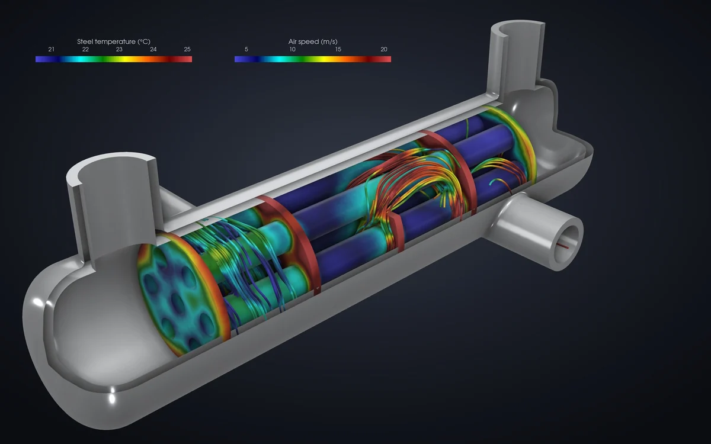
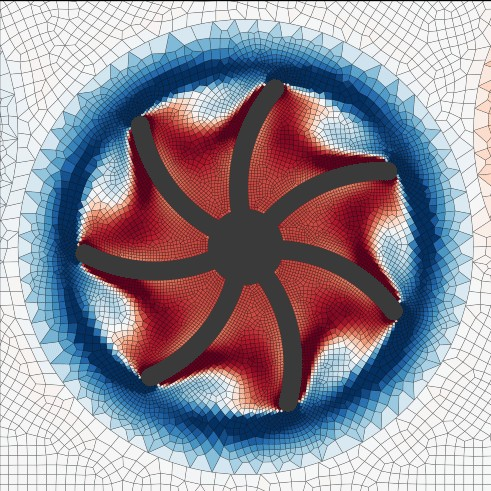
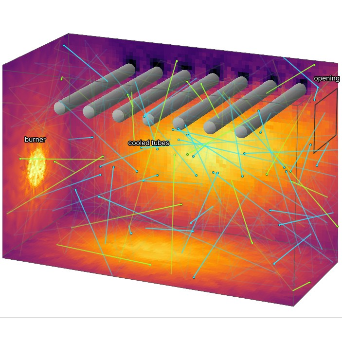
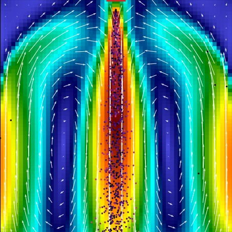
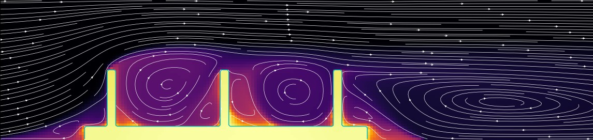
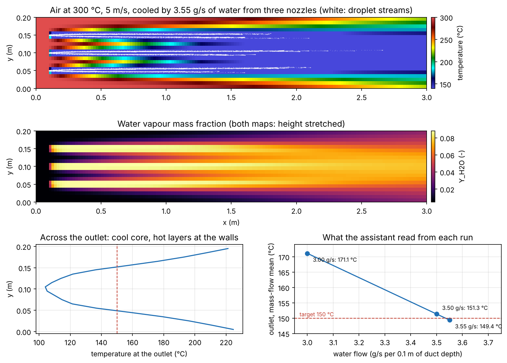

<p align="center">
  
</p>

<h1 align="center">Foehncraft</h1>

<p align="center">
  An open-source, industry-strength, general purpose CFD solver, written in Rust and built for modern GPUs.
</p>

---

> **Status: release 1.0.1, milestone 1.** Incompressible and low-Mach
> flow, laminar and RANS, the energy equation, conjugate heat transfer with
> several fluids and solids, buoyancy and rotating machinery, on CPUs and
> NVIDIA GPUs in one process. The stage plan and every decision are in
> [docs/requirements.md](docs/requirements.md);
> [What works today](docs/features.md) lists what is on `main` now.
> Multi-rank MPI and the natural-convection benchmarks follow in 1.1.

[](https://github.com/chiefenne/Foehncraft/actions/workflows/ci.yml)
[](https://github.com/chiefenne/Foehncraft/releases)
[](Cargo.toml)
[](LICENSE)

<p align="center">
  <b><a href="docs/features.md">What works today</a></b> ·
  <b><a href="docs/gallery.md">Example gallery</a></b> ·
  <b><a href="docs/applications.md">Engineering gallery</a></b> ·
  <b><a href="docs/agents.md">Connect an assistant</a></b> ·
  <b><a href="docs/tutorial.md">Tutorial</a></b> ·
  <b><a href="#documentation">Documentation</a></b>
</p>

<table>
  <tr>
    <td colspan="3"><a href="docs/applications/heat-exchangers.md#shell-tube-hx"></a></td>
  </tr>
  <tr>
    <td><a href="docs/gallery/flow.md#curved-blades"></a></td>
    <td><a href="docs/gallery/radiation.md#furnace-paths"></a></td>
    <td><a href="docs/gallery/sprays.md#spray-two-way"></a></td>
  </tr>
  <tr>
    <td colspan="3"><a href="docs/gallery/energy.md#cht-turbulent"></a></td>
  </tr>
</table>

<sub>Real results of Foehncraft, each linked to its entry: a shell and tube
heat exchanger with hot air, water and steel in one conjugate case; a rotor
with seven curved blades on a sliding mesh; Monte Carlo radiation in a box
furnace with cooled tubes; a water spray that drives the air of a room
(two-way coupled Lagrangian parcels); a finned heat sink in turbulent air
(conjugate heat transfer, k-ω SST).</sub>

## From one sentence to a moving rotor

> *"Make a 2D domain with three rotors (3, 5, 7 blades), each rotating with
> different speed, one turns in opposite direction and make an animation of
> the vorticity"*

One sentence in a chat with an AI coding assistant connected to
Foehncraft's MCP server (`foehn mcp`) started it. The assistant wrote the
Gmsh mesh script and the case file, checked the mesh, ran the transient
case with three sliding rotors through `foehn` (runs wait for the
engineer's approval in the chat), and rendered the vorticity into this
animation with ParaView. No GUI, no meshing by hand, no case file typed.

<p align="center">
  <a href="docs/gallery/flow.md#curved-blades"></a>
</p>

<sub>Three rotors on a sliding mesh by imprinting at +10, +20 and −15 rad/s,
started from rest: 26 060 cells, 800 time steps in about ten minutes on four
CPU cores. The seven curved blades and the movie script were refined in a
second chat ([gallery 225](docs/gallery/flow.md#curved-blades));
[MP4](assets/readme/three_rotors.mp4). Connect your own assistant:
[docs/agents.md](docs/agents.md).</sub>

## From one question to a design number

> *"How much water do I need to spray to cool 300 °C air to 150 °C before
> the filter?"*

The same kind of chat, with an engineering question instead of a picture.
The assistant wrote the duct and the nozzles, guessed the water flow from
the heat balance, ran it, read the outlet temperature, interpolated and
checked the result with a third run and on a finer mesh: **about 3.55 g/s
of water per 0.1 m of duct depth (5.9 % of the air mass flow), all of it
evaporated**. Then it
added what nobody asked for: 150 °C is only the mean, the air along the
walls leaves at up to 225 °C. Every run stated its limitations, and the
session is journaled so anyone can replay it.

<p align="center">
  <a href="docs/gallery/runs.md#spray-cooler-chat"></a>
</p>

<sub>Steady evaporating sprays with k-ω SST on 3000 cells, three runs of about
seven minutes each on four CPU cores, and a mesh check on 12 000 cells. The transcript, with the assistant's
slips and the refusals of the action table:
[docs/agents.md](docs/agents.md#a-recorded-chat-sizing-a-spray-cooler).</sub>

## What works today

- **Meshes.** Polyhedral cells in 2D and 3D, read from Gmsh, SU2, CGNS, OpenFOAM, Fluent `.msh`, VTK and VTKHDF.
- **Flow.** Steady and transient; SIMPLEC, PISO and a coupled solver; RANS from k-ω SST to k-ε-ζ-f₀.
- **Heat.** The energy equation, conjugate heat transfer with several fluids and solids, buoyancy, low-Mach density, Monte Carlo radiation.
- **More physics.** Rotating machinery (moving frame, sliding mesh), Lagrangian sprays with evaporation (water and fuel liquids, 1/3-rule film, high-pressure droplet surface) and breakup, species and laminar reacting flows, porous regions, immersed bodies, deforming meshes, linear structures.
- **Hardware.** CPUs and NVIDIA GPUs in one process; MPI ranks with results bitwise equal to one rank.
- **Driving it.** TOML case files, the `foehn` command, a Python package, and an MCP server for AI assistants.

**[The full list, with the evidence for each feature →](docs/features.md)** ·
[verification status](docs/verification/status.md)

## Goal

Foehncraft aims to be a general purpose computational fluid dynamics solver of
industry strength: the class of tool that engineers rely on every day for
fluid flow, heat and mass transfer, species transport and reacting flows, on real
geometries and at real problem sizes. It is free and open source under the MIT
licence.

The guiding targets are:

- **General purpose.** Arbitrary polyhedral meshes in 3D, with a physics
  roadmap that reaches from incompressible flow to conjugate heat transfer,
  reacting flow, multiphase flow, moving meshes and scale-resolving
  turbulence.
- **Performance first.** Modern parallel GPUs are the primary platform, with
  a design target of more than 100 million cells on several GPUs and on
  clusters. The same solver runs on any CPU.
- **Accuracy that can be checked.** Double precision, numerics taken from the
  published literature, and every development stage verified against analytic
  solutions and published reference data.
- **Solver first.** A case file and a command line; meshes from established
  open tools, results to established open post-processors.

## First milestone

Version 1.0: incompressible flow, steady and transient, on unstructured 3D
meshes with the RANS models above, heat transfer with the energy equation,
buoyancy and conjugate heat transfer (stage 7), the internal-flow cases of
stage 8, on NVIDIA GPUs and CPUs in one process. Runs on several MPI ranks
(with the exact reductions of v1.0 as the groundwork) follow in v1.1.
Everything after that follows the roadmap in the
[requirements](docs/requirements.md): reacting flows, sprays, multiphase
flow, moving meshes and scale-resolving turbulence.

## Build and run

Needs Rust 1.89 or newer, a C compiler and CMake (HDF5 and METIS are built
from source on the first build; recipe 1 has the details).

```
cargo test --workspace
cargo build --release -p foehncraft-cli
target/release/foehn info
target/release/foehn bench g1 examples/cases/bench/g1_ci_small.toml
target/release/foehn mesh examples/cases/mesh/poly_partition.toml
target/release/foehn scalar examples/cases/scalar/mms_poly_box.toml
target/release/foehn poisson examples/cases/poisson/poisson_poly_box.toml
target/release/foehn flow examples/cases/flow/cavity_re100.toml
target/release/foehn flow examples/cases/flow/taylor_green_bdf2.toml
target/release/foehn flow examples/cases/flow/backstep_zeta_f0.toml
target/release/foehn flow examples/cases/flow/impinging_jet.toml
target/release/foehn flow examples/cases/flow/taylor_couette_mrf.toml
```

## Documentation

| Kind | What it is for | Where |
|---|---|---|
| Tutorial | a first mesh, end to end, in about ten minutes | [docs/tutorial.md](docs/tutorial.md) |
| Guides | install and update, connect an assistant to `foehn mcp` with safety advice, troubleshooting | [docs/install.md](docs/install.md), [docs/agents.md](docs/agents.md), [docs/troubleshooting.md](docs/troubleshooting.md) |
| How-to | steps for one task: build, run, check, partition, rerun G1, order of accuracy, pressure solver and hypre, GPU runs, flow cases and boundary conditions, transient runs, turbulence models and wall treatments, scalars and heat transfer, the coupled algorithm, rotating machinery, derived fields, restart and control files, scripts and agents, balances and divergence reports | [docs/recipes.md](docs/recipes.md) (index of topic pages) |
| Reference | every case file, its keys and defaults; the machine interfaces (JSON formats, exit codes, signals, diagnostic codes, balance and divergence files) | [docs/cases.md](docs/cases.md) (index of topic pages), [docs/keys.md](docs/keys.md), [docs/interfaces.md](docs/interfaces.md) |
| Features | everything on `main` now, with the evidence and the gallery entry of each feature | [docs/features.md](docs/features.md) |
| Examples | what each feature computes, with pictures and the commands | [docs/gallery.md](docs/gallery.md) (index of topic pages) |
| Engineering Gallery | industrial cases with complex geometry and the checks that trust them (demonstration entries, no reference data) | [docs/applications.md](docs/applications.md) |
| Sayings | the small words of the trade, for example *Residuen-gaffen* | [docs/sayings.md](docs/sayings.md) |
| Contributing | the documentation every feature ships with (gallery example, case files, recipe) and where it goes | [CONTRIBUTING.md](CONTRIBUTING.md) |
| Explanation | requirements, decisions, benchmark and verification results and their reading | [docs/requirements.md](docs/requirements.md), [G1](docs/benchmarks/g1.md), [stage 2](docs/verification/stage2.md), [stage 3](docs/verification/stage3.md), [stage 4](docs/verification/stage4.md), [stage 5](docs/verification/stage5.md), [stage 6](docs/verification/stage6.md), [verification manual](docs/verification/manual.md), [verification status](docs/verification/status.md) |

The [changelog](CHANGELOG.md) lists every release.

| Crate | Content |
|---|---|
| `foehncraft-core` | generic floating-point type, index types, reproducible sums, counter-based random numbers (`no_std`) |
| `foehncraft-kernels` | compute kernels, one source for CPU and GPU (`no_std`): benchmark, scalar operators, multigrid, flow, the cell walk of particles and radiation, water and steam states of IAPWS-IF97 |
| `foehncraft-parallel` | communicator (serial, MPI) with exact all-reduce, exact threaded reductions |
| `foehncraft-mesh` | polyhedral mesh, geometry, quality report, mesh-format layer with the Gmsh, SU2, CGNS, OpenFOAM, Fluent .msh, VTK and VTKHDF readers, test mesher (also the cylinder benchmark mesh and annuli for rotors), partitioning and halo, VTKHDF output, point location and ray casting, the hand-over of walks between ranks, wall distance, the imprint of sliding interfaces |
| `foehncraft-radiation` | thermal radiation by Monte Carlo energy bundles on the cell walk: emission from Owen-scrambled Sobol points, exact path lengths per cell, grey diffuse walls, symmetry planes and open boundaries, integer tallies with an exact energy account, bitwise the same on any number of threads and ranks; exact solutions of the verification cases |
| `foehncraft-structure` | linear structural finite elements (L53): beams, shells, quadratic solids, dynamics, thermal loads (given or mapped from a flow result), clamp springs, contact with rigid planes, the sparse LDLᵀ solver with its Sturm count, shift-invert Lanczos, the structural case file and the clamp fit |
| `foehncraft-fv` | finite-volume operators on a scalar (gradients, limiters, convection, diffusion, assembly), BiCGStab, and the pressure solver: CG with smoothed-aggregation multigrid in mixed precision, optional hypre reference; CPU backend (the GPU backend is in `foehncraft-cuda`) |
| `foehncraft-flow` | incompressible flow: SIMPLEC and SIMPLE (steady), PISO with BDF2 and Crank–Nicolson (transient), the coupled algorithm, the Rhie–Chow interpolation, boundary conditions and their check, turbulence models and wall treatments, passive scalars and thermal wall functions, the moving reference frame and sliding meshes, torque and machine performance, restart and control files, probes and force coefficients, the flow device written once over a CPU or GPU executor, the `foehn flow` case, exact solutions, reference and benchmark data |
| `foehncraft-bench` | gate G1: kernel benchmark, CPU backends |
| `foehncraft-cuda` | all NVIDIA GPU code (D60): the flow executor, the scalar and multigrid backend, the radiation transport, water and steam states, the G1 backends with the CUDA C reference |
| `foehncraft-tools` | the tool registry (D196): every engine function as a typed tool with a stable id, its JSON schemas, the catalogue and `call` by id, what a call would write and the action table of agent calls (D198); the front ends call it |
| `foehncraft-cli` | the `foehn` command, with the MCP server `foehn mcp` |
| `foehncraft-py` | the Python package `foehncraft` (in `python/`) |
| `gpu/ptx-kernels` | the kernels compiled to NVIDIA PTX (nightly toolchain) |

## How it is built

Foehncraft follows the paradigm of the
[ArtCraft Crafting Apps](https://getartcraft.com/apps/craft-anything): open
source software in Rust, one engine with thin front ends on top, and
development carried out together with a coding agent in a loop of exploring,
building, checking and refining. The falcon joins the animals of that family.

What the agent builds is decided by a person. The development is driven by the
expert knowledge of the maintainer, from 40 years in computational fluid
dynamics: the requirements, the choice of methods, the test cases and the
judgement of every result come from that experience. The agent writes and
checks code; it does not decide what a CFD solver has to be.

Three rules follow from this:

1. **Requirements before code.** Each decision is recorded with its reason in
   [docs/requirements.md](docs/requirements.md) before anything is implemented.
2. **Every stage ends with results that can be tested.** No stage is done
   until its verification cases pass.
3. **Clean-room numerics.** Methods come from the published literature, with
   references; no code is taken from other solvers.

## Why a falcon

The peregrine falcon is the fastest animal there is, and its shape is the work
of the flow around it.

## Why the name

**Foehn** (German *Föhn*) is pronounced [føːn], with a long "ö" as in French *feu*, followed by "n". English speakers say /fɜːn/ ("fern") or /feɪn/. Foehncraft is therefore [ˈføːnkraft].

The foehn is the warm, dry wind that falls down the lee side of a mountain
range. Innsbruck, where the maintainer grew up and where the name comes from,
is one of the best-known foehn places in the world. With a southerly flow, air crosses the main Alpine ridge
at the Brenner Pass, the lowest gap at about 1370 m, runs down the Wipp valley
past Mount Patscherkofel and breaks into the Inn valley at Innsbruck, often in
strong gusts. Sinking without cloud, the air warms by about 1 °C per 100 m of
descent; when the foehn reaches the valley floor at about 580 m, the
temperature in town can rise by 5 to 10 °C within an hour, and the cold air
pooled in the valley is swept away.

Gap flow, a downslope windstorm, stratified flow over complex terrain and a
moving front between warm and cold air: the foehn is computational fluid
dynamics in the open air, and it has been studied at the University of
Innsbruck since the early twentieth century. The command is `foehn`.

## Contributing

The project is at release 1.0.1 (milestone 1) and has one maintainer. Comments on the
requirements are welcome as GitHub issues. [CONTRIBUTING.md](CONTRIBUTING.md)
has the rules every pull request follows, among them that it keeps this
README and the documentation up to date with what it changes.

## Licence

Distributed under the MIT licence. See [LICENSE](LICENSE) for more information.

<!-- year:start -->2026<!-- year:end --> Andreas Ennemoser – andreas.ennemoser@aon.at
