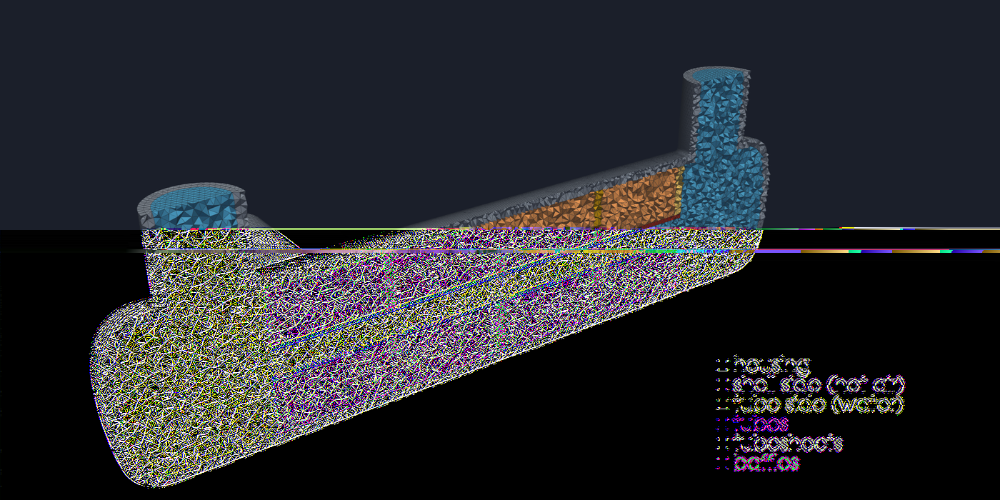
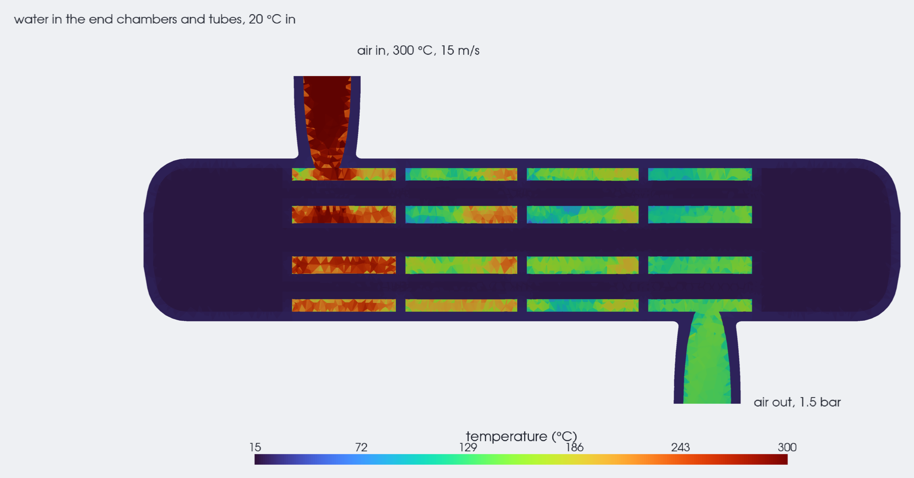
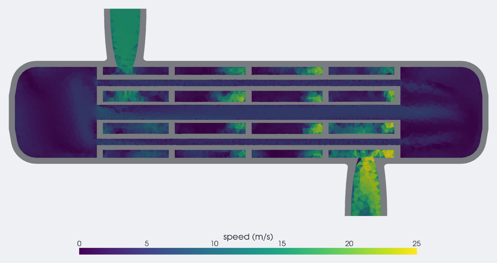
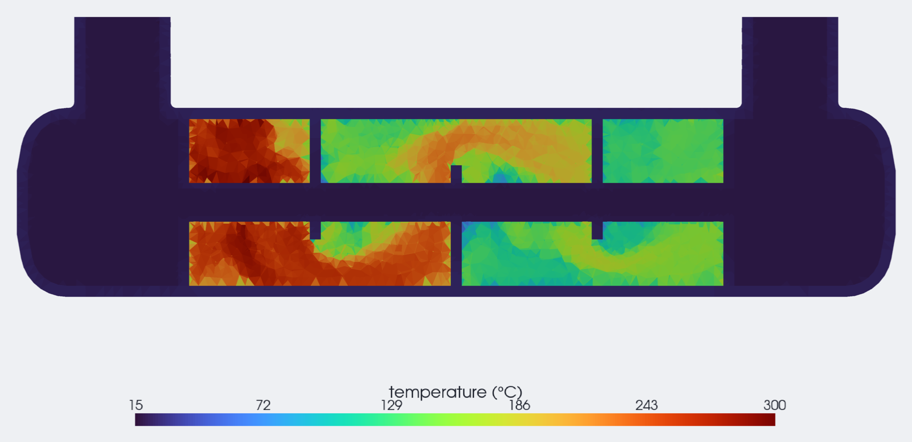

# Heat exchangers

Part of the [Engineering Gallery](../applications.md): shell and tube,
plate and finned exchangers, with the fluids and the metal in one mesh for
conjugate heat transfer (recipes [156](../recipes/energy.md#cht-solids) to
[190](../recipes/energy.md#cht-cycle)).

| # | Application | Sector | Confidence |
|---|---|---|---|
| 203 | [Shell and tube heat exchanger: hot air, water and steel in one conjugate case](#shell-tube-hx) | heat exchangers | demonstration |

---

## 203. Shell and tube heat exchanger: hot air, water and steel in one conjugate case

**Problem.** A compact shell and tube exchanger: hot air flows around the
tube bundle on the shell side, guided by three segmental baffles, and heats
water that flows through seven tubes from one end chamber to the other. To
compute the heat duty both fluids and every metal part must share one mesh
whose faces match across every interface. This entry builds that mesh from
the CAD assembly with Gmsh and solves the air, the water and the steel in
one steady conjugate case, with the water in coflow and in counter flow.

| | |
|---|---|
| Sector | heat exchangers |
| Geometry | `examples/applications/shell_tube_hx/shell_tube_hx.step` (realistic, not from a real project): shell of inner diameter 90 mm, wall 6 mm, dished heads, 474 mm long; seven tubes 21 × 3 mm, 300 mm long; two tubesheets and three segmental baffles 6 mm thick (cut 20 mm off the axis, alternating); tube-side nozzles DN 40 on top, shell-side nozzles DN 30 on the sides |
| Mesh | Gmsh tetrahedra (HXT, Netgen optimised), no prism layers; level 2 (3 mm): 983 249 cells, 196 435 nodes; largest non-orthogonality 73.6° (2 faces above 70°), 74 faces of skewness above 0.9 (D50 remediation); level 0 (5.1 mm): 477 921 cells |
| Cell zones | `shell_side` (hot air), `tube_side` (water: the end chambers and the tube bores), `tubes`, `tubesheets`, `baffles`, `housing` |
| Boundaries | `tube_nozzle_front`, `tube_nozzle_rear` (water), `shell_nozzle_front`, `shell_nozzle_rear` (air), `housing_outer` (every outer face of the housing) |
| Interfaces | found by the solver from the cell zones (`interface-<region>`, recipe 156); the two fluids touch nowhere |
| Run cost | meshing 40 s (level 0) to 2 min (level 2) on one core; the flow on level 0, 2 500 iterations in 90 min on four cores |
| Confidence | **demonstration**: one mesh (level 0), the water-side heat flows not settled (C3), see the check card |
| Boundary conditions | hot air in through `shell_nozzle_front` at 15 m/s and 300 °C, out through `shell_nozzle_rear` at 1.5 bar; water in through a top nozzle at 5 m/s and 20 °C, out through the other at 1 bar; housing outside at 25 °C; everything starts at rest |
| Case files | `applications/shell_tube_hx/mesh.toml` (mesh check); `case_coflow.toml` (water in at `tube_nozzle_front`, the air's end) and `case_counterflow.toml` (water in at `tube_nozzle_rear`); `flow_images.py` draws the flow images |

### The mesh

*The section x < 0 (whole cells): water in the end chambers and in the
bore of the centre tube (blue), hot air between the tubesheets (orange),
the three baffles alternating top and bottom, the housing around them.*

*The housing cut open, the bundle whole: seven tubes, the two tubesheets
and the three segmental baffles with their surface mesh.*

### Volumes and interfaces

The zone volumes match the CAD solids: tubes 7 × 50 893.8 mm³, tubesheets
2 × 23 623.2 mm³, baffles 3 × 18 470.4 mm³ exactly, the housing to
1·10⁻⁵. The interfaces the solver will couple:

| Zone | Zone | Area (cm²) |
|---|---|---:|
| shell_side | tubes | 1 263.4 |
| shell_side | housing | 883.8 |
| shell_side | baffles | 193.0 |
| shell_side | tubesheets | 78.7 |
| tube_side | tubes | 1 013.4 |
| tube_side | housing | 643.5 |
| tube_side | tubesheets | 78.7 |
| tubes | baffles | 66.7 |
| tubes | tubesheets | 55.4 |
| tubesheets | housing | 33.9 |
| baffles | housing | 32.9 |

### How the mesh is built

`mesh.py` reads only the housing from the STEP file. The tubes, tubesheets
and baffles are rebuilt as exact OpenCASCADE primitives with the
dimensions of the STEP file (the same to 10⁻¹² mm): a Boolean cut of the
STEP tubes from the void inside the housing returned wrong pieces (tube
walls classified as fluid), the primitives do not. One `fragment` of a box,
the housing, four nozzle plugs and every internal part then gives each
piece once, with shared faces. A piece takes its zone from the inputs that
contain it (housing before tube bore before tube wall before tubesheet
before baffle); a piece only inside the box is fluid, on the shell side
between the tubesheets and on the tube side beyond them. The plugs, short
discs just outside the nozzle ends, close the nozzles: their flat faces
become the four inlet and outlet boundaries. The script stops when the two
fluids share a face or a nozzle face is missing.

### The flow cases

Two steady conjugate cases share the mesh. Air enters the shell side
through the side nozzle at the front end (x = −100 mm) at 15 m/s and
300 °C and leaves at the rear end against 1.5 bar (the operating pressure
of its ideal-gas density; the solved pressures are gauge values). Water
enters at 5 m/s and 20 °C and leaves against 1 bar: through
`tube_nozzle_front` in `case_coflow.toml`, so both streams run from the
front to the rear end, and through `tube_nozzle_rear` in
`case_counterflow.toml`, against the air (counter flow overall; in the
baffle windows the air crosses the tubes). The outside of the housing is
held at 25 °C, the metal is plain carbon steel. Reynolds numbers: about
9 400 for the air in its nozzle, 7.6·10⁴ for the water in the tubes
(5.1 m/s, d = 15 mm); k-ω SST with the automatic wall treatment and the
thermal wall function. Each fluid region names its own material
(`[regions.air]` with air, `[regions.water]` with water, D194).

### Results

Both cases ran on level 0 (477 921 cells, 220 985 of them in the two
fluids) with the coupled solver from rest, the energy equation with the
vertex limiter of D237 (`limiter = "mlp"`), k-ω SST in both fluids.

*Coflow, iteration 3 250: the air cools from 300 °C to 123 °C across the
four compartments between the baffles; the water, the tubes and the
housing stay within a few kelvin of 20 °C.*

*The speed on the same section: the air jet of the inlet nozzle, the
windows of the segmental baffles and the outlet nozzle; the water at
about 5 m/s in the tubes.*

*The plane through the water nozzles: the air winds around the baffle
cuts, alternately above and below the tubes.*

| | Coflow | Counter flow |
|---|---|---|
| Iterations | 3 250 | 2 500 |
| Air outlet, mixed mean | 396.6 K (123.5 °C) | 397.0 K (123.8 °C) |
| Heat given up by the air | 1.722 kW | 1.719 kW |
| Heat into the outer housing face (25 °C) | 0.86 kW (0.77 to 0.86 over the last 600 iterations) | 0.80 kW |
| Heat taken up by the water | 2.58 kW (2.49 to 2.59) | 2.51 kW |
| Temperature rise of the water | 0.094 K | 0.088 K |
| Effectiveness of the air side, ε = (T_air,in − T_air,out)/(T_air,in − T_water,in) | 0.630 | 0.629 |
| Pressure drop, air / water | 905 Pa / 47.5 kPa | 909 Pa / 48.9 kPa |

**Coflow and counter flow give the same result.** The water carries
6.2 kg/s, about 2 600 times the heat capacity flow of the air (9.5 g/s):
C_r = C_air/C_water = 3.8·10⁻⁴, so the water warms by less than 0.1 K and
the flow arrangement drops out of ε-NTU (for C_r → 0, ε = 1 − e^(−NTU)
for every arrangement; here NTU = 0.99, UA = 9.7 W/K). The two runs agree
within the swing of the iterations. The water also takes up the heat that
enters through the outer housing face, held at 25 °C above the 20 °C of
the water: 0.8 kW, almost half of the air's heat.

### Check card

| Check | Result |
|---|---|
| C1 Mass balance | **pass**: net imbalance 3.7·10⁻⁷ (coflow) and 1.0·10⁻⁶ (counter flow) of the throughput |
| C2 Energy balance | heat ledger closes to 1.3·10⁻⁵ (coflow) and 2.8·10⁻⁵ of the heat flows; the mechanical energy balance is not evaluated |
| C3 Iterative convergence | **fail**: the air outlet temperature and the air's heat stay within 0.13 % over the last 600 of 3 250 iterations, but the heat into the water swings by ±1.8 % and the heat through the housing by ±5.5 % (together: the end chambers and the housing walls); the residuals stall near 10⁻³ from iteration 400 (`RUN016`) |
| C4 Mesh sensitivity | **not run**: one mesh; levels 0 to 3 (ratio 1.3) are ready, level 2 is about 5 h per case on four cores |
| C5 Wall resolution | **pass**: automatic wall treatment, y⁺ from 0.6 to 459 (mean 72) on the walls between fluid and steel, all within its range |
| C6 Mesh quality | **pass**: 81 faces with skewness above 0.9 in 162 cells, remediated (`MESH001`, `MESH002`, D50) |
| C7 Plausibility | ε-NTU: at C_r = 3.8·10⁻⁴ coflow and counter flow must give the same ε, and they do (0.630, 0.629); the shell-side heat transfer coefficient is not compared with a tube-bank correlation yet |
| C8 Independence of the domain | not run: the nozzles end at the boundaries with uniform inlet velocities |
| C9 Health | warnings explained: `MESH001`, `MESH002` (C6), `RUN016` (C3), `BAL001` (the per-step mass imbalance 3.5·10⁻⁶ above `tolerance_step`, a consequence of the stall) |

### Limits

One mesh, the coarsest level; the case files name level 2, run here with
`--set 'mesh.file="hx_L0.msh"'`. The steady run stalls near 10⁻³ and the
heat into the water and through the housing swings by a few percent: a
transient run of the end chambers would settle it (not run). No prism
layers yet: the first cell at the tube walls is about 1 mm, so the walls
take wall functions. The properties of each fluid are constant, the air's
at 300 °C and 1.5 bar, the water's at 20 °C: the air, which cools to about
124 °C, keeps the density and viscosity of its inlet, so its speeds and its
pressure drop downstream are too high (variable density with several
fluids comes with MF-B of D194). With these flow rates the two cases cannot
show a difference between coflow and counter flow (C_r ≈ 0, see above);
water slow enough for C_r near 1 is laminar and waits for turbulence
models per fluid region (MF-C of D194).

Recipe: [203](../recipes/applications.md#shell-tube-hx-recipe).
