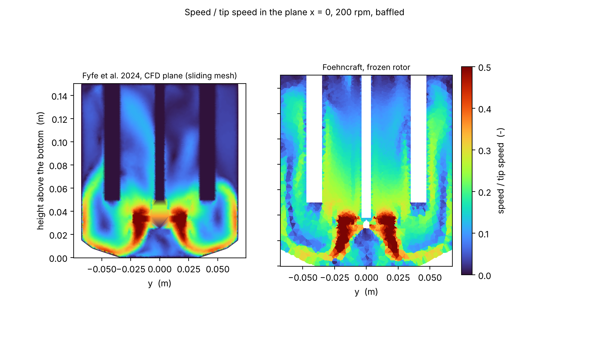
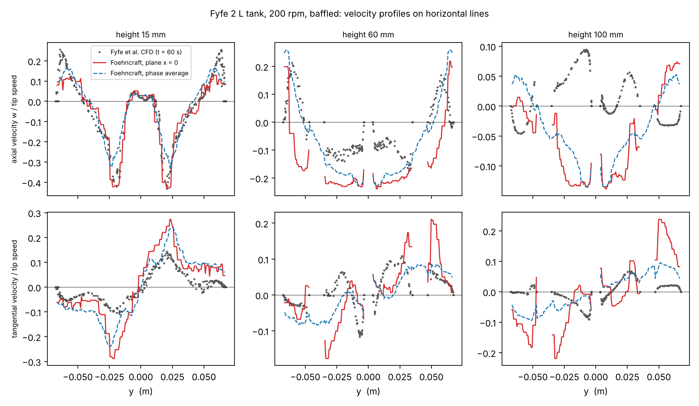

# Rotating machinery

Part of the [Engineering Gallery](../applications.md): stirred tanks, pumps
and fans, with the rotor in a moving reference frame (D55) or on a sliding
mesh (D182). The features behind them are validated in the
[Example gallery](../gallery/flow.md) (Taylor–Couette flow, the baffled
mixer of gallery 100, the sliding-mesh studies).

| # | Application | Sector | Confidence |
|---|---|---|---|
| 131 | [Stirred tank with a three-blade hydrofoil: power and pumping number](#stirred-tank) | rotating machinery | demonstration |
| 161 | [Stirred 2 L lab tank of Fyfe et al.: velocity planes against the published CFD](#fyfe-stirred-tank) | rotating machinery | demonstration |

---

<a id="stirred-tank"></a>
## 131. Stirred tank with a three-blade hydrofoil: power and pumping number

**Problem.** How much power a baffled stirred tank draws at a given speed,
and how much liquid the hydrofoil pumps down, which sets the mixing time and
the dead zones of the tank.

| | |
|---|---|
| Sector | rotating machinery |
| Geometry | T = 1 m, liquid height 1 m, dished base; impeller D = 0.4 m, three-blade hydrofoil; three baffles; sparger ring on three legs; feed pipe; source `examples/applications/stirred_tank/mesh.py` |
| Mesh | Gmsh tetrahedra, no prism layers; level 1: 607 032 cells, largest skewness 0.94 (12 faces above 0.9, D50 remediation on) |
| Fluid | water, ρ = 998.2 kg/m³, μ = 1.0016·10⁻³ Pa s; Re = ρND²/μ = 2.4·10⁵ |
| Boundary conditions | impeller and shaft: walls in the rotor frame (MRF, 90 rpm); vessel, baffles, sparger and feed pipe: walls; liquid surface: symmetry plane |
| Models | k-ω SST, automatic wall treatment; coupled solver |
| Run cost | 2 500 iterations, 2.8 h on one rank (2.1 GHz Intel Xeon) |
| Confidence | **demonstration**: C3 fails (torque still moves about ±4 %), C4 not run (one mesh) |
| Case files | `applications/stirred_tank/case.toml` (level 1); the smoke variant follows |

### Results

| Quantity | Value at 2 500 iterations | Mean over iterations 1 500–2 500 |
|---|---|---|
| Impeller torque | −1.05 N·m | −1.07 N·m |
| Power number N_P | 0.29 | 0.30 |
| Pumping number N_Q (downward, through the plane below the impeller) | 0.45 | – |
| Dead-volume fraction (speed below 5 % of the tip speed) | 13 % | – |
| Mean speed over tip speed | 0.13 | – |

### Images

Rendered from the level-1 run (800 iterations, kept in the project files;
the 2 500-iteration run is the one of the table, with the same flow
pattern); the script is `examples/applications/stirred_tank/images.py`.
The run is a frozen-rotor demonstration: the flow is not settled to the
check level, so read the images as the structure of the flow, not as
numbers.


The impeller (centre) pumps the liquid down and outward along the dished
bottom; the liquid climbs along the wall and returns along the shaft, two
large recirculation loops on each side. The dark patch above the sparger is
the slow liquid between the sparger legs.


Below the impeller the discharge forms a ring of fast liquid around a slow
core; the three slow patches are the wakes between the baffles.


### Check card

| Check | Result |
|---|---|
| C1 Mass balance | pass: net imbalance 2·10⁻¹⁵ kg/s |
| C2 Energy balance | not run |
| C3 Iterative convergence | **fail**: torque moves 7 % over the last tenth of the iterations (rule: below 0.1 %); largest residual 2.8·10⁻³ |
| C4 Mesh sensitivity | not run (one mesh) |
| C5 Wall resolution | mean y⁺ 48 on the impeller, 72 on the vessel; the distribution is not yet checked |
| C6 Mesh quality | 12 faces above skewness 0.9, largest 0.94; remediation on |
| C7 Plausibility | the power number is in the range usually quoted for hydrofoil impellers; a plausibility check, not validation |
| C8 Independence of the domain | not run |
| C9 Health | MRF003: 5 676 cells where the rotor-interface flux does not close (the blades make an interface that is not a surface of revolution); RUN006: not converged. Both explained by the unsteady drift of the torque |

### What to trust, what not

- The mass balance and the power number are the most reliable numbers here.
  The power number carries the torque drift: about ±4 % from the mean.
- The pumping number comes from one plane below the impeller, so it is a
  flow estimate, not a field average.
- The dead-volume fraction depends on the mesh and on the threshold of 5 %
  of the tip speed. Treat it as indicative.

### Run it

From the repository root:

```
pip install gmsh h5py
python3 examples/applications/stirred_tank/mesh.py --level 1
target/release/foehn flow examples/applications/stirred_tank/case.toml
python3 examples/applications/stirred_tank/post.py output/case
```

### Limits and next steps

- The steady frozen rotor on this geometry does not settle; a longer
  averaging run, a sliding mesh, or a mesh-independence study (levels 2 and
  3) are the next steps.
- The images come from a 800-iteration run; they are re-rendered from the finished run by `images.py`.

---

<a id="fyfe-stirred-tank"></a>
## 161. Stirred 2 L lab tank of Fyfe et al.: velocity planes against the published CFD

**Problem.** Does the steady frozen-rotor flow of a small baffled tank with a
four-blade pitched-blade turbine show the same jets, loops and axial
velocities as the published sliding-mesh CFD of the same tank, and what
power number does it give?

| | |
|---|---|
| Sector | rotating machinery (laboratory scale) |
| Geometry | the tank of C. Fyfe, H. Barrington, C. M. Gordon, M. Reid, Org. Process Res. Dev. 2024, 28, 3661–3673 ([doi:10.1021/acs.oprd.4c00229](https://doi.org/10.1021/acs.oprd.4c00229), CC BY 4.0): T = 135 mm, liquid height 150 mm, chamfered bottom, four-blade 45° pitched-blade turbine D = 45 mm, four baffle plates; dimensions from their Supporting Information, the bottom chamfer read from their CFD plane. The geometry is theirs, not a Foehncraft design, so the four-fold arrangement is shown with this reference. Source `examples/applications/stirred_tank_fyfe/mesh.py` |
| Mesh | Gmsh tetrahedra, level 0: 196 713 cells, 6 faces above skewness 0.9 (largest 1.61, D50 remediation on) |
| Fluid | water, ρ = 998.2 kg/m³, μ = 0.9·10⁻³ Pa s; Re = ρND²/μ = 7 500 |
| Boundary conditions | impeller and shaft: walls in the rotor frame (MRF, 200 rpm); vessel and baffles: walls; liquid surface: symmetry plane |
| Models | k-ω SST, automatic wall treatment; coupled solver |
| Run cost | 2 500 iterations, 46 min on 4 cores |
| Confidence | **demonstration**: C3 fails, C4 not run |
| Case files | `applications/stirred_tank_fyfe/case.toml` |

### Images



Left: the plane of the paper's CFD (their data, figshare doi:10.6084/m9.figshare.26405800, not stored in the repository). Right: Foehncraft in the same plane. Both show the two downward discharge jets of the turbine, the loops along the chamfered bottom and the slow liquid between the baffle plates; the dark rectangles are the baffles and the shaft. Their plane has z = 0 at the bottom and z pointing down; the plots turn it to height above the bottom.



The dots are the paper's CFD (one snapshot, t = 60 s); the red line is the plane x = 0 of our frozen rotor, the dashed blue line the average over eight planes through the axis (their rotor phase is not known).

### Results

| Quantity | Value |
|---|---|
| Impeller torque (mean of the last 500 iterations, ±6 % oscillation) | −6.0·10⁻⁴ N·m |
| Power number N_P | about 2.0 (paper's correlation table: 1.8, baffled; plausibility only) |
| RMS difference of the phase-averaged axial velocity to the paper, in tip speeds | 0.05 (15 mm above the bottom, below the blades), 0.09 (60 mm), 0.13 (100 mm) |
| RMS difference of the tangential velocity, in tip speeds | 0.08 (15 mm), 0.06 (60 mm), 0.05 (100 mm) |

### Check card

| Check | Result |
|---|---|
| C1 Mass balance | pass: 5·10⁻¹⁷ kg/s |
| C2 Energy balance | not run; numerical dissipation 58 % of the shaft work on this coarse mesh |
| C3 Iterative convergence | **fail**: torque oscillates ±6 %, largest residual 9·10⁻³ |
| C4 Mesh sensitivity | not run (one mesh) |
| C6 Mesh quality | 6 faces above 0.9, largest 1.61; remediation on |
| C7 Plausibility | N_P near the correlation value; the jets and loops agree with the paper's plane |

### What to trust, what not

- The agreement is best close to the impeller (axial velocity below the blades, the jets): the shape and size of the jets match. Far from it, at 100 mm, the profiles differ in detail; the paper's snapshot is unsteady and ours is a steady frozen rotor.
- The tangential velocity has the same sense and shape as the paper's below the blades; our peak is about twice as high there (0.28 against 0.14 tip speeds), which the frozen rotor and the coarse mesh may explain.
- Our impeller blades are flat plates with square edges at an assumed azimuth; the paper does not state the rotor phase of its snapshot.
- The experiments of the paper are mixing times, not velocities; there is no experimental velocity comparison here.

### Run it

```
pip install gmsh h5py scipy matplotlib
python3 examples/applications/stirred_tank_fyfe/mesh.py --level 0
target/release/foehn flow examples/applications/stirred_tank_fyfe/case.toml
python3 examples/applications/stirred_tank_fyfe/compare.py output/case "YZ plane 200rpm baffled Viscosity 0.0009.csv" --out docs/figures/applications
```

### Limits and next steps

- Mesh levels 1 and 2 (a mesh study), a transient frozen rotor or a sliding mesh, and the 120 and 400 rpm cases.
- Unbaffled runs need a free surface (VOF) and are not possible yet.
