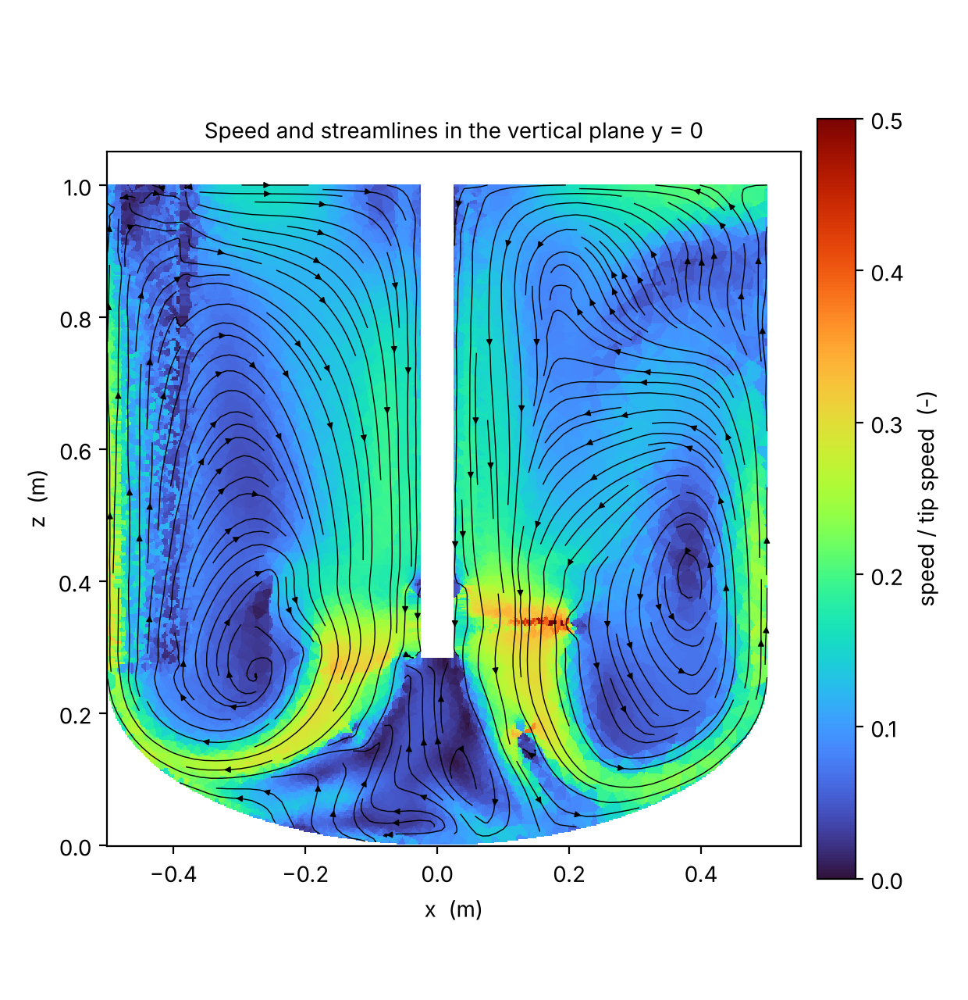
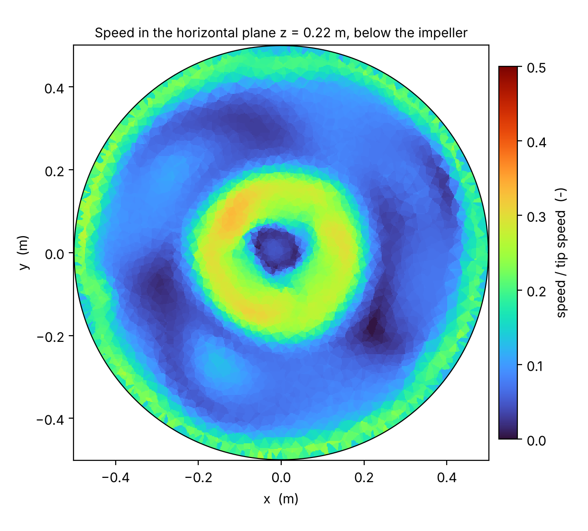
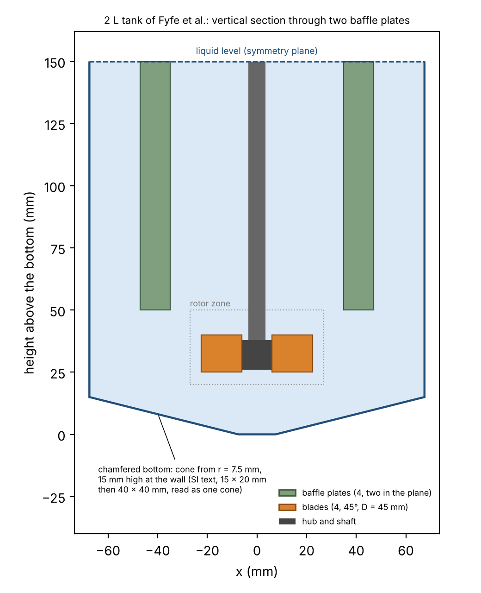

# Rotating machinery

Part of the [Engineering Gallery](../applications.md): stirred tanks, pumps
and fans, with the rotor in a moving reference frame (D55) or on a sliding
mesh (D182). The features behind them are validated in the
[Example gallery](../gallery/flow.md) (Taylor–Couette flow, the baffled
mixer of gallery 100, the sliding-mesh studies).

| # | Application | Sector | Confidence |
|---|---|---|---|
| 131 | [Stirred tank with a three-blade hydrofoil: power and pumping number](#stirred-tank) | rotating machinery | demonstration |
| 161 | [Stirred 2 L lab tank of Fyfe et al.: power number and mixing time against measurements](#fyfe-stirred-tank) | rotating machinery | demonstration |

---

<a id="stirred-tank"></a>
## 131. Stirred tank with a three-blade hydrofoil: power and pumping number

**Problem.** How much power a baffled stirred tank draws at a given speed,
and how much liquid the hydrofoil pumps down, which sets the mixing time and
the dead zones of the tank.

| | |
|---|---|
| Sector | rotating machinery |
| Geometry | T = 1 m, liquid height 1 m, dished base; impeller D = 0.4 m, three-blade hydrofoil; three baffles; sparger ring on three legs; feed pipe; source `examples/applications/stirred_tank/mesh.py` |
| Mesh | Gmsh tetrahedra, no prism layers; level 1: 607 032 cells, largest skewness 0.94 (12 faces above 0.9, D50 remediation on) |
| Fluid | water, ρ = 998.2 kg/m³, μ = 1.0016·10⁻³ Pa s; Re = ρND²/μ = 2.4·10⁵ |
| Boundary conditions | impeller and shaft: walls in the rotor frame (MRF, 90 rpm); vessel, baffles, sparger and feed pipe: walls; liquid surface: symmetry plane |
| Models | k-ω SST, automatic wall treatment; coupled solver |
| Run cost | 2 500 iterations, 2.8 h on one rank (2.1 GHz Intel Xeon) |
| Confidence | **demonstration**: C3 fails (torque still moves about ±4 %), C4 not run (one mesh) |
| Case files | `applications/stirred_tank/case.toml` (level 1); the smoke variant follows |

### Results

| Quantity | Value at 2 500 iterations | Mean over iterations 1 500–2 500 |
|---|---|---|
| Impeller torque | −1.05 N·m | −1.07 N·m |
| Power number N_P | 0.29 | 0.30 |
| Pumping number N_Q (downward, through the plane below the impeller) | 0.45 | – |
| Dead-volume fraction (speed below 5 % of the tip speed) | 13 % | – |
| Mean speed over tip speed | 0.13 | – |

### Images

Rendered from the level-1 run (800 iterations, kept in the project files;
the 2 500-iteration run is the one of the table, with the same flow
pattern); the script is `examples/applications/stirred_tank/images.py`.
The run is a frozen-rotor demonstration: the flow is not settled to the
check level, so read the images as the structure of the flow, not as
numbers.



The impeller (centre) pumps the liquid down and outward along the dished
bottom; the liquid climbs along the wall and returns along the shaft, two
large recirculation loops on each side. The dark patch above the sparger is
the slow liquid between the sparger legs.



Below the impeller the discharge forms a ring of fast liquid around a slow
core; the three slow patches are the wakes between the baffles.


### Check card

| Check | Result |
|---|---|
| C1 Mass balance | pass: net imbalance 2·10⁻¹⁵ kg/s |
| C2 Energy balance | not run |
| C3 Iterative convergence | **fail**: torque moves 7 % over the last tenth of the iterations (rule: below 0.1 %); largest residual 2.8·10⁻³ |
| C4 Mesh sensitivity | not run (one mesh) |
| C5 Wall resolution | mean y⁺ 48 on the impeller, 72 on the vessel; the distribution is not yet checked |
| C6 Mesh quality | 12 faces above skewness 0.9, largest 0.94; remediation on |
| C7 Plausibility | the power number is in the range usually quoted for hydrofoil impellers; a plausibility check, not validation |
| C8 Independence of the domain | not run |
| C9 Health | MRF003: 5 676 cells where the rotor-interface flux does not close (the blades make an interface that is not a surface of revolution); RUN006: not converged. Both explained by the unsteady drift of the torque |

### What to trust, what not

- The mass balance and the power number are the most reliable numbers here.
  The power number carries the torque drift: about ±4 % from the mean.
- The pumping number comes from one plane below the impeller, so it is a
  flow estimate, not a field average.
- The dead-volume fraction depends on the mesh and on the threshold of 5 %
  of the tip speed. Treat it as indicative.

### Run it

From the repository root:

```
pip install gmsh h5py
python3 examples/applications/stirred_tank/mesh.py --level 1
target/release/foehn flow examples/applications/stirred_tank/case.toml
python3 examples/applications/stirred_tank/post.py output/case
```

### Limits and next steps

- The steady frozen rotor on this geometry does not settle; a longer
  averaging run, a sliding mesh, or a mesh-independence study (levels 2 and
  3) are the next steps.
- The images come from a 800-iteration run; they are re-rendered from the finished run by `images.py`.

---

<a id="fyfe-stirred-tank"></a>
## 161. Stirred 2 L lab tank of Fyfe et al.: power number and mixing time against measurements

**Problem.** What power number does the steady frozen-rotor flow of a small
baffled tank with a four-blade pitched-blade turbine give, and how long does
a tracer released at the liquid surface take to mix, against the measured
mixing time of the paper and the blend-time correlation of Grenville?

| | |
|---|---|
| Sector | rotating machinery (laboratory scale) |
| Geometry | the tank of C. Fyfe, H. Barrington, C. M. Gordon, M. Reid, Org. Process Res. Dev. 2024, 28, 3661–3673 ([doi:10.1021/acs.oprd.4c00229](https://doi.org/10.1021/acs.oprd.4c00229), CC BY 4.0): T = 135 mm, liquid height 150 mm, four-blade 45° pitched-blade turbine D = 45 mm, four baffle plates; all dimensions from their Supporting Information, including the bottom edge (a chamfer of 15 and 20 mm, then one of 40 and 40 mm). The second chamfer is longer than the 25 mm face the first leaves, so it consumes it: the bottom is read as one cone, flat out to r = 7.5 mm and 15 mm high at the wall (**our reading**, the text does not say it). The geometry is theirs, not a Foehncraft design, so the four-fold arrangement is shown with this reference. Source `examples/applications/stirred_tank_fyfe/mesh.py` |
| Mesh | Gmsh tetrahedra, level 0: 194 827 cells |
| Fluid | water, ρ = 998.2 kg/m³, μ = 0.9·10⁻³ Pa s; Re = ρND²/μ = 7 500 |
| Boundary conditions | impeller and shaft: walls in the rotor frame (MRF, 200 rpm); vessel and baffles: walls; liquid surface: symmetry plane |
| Models | k-ω SST, automatic wall treatment; coupled solver; the tracer a passive scalar with Sc = 1 000 and Sc_t = 0.7 |
| Run cost | steady flow about 45 min on 4 cores (2 500 iterations, first geometry); tracer run 1 to 2 h expected, not yet run |
| Confidence | **demonstration** |
| Case files | `applications/stirred_tank_fyfe/case.toml` (steady flow), `tracer.toml` (tracer, restarted from it) |

### Images



The vertical section through two baffle plates (the script `geometry_figure.py` draws it from the constants of `mesh.py`): the chamfered bottom, the baffle plates that hang from the lid down to 50 mm above the bottom, the shaft with the hub, the blade zone (25 to 40 mm) and the rotor zone of the frozen rotor. No top view, since four blades and four baffles at 90° are the four-fold arrangement that the images rule excludes.

### What is compared with what

The paper reports no measured velocities. Its measured quantity is the macromixing (plateau) time of the whole-reactor colour change after 20 mL of 1 M HCl is added at the liquid surface to 2 L of dilute NaOH with phenolphthalein, at 200 rpm (Table 3 of the paper):

| Stirring | Baffles | Measured plateau time t_m (s) |
|---|---|---|
| 200 rpm | no | 17.3 |
| 200 rpm | yes | 18.7 |
| 400 rpm | no | 20.0 |
| 400 rpm | yes | 6.5 |

Single runs, whole-reactor colour metric with a plateau detection (their Supporting Information, Table S2); the times are not monotone in the stirring rate (the authors discuss the vortex of the unbaffled tank at 400 rpm), so they are a wide target, not a tight one. This case is the 200 rpm baffled run, **18.7 s**. The blend-time correlation of Grenville, θ₉₅ = 5.20 N_P^(−1/3) N⁻¹ (T/D)² (to be verified against the source, see DATA_SOURCES), gives 12.9 s at N_P = 1.3 and 11.2 s at N_P = 2.0 with N = 200/60 1/s and T/D = 3.

The tracer run is a transient frozen-rotor run, restarted from the steady flow: a blob of 20 mL (radius 16.8 mm, the final mixture fraction 20/2020 = 0.0099) at the liquid surface halfway between the shaft and the wall between two baffle plates, carried by the mean flow and the turbulent diffusivity ν_t/Sc_t. The mixing time θ₉₅ is the time after which the tracer lies within 5 % of its final value in every cell (`mixing_time.py`). The frozen rotor holds the blades at one phase, so the transport by the passing of the blades is represented by the turbulence model only; the result is an estimate, not the sliding-mesh answer.

### Results

**Status (2026-11-22):** neither run has been made on this geometry. The maintainer builds the CAD and the mesh of this tank himself and asked for no simulation before it arrives (2026-11-21); the cases, the analysis script and the bands are ready and the runs wait for that mesh. Until then the entry is a geometry and set-up demonstration.

| Quantity | Reference | Band | Result |
|---|---|---|---|
| Power number N_P (baffled) | measured values of a four-blade 45° pitched-blade turbine in a baffled tank, about 1.2 to 1.4 in the turbulent range (Chapple, Kresta, Wall & Afacan 2002, to be verified); the tank here is at Re 7 500 (transitional) and the baffles hang from the lid | 1.0 to 1.7 | waits for the maintainer's mesh; **the run on the first geometry gave about 2.0**, above the band: a finding, not a reason to move the band |
| Mixing time θ₉₅ at 200 rpm, baffled | measured t_m 18.7 s; Grenville 12.9 s (N_P 1.3) | 10 to 25 s | waits for the maintainer's mesh |

### Check card

| Check | Result |
|---|---|
| C1 Mass balance | not yet run on this geometry (first geometry: 5·10⁻¹⁷ kg/s) |
| C2 Energy balance | not run |
| C3 Iterative convergence | not yet run on this geometry (first geometry: **fail**, torque oscillates ±6 %) |
| C4 Mesh sensitivity | not run (one mesh) |
| C6 Mesh quality | not yet run on this geometry |
| C7 Plausibility | N_P and θ₉₅ against the references above |

### What to trust, what not

- The comparison with measurements is one number, and the measured number is a plateau time of a camera metric, not a θ₉₅ of a concentration field; a factor of two between them would not be a surprise.
- **Geometry caveat:** the SI drawings (primitive list) put the hub (z 38–50 mm above the bottom) on top of the blade box (26–41 mm) and the shaft above it; this model has the hub at 26–38 mm, below the blades' upper half. The entry will be rebuilt from the SI primitives before it is called checked.
- The bottom is our reading of the two chamfers (above); the earlier version read it from the paper's published CFD plane, which the clean-room rule (D201) does not allow, and had a flat bottom out to r = 35 mm.
- Our impeller blades are flat plates with square edges at an assumed azimuth; the paper does not state the rotor phase.
- No velocity field of another code is used anywhere in this entry (D201).

### Run it

```
pip install gmsh h5py scipy matplotlib
python3 examples/applications/stirred_tank_fyfe/mesh.py --level 0
target/release/foehn flow examples/applications/stirred_tank_fyfe/case.toml --out output/fyfe
target/release/foehn flow examples/applications/stirred_tank_fyfe/tracer.toml --out output/fyfe_tracer --set 'run.restart="output/fyfe/restart.h5"'
python3 examples/applications/stirred_tank_fyfe/mixing_time.py output/fyfe_tracer
python3 examples/applications/stirred_tank_fyfe/geometry_figure.py docs/figures/applications/fyfe_geometry.png
```
