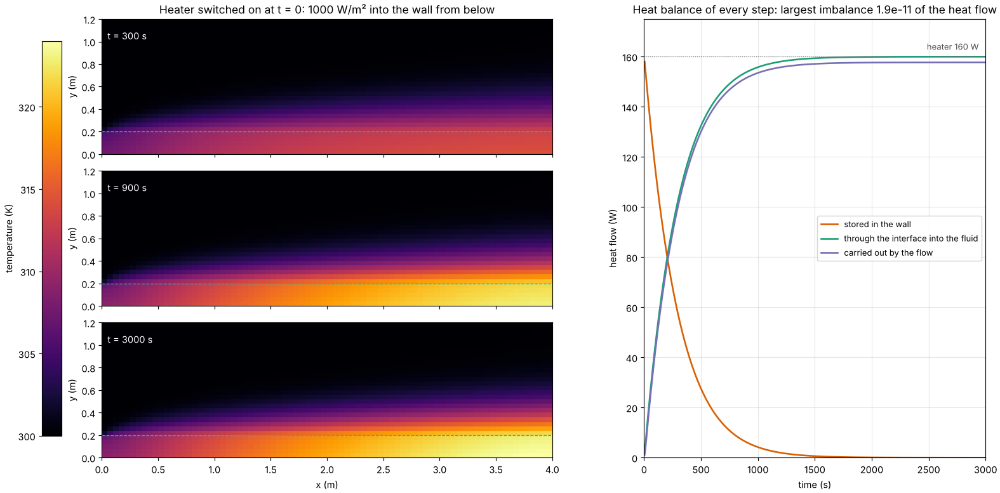
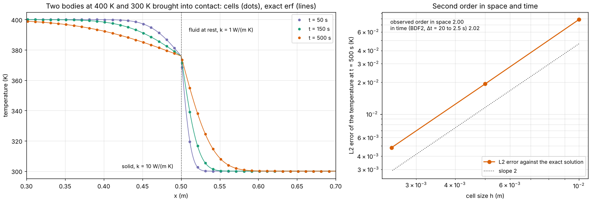
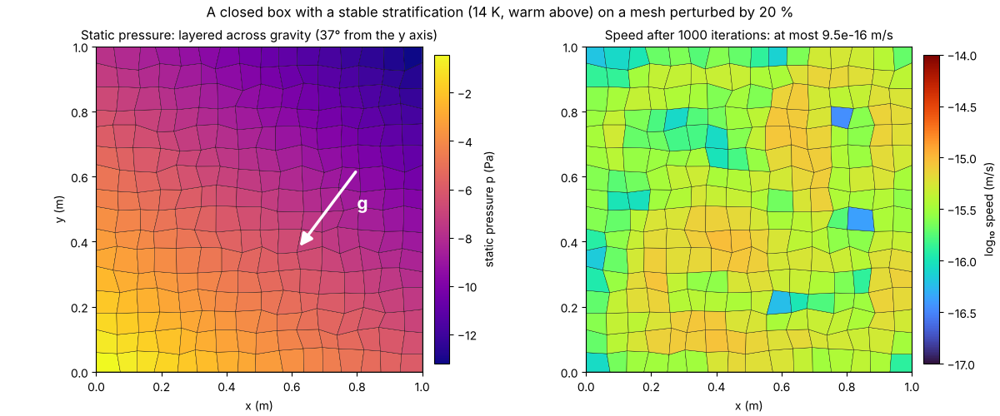

# Energy equation and heat transfer

Part of the [Example gallery](../gallery.md): the energy equation of the fluid (stage 7, D150) with temperature-dependent c_p, k and μ, viscous heating and the thermal wall conditions, checked by manufactured and exact solutions ([specification](../requirements/stage7-energy-buoyancy-cht.md)).

| # | Example | Stage | Feature |
|---|---|---|---|
| 154 | [A heated cavity, conduction with k(T) and a Couette flow heated by its friction](#energy-fluid) | 7 | `[energy]`, `[boundary.<name>.energy]`, `[fluid] specific_heat`, `conductivity`, `viscous_heating`, `temperature_dependent`, `[solver.energy]` |
| 156 | [A heated wall cooled by a channel flow, and a composite wall](#cht-solids) | 7 | `[regions.<name>] kind = "solid"`, `[materials.<name>] kind = "solid"`, `[mesh.generate] zones`, `interface-<region>` |
| 158 | [A finned heat sink in a turbulent air channel, and a turbulent channel over a conducting wall](#cht-turbulent) | 7 | `[turbulence]` with solid regions, `[energy] wall_function`, `turbulent_prandtl` |
| 159 | [A heated wall switched on, and two bodies brought into contact](#cht-transient) | 7 | `[time]` with solid regions, `heat.csv`, `<probe>_T`, `[energy] exact` with `erf` |
| 160 | [A chip on a circuit board with a thermal pad, and an orthotropic patch test](#cht-contact) | 7 | `[interfaces.<name>] contact_resistance`, `thin_wall`, orthotropic `conductivity`, `[regions.<name>] axes`, `[[energy.sources]]` |
| 180 | [A heated wall brought to its steady and periodic state with thermal acceleration](#cht-acceleration) | 7 | `[energy.acceleration]` `inertia_scale`, `period`, `restore`, `restore_ramp`, `heat.csv` `inertia_scaling` |
| 190 | [A pulsating channel over a heated wall, coupled by the cycle-averaged loop](#cht-cycle) | 7 | `[energy.cycle]` `period`, `solid_model`, `update`, `enabled`, `cycle_coupling.csv`, `cycle_faces.csv` |
| 202 | [A thin-skin wall under a pulsating channel: the skin swing, fully coupled cycles at the end and the CHT restart](#cht-cycle-skin) | 7 | `[energy.cycle]` `skin`, `skin_harmonics`, `resolved_cycles`, `cycle_faces.csv` `t_wall_amplitude`, CHT `restart.h5` |
| 186 | [A warm strip in a closed air enclosure, and a stratified box that stays at rest](#buoyancy) | 7 | `[gravity]`, `[buoyancy] model = "boussinesq"`, `expansion_coefficient`, `static_pressure` |
| 195 | [Air between walls at 960 K and 240 K, a heated duct and two closed boxes](#variable-density) | 7 | `[energy] density = "variable"`, `thermodynamic_pressure`, `pressure_work`, `[buoyancy] model = "variable-density"`, `density` |

---

<a id="energy-fluid"></a>
## 154. A heated cavity, conduction with k(T) and a Couette flow heated by its friction


**The heated cavity.** `cavity_heated.toml` is the Re = 100 cavity of
`cavity_re100.toml` with the lid held at 310 K, the bottom at 300 K and
adiabatic side walls; Pr = μ c_p/k = 0.71. The lid drags warm fluid down
the right-hand wall, the primary vortex wraps it around its core and the
heat leaves through the bottom. The run converges in 439 outer iterations
on 64 × 64 cells. The report gives the heat flow of each wall: 288.5 W/m²
enter at the lid and leave at the bottom, the mean Nusselt number is
Nu = q L/(k ΔT) = 2.05, and the heat balance closes to 7·10⁻¹² of the
largest flow. The temperature does not act on the flow yet (buoyancy is
PR 7b1).


**Conduction with k(T) (check V7.1).** `conduction_mms.toml` solves
∇·(k(T)∇T) + q''' = 0 in the unit square, perturbed by 15 %, with
k(T) = 1 + 0.01 (T − 300) W/(m K), the manufactured solution
T = 300 + 50 sin(πx) sin(πy) K and the source that belongs to it. The
conductivity is refreshed from the temperature in every outer iteration,
here from 1.0 at the walls to 1.5 in the centre. The L2 error is 0.112,
0.0258 and 0.00668 K on 16², 32² and 64² cells, observed orders 2.11 and
1.95 (the case requires 1.8 to 2.2); on the finest mesh 20.000 W of source leave through the four walls, with a
reported imbalance of 2·10⁻⁴ (the reported wall flux takes the orthogonal
part of the gradient, so the perturbed mesh shows a small gap).

**Couette flow heated by its friction (check V7.2).** In
`couette_viscous_heating.toml` the upper wall moves at U = 1 m/s over a
gap of h = 1 m (μ = 0.1 Pa s, k = 0.05 W/(m K)), both walls are held at
300 K and `viscous_heating = true` adds Φ = μ (∂u/∂y)². The temperature is
the parabola T = T₀ + μU²/(2k) η(1 − η), 0.25 K above the walls on the
centre line (Brinkman number 1):

| Cells across | L2 error of T (K) | Wall heat flux (W/m²) | Balance |
|---|---|---|---|
| 8 | 3.906e-3 | −0.0500 | 1e-9 |
| 16 | 9.766e-4 | −0.0500 | 3e-9 |
| 32 | 2.441e-4 | −0.0500 | 1e-8 |

The observed order is 2.000. Each wall takes half of the friction power
μU²/h = 0.1 W/m², and the conduction out of the walls equals the viscous
heating of the report.

**Properties that follow the temperature.** With a `material` the
specific heat, the conductivity and the viscosity come from the database
as functions of T (`temperature_dependent = true`, the default); μ(T)
reaches the momentum equation in every outer iteration. A Couette flow of
air between walls at 300 K and 600 K bends its velocity profile by 4 %
against the linear one, which comes back to below 10⁻⁶ with
`temperature_dependent = false` (`tests/energy.rs`). The convection
condition h (T∞ − T_w) gives the exact series resistance of a slab and a
film, and a `heat_flow` in W is spread over its boundary.

```
cargo build --release -p foehncraft-cli
target/release/foehn flow examples/cases/flow/cavity_heated.toml --out output/cavity_heated
target/release/foehn flow examples/cases/flow/conduction_mms.toml --out output/conduction \
    --set 'verification.levels=[2]' --set output.vtkhdf=true
for l in 0 1 2; do
  target/release/foehn flow examples/cases/flow/couette_viscous_heating.toml \
      --out output/couette_$l --set "verification.levels=[$l]" \
      --set 'output.lines=[{name="across",from=[1.0,0.0,0.05],to=[1.0,1.0,0.05],points=64}]'
done
python3 -m tools.plot.energy_fields docs/figures/gallery output/cavity_heated \
    output/conduction output/couette
```

---

<a id="cht-solids"></a>
## 156. A heated wall cooled by a channel flow, and a composite wall


**A heated wall under a channel flow.** `cht_heated_wall.toml` is the
first conjugate case: one generated mesh of 80 × 30 cells holds a channel
1 m high and a solid wall 0.2 m thick below it, 4 m long, marked by a
`zones` box of the generator. The fluid enters at 300 K with 1 m/s
(Re = 100, Pr = 0.71); the outer face of the wall takes 1000 W/m². The
flow runs on the fluid cells, where the faces against the wall become the
no-slip boundary `interface-wall`; the temperature runs on all cells, with
the series conductance of the two half cells at every face between the
materials. All of the heater's 160 W (4 m × 0.04 m) cross the interface
and leave with the flow, and the heat balance of the whole domain closes
to 5·10⁻¹². With k_s/k_f = 10 (left) the heat spreads along the wall
towards the inlet, where the fluid is cold. The right-hand plot runs the
same case with three wall conductivities:

| k_s/k_f | Outer iterations | Heated face, mean (K) | Interface, mean (K) | Hottest cell (K) |
|---|---|---|---|---|
| 0.1 | 146 | 459.11 | 317.11 | 451.77 |
| 10 | 146 | 318.53 | 317.11 | 324.05 |
| 100 | 146 | 317.57 | 317.43 | 319.87 |

The interface mean is the same 317.1 K for the two lower ratios because
the fluid sees the same heat flow; a poor conductor (0.1) needs 142 K
across its thickness to pass it, a good one (100) spreads it so evenly
that the wall is almost isothermal.

**A composite wall (check V7.4).** `cht_composite_wall.toml` stacks a
solid with k = 200 W/(m K), a closed fluid layer at rest with k = 2 and a
solid with k = 20 000, 0.4 m each, between 300 K and 400 K: conductivity
ratios 1 : 100 : 10⁴. The temperature is piecewise linear and the series
heat flux is q = ΔT/Σ tᵢ/kᵢ = 495.0005 W/m². The run gives it at both
outer walls and at both interfaces to 10⁻⁹ relative, and the interface
temperatures 300.990 K and 399.990 K to 10⁻⁹ K (`tests/cht.rs`).

```
cargo build --release -p foehncraft-cli
target/release/foehn flow examples/cases/flow/cht_composite_wall.toml --out output/cht_wall
for r in 0.1 10 100; do
  k=$(python3 -c "print(14.084507042253522 * $r)")
  target/release/foehn flow examples/cases/flow/cht_heated_wall.toml --out output/cht_$r \
      --set "materials.wall-solid.conductivity=$k" --set output.vtkhdf=true
done
python3 -m tools.plot.cht_fields docs/figures/gallery output/cht
```

<a id="cht-turbulent"></a>
## 158. A finned heat sink in a turbulent air channel, and a turbulent channel over a conducting wall


**A finned heat sink.** `cht_heat_sink_turbulent.toml` puts an aluminium
heat sink (k = 167 W/(m K)) on the floor of a plane channel 50 mm high:
a base 100 mm long and 5 mm thick with three fins 3 mm thick and 20 mm
tall. Air enters at 5 m/s and 300 K (k-ω SST with the automatic wall
treatment), and a chip under the base puts 2000 W/m² into the metal.
One mesh of 300 × 50 cells holds both: the flow runs on the air, the
temperature on everything, and every face between the air and the
aluminium takes the thermal wall function of Kader in series with the
half cell of the metal. The run converges in 1007 outer iterations
(2.5 min on 4 threads). All 2.000 W of the chip (per 10 mm of depth)
cross the interface and leave with the air, 0.68 K warmer on average;
the heat balance closes to 4·10⁻⁷. The aluminium conducts so well that
its top varies by only 0.7 K (328.5 to 329.2 K); the mean heat transfer
coefficient over the wetted surface is
q/(T_i − T_in) = 869.6 W/m² / 28.45 K = 30.6 W/(m² K). The fins block
half of the channel, so the air speeds up to 15 m/s over their tips,
while slow vortices fill the gaps between them, hold the warm air and
cool the inner fin faces poorly. The first-cell y⁺ on the metal runs
from 0.2 in the gaps to 24 at the fin tips, which the automatic wall
treatment and the thermal law bridge.


**A turbulent channel over a conducting wall (check V7.36).**
`cht_turbulent_channel.toml` is half of a plane channel (H = 1 m, a
symmetry plane on top, Re = 2·10⁵, Pr = 0.71) over a solid wall 0.1 m
thick whose outer face is held at 350 K. The wall's resistance
t/k_s = 0.5 m²K/W is of the order of the fluid side's 1/h_w, so both
matter. The same channel without the solid, whose wall carries the
wall function in series with a convection condition h = k_s/t to 350 K,
is the independent path of the fluid-only code (stage 6f); the two must
agree, since the solid's axial conduction is negligible here
(`tests/cht.rs`):

| Model | Outer iterations | Heat flow, conjugate (W) | Heat flow, fluid only (W) | Interface, conjugate (K) | Wall, fluid only (K) |
|---|---|---|---|---|---|
| k-ε, scalable | 56 | 107.692 | 107.681 | 323.077 | 323.080 |
| k-ω SST, automatic | 64 | 106.023 | 106.006 | 323.494 | 323.498 |

The heat flow through the interface equals that of the outer face to
10⁻⁶, the drop across the wall is q t/k_s to 10⁻³, and the heat balance
closes to 10⁻¹⁰. On the right the temperature is linear in the wall and
jumps at the interface by the wall function's 1/h_w (first-cell y⁺ 70
to 85).

```
cargo build --release -p foehncraft-cli
target/release/foehn flow examples/cases/flow/cht_heat_sink_turbulent.toml --out output/cht_sink
target/release/foehn flow examples/cases/flow/cht_turbulent_channel.toml --out output/cht_channel_keps
target/release/foehn flow examples/cases/flow/cht_turbulent_channel.toml --out output/cht_channel_sst \
    --set turbulence.model=k-omega-sst --set turbulence.wall_treatment=automatic
python3 -m tools.plot.cht_turbulent docs/figures/gallery output/cht_sink \
    output/cht_channel_keps output/cht_channel_sst
```

<a id="cht-transient"></a>
## 159. A heated wall switched on, and two bodies brought into contact



**A heated wall switched on (check V7.37).**
`cht_heated_wall_transient.toml` is the heated wall of entry 156 with a
`[time]` table: everything starts at 300 K and the flow at rest, and at
t = 0 the 1000 W/m² under the wall switch on. The wall is made lighter
(ρ = 100 kg/m³, the conductivity unchanged), so that its heat capacity of
16 kJ/(m² K) against the 50 to 60 W/(m² K) to the flow gives a time
constant of about 4 min; the steady temperatures do not depend on ρ c_p.
600 BDF2 steps of 5 s (Courant numbers up to 150, three outer iterations
per step) take 16 s on 4 threads. At first the wall stores almost all of
the heater's 160 W; the stored heat decays with a time constant of 263 s,
and after 3000 s it is 2·10⁻³ W, the interface passes 159.998 W and the
flow carries 157.74 W out (the other 2.25 W leave by conduction through
the inlet, where the fluid is held at 300 K). The heat balance of
`heat.csv` closes in every step to 1.9·10⁻¹¹ of the heat flow, and the end
state is the steady solution of entry 156: every cell within 1.5·10⁻⁵ of
the temperature range (the heated face 318.529 K against 318.529 K, the
interface 317.109 K against 317.109 K).



**Two bodies brought into contact (check V7.6).**
`cht_contact_transient.toml` is a bar 1 m long: a solid at 400 K
(k = 10 W/(m K)) and a fluid at rest at 300 K (k = 1), both with
ρ c_p = 10⁶ J/(m³ K), touch at t = 0. Until the heat reaches the ends,
both are semi-infinite bodies: the contact temperature is
T_i = (e₁T₁ + e₂T₂)/(e₁ + e₂) = 375.975 K with the effusivities
e = √(kρc_p) from the first moment on, and each side follows an erf
profile (Carslaw & Jaeger 1959, §2.15), which the case gives as
`[energy] exact` (the expression language has `erf` and `erfc` since this
PR). On 400 cells with Δt = 1 s the interface is within 3·10⁻³ K of T_i
after 10 steps and at T_i to 10⁻¹² K at 500 s, and the heat flow through
it is e₁(T₁ − T_i)/√(πt) to 6·10⁻⁴; what the solid loses
the fluid stores, in every step. The L2 error is 0.0784, 0.0193 and
0.0048 K on 100, 200 and 400 cells, second order (2.02, 2.00), and four
time steps from 20 s to 2.5 s give the time order of BDF2 (2.05, 2.02).
Copper against air (the contact stays at 399.985 K, the copper's
temperature) and two equal bodies (350 K to round-off) are the variants
of `tests/cht.rs`.

```
cargo build --release -p foehncraft-cli
target/release/foehn flow examples/cases/flow/cht_heated_wall_transient.toml --out output/cht_wall_t
target/release/foehn flow examples/cases/flow/cht_contact_transient.toml --out output/cht_contact
target/release/foehn flow examples/cases/flow/cht_contact_transient.toml --out output/cht_contact_space \
    --set 'verification.levels=[0, 1, 2]' --set 'mesh.generate.cells=[100, 1, 1]'
target/release/foehn flow examples/cases/flow/cht_contact_transient.toml --out output/cht_contact_time \
    --set 'verification.time_steps=[20.0, 10.0, 5.0, 2.5]'
python3 -m tools.plot.cht_transient docs/figures/gallery output/cht_wall_t output/cht_contact \
    output/cht_contact_space output/cht_contact_time
```

<a id="cht-contact"></a>
## 160. A chip on a circuit board with a thermal pad, and an orthotropic patch test


**A chip on a circuit board (stage 7d2).** `cht_circuit_board.toml` is a
2D slice 1 cm deep: a board 1.6 mm thick and 12 cm long carries a silicon
chip 20 mm long and 1.6 mm high that dissipates 1 W
(`[[energy.sources]]` with `power`), cooled by air at 300 K and 1 m/s in
a channel 12 mm high (laminar) and, below the board, by the still air of
the enclosure (h = 5 W/(m² K)). The board is a glass-fibre laminate with
copper planes, an **orthotropic** conductivity of 25 W/(m K) along the
board and 0.35 W/(m K) through it; the chip sits on a **thermal pad** of
R″ = 2·10⁻⁴ m²K/W (`[interfaces.pad]`). 250 iterations take 12 s on 4
threads, and the heat balance closes to 7·10⁻¹³ of the chip's power.
With the copper planes 74 % of the heat goes down into the board, which
spreads it over its whole length: 48 % reaches the air through the top of
the board, 26 % leaves through the bottom, and the chip stays at
363.7 K. With a plain laminate (0.35 W/(m K) in every direction, the
same case with `--set`) only 29 % enters the board, the chip has to pass
71 % to the air over its own small surface, and it runs at 423.7 K, 60 K
hotter. The pad costs 0.6 K: without it the chip is at 363.1 K, and the
two faces of the pad differ by the heat flux through it times R″
(363.6 K on the chip side, 362.8 K on the board side, in the report as
`interface-board-chip`).


**The orthotropic patch test (V7.4 variant of the stage 7
specification).** `cht_orthotropic_patch.toml` puts three layers side by
side on a unit square whose nodes are moved by up to 25 % of a cell (the
two interface planes stay planes): a laminate with k₁ = 20 and
k₂ = 2 W/(m K) along axes turned by 30°, a fluid layer at rest
(k = 2), and a block (k = 50) behind a contact resistance of
0.01 m²K/W. The exact temperature is linear in every region, with the same
tangential gradient everywhere, the same heat flux of 200 W/m² through
every layer (in the laminate part of it comes from the cross term
K_xy ∂T/∂y) and a jump of 2 K across the contact. A scheme with the
two-sided gradient of an ordinary face, the harmonic mean or k of the
face normal alone misses this on a skewed mesh; with the **one-sided
gradients** of the interface cells, the series conductance with R″_c and
the deferred **cross terms** of K the solution is exact: the largest error
is 2.7·10⁻¹¹ K after 49 iterations, and the heat flux is 200 W/m² to
10⁻⁸ at both outer walls and through both interfaces. tests/cht.rs also
gives the laminate its axes in the region in place of the material
(`[regions.laminate] axes`), with the same result.

```
cargo build --release -p foehncraft-cli
target/release/foehn flow examples/cases/flow/cht_circuit_board.toml --out output/cht_board
target/release/foehn flow examples/cases/flow/cht_circuit_board.toml --out output/cht_board_plain \
    --set 'materials.board-laminate.conductivity=0.35'
target/release/foehn flow examples/cases/flow/cht_circuit_board.toml --out output/cht_board_nopad \
    --set 'interfaces.pad.contact_resistance=0.0'
target/release/foehn flow examples/cases/flow/cht_orthotropic_patch.toml --out output/cht_patch
pip install matplotlib h5py numpy
python3 -m tools.plot.cht_contact docs/figures/gallery output/cht_board output/cht_board_plain \
    output/cht_board_nopad output/cht_patch
```

<a id="cht-acceleration"></a>
## 180. A heated wall brought to its steady and periodic state with thermal acceleration


**A heated wall in a steady flow (check V7.41).**
`cht_heated_wall_accelerated.toml` is the heated wall of entry 159 with
`[energy.acceleration] inertia_scale = "auto"`. The steady temperatures of
a solid do not depend on its ρ c_p, so scaling ρ c_p down changes only how
fast the wall gets there, like a good initial field. After the first
window (10 steps of 5 s) the run measures the wall's conductance to the
flow, G = 8.96 W/K (the heat flow out of the wall for 1 K more, two steady
energy solves with the wall held and the flow as it is), and its time
constant C/G = 286 s with C = ρ c_p V = 2560 J/K; ρ c_p is scaled by
f = 0.175, so that the time constant becomes one window. The wall has
settled at 450 s (the change still to come, extrapolated from the last two
windows, below 0.1 % of the rise) and has its true ρ c_p from then on. At
600 s the heated face is at 322.610 K against 322.612 K of the true wall
after 3000 s: the same state with a fifth of the simulated time (120 steps
in 4.2 s against 600 steps in 16.5 s on 4 threads). The balance of the
solved equation closes in every step to 1.9·10⁻¹¹ of the heat flow, and
`heat.csv` has the column `inertia_scaling`: the heat the true wall would
have stored in addition, exactly (1 − f)/f of the wall's solved storage
while accelerated (31.2 kJ over the run).


**The same wall in a periodic flow.**
`cht_heated_wall_periodic_accelerated.toml` swings the inlet temperature
between 250 and 350 K over 50 s and gives the period: a window is one
period, the target is two periods (f = 0.35) and the wall settles at
700 s. A jump back to the true ρ c_p would catch the accelerated wall in
the middle of its swing, whose depth and amplitude are 1/√f larger than
the true ones (the skin depth of the period √(2k/(f ρ c_p ω)) = 0.28 m is
larger than the 0.2 m wall: ACC003). That part stays in the deep
temperature and decays only with the true time constant: 1.5 K too cold
right after the jump, still 0.24 K at 1500 s. Raising f geometrically back
to 1 over three periods (`restore_ramp`, the default with a period) lets
the swing die out on the way: the cycle mean at 1500 s is within 0.0025 K
of the true wall's periodic state, which the unaccelerated run reaches
after about 2500 s (4000 s run). The same effect in a lumped model: a jump
leaves about (gas swing)/(ω τ_f) in the solid, 8 % of the swing at
τ_f = 2 periods; a ramp over three periods 0.3 %.

```
cargo build --release -p foehncraft-cli
target/release/foehn flow examples/cases/flow/cht_heated_wall_accelerated.toml --out output/acc
target/release/foehn flow examples/cases/flow/cht_heated_wall_transient.toml --out output/ref
target/release/foehn flow examples/cases/flow/cht_heated_wall_periodic_accelerated.toml --out output/per
target/release/foehn flow examples/cases/flow/cht_heated_wall_periodic_accelerated.toml --out output/per_jump \
    --set energy.acceleration.restore_ramp=0
target/release/foehn flow examples/cases/flow/cht_heated_wall_periodic_accelerated.toml --out output/per_ref \
    --set energy.acceleration.inertia_scale=1.0 --set time.end_time=4000.0
pip install matplotlib h5py numpy
python3 -m tools.plot.cht_acceleration docs/figures/gallery output/acc output/ref output/per \
    output/per_jump output/per_ref
```

<a id="cht-cycle"></a>
## 190. A pulsating channel over a heated wall, coupled by the cycle-averaged loop


**The case (checks V7.39 and V7.40).** `cht_pulsating_channel_cycle.toml`
is a laminar channel 4 m long and 0.2 m high (Re = 20) over a wall 0.2 m
thick (k = 140.85 W/(m K), ρ c_p = 8·10⁴ J/(m³ K)) heated from below with
1000 W/m² (160 W over the 4 m × 0.04 m face of the slice). The inlet
velocity swings by ±50 % and the inlet temperature by ±50 K around 300 K
with a period of 50 s (20 steps of 2.5 s). `[energy.cycle]` holds the wall
at its current temperature and runs the flow for a warm-up cycle and an
averaged one; per interface face it accumulates the conductance, the heat
flow and the mass flux over the averaged cycle. The solid phase then
solves the whole energy equation steady with the fluid convected by the
cycle-mean mass flux and adds to each solid cell at the interface the
difference between the cycle-mean heat flow of the transient phase and
that of the mean flow (`solid_model = "mean-flow"`, the default): the
wall answers a change of its own temperature with the response of the mean
flow, and at the converged wall temperature its heat flows are those of the
periodic flow. The new wall temperatures go back to the fluid phase, which
continues from its own last state. After the first update a quasi-Newton
update (IQN-ILS) takes the place of the relaxation.

The loop converges after 4 updates and 10 cycles: 500 s simulated in 5.5 s
on 4 threads. The interface heat flow is 160.0002 W, the heat put in; the
probes in the wall are within 0.14 K (0.4 % of the 33.7 K rise of the
heated face) of the cycle means of the fully coupled run at 4000 s
(`--set energy.cycle.enabled=false`), which reaches its periodic state to
0.1 K at 1350 s (about 12 s of its 36 s). The rest is the correlation of
the heat-transfer coefficient with the swing of the wall temperature,
which the held wall does not have. The heat balance closes to 10⁻¹³ of the
heat flow in every fluid step (the heat into the held wall is booked as
`held`) and in every solid phase (the defect booked as `robin`).


**Why not the Robin pair of the first fluid cell.** The classic loop maps
the cycle-mean heat transfer onto the structure as a Robin condition
(h̄, T̄_ref) with h̄ the conductance of the first fluid cell. That
conductance (205 W/K for this wall) is how the heat flux answers a change
of the wall temperature with the fluid held; the flow does not hold: the
near-wall fluid follows the wall and the bulk warms downstream, so the
cycle-mean heat flow answers like the flow (ṁ c_p ≈ 8 W/K, h A ≈ 30 W/K).
A structure that sees 25 times the true conductance moves too little per
update. `solid_model = "robin"` keeps this classic solid phase for
comparison: with the same quasi-Newton update its wall change grows to
6.7 K before it falls, it is still 0.14 K after 12 updates, and its cycle
mean reaches the periodic state no sooner than the fully coupled run
(CYC004 when `max_updates` stops it first).

**Where it pays.** Here the wall settles in about 25 periods, so the loop
saves a factor of 2 to 3. The gain grows with the ratio of the solid's
time constant to the period: an exhaust manifold needs thousands of
cycles of 40 ms fully coupled and the same few updates in the loop. The
loop leaves out the swing of the wall temperature over a cycle (LIM009);
gallery 202 adds the skin swing from the solid's effusivity and a few
fully coupled cycles at the end.

**The classic loop with a better h.** The offline coupling of industry
practice maps a heat-transfer coefficient and a reference temperature
onto the structure, solves it and maps the wall temperature back, two to
four times. How fast that converges depends on which h goes over. The
conductance of the first fluid cell (above) is the stiffest choice; an h
against the bulk temperature is about h A, much closer to the flow's
answer, and converges in a few passes when ṁ c_p is large against h A
(a turbulent flow with a large mass flow). This channel is the adverse
case on purpose: laminar, ṁ c_p ≈ 8 W/K, and all of the heat put in must
leave through the fluid. The mean-flow solid phase needs no choice of h.

```
cargo build --release -p foehncraft-cli
target/release/foehn flow examples/cases/flow/cht_pulsating_channel_cycle.toml --out output/cyc
target/release/foehn flow examples/cases/flow/cht_pulsating_channel_cycle.toml --out output/cyc_robin \
    --set energy.cycle.solid_model=robin --set energy.cycle.max_updates=12
target/release/foehn flow examples/cases/flow/cht_pulsating_channel_cycle.toml --out output/cyc_ref \
    --set energy.cycle.enabled=false --set time.end_time=4000.0
pip install matplotlib h5py numpy
python3 -m tools.plot.cht_cycle docs/figures/gallery output/cyc output/cyc_robin output/cyc_ref
```

<a id="cht-cycle-skin"></a>
## 202. A thin-skin wall under a pulsating channel: the skin swing, fully coupled cycles at the end and the CHT restart


**The case.** `cht_pulsating_channel_skin.toml` is the pulsating channel
of gallery 190 (inlet velocity 1 ± 0.5 m/s and temperature 300 ± 50 K
over 50 s, 1000 W/m² into the wall from below) over a wall with a thin
skin: k = 14.08 W/(m K) (the fluid's), ρ c_p = 2.5·10⁵ J/(m³ K). The swing
of the period then reaches δ = √(2k/(ρ c_p ω)) = 0.030 m into the wall
0.2 m thick, resolved by 6 cells of 5 mm; the wall as a whole settles with
a time constant of about 700 s. In the loop of gallery 190 the held wall
has no swing at all.

**The skin swing (`skin = "effusivity"`).** Over the averaged cycle the
loop also takes the harmonics q̂ₙ of the heat flux into the solid per face
(up to `skin_harmonics`, 10, and half the steps of a cycle). A
semi-infinite solid answers a periodic flux with the surface swing
θₙ = Zₙ q̂ₙ, Zₙ = (1 − i)/(√2 e √ωₙ), e = √(k ρ c_p) its effusivity
(Carslaw and Jaeger, *Conduction of Heat in Solids*, §2.6). In the next
fluid phase the held solid cell at the interface swings by
(Zₙ − r_s) q̂ₙ around its mean, r_s the resistance of its half cell from
the cycle, so that the flow sees the swing of the surface. The swing
changes the flux it is made of, so its amplitudes join the wall
temperatures in the unknowns of the quasi-Newton update. The loop
converges after 10 updates (1100 s, 22 cycles): the mean wall within
0.0005 K and the harmonics of the swing within 0.0075 K per update.
Where δ is more than a third of a wall's thickness V/A the
semi-infinite answer does not hold, and CYC003 says so (the thick wall of
gallery 190 has δ = 0.17 m).

**Fully coupled cycles at the end (`resolved_cycles = 3`).** The loop
then releases the solids and runs three cycles fully coupled. It starts
them from the periodic state of the skin: every solid cell within six
skin depths of an interface takes the swing of its held cell damped and
delayed by its depth d beyond it, e^{−(1+i) d/δₙ}, on its temperature and
on its old time levels. Released from the mean alone the solids would
lack the energy of the swing in the skin, and that error leaves only with
the 700 s time constant of the whole wall (0.3 K after three cycles, as a
first version showed). The three cycles give the exact swing and the heat
flow (159.99 W, the 160 W put in).

| | Loop (end of the loop, 1100 s) | After three fully coupled cycles (1250 s) | Fully coupled, periodic (10 000 s) |
|---|---|---|---|
| Heated face, cycle mean | 346.333 K | 346.335 K | 346.329 K |
| 2.5 mm below the surface at x = 0.5 m | 313.177 ± 5.780 K | 313.162 ± 5.664 K | 313.178 ± 5.665 K |
| same, x = 2.0 m | 326.191 ± 1.571 K | 326.182 ± 1.515 K | 326.188 ± 1.514 K |
| same, x = 3.5 m | 335.316 ± 0.574 K | 335.314 ± 0.547 K | 335.311 ± 0.547 K |
| 97.5 mm below the surface at x = 2.0 m | 332.914 K | 332.908 ± 0.047 K | 332.909 ± 0.047 K |

The loop ends within 0.016 K of the periodic state and within 0.1 % on
the swing. The fully coupled run comes within 0.1 K of it at 4400 s in
the skin and at 5550 s at the heated face: 1250 s against 5550 s
simulated, 96 s against about 6.5 minutes on 4 threads. The heat the
held cells store while they swing is booked with the `held` heat, and the
balance closes to 2·10⁻⁵ of the largest flow in every step, set by the
energy solver's 300 iterations on this mesh (the fully coupled run:
4·10⁻⁴; 10⁻¹¹ on the 40 × 40 mesh of the test).


**The CHT restart.** A conjugate run now writes the temperature of the
solids and its old time level into `restart.h5`, by cell identity of the
full mesh, and with `[energy.cycle]` the state of the loop: the averages
of the running fluid phase, the history of the quasi-Newton update, the
held means, the swing and the fully coupled cycles. A run continued from
it is bit-identical to one run through, checked for a plain transient
conjugate run, for the loop stopped in a fluid phase, and for the skin
loop stopped in a fluid phase and in the fully coupled cycles
(`tests/cht_cycle.rs`). A steady conjugate run continues from its solids
as well. A restart with `[energy.acceleration]` is still refused.

```
cargo build --release -p foehncraft-cli
target/release/foehn flow examples/cases/flow/cht_pulsating_channel_skin.toml --out output/skin
target/release/foehn flow examples/cases/flow/cht_pulsating_channel_skin.toml --out output/skin_ref \
    --set energy.cycle.enabled=false --set time.end_time=10000.0 --set output.fields_every=4000
pip install matplotlib h5py numpy
python3 -m tools.plot.cht_skin docs/figures/gallery output/skin output/skin_ref
```

<a id="buoyancy"></a>
## 186. A warm strip in a closed air enclosure, and a stratified box that stays at rest


**A warm strip in a closed air enclosure (stage 7b1).**
`buoyancy_enclosure_plume.toml` is air at 300 K in a closed enclosure
10 cm wide and 6 cm high, gravity 9.81 m/s² downwards. A strip of the
floor at x = 3.5 cm is up to 5 K warmer (a smooth Gaussian profile), the
ceiling is held at 300 K, and the other walls are adiabatic. The
Rayleigh number on the height and the 5 K is about 1.1·10⁵, so the flow
is laminar and steady. `[gravity]` and `[buoyancy] model = "boussinesq"`
with β = 1/T = 3.333·10⁻³ 1/K add the force −ρ₀β(T − T_ref)g. The warm air
rises in a plume that leans towards the nearer, left wall, spreads to the
right under the ceiling at up to 1.9 cm/s and returns along the floor. A
small counter-rotating roll fills the corner left of the strip. SIMPLEC
converges in 2009 iterations (30 s on one core) and takes the buoyancy
pseudo-time step of stage 7b1. That step is 1/N, with N the buoyancy
frequency; without it, relaxation alone takes far longer steps on coarse
meshes and keeps overshooting the internal waves of a stratification.



**A stratified box that stays at rest (check V7.7 (a)).**
`buoyancy_box_at_rest.toml` is a closed box 1 m × 1 m on a mesh
perturbed by 20 %, with gravity 37° from the y axis. The temperature
rises linearly by 14 K against gravity and is held on all four walls,
which is a stable stratification. The fluid must stay at rest. A force
interpolated like an ordinary body force leaves a small part on the
skewed faces that the pressure cannot balance, and that part drives
spurious currents. The **balanced force** of D154 builds the buoyancy of
every face from the same face differences and the same least-squares
operator as the pressure gradient, so the discrete hydrostatic pressure
balances it exactly in every cell and on every face. The largest speed
after 1000 iterations is 1·10⁻¹⁵ m/s, which is round-off. tests/buoyancy.rs
also runs the box on tet and poly meshes, on a mixed 3D mesh (gravity
oblique to all three axes) and with the coupled algorithm, and stays
below 3·10⁻¹⁰ m/s in every run. The buoyant slot between a hot and a
cold wall (`buoyancy_slot.toml`) meets its exact cubic profile at
observed orders 2.14 and 2.13.

```
cargo build --release -p foehncraft-cli
target/release/foehn flow examples/cases/flow/buoyancy_enclosure_plume.toml --out output/plume
target/release/foehn flow examples/cases/flow/buoyancy_box_at_rest.toml --out output/box
target/release/foehn flow examples/cases/flow/buoyancy_channel_reduced.toml --out output/chan_reduced
target/release/foehn flow examples/cases/flow/buoyancy_channel_static.toml --out output/chan_static
pip install matplotlib h5py numpy
python3 -m tools.plot.buoyancy_fields docs/figures/gallery output/plume output/box \
    output/chan_reduced output/chan_static
```

---

<a id="variable-density"></a>
## 195. Air between walls at 960 K and 240 K, a heated duct and two closed boxes


**Air between walls at 960 K and 240 K (stage 7c).**
`vd_cavity_large_dt.toml` is air from the material library (ideal gas,
c_p(T), k(T), the Sutherland viscosity) in a closed square cavity of
3.2 cm, the left wall at 960 K, the right wall at 240 K, the top and
bottom adiabatic, gravity downwards. The temperature difference is 1.2
times the mean temperature (ε = 0.6), far outside the Boussinesq range,
so `[buoyancy] model = "variable-density"` takes ρ(T, p₀) in every cell
and face: the density falls to 0.34 kg/m³ at the hot wall and rises to
1.37 kg/m³ at the cold one, and the body force is (ρ − ρ_ref) g. The
cavity is closed, so the thermodynamic pressure p₀ follows from the mass
of the start state (600 K at 101 325 Pa); the gas ends cooler on average,
and p₀ falls to 94 975 Pa. The flow is not the point-symmetric roll of
the Boussinesq limit: the hot air is ten times more viscous than the cold
air, so the rising layer is broad and the sinking one thin, and the core
is stratified, warmer above. The coupled algorithm converges in 2667
iterations on 128 × 128 cells clustered to the walls. Three nested meshes
(32², 64², 128²) give our own estimate of the discretisation error: the
heat flow through the hot wall is 0.14858 W per mm of depth, observed
order 2.13, GCI 0.020 %, and p₀ has order 2.2 and GCI 0.003 % (D67; no
results of other codes are used, D201). Uniform meshes up to 96² are not
yet in the asymptotic range, because the thin cold layer has only two or
three cells across.


**A heated duct and two closed boxes (checks V7c.1 to V7c.3).**
`vd_heated_duct.toml` heats a gas by 100 K in a duct with slip walls.
With the density following the temperature, the mass flow stays the same
at both ends to 10⁻¹², so the gas leaves 4/3 faster and 3/4 as dense as
it came in; the heat ṁ c_p ΔT equals the source; and the pressure the
inlet needs to accelerate the expanding gas, 0.392245 Pa, is the exact
momentum flux difference G²(1/ρ_out − 1/ρ_in) = 0.3922 Pa.
`vd_closed_box_heating.toml` heats a closed box of gas at rest uniformly.
Its mass stays, so it warms with c_v, and T and p₀ rise linearly in time:
both are exact to 10⁻¹⁰ at any time step. With `pressure_work = "none"`
the same box warms with c_p, which is wrong for a closed volume.
`vd_closed_box_side_heated.toml` heats a closed box of air through one
wall at 400 K. The heated layer expands and pushes the gas towards the
far wall at first (1.3 mm/s at 0.1 s) and compresses it there. As the
heating slows and p₀ keeps rising, the gas next to the wall, held at
400 K, grows denser, and by 2 s the flow runs back towards the hot wall.
p₀ rises to 117 630 Pa in 2 s; the mass in the box stays to round-off (10⁻¹⁵) and the
mass ledger of every step closes with the storage of the density. The
manufactured solution of `vd_mms_steady.toml` (ρ = 1/T in a closed
volume, generated by `tools/verification/vd_mms.py`) converges at second
order for velocity and temperature on hexahedra and polygons.

```
cargo build --release -p foehncraft-cli
target/release/foehn flow examples/cases/flow/vd_cavity_large_dt.toml --out output/cavity \
    --set 'mesh.generate.cells=[128,128,1]' --set 'verification.levels=[0]'
target/release/foehn flow examples/cases/flow/vd_heated_duct.toml --out output/duct
target/release/foehn flow examples/cases/flow/vd_closed_box_heating.toml --out output/box
target/release/foehn flow examples/cases/flow/vd_closed_box_side_heated.toml --out output/side
pip install matplotlib h5py numpy
python3 -m tools.plot.variable_density docs/figures/gallery output/cavity output/duct \
    output/box output/side
```
