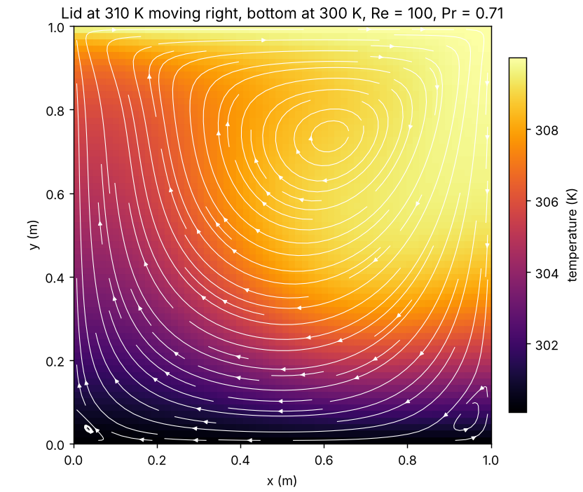
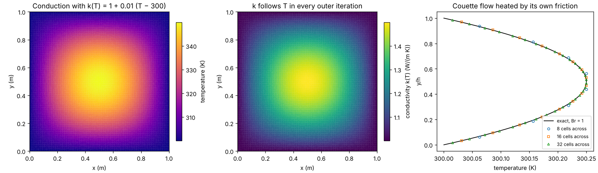

# Energy equation and heat transfer

Part of the [Example gallery](../gallery.md): the energy equation of the fluid (stage 7, D150) with temperature-dependent c_p, k and μ, viscous heating and the thermal wall conditions, checked by manufactured and exact solutions ([specification](../requirements/stage7-energy-buoyancy-cht.md)).

| # | Example | Stage | Feature |
|---|---|---|---|
| 154 | [A heated cavity, conduction with k(T) and a Couette flow heated by its friction](#energy-fluid) | 7 | `[energy]`, `[boundary.<name>.energy]`, `[fluid] specific_heat`, `conductivity`, `viscous_heating`, `temperature_dependent`, `[solver.energy]` |
| 156 | [A heated wall cooled by a channel flow, and a composite wall](#cht-solids) | 7 | `[regions.<name>] kind = "solid"`, `[materials.<name>] kind = "solid"`, `[mesh.generate] zones`, `interface-<region>` |
| 158 | [A finned heat sink in a turbulent air channel, and a turbulent channel over a conducting wall](#cht-turbulent) | 7 | `[turbulence]` with solid regions, `[energy] wall_function`, `turbulent_prandtl` |
| 159 | [A heated wall switched on, and two bodies brought into contact](#cht-transient) | 7 | `[time]` with solid regions, `heat.csv`, `<probe>_T`, `[energy] exact` with `erf` |
| 160 | [A chip on a circuit board with a thermal pad, and an orthotropic patch test](#cht-contact) | 7 | `[interfaces.<name>] contact_resistance`, `thin_wall`, orthotropic `conductivity`, `[regions.<name>] axes`, `[[energy.sources]]` |

---

<a id="energy-fluid"></a>
## 154. A heated cavity, conduction with k(T) and a Couette flow heated by its friction



**The heated cavity.** `cavity_heated.toml` is the Re = 100 cavity of
`cavity_re100.toml` with the lid held at 310 K, the bottom at 300 K and
adiabatic side walls; Pr = μ c_p/k = 0.71. The lid drags warm fluid down
the right-hand wall, the primary vortex wraps it around its core and the
heat leaves through the bottom. The run converges in 439 outer iterations
on 64 × 64 cells. The report gives the heat flow of each wall: 288.5 W/m²
enter at the lid and leave at the bottom, the mean Nusselt number is
Nu = q L/(k ΔT) = 2.05, and the heat balance closes to 7·10⁻¹² of the
largest flow. The temperature does not act on the flow yet (buoyancy is
PR 7b1).



**Conduction with k(T) (check V7.1).** `conduction_mms.toml` solves
∇·(k(T)∇T) + q''' = 0 in the unit square, perturbed by 15 %, with
k(T) = 1 + 0.01 (T − 300) W/(m K), the manufactured solution
T = 300 + 50 sin(πx) sin(πy) K and the source that belongs to it. The
conductivity is refreshed from the temperature in every outer iteration,
here from 1.0 at the walls to 1.5 in the centre. The L2 error is 0.112,
0.0258 and 0.00668 K on 16², 32² and 64² cells, observed orders 2.11 and
1.95 (the case requires 1.8 to 2.2); on the finest mesh 20.000 W of source leave through the four walls, with a
reported imbalance of 2·10⁻⁴ (the reported wall flux takes the orthogonal
part of the gradient, so the perturbed mesh shows a small gap).

**Couette flow heated by its friction (check V7.2).** In
`couette_viscous_heating.toml` the upper wall moves at U = 1 m/s over a
gap of h = 1 m (μ = 0.1 Pa s, k = 0.05 W/(m K)), both walls are held at
300 K and `viscous_heating = true` adds Φ = μ (∂u/∂y)². The temperature is
the parabola T = T₀ + μU²/(2k) η(1 − η), 0.25 K above the walls on the
centre line (Brinkman number 1):

| Cells across | L2 error of T (K) | Wall heat flux (W/m²) | Balance |
|---|---|---|---|
| 8 | 3.906e-3 | −0.0500 | 1e-9 |
| 16 | 9.766e-4 | −0.0500 | 3e-9 |
| 32 | 2.441e-4 | −0.0500 | 1e-8 |

The observed order is 2.000. Each wall takes half of the friction power
μU²/h = 0.1 W/m², and the conduction out of the walls equals the viscous
heating of the report.

**Properties that follow the temperature.** With a `material` the
specific heat, the conductivity and the viscosity come from the database
as functions of T (`temperature_dependent = true`, the default); μ(T)
reaches the momentum equation in every outer iteration. A Couette flow of
air between walls at 300 K and 600 K bends its velocity profile by 4 %
against the linear one, which comes back to below 10⁻⁶ with
`temperature_dependent = false` (`tests/energy.rs`). The convection
condition h (T∞ − T_w) gives the exact series resistance of a slab and a
film, and a `heat_flow` in W is spread over its boundary.

```
cargo build --release -p foehncraft-cli
target/release/foehn flow examples/cases/flow/cavity_heated.toml --out output/cavity_heated
target/release/foehn flow examples/cases/flow/conduction_mms.toml --out output/conduction \
    --set 'verification.levels=[2]' --set output.vtkhdf=true
for l in 0 1 2; do
  target/release/foehn flow examples/cases/flow/couette_viscous_heating.toml \
      --out output/couette_$l --set "verification.levels=[$l]" \
      --set 'output.lines=[{name="across",from=[1.0,0.0,0.05],to=[1.0,1.0,0.05],points=64}]'
done
python3 -m tools.plot.energy_fields docs/figures/gallery output/cavity_heated \
    output/conduction output/couette
```

---

<a id="cht-solids"></a>
## 156. A heated wall cooled by a channel flow, and a composite wall


**A heated wall under a channel flow.** `cht_heated_wall.toml` is the
first conjugate case: one generated mesh of 80 × 30 cells holds a channel
1 m high and a solid wall 0.2 m thick below it, 4 m long, marked by a
`zones` box of the generator. The fluid enters at 300 K with 1 m/s
(Re = 100, Pr = 0.71); the outer face of the wall takes 1000 W/m². The
flow runs on the fluid cells, where the faces against the wall become the
no-slip boundary `interface-wall`; the temperature runs on all cells, with
the series conductance of the two half cells at every face between the
materials. All of the heater's 160 W (4 m × 0.04 m) cross the interface
and leave with the flow, and the heat balance of the whole domain closes
to 5·10⁻¹². With k_s/k_f = 10 (left) the heat spreads along the wall
towards the inlet, where the fluid is cold. The right-hand plot runs the
same case with three wall conductivities:

| k_s/k_f | Outer iterations | Heated face, mean (K) | Interface, mean (K) | Hottest cell (K) |
|---|---|---|---|---|
| 0.1 | 146 | 459.11 | 317.11 | 451.77 |
| 10 | 146 | 318.53 | 317.11 | 324.05 |
| 100 | 146 | 317.57 | 317.43 | 319.87 |

The interface mean is the same 317.1 K for the two lower ratios because
the fluid sees the same heat flow; a poor conductor (0.1) needs 142 K
across its thickness to pass it, a good one (100) spreads it so evenly
that the wall is almost isothermal.

**A composite wall (check V7.4).** `cht_composite_wall.toml` stacks a
solid with k = 200 W/(m K), a closed fluid layer at rest with k = 2 and a
solid with k = 20 000, 0.4 m each, between 300 K and 400 K: conductivity
ratios 1 : 100 : 10⁴. The temperature is piecewise linear and the series
heat flux is q = ΔT/Σ tᵢ/kᵢ = 495.0005 W/m². The run gives it at both
outer walls and at both interfaces to 10⁻⁹ relative, and the interface
temperatures 300.990 K and 399.990 K to 10⁻⁹ K (`tests/cht.rs`).

```
cargo build --release -p foehncraft-cli
target/release/foehn flow examples/cases/flow/cht_composite_wall.toml --out output/cht_wall
for r in 0.1 10 100; do
  k=$(python3 -c "print(14.084507042253522 * $r)")
  target/release/foehn flow examples/cases/flow/cht_heated_wall.toml --out output/cht_$r \
      --set "materials.wall-solid.conductivity=$k" --set output.vtkhdf=true
done
python3 -m tools.plot.cht_fields docs/figures/gallery output/cht
```

<a id="cht-turbulent"></a>
## 158. A finned heat sink in a turbulent air channel, and a turbulent channel over a conducting wall


**A finned heat sink.** `cht_heat_sink_turbulent.toml` puts an aluminium
heat sink (k = 167 W/(m K)) on the floor of a plane channel 50 mm high:
a base 100 mm long and 5 mm thick with three fins 3 mm thick and 20 mm
tall. Air enters at 5 m/s and 300 K (k-ω SST with the automatic wall
treatment), and a chip under the base puts 2000 W/m² into the metal.
One mesh of 300 × 50 cells holds both: the flow runs on the air, the
temperature on everything, and every face between the air and the
aluminium takes the thermal wall function of Kader in series with the
half cell of the metal. The run converges in 1007 outer iterations
(2.5 min on 4 threads). All 2.000 W of the chip (per 10 mm of depth)
cross the interface and leave with the air, 0.68 K warmer on average;
the heat balance closes to 4·10⁻⁷. The aluminium conducts so well that
its top varies by only 0.7 K (328.5 to 329.2 K); the mean heat transfer
coefficient over the wetted surface is
q/(T_i − T_in) = 869.6 W/m² / 28.45 K = 30.6 W/(m² K). The fins block
half of the channel, so the air speeds up to 15 m/s over their tips,
while slow vortices fill the gaps between them, hold the warm air and
cool the inner fin faces poorly. The first-cell y⁺ on the metal runs
from 0.2 in the gaps to 24 at the fin tips, which the automatic wall
treatment and the thermal law bridge.


**A turbulent channel over a conducting wall (check V7.36).**
`cht_turbulent_channel.toml` is half of a plane channel (H = 1 m, a
symmetry plane on top, Re = 2·10⁵, Pr = 0.71) over a solid wall 0.1 m
thick whose outer face is held at 350 K. The wall's resistance
t/k_s = 0.5 m²K/W is of the order of the fluid side's 1/h_w, so both
matter. The same channel without the solid, whose wall carries the
wall function in series with a convection condition h = k_s/t to 350 K,
is the independent path of the fluid-only code (stage 6f); the two must
agree, since the solid's axial conduction is negligible here
(`tests/cht.rs`):

| Model | Outer iterations | Heat flow, conjugate (W) | Heat flow, fluid only (W) | Interface, conjugate (K) | Wall, fluid only (K) |
|---|---|---|---|---|---|
| k-ε, scalable | 56 | 107.692 | 107.681 | 323.077 | 323.080 |
| k-ω SST, automatic | 64 | 106.023 | 106.006 | 323.494 | 323.498 |

The heat flow through the interface equals that of the outer face to
10⁻⁶, the drop across the wall is q t/k_s to 10⁻³, and the heat balance
closes to 10⁻¹⁰. On the right the temperature is linear in the wall and
jumps at the interface by the wall function's 1/h_w (first-cell y⁺ 70
to 85).

```
cargo build --release -p foehncraft-cli
target/release/foehn flow examples/cases/flow/cht_heat_sink_turbulent.toml --out output/cht_sink
target/release/foehn flow examples/cases/flow/cht_turbulent_channel.toml --out output/cht_channel_keps
target/release/foehn flow examples/cases/flow/cht_turbulent_channel.toml --out output/cht_channel_sst \
    --set turbulence.model=k-omega-sst --set turbulence.wall_treatment=automatic
python3 -m tools.plot.cht_turbulent docs/figures/gallery output/cht_sink \
    output/cht_channel_keps output/cht_channel_sst
```

<a id="cht-transient"></a>
## 159. A heated wall switched on, and two bodies brought into contact


**A heated wall switched on (check V7.37).**
`cht_heated_wall_transient.toml` is the heated wall of entry 156 with a
`[time]` table: everything starts at 300 K and the flow at rest, and at
t = 0 the 1000 W/m² under the wall switch on. The wall is made lighter
(ρ = 100 kg/m³, the conductivity unchanged), so that its heat capacity of
16 kJ/(m² K) against the 50 to 60 W/(m² K) to the flow gives a time
constant of about 4 min; the steady temperatures do not depend on ρ c_p.
600 BDF2 steps of 5 s (Courant numbers up to 150, three outer iterations
per step) take 16 s on 4 threads. At first the wall stores almost all of
the heater's 160 W; the stored heat decays with a time constant of 263 s,
and after 3000 s it is 2·10⁻³ W, the interface passes 159.998 W and the
flow carries 157.74 W out (the other 2.25 W leave by conduction through
the inlet, where the fluid is held at 300 K). The heat balance of
`heat.csv` closes in every step to 1.9·10⁻¹¹ of the heat flow, and the end
state is the steady solution of entry 156: every cell within 1.5·10⁻⁵ of
the temperature range (the heated face 318.529 K against 318.529 K, the
interface 317.109 K against 317.109 K).


**Two bodies brought into contact (check V7.6).**
`cht_contact_transient.toml` is a bar 1 m long: a solid at 400 K
(k = 10 W/(m K)) and a fluid at rest at 300 K (k = 1), both with
ρ c_p = 10⁶ J/(m³ K), touch at t = 0. Until the heat reaches the ends,
both are semi-infinite bodies: the contact temperature is
T_i = (e₁T₁ + e₂T₂)/(e₁ + e₂) = 375.975 K with the effusivities
e = √(kρc_p) from the first moment on, and each side follows an erf
profile (Carslaw & Jaeger 1959, §2.15), which the case gives as
`[energy] exact` (the expression language has `erf` and `erfc` since this
PR). On 400 cells with Δt = 1 s the interface is within 3·10⁻³ K of T_i
after 10 steps and at T_i to 10⁻¹² K at 500 s, and the heat flow through
it is e₁(T₁ − T_i)/√(πt) to 6·10⁻⁴; what the solid loses
the fluid stores, in every step. The L2 error is 0.0784, 0.0193 and
0.0048 K on 100, 200 and 400 cells, second order (2.02, 2.00), and four
time steps from 20 s to 2.5 s give the time order of BDF2 (2.05, 2.02).
Copper against air (the contact stays at 399.985 K, the copper's
temperature) and two equal bodies (350 K to round-off) are the variants
of `tests/cht.rs`.

```
cargo build --release -p foehncraft-cli
target/release/foehn flow examples/cases/flow/cht_heated_wall_transient.toml --out output/cht_wall_t
target/release/foehn flow examples/cases/flow/cht_contact_transient.toml --out output/cht_contact
target/release/foehn flow examples/cases/flow/cht_contact_transient.toml --out output/cht_contact_space \
    --set 'verification.levels=[0, 1, 2]' --set 'mesh.generate.cells=[100, 1, 1]'
target/release/foehn flow examples/cases/flow/cht_contact_transient.toml --out output/cht_contact_time \
    --set 'verification.time_steps=[20.0, 10.0, 5.0, 2.5]'
python3 -m tools.plot.cht_transient docs/figures/gallery output/cht_wall_t output/cht_contact \
    output/cht_contact_space output/cht_contact_time
```

<a id="cht-contact"></a>
## 160. A chip on a circuit board with a thermal pad, and an orthotropic patch test


**A chip on a circuit board (stage 7d2).** `cht_circuit_board.toml` is a
2D slice 1 cm deep: a board 1.6 mm thick and 12 cm long carries a silicon
chip 20 mm long and 1.6 mm high that dissipates 1 W
(`[[energy.sources]]` with `power`), cooled by air at 300 K and 1 m/s in
a channel 12 mm high (laminar) and, below the board, by the still air of
the enclosure (h = 5 W/(m² K)). The board is a glass-fibre laminate with
copper planes, an **orthotropic** conductivity of 25 W/(m K) along the
board and 0.35 W/(m K) through it; the chip sits on a **thermal pad** of
R″ = 2·10⁻⁴ m²K/W (`[interfaces.pad]`). 250 iterations take 12 s on 4
threads, and the heat balance closes to 7·10⁻¹³ of the chip's power.
With the copper planes 74 % of the heat goes down into the board, which
spreads it over its whole length: 48 % reaches the air through the top of
the board, 26 % leaves through the bottom, and the chip stays at
363.7 K. With a plain laminate (0.35 W/(m K) in every direction, the
same case with `--set`) only 29 % enters the board, the chip has to pass
71 % to the air over its own small surface, and it runs at 423.7 K, 60 K
hotter. The pad costs 0.6 K: without it the chip is at 363.1 K, and the
two faces of the pad differ by the heat flux through it times R″
(363.6 K on the chip side, 362.8 K on the board side, in the report as
`interface-board-chip`).


**The orthotropic patch test (V7.4 variant of the stage 7
specification).** `cht_orthotropic_patch.toml` puts three layers side by
side on a unit square whose nodes are moved by up to 25 % of a cell (the
two interface planes stay planes): a laminate with k₁ = 20 and
k₂ = 2 W/(m K) along axes turned by 30°, a fluid layer at rest
(k = 2), and a block (k = 50) behind a contact resistance of
0.01 m²K/W. The exact temperature is linear in every region, with the same
tangential gradient everywhere, the same heat flux of 200 W/m² through
every layer (in the laminate part of it comes from the cross term
K_xy ∂T/∂y) and a jump of 2 K across the contact. A scheme with the
two-sided gradient of an ordinary face, the harmonic mean or k of the
face normal alone misses this on a skewed mesh; with the **one-sided
gradients** of the interface cells, the series conductance with R″_c and
the deferred **cross terms** of K the solution is exact: the largest error
is 2.7·10⁻¹¹ K after 49 iterations, and the heat flux is 200 W/m² to
10⁻⁸ at both outer walls and through both interfaces. tests/cht.rs also
gives the laminate its axes in the region in place of the material
(`[regions.laminate] axes`), with the same result.

```
cargo build --release -p foehncraft-cli
target/release/foehn flow examples/cases/flow/cht_circuit_board.toml --out output/cht_board
target/release/foehn flow examples/cases/flow/cht_circuit_board.toml --out output/cht_board_plain \
    --set 'materials.board-laminate.conductivity=0.35'
target/release/foehn flow examples/cases/flow/cht_circuit_board.toml --out output/cht_board_nopad \
    --set 'interfaces.pad.contact_resistance=0.0'
target/release/foehn flow examples/cases/flow/cht_orthotropic_patch.toml --out output/cht_patch
pip install matplotlib h5py numpy
python3 -m tools.plot.cht_contact docs/figures/gallery output/cht_board output/cht_board_plain \
    output/cht_board_nopad output/cht_patch
```
