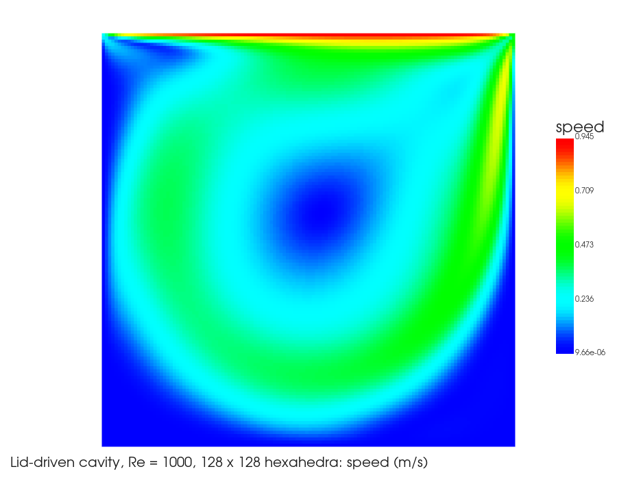
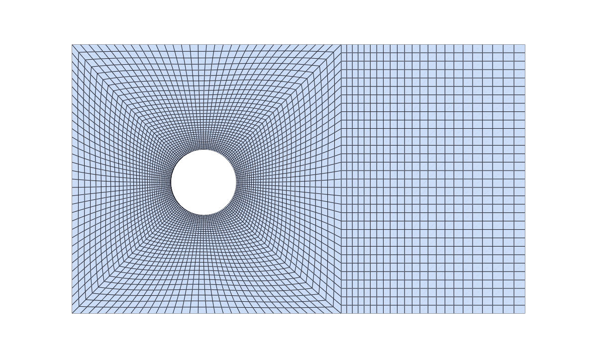
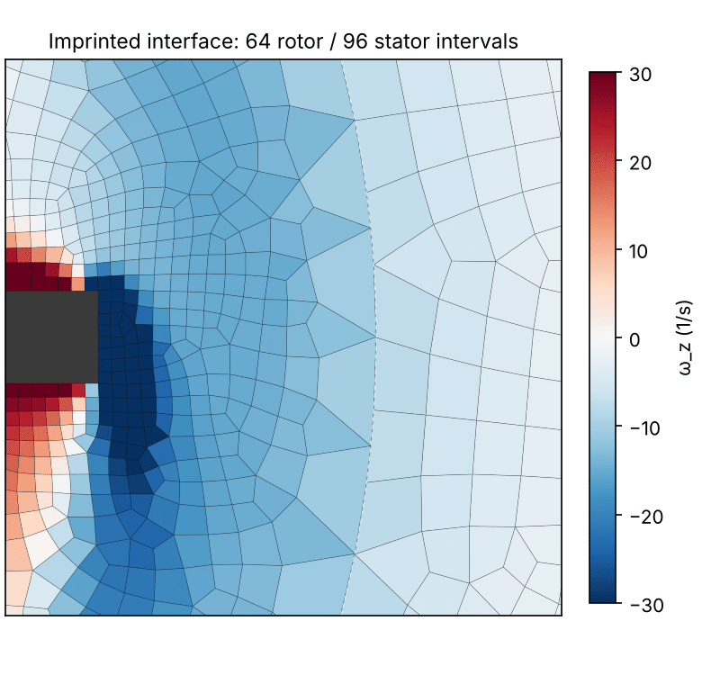
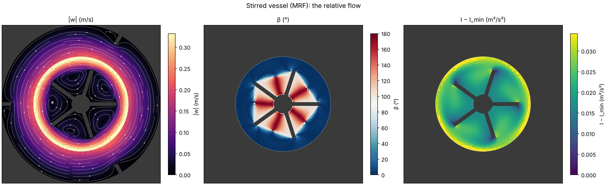
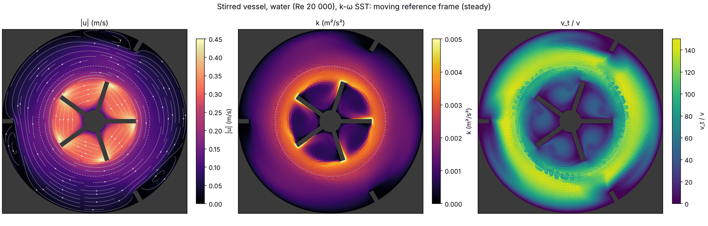
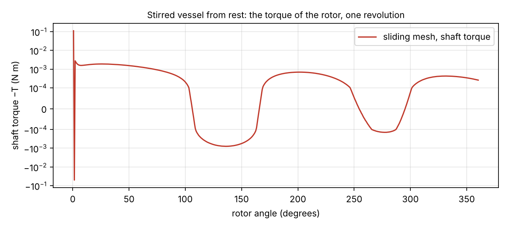
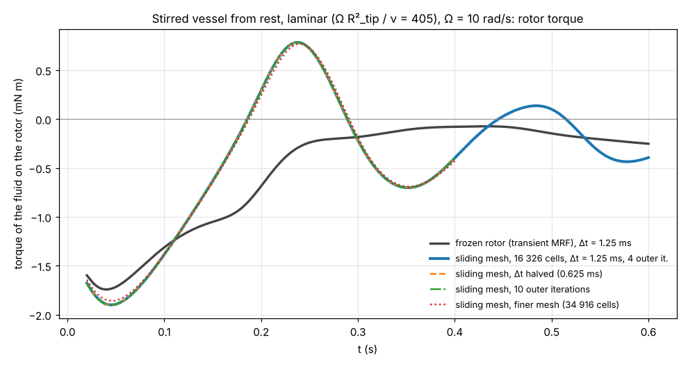
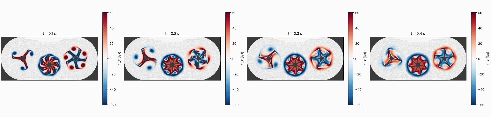
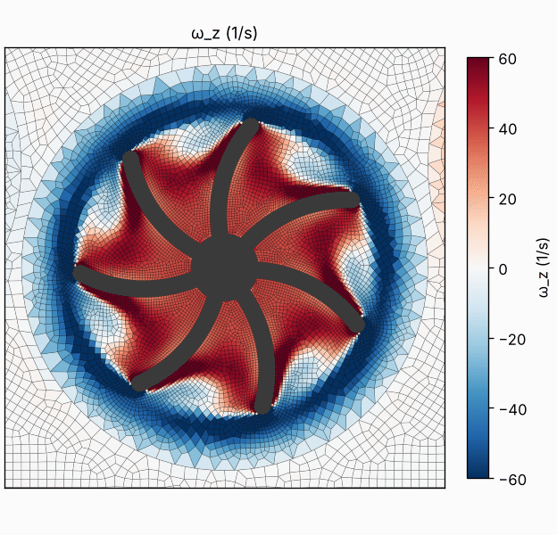

# Incompressible flow

Part of the [Example gallery](../gallery.md): steady and transient laminar verification and benchmarks: cavity, Poiseuille, Taylor–Green, cylinder, time-step control.

| # | Example | Stage | Feature |
|---|---|---|---|
| 12 | [Lid-driven cavity against Ghia et al.](#cavity) | 4 | SIMPLEC, Rhie–Chow, reference cell, centre-line comparison, 2D and 3D cells |
| 13 | [Poiseuille flow: order of accuracy of the flow solver](#poiseuille) | 4 | second order on all mesh types, velocity inlet with the exact profile, pressure outlet |
| 14 | [Taylor–Green vortex: second order in time and space](#taylor-green) | 5 | PISO, variable-step BDF2, Crank–Nicolson, extrapolation, outer iterations at large steps |
| 15 | [Cylinder in a channel: the Schäfer & Turek benchmark](#cylinder) | 5 | built-in O-grid, steady Re 20, vortex street at Re 100, adaptive time step, force coefficients |
| 20 | [Time step from the error, output at exact times, potential-flow start](#time-control) | 5 | BDF2 error estimate with rejected steps, output in simulated time, potential flow from the pressure multigrid |
| 78 | [Coupled algorithm and pseudo-time steps: the step case in 65 iterations](#coupled) | 6 | `solver.algorithm = "coupled"`, `[solver.coupled]`, `[solver.pseudo_time]`, log column `K` |
| 80 | [A multigrid for the momentum sweep of the coupled algorithm](#momentum-multigrid) | 6 | `solver.coupled.momentum_sweep`, `momentum_cycles`, `momentum_reuse`, `[solver.coupled.multigrid]` |
| 81 | [A multigrid for the turbulence equations: the step settles in 40 and 65 iterations](#turbulence-multigrid) | 6 | `solver.turbulence.preconditioner`, `solver.turbulence.reuse`, relaxations 0.995 |
| 83 | [The pressure hierarchy follows its matrix: the fine step 6 times faster than SIMPLEC](#pressure-hierarchy) | 6 | `solver.coupled.pressure_reuse`, `solver.coupled.pressure_tolerance` |
| 85 | [Heat transfer in turbulent flow: the heated pipe and the heated flat plate](#thermal-wall-function) | 6 | `scalars.<name>.wall_function`, `turbulent_prandtl`, `turbulent_prandtl_model`, wall file columns of a scalar |
| 86 | [The heated channel against DNS: Nu at Re_τ = 395](#heated-channel-dns) | 6 | `channel_heated_keps.toml`, `examples/studies/channel_heat_dns.py` |
| 94 | [Rotating machinery, steady: the moving reference frame on Taylor–Couette flow](#mrf) | 6 | `[[mrf]]`, `[mesh.annulus]`, `analytic.type = "taylor-couette"`, `taylor_couette_mrf.toml` |
| 95 | [Rotating machinery, transient: the sliding mesh on Taylor–Couette flow](#sliding-mesh) | 6 | `[[sliding]]`, `time_step`, `taylor_couette_sliding.toml` |
| 96 | [The sliding mesh with a pitch ratio that is not one: the interface imprinted in every step](#sliding-mesh-imprint) | 6 | `[[sliding]] rotor_interface`, `[mesh.annulus] n_theta_stator`, `taylor_couette_imprint.toml` |
| 98 | [A stirred vessel: blades and baffles with the moving reference frame and the sliding mesh](#stirred-vessel) | 6 | `[[mrf]]` and `[[sliding]]` on a Gmsh mesh, walls that turn with a zone, `studies/mixer.py`, `tools/plot/rotor_fields.py` |
| 99 | [The flow a blade sees: relative and frame velocity, flow angles and rothalpy](#rotor-fields) | 6 | `output.derived`: `relative-velocity`, `frame-velocity`, `turbomachinery`, `relative-total-pressure`, `rothalpy`; `output.frame` |
| 100 | [A turbulent rotor: the stirred vessel with water, in the frame and on the sliding mesh](#turbulent-rotor) | 6 | turbulence models on `[[mrf]]` and `[[sliding]]`, the wall distance of a turning rotor |
| 101 | [Torque, shaft power and the performance of a machine: the rotor of the stirred vessel](#torque-power) | 6 | torque per wall and rotor, shaft power in the energy ledger, `[[output.machines]]`, `tools/plot/rotor_movie.py` |
| 102 | [Several rotors at their own speeds, and the transient frozen rotor](#several-rotors) | 6 | several `[[sliding]]` tables, `[mesh.annulus] outer_rotor_layers`, `examples/meshes/twin_mixer.py`, `[[mrf]]` with `[time]` |
| 103 | [Interfaces of any rotationally symmetric shape: a disc impeller in a pot, a turning duct section between cones](#revolved-interfaces) | 6 | `[[sliding]]` with disc, cone and pot interfaces (D186), `[mesh.revolved]`, `tools/plot/meridional_fields.py` |
| 225 | [Three stirrers, one with seven curved blades: circular-arc blades of constant thickness from Gmsh](#curved-blades) | 6 | `examples/meshes/three_mixer.py` (`curved_blade`), three `[[sliding]]` tables |

---

<a id="cavity"></a>
## 12. Lid-driven cavity against Ghia et al.



The first flow of Foehncraft: the unit cavity with the lid sliding at 1 m/s,
steady and laminar, solved with SIMPLEC and the relaxation-independent
Rhie–Chow interpolation of stage 4. No boundary fixes the pressure, so a
reference cell holds its level. At Re = 1000 the primary vortex moves
towards the centre and the two corner vortices at the bottom grow; the
velocity on the two centre lines matches the tabulated multigrid solution
of Ghia, Ghia & Shin (1982) to 0.4 % (u) and 1.4 % (v) of the lid speed.


The same flow on fully three-dimensional cells, a slab with symmetry planes
front and back: 0.7 % / 1.3 % at Re = 100 on 5 445 polyhedra, 2.0 % / 2.4 %
at Re = 1000 on 28 227 polyhedra, 2.5 % / 2.2 % at Re = 100 on 24 576
tetrahedra. Re = 100 on 64 × 64 hexahedra: 0.44 % / 0.95 %
([u](../figures/gallery/cavity_re100_u.svg), [v](../figures/gallery/cavity_re100_v.svg)).


| | |
|---|---|
| Mesh | generated hex 2D, 128 × 128 cells, one layer with symmetry planes |
| Physics | ρ = 1 kg/m³, μ = 0.001 Pa s, lid 1 m/s: Re = 1 000 |
| Solver | SIMPLEC, linear upwind, α_u = 0.9, CG + AMG for the pressure correction; 1 397 outer iterations to 1e-8, 54 s on a shared 4-core cloud machine |
| Case files | `flow/cavity_re1000.toml`, `cavity_re100.toml`, `cavity_re100_poly3d.toml`, `cavity_re100_tet3d.toml`, `cavity_re1000_poly3d.toml` |

```
cargo build --release -p foehncraft-cli
target/release/foehn flow examples/cases/flow/cavity_re1000.toml
# report: output/cavity_re1000/flow.md, charts: centreline_u.svg, centreline_v.svg, residuals.svg
python3 -m tools.mesh.render_mesh output/cavity_re1000/fields.vtkhdf cavity.png --field speed --top --no-edges
```

[↑ back to top](#incompressible-flow)

---

<a id="poiseuille"></a>
## 13. Poiseuille flow: order of accuracy of the flow solver


Plane channel flow between walls at rest, the exact parabola at the inlet
(`profile = "analytic"`), a static-pressure outlet, Re = 10, on three nested
meshes per cell type. The velocity error falls with the square of the mesh
size on every type, the check of stage 4 (1.8–2.2 on the finest pair);
Couette flow (`couette_*.toml`) comes out at the iteration error, as a
linear profile must.

| Mesh | Cells (finest) | L2 error (finest) | Observed order |
|---|---:|---:|---:|
| hex, perturbed 15 % | 8 192 | 1.10e-4 | 1.98, 1.89 |
| tet (prisms) | 16 384 | 6.70e-5 | 1.93, 1.80 |
| poly, perturbed 15 % | 8 385 | 7.74e-5 | 2.01, 2.00 |
| mixed | 12 288 | 9.05e-5 | 1.94, 1.88 |

| | |
|---|---|
| Meshes | generated 2D, 32 × 16 to 128 × 64 intervals in a 2 × 1 channel |
| Case files | `flow/poiseuille_hex.toml`, `poiseuille_tet.toml`, `poiseuille_poly.toml`, `poiseuille_mixed.toml` |

```
target/release/foehn flow examples/cases/flow/poiseuille_poly.toml
# report: output/poiseuille_poly/flow.md, plot: convergence.svg
```

[↑ back to top](#incompressible-flow)

---

<a id="taylor-green"></a>
## 14. Taylor–Green vortex: second order in time and space


The decaying vortex on the unit square, Re = 100, the exact velocity on
the four sides at each time level. Five runs on the same 64 × 64 mesh
with time steps from 0.01 to 0.000625 s: the change of the solution when
the step is halved falls with Δt², for BDF2 and for Crank–Nicolson, with
one outer iteration per step (plain PISO with two correctors). That needs
the convecting flux and the deferred corrections extrapolated to the new
time; without it the lag of these terms makes PISO first order.

| Scheme | Observed time order (pairs of steps) |
|---|---|
| BDF2 | 2.35, 2.42, 2.21 |
| Crank–Nicolson | 2.40, 2.41, 2.00 |
| BDF2, Courant 1.3 to 9, outer iterations to 1e-9 | 1.97, 2.00 |


In space, at a fixed small step, the error falls from 2.6e-2 on 16² to
1.3e-4 on 128² cells, order 2.09 on the finest pair.

| | |
|---|---|
| Mesh | generated hex 2D, 64 × 64 (time), 16² to 128² (space) |
| Physics | ρ = 1 kg/m³, μ = 0.01 Pa s, U = 1 m/s, L = 1 m: Re = 100, t = 0 to 0.4 s |
| Solver | PISO, two correctors, BDF2 or Crank–Nicolson, linear solves to 1e-8 |
| Case files | `flow/taylor_green_bdf2.toml`, `taylor_green_cn.toml`, `taylor_green_space.toml`, `taylor_green_cfl10.toml` |

```
cargo build --release -p foehncraft-cli
target/release/foehn flow examples/cases/flow/taylor_green_bdf2.toml
# report: output/taylor_green_bdf2/flow.md, plot: time_convergence.svg
target/release/foehn flow examples/cases/flow/taylor_green_space.toml
# report: output/taylor_green_space/flow.md, plot: convergence.svg
```

[↑ back to top](#incompressible-flow)

---

<a id="cylinder"></a>
## 15. Cylinder in a channel: the Schäfer & Turek benchmark


The laminar cylinder benchmark of Schäfer & Turek (1996): a cylinder of
0.1 m in a 2.2 × 0.41 m channel, slightly off the centre line, with a
parabolic inflow. At Re = 20 the flow is steady with two attached
vortices; on 98 304 cells the drag and lift coefficients and the pressure
difference across the cylinder lie inside the reference ranges
(C_D 5.5800, C_L 0.01060, Δp 0.11751 Pa).


At Re = 100 a vortex street forms. The time step follows a Courant number
of 0.8; from t = 5 s the run evaluates the largest drag and lift, the
Strouhal number of the lift and the pressure difference half a period
after the lift maximum.


| Case | Cells | C_D (max) | C_L (max) | St | Δp (Pa) |
|---|---:|---:|---:|---:|---:|
| Re 20, reference | | 5.57–5.59 | 0.0104–0.0110 | | 0.1172–0.1176 |
| Re 20 | 24 576 | 5.5808 | 0.01036 | | 0.11750 |
| Re 20 | 98 304 | 5.5800 | 0.01060 | | 0.11751 |
| Re 100, reference | | 3.22–3.24 | 0.99–1.01 | 0.295–0.305 | 2.46–2.50 |
| Re 100 | 6 144 | 3.2319 | 0.9712 | 0.2955 | 2.4819 |
| Re 100 | 24 576 | 3.2305 | 0.9847 | 0.3008 | 2.4854 |



| | |
|---|---|
| Mesh | built in (`[mesh.cylinder]`): O-grid around the cylinder, graded wake block; refine 0, 1, 2: 6 144, 24 576, 98 304 hexahedra in one layer |
| Physics | ρ = 1 kg/m³, μ = 0.001 Pa s, Ū = 0.2 m/s (Re 20) or 1 m/s (Re 100), D = 0.1 m |
| Solver | Re 20 steady SIMPLEC; Re 100 PISO with BDF2, adaptive Δt (Courant 0.8), t = 0 to 8 s |
| Case files | `flow/cylinder_re20.toml`, `cylinder_re100.toml` |

```
target/release/foehn flow examples/cases/flow/cylinder_re20.toml
target/release/foehn flow examples/cases/flow/cylinder_re100.toml
# report: output/cylinder_re100/flow.md, chart: coefficients.svg, histories: forces.csv, probes.csv
python3 -m tools.mesh.render_mesh output/cylinder_re20/fields.vtkhdf cylinder.png --field speed --top --no-edges --size 1800x420 --zoom 2.9
```

[↑ back to top](#incompressible-flow)

---

<a id="time-control"></a>
## 20. Time step from the error, output at exact times, potential-flow start


The Taylor–Green vortex with the step chosen by the error of BDF2 (D65):
from the fourth step on, the local error is estimated from the difference
between the step and the quadratic extrapolation of the last three levels,
and the next step is the one that meets the tolerance, at most 1.2 times
the last and below Courant number 5. With 1e-4 the error never limits and
the run follows the growth limit like the Courant control alone; with
1e-5 and 1e-6 the estimate cuts the step where plain PISO loses accuracy,
at Courant numbers about 2, and repeats the steps that missed (the
crosses). The velocity error at the end falls from 1.6e-3 to 6.3e-4, near
the spatial error of the mesh (5.5e-4), for twice the steps. A rejected
step is taken back exactly: the repeated step is bitwise the step a run
with the shorter Δt takes, and a restart continues bitwise. At the end
every run lands on t = 0.4 s in two equal steps; the same holds for
field, monitor and restart output in simulated time (D66).


The start field of `initial.potential_flow` (D52) for the cylinder of
gallery 15: the irrotational flow that carries the parabolic inflow
around the cylinder to the outlet, with the stagnation points on the axis
and the fastest flow above and below the cylinder. It is one Laplace solve
with the pressure multigrid (the pressure-correction equation with unit
coefficients) and four passes of the non-orthogonal correction; the cell
velocity is rebuilt from the face fluxes, which are continuous to the
solver tolerance. The steady run at Re 20 from it converges in 1527
instead of 1570 outer iterations.

| Check | Result |
|---|---|
| Taylor–Green, 64², BDF2, tolerance 1e-4 / 1e-5 / 1e-6 | 26 / 37 / 50 steps, 0 / 6 / 9 rejected, velocity error L2 1.53e-3 / 8.36e-4 / 6.25e-4 (Courant control alone: 25 steps, 1.64e-3) |
| Rejected step, BDF2 and Crank–Nicolson | the repeated step and the next one bitwise equal to the run that took the short step at once |
| Restart of an error-controlled run with rejections | bit-identical continuation |
| Output at exact times | monitor rows at multiples of 0.05 s to 1e-12 s, restart at its time, no step below half the one before |
| Potential start in a channel with uniform inflow | uniform flow to 1e-11 on hexahedra, RMS deviation 1.2 % on polygons perturbed by 15 % (12 % without the non-orthogonal correction) |
| The catalogue against part 4b | 22 flow cases and the scalar cases bitwise equal without the new keys |

| | |
|---|---|
| Code | `foehncraft_flow::transient` (`ErrorControl`, `Transient::reject`), `unsteady` (rejection, `Schedule`), `simplec::Flow::potential_flow` |
| Tests | `adjoint_tests.rs` (`rejected_step_repeats_bitwise`, `potential_flow_start_in_a_channel`), `tests/stage5.rs` (`error_controlled_steps_restart_bit_identically`, `output_lands_on_scheduled_times`) |
| Case files | `flow/taylor_green_error.toml`, `flow/cylinder_potential.toml` |
| Recipe | [28](../recipes/flow.md#time-control) |

```
target/release/foehn flow examples/cases/flow/taylor_green_error.toml
python3 -m tools.plot.time_step_chart time_step_error.svg
target/release/foehn flow examples/cases/flow/cylinder_potential.toml
python3 -m tools.mesh.render_mesh output/cylinder_potential/fields.vtkhdf potential.png --field speed --top --no-edges --size 1800x420 --zoom 2.9
```

[↑ back to top](#incompressible-flow)

---

<a id="coupled"></a>
## 78. Coupled algorithm and pseudo-time steps: the step case in 65 iterations


**Why SIMPLEC needs hundreds of iterations.** Under-relaxation is a time
step in disguise: with the factor α a cell advances by α/(1 − α) of its
own transit time per outer iteration, 4 transit times at α = 0.8. The
step shrinks with the cell, but the recirculation zone behind a step
needs a fixed physical time to form. So the backward-facing step of
gallery 74 takes about 600 iterations on 8 200 cells and 1 600 to 1 750
on 32 800.

**The coupled algorithm.** `algorithm = "coupled"` solves the momentum
equations and the continuity equation of an outer iteration as one linear
system for the increments of velocity and pressure, and replaces the
relaxation by pseudo-time steps on physical scales:

```toml
[solver]
algorithm = "coupled"
```

- The momentum equations take one step Δτ for all cells, by default the
  volume of the domain over the area of its boundaries, over the flow
  speed (7.3 H/U on the step). The relaxation, now 0.98, only caps the
  local Courant number at 49.
- The turbulence equations take the step min(Δτ, 0.5 T) per cell, with T
  the time scale of the model (k/ε, 1/(β* ω)): their sources are stiff on
  that scale.
- The discrete equations are those of SIMPLEC. The converged result is
  the same and depends neither on the step nor on the cap; the face
  fluxes satisfy continuity after every outer iteration.

No block matrix is built: the coupled system is applied with the kernels
of the segregated solver and solved by flexible GMRES with a SIMPLE-type
preconditioner (a momentum sweep, a pressure solve with the multigrid of
the pressure, a velocity correction).

**The step** (`backstep_zeta_f0_coupled.toml`, 8 200 cells, from a
uniform start, no relaxation ramp). Outer iterations until x_r stays
within 1 % of its final value:

| Model | SIMPLEC (0.5, then 0.8) | Coupled | Final x_r/H, both |
|---|---|---|---|
| k-ε-ζ-f₀ | 525 | 65 | 6.385 |
| k-ε, scalable wall functions | 600 | 75 | 5.287 |
| k-ω SST | 675 | 80 | 6.82 |
| k-ε-ζ-f₀, 32 800 cells | 1 600 | 175 | 6.352 |

The gain in run time is smaller, because a coupled iteration costs
several SIMPLEC iterations: with the multigrid momentum sweep of
[gallery 80](#momentum-multigrid) the coarse step settles on one
thread in 7.0 s instead of 18.7 s and the fine one, in 150 iterations,
in 74 s instead of 243 s. The
counts are good to about 10 %: they repeat exactly for the same input,
but a change in the last digit of the step can move them
([verification page](../verification/stage6.md#coupled-algorithm-and-pseudo-time-steps-part-6e),
finding 8).

**Channel and cavity.** The channel at Re_τ = 395 with k-ε-ζ-f₀
(`channel_zeta_f0.toml` with `--set solver.algorithm=coupled`) converges
in 323 iterations instead of about 2 100, to the same U_b⁺ = 17.79. The
laminar cavity at Re = 1000 on 128 × 128 cells
(`cavity_re1000_coupled.toml`) converges to 10⁻⁸ in about 450 iterations
instead of 1 397, with the same deviation from Ghia et al. (0.0040,
0.0136) and the same kinetic-energy ledger: numerical dissipation 0.637 %
of the lid power with both algorithms, its Rhie–Chow part equal to seven
digits.

**Where it pays little.** On small laminar cases SIMPLEC at α = 0.9 is
about as fast: the cavity at Re = 400 on 48 × 48 cells takes 255
iterations with SIMPLEC and 289 with the automatic step, which is a
careful one. A larger step (`[solver.pseudo_time] factor = 4` or `20`)
brings 130 or 84 iterations. With the BiCGStab momentum sweep of the
first version such steps cost more than they saved; with the multigrid
sweep of [gallery 80](#momentum-multigrid) they no longer do (cavity
at Re = 1000 on 64 × 64 cells: 3.0 s with SIMPLEC, 3.7 s, 2.8 s and
2.6 s with the factors 1, 4 and 20). The cap stays at 0.98, which is why
the fine step mesh still needs more than twice the iterations of the
coarse one
([requirements step 22](../requirements/step22-coupled-solver.md),
section 8).

The commands are in [recipe 78](../recipes/flow.md#coupled), the
measurements and the method in the
[verification page](../verification/stage6.md#coupled-algorithm-and-pseudo-time-steps-part-6e).

[↑ back to top](#incompressible-flow)

---

<a id="momentum-multigrid"></a>
## 80. A multigrid for the momentum sweep of the coupled algorithm


**The sweep.** Every Krylov iteration of the coupled solve of
[gallery 78](#coupled) needs an approximate inverse of the momentum
matrix for each velocity component. BiCGStab with a diagonal
preconditioner did that, cut off after 10 iterations. With a large
pseudo-time step the matrix is far from diagonally dominant and 10
iterations do not reach the tolerance, so the coupled solve took more
Krylov iterations, each with its pressure solve, and an erratic number
of them (figure: red).

**The multigrid.** The momentum matrix is not symmetric: upwind
convection makes it nearly triangular along the flow, and the
aggregation multigrid of the pressure fails on it. A reduction multigrid
uses that structure. It splits the cells into coarse and fine points
such that the fine points are almost decoupled from each other (one
Jacobi sweep solves them), and it builds the coarse problem with a
restriction that approximates the ideal one (Manteuffel, Ruge &
Southworth 2018) and the direct interpolation of classical multigrid.
One V-cycle per velocity component is the sweep. It runs on the level
kernels of the pressure multigrid, on the CPU and on the GPU. It is the
default with the coupled algorithm; the old sweep is one key away:

```toml
[solver]
algorithm = "coupled"

[solver.coupled]
# momentum_sweep = "bicgstab"   # the sweep of gallery 78
```

**The step case** (k-ε-ζ-f₀, one thread; outer iterations and run time
until x_r stays within 1 % of its final value):

| Mesh | SIMPLEC (0.5, then 0.8) | Coupled, BiCGStab sweep | Coupled, multigrid sweep |
|---|---|---|---|
| 8 200 cells | 525, 18.7 s | 65, 8.3 s | 65, 7.0 s |
| 32 800 cells | 1 600, 243 s | 175, 131 s | 150, 74 s |

Up to the settled result the Krylov iterations per outer iteration halve
(10 → 5.3 and 14 → 6.0), and the pressure solves with them; the fine mesh
settles 25 iterations earlier. The final x_r is the same (6.385 H and
6.35 H). The laminar cavity at Re = 1000 on 128 × 128 cells
(`cavity_re1000_coupled.toml`) converges to 10⁻⁸ in 12.1 s instead of
18.8 s; SIMPLEC needs 28.3 s. k-ε and k-ω SST settle on the coarse step
in 75 and 80 iterations as before.

**Kept hierarchies.** Building a hierarchy costs as much as twenty to
thirty cycles. So a hierarchy is kept while the momentum matrix has
changed by at most 2 % since its setup (`momentum_reuse`), and rebuilt at
once if its cycle no longer halves the residual. The cavity needs 28
setups in 449 iterations; the step, whose matrix changes quickly while
the recirculation zone forms, 96 in 65. The report of a run counts them:

```
Seconds per phase (R6): … momentum solve 0.30, … pressure solve 1.56, multigrid setup 1.49 (7 setups, 96 of the momentum sweeps)
```

A restart file holds the matrices of the kept hierarchies, so a
continued run stays bit-identical to an uninterrupted one.

**A side result: one thread without a pool.** Timing these runs showed
a loss in the CPU backend that had nothing to do with the algorithm. On
a pool of one thread (meshes below 20 000 cells always run on one) every
kernel call was still handed to the worker thread and waited for, about
2 000 times per outer iteration of the cavity. Such loops, and loops of
one task like the coarse levels of a multigrid cycle, now run on the
calling thread, with the same values. That alone took the SIMPLEC run of
the coarse step from 31 s to 18.7 s and the coupled run of gallery 78
from 21 s to 8.3 s.

**What limits a coupled run now.** On the fine mesh the momentum sweeps
and their setups take 16 % of the run time (the BiCGStab sweeps took a
quarter), the
turbulence model 35 % (its linear solves 21 %) and the pressure solves
25 %. The setups cost
more than the cycles they serve (7.3 s against 4.1 s). And the cap on
the local step stays at 0.98: without it the fine step settles in about
120 iterations, but the Krylov solve then runs into its limit in every
outer iteration, because of the SIMPLE-type approximation of the Schur
complement and no longer because of the sweep. The same multigrid for
the turbulence equations, a cheaper setup, a multigrid with a
coarse–fine splitting for the pressure and a better Schur complement are
the next steps ([requirements step 22](../requirements/step22-coupled-solver.md),
section 8).

The commands are in [recipe 80](../recipes/flow.md#momentum-multigrid),
the method and the tests in the
[verification page](../verification/stage6.md#multigrid-for-the-momentum-sweep-part-6f).

[↑ back to top](#incompressible-flow)

---

<a id="turbulence-multigrid"></a>
## 81. A multigrid for the turbulence equations: the step settles in 40 and 65 iterations


**Why the count grew with the mesh.** With the coupled algorithm of
[gallery 78](#coupled) and the momentum multigrid of
[gallery 80](#momentum-multigrid) the step settled in 65 outer
iterations on 8 200 cells and in 150 on 32 800: 2.3 times more per four
times the cells, where the published coupled solvers stay nearly
independent of the mesh. The cause was not the pressure–velocity
coupling but the relaxation 0.98 of the turbulence equations. A
relaxation α acts as a local pseudo step α/(1−α) ρV/a_P, in a flat cell
at the wall about 25 h²/ν: it shrinks with the cells. Raising it to
0.99 alone took the fine step from 150 to 95 iterations, but then the
BiCGStab solves of k, ε and ζ with a diagonal preconditioner run into
their limit of 50 iterations in every outer iteration and the
reattachment length jitters.

**The multigrid.** The transport equations of k, ε and ζ have the same
structure as the momentum equations: convection makes them nearly
triangular along the flow. So the reduction multigrid of gallery 80
serves as their preconditioner, one V-cycle per BiCGStab iteration, and
a solve needs 1 to 2 iterations at any relaxation. With it the
relaxations of the momentum and of the turbulence equations default to
0.995. That is the default for the k-ε family (k-ε, realizable k-ε,
k-ε-ζ-f, k-ε-ζ-f₀) with the coupled algorithm in steady runs; a case
needs no key:

```toml
[solver]
algorithm = "coupled"

[solver.turbulence]
# preconditioner = "jacobi"   # with relaxation = 0.98: the runs of part 6f
```

**The step case** (k-ε-ζ-f₀, one thread, quiet machine; outer
iterations and run time until x_r stays within 1 % of its final value):

| Mesh | SIMPLEC (0.5, then 0.8) | Coupled, part 6f | Coupled, multigrid in the turbulence equations |
|---|---|---|---|
| 8 200 cells | 525, 18.7 s | 65, 7.0 s | 40, 7.5 s |
| 32 800 cells | 1 600, 243 s | 150, 74 s | 65, 56 s |

The count now grows by 1.6 per four times the cells. k-ε settles in 45
iterations instead of 75, the channel at Re_τ = 395 converges in 231
instead of 323. The final values do not change (x_r = 6.385 H and
6.353 H, 5.287 H with k-ε).

**The honest part: the cost of an iteration.** Fewer iterations do not
yet mean a shorter run on small meshes. At the momentum cap 0.995 the
SIMPLE-type Schur complement needs about 9 Krylov iterations per outer
iteration instead of 5, each with its pressure solve, and while the
recirculation zone forms the matrices of the turbulence equations change
by more than 2 % in most iterations, so their hierarchies are rebuilt in
most solves (114 setups in 120 solves on the coarse step). The coarse
steps therefore take about the time they took before (7.5 s against
7.0 s; k-ε 5.7 s against 4.5 s). The fine step is 1.3 times faster, and
the gain grows with the mesh: against SIMPLEC it is now a factor of 4.3
there. A cheaper setup and a better Schur complement are the next steps
([requirements step 22](../requirements/step22-coupled-solver.md),
section 8). The report counts the setups (coarse step, 40 iterations):

```
Seconds per phase (R6): … pressure solve 1.97, multigrid setup 1.17 (4 setups, 76 of the momentum sweeps, 114 of the turbulence equations), turbulence model 2.86
```

**k-ω SST keeps the old defaults.** With accurate solves of k and ω the
SST residuals on the step grow again after about 160 iterations and x_r
wanders from 6.81 to 6.85 H, at any relaxation; the loose Jacobi solves
of today damp this. SST therefore keeps Jacobi and 0.98 (80 iterations
on the coarse step), and laminar cases keep the cap 0.98.

The commands are in [recipe 81](../recipes/flow.md#turbulence-multigrid),
the method and the tests in the
[verification page](../verification/stage6.md#multigrid-for-the-turbulence-equations-part-6g).

[↑ back to top](#incompressible-flow)

---

<a id="pressure-hierarchy"></a>
## 83. The pressure hierarchy follows its matrix: the fine step 6 times faster than SIMPLEC

**Where the time went.** After [gallery 81](#turbulence-multigrid) the
fine step (32 800 cells) settled in 65 outer iterations, but each one
cost about 9.7 Krylov iterations of the coupled solve, each with a
pressure solve in the SIMPLE-type preconditioner, and those pressure
solves took 30 to 35 % of the run. Two published improvements of the
Schur complement were measured first (SIMPLER and the least-squares
commutator, [requirements step 22](../requirements/step22-coupled-solver.md)
section 7.9): neither pays on the step. The cost was elsewhere: the
multigrid hierarchy of the pressure matrix was built every 10 outer
iterations, while the matrix changes in every one with the momentum
coefficients. An old hierarchy needed 9 to 20 CG iterations per solve,
a fresh one two.

**The fix.** The hierarchy is built anew when the pressure matrix has
changed by more than 5 % since its setup (`pressure_reuse`, the measure
of the momentum sweeps of gallery 80), and the pressure solve of the
preconditioner stops at the relative tolerance 0.3 instead of 0.1 (#82;
the Krylov iteration corrects what it leaves). A case needs no key.

**The step case** (one thread, quiet machine; outer iterations and run
time until x_r stays within 1 % of its final value):

| Case | Iterations | SIMPLEC | Gallery 81 | Now | Pressure solves (before) |
|---|---|---|---|---|---|
| Step, k-ε-ζ-f₀, 8 200 cells | 40 | 18.7 s | 8.0 s | 6.2 s | 0.69 s (2.02 s) |
| Step, k-ε-ζ-f₀, 32 800 cells | 65 | 243 s | 56.9 s | 39.8 s | 5.81 s (20.0 s) |
| Step, k-ε, 8 200 cells | 45 | – | 6.4 s | 4.7 s | 0.85 s (2.03 s) |

The fine step needs 71 CG iterations per outer iteration instead of 160
and runs 6.1 times faster than SIMPLEC, the coarse one 3.0 times: the
gain grows with the mesh. The iteration counts and the final values do
not change (x_r = 6.385 H and 6.353 H, 5.287 H with k-ε). Laminar cases
do not trigger the rule (the cavity builds the same 45 hierarchies in
442 iterations). The report counts the pressure hierarchies first
(fine step, 65 iterations; 7 setups before):

```
Seconds per phase (R6): gradients 0.21, momentum assembly 0.74, momentum solve 2.45, pressure assembly 4.03, pressure solve 5.81, multigrid setup 6.94 (20 setups, 118 of the momentum sweeps, 172 of the turbulence equations), turbulence model 16.66
```

A later change (#84) builds the multigrid matrices into flat arrays
instead of a vector per row, with bit-identical results: the setups of
the fine step take 4.9 s instead of 6.9 s and the run 33.3 s (7.3 times
faster than SIMPLEC), the coarse step 5.7 s.

The turbulence model is now the largest part of a fine run (42 %), the
pressure solves 15 %. The published coupled solvers report 8 to 40
times on 12 000 to 195 000 cells; closing that is the work of the next
steps (step 22, section 8).

The commands are in [recipe 83](../recipes/flow.md#pressure-hierarchy),
the tests in the
[verification page](../verification/stage6.md#the-pressure-solve-of-the-coupled-preconditioner-part-6h).

[↑ back to top](#incompressible-flow)

---

<a id="thermal-wall-function"></a>
## 85. Heat transfer in turbulent flow: the heated pipe and the heated flat plate

A passive scalar (a temperature of constant properties, or a
concentration) of a turbulent flow diffuses with ν/Pr + ν_t/Pr_t. At a
wall the first cell lies in the logarithmic layer, so the molecular
conduction across it would be far too small: the wall face carries the
conductance h_w = ρ u\*/T⁺ of a thermal wall law instead (`kader`, the
default: Kader 1981, all y⁺ and any Pr; `jayatilleke`, the log region).
Where the wall is resolved (y⁺ below 1) Kader's profile is T⁺ = Pr y⁺:
the same default is exact for a fine mesh, nothing is switched off.

**Heated pipe** (`pipe_heated_keps.toml`): Re = 10⁵, Pr = 0.71, uniform
wall flux on a periodic module with the heat-flux jump (the periodic heated pipe `pipe_heated_periodic.toml`), standard k-ε with scalable wall functions, first-cell
y⁺ 32. Nu against Gnielinski (1976), 180.2:

| Wall law and Pr_t | Nu | Deviation |
|---|---|---|
| `kader`, Pr_t = 0.85 (default) | 182.6 | +1.3 % |
| `kader`, Kays–Crawford | 181.3 | +0.6 % |
| `jayatilleke`, Pr_t = 0.85 | 188.7 | +4.7 % |
| `none` (molecular conduction at the wall) | 110.5 | −38.7 % |

**Heated flat plate** (`plate_heated_keps.toml`): the plate of the TMR
case at Re = 5·10⁶ per unit length, θ = 1 on the plate and 0 outside,
Pr = 0.71. The Stanton number of the wall file (`theta_flux/theta_wall`,
U = 1) against St = 0.0287 Re_x^−0.2 Pr^−0.4:

| x | 0.29 | 0.5 | 0.97 | 1.5 |
|---|---|---|---|---|
| St against the correlation | +1.7 % | +4.3 % | +7.5 % | +9.8 % |

Within ±10 % for x between 0.25 and 1.5 (Re_x 1.25·10⁶ to 7.5·10⁶).
For x below 0.2 the k-ε model has not yet turned the boundary layer
turbulent (the wall shear shows the same start), and St is 50 % low
there; the correlation is for the turbulent layer.

The commands are in [recipe 85](../recipes/flow.md#thermal-wall-function),
the numbers on the [verification page](../verification/stage6.md#thermal-wall-function-and-turbulent-prandtl-number-part-6f).

---

<a id="heated-channel-dns"></a>
## 86. The heated channel against DNS: Nu at Re_τ = 395

The channel of [gallery 85](#thermal-wall-function)'s family at Re_τ = 395
(`channel_heated_keps.toml`, 12 cells across 2h, first-cell y⁺ 32,
standard k-ε with scalable wall functions) with a passive temperature,
Pr = 0.71, the same uniform heat flux on both walls and the periodic
heat-flux jump. Nusselt number on the channel width 2h against the DNS of
Abe, Kawamura & Matsuo (JAXA DNS database, 36.39 at Re_b = 13 849):

| Pr_t | Nu | Deviation |
|---|---|---|
| constant 0.85 | 36.01 | −1.0 % |
| Kays–Crawford | 35.65 | −2.0 % |

The DNS tables are JAXA's property and are fetched by
`examples/studies/channel_heat_dns.py`, not stored; see [recipe 86](../recipes/flow.md#heated-channel-dns).

<a id="channel-dns-reynolds"></a>
## 87. The heated channel at every DNS point: Re_τ 180 to 1020, Pr 0.71 and 0.025

The channel of [gallery 86](#heated-channel-dns)
at the eight points of the DNS of Abe, Kawamura & Matsuo (JAXA DNS
database): Re_τ 180, 395, 640 and 1020 at Pr 0.71 (air) and 0.025 (a
liquid metal, `channel_heated_pr0025.toml` at Re_τ 395). Standard k-ε
with scalable wall functions on 6, 12, 20 and 32 uniform cells across 2h
(first-cell y⁺ ≈ 30), the mass flow of each DNS bulk Reynolds number.
Nusselt number on 2h:

| Re_τ | Pr | DNS | Pr_t 0.85 | Kays–Crawford |
|---|---|---|---|---|
| 180 | 0.71 | 18.25 | +1.0 % | −0.2 % |
| 395 | 0.71 | 36.39 | −1.1 % | −2.1 % |
| 640 | 0.71 | 55.57 | −1.7 % | −2.6 % |
| 1020 | 0.71 | 83.00 | −0.2 % | −1.0 % |
| 180 | 0.025 | 5.48 | +12.4 % | +5.9 % |
| 395 | 0.025 | 6.60 | +19.4 % | +7.2 % |
| 640 | 0.025 | 7.89 | +21.3 % | +6.7 % |
| 1020 | 0.025 | 9.81 | +22.1 % | +6.9 % |

For air any Pr_t model is good to 3 %. For a liquid metal the constant
Pr_t over-predicts the turbulent heat flux; Kays & Crawford cuts the
error to between a half and a third. The whole table runs in about 2 s
(`python examples/studies/channel_heat_dns.py --run`, [recipe 87](../recipes/flow.md#channel-dns-reynolds)).

<a id="mrf"></a>
## 94. Rotating machinery, steady: the moving reference frame on Taylor–Couette flow

The flow between a cylinder of radius 0.05 m turning at 10 rad/s and a
fixed outer cylinder of radius 0.10 m (Re = ω r₁ (r₂ − r₁)/ν = 50, 2D,
`taylor_couette_mrf.toml`) has the exact solution u_θ = A r + B/r. The inner
half of the radial layers is the cell zone `rotor`, and a `[[mrf]]` table
turns it as a frame about the axis. The solver keeps the absolute velocity
and convects momentum, turbulence variables and scalars with the flux
relative to the frame; the rotor cells get the Coriolis source −ρV Ω × u.
Continuity and the pressure correction work on the absolute flux, as before.
The interface at the middle of the gap is a circle about the axis, where the
method is exact (a frozen rotor has no other limit than that: a zone whose
interface is not a surface of revolution is reported, `MRF003`).

| Mesh | Cells | L2 error of the velocity | L∞ error | Iterations |
|---|---|---|---|---|
| 32 × 8 | 256 | 3.46 % | 10.1 % | 125 |
| 64 × 16 | 1 024 | 0.69 % | 2.95 % | 366 |
| 128 × 32 | 4 096 | 0.13 % | 0.76 % | 1 169 |

Observed order 2.3 and 2.4 (errors relative to the speed of the inner wall). The
solution does not depend on the frame: on the 1 024-cell mesh the L2
error is 0.63 % in the inertial frame (no `[[mrf]]`), 0.69 % in the
frame of the inner cylinder, 0.57 % in the opposite frame (−10 rad/s)
and 0.58 % in a faster frame (25 rad/s); a frame at rest is bitwise the
inertial run. A passive scalar between the cylinders gives the same error
in every frame to round-off, and the coupled algorithm reproduces the
SIMPLEC result. Solid-body rotation of the whole mesh with the fluid is
reproduced to 1 % in its own frame and in the inertial one (the error of the
pressure gradient on the polygonal ring; there the relative flux is zero and
only the Coriolis source and the pressure remain).


The 128 × 32 mesh: |u| with streamlines and p − p_min; the dashed circle is
the interface of the zone `rotor`, which the solution does not see. Drawn with
`tools/plot/rotor_fields.py` from `fields.vtkhdf` (`output.vtkhdf = true`).

Checks: observed order 1.8–2.6; the cases of `crates/foehncraft-flow/tests/mrf.rs`
(frame independence, solid body, scalar, closure of the frame flux, zones,
refusal of a transient case). [Recipe 94](../recipes/flow.md#mrf).

<a id="sliding-mesh"></a>
## 95. Rotating machinery, transient: the sliding mesh on Taylor–Couette flow

The same flow as entry 94 (cylinder of radius 0.05 m turning at 10 rad/s
inside a fixed one of radius 0.10 m, Re = 50, `taylor_couette_sliding.toml`),
now started from rest and followed in time until it has spun up. The inner
half of the radial layers is the cell zone `rotor`, and a `[[sliding]]` table
turns it with the cylinder, **cell by cell**: the mesh is a ring of 32
identical sectors, the time step is Δt = 2π/(32 · 10 rad/s) = 0.01963 s, and
in every step the rotor advances by exactly one sector. The cells of the
interface meet their new neighbours without any interpolation, the mesh stays
conformal, and the flux through the interface is the flux of the moving
mesh (the interface is a circle about the axis, so the mesh flux of its
faces is zero). The solver does not move anything: the velocity is the
absolute one, momentum and scalars are convected with the flux relative to
the mesh, there is no Coriolis source, and only the time term knows that the
cells have moved: the old time levels of a rotor cell are those of the cell
that stood at its place one (two) sectors before. The case file names the
sector count by the time step; a step that is not a whole sector is refused
with the value that fits (`SLD003`).

| Mesh | Cells | L2 error of the velocity | Observed order |
|---|---|---|---|
| 16 × 8 | 128 | 6.76 % | |
| 32 × 16 | 512 | 1.35 % | 2.3 |
| 64 × 32 | 2 048 | 0.28 % | 2.3 |
| 128 × 64 | 8 192 | 0.06 % | 2.2 |

(Errors relative to the speed of the inner wall at the end of the spin-up,
t = 10 s, two viscous times; the time step is halved with each mesh, so both
errors fall together, second order in space and time.) The 512-cell case runs
in about one second. Two further checks: with two sectors per step the
error is 2.7 % on the 512-cell mesh (the time step is twice as long, the
error of the second order scheme four times as large); a fluid in solid-body
rotation, started from the exact solution with the whole mesh turning, keeps
its error at 1.7 % (0.6 s) and 1.6 % (3 s), without growth (a method that moves the
gradients and fluxes with the data is unstable here: this is why only the time
term sees the motion). A passive scalar (θ = 1 inside, 0 outside, exact
ln(r₂/r)/ln(r₂/r₁)) ends in its exact solution to 0.7 %.


The spin-up on the case file's mesh (32 × 16): |u| at t = 0.22 s, 1.0 s and
10 s. The momentum diffuses out from the inner cylinder through the
interface (dashed) while the rotor turns by one sector per step.

Limits: one rotor per case in conformal stepping (several by imprinting,
entry 102), a fixed time step, one process (CPU), rotor
boundaries that are walls turning with the rotor, slip walls, symmetry or
wedge planes. A fluid that stands in space, with a CFL number of about one
relative to the rotor, is smeared by the implicit upwind convection, as in any
sliding or ALE scheme. A pitch ratio that is not one (different sector counts
on the two sides) needs the variant by imprinting (D182, variant B,
[entry 96](#sliding-mesh-imprint)).

Checks: observed order 1.9–2.7; the cases of
`crates/foehncraft-flow/tests/sliding.rs` (shift of the cells, refusals,
convergence, two sectors per step, solid body, scalar, frame and sliding mesh
do not mix). [Recipe 95](../recipes/flow.md#sliding-mesh).

<a id="sliding-mesh-imprint"></a>
## 96. The sliding mesh with a pitch ratio that is not one: the interface imprinted in every step

Entry 95 needs a rotor and a stator with the same sector angle, so that the
rotor can advance by whole sectors. Real machines have 32 rotor blades against
48 stator vanes, and the time step should follow the physics, not the pitch.
Variant B (D182) takes both: the same Taylor–Couette flow (`taylor_couette_imprint.toml`,
Re = 50, from rest to the steady state) with **32 sectors in the rotor and 48 in
the stator** and a time step of 0.02 s that no sector decides. `[mesh.annulus]`
with `n_theta_stator = 24` makes two separate rings that meet at r = 0.075 m
in two boundaries, `rotor_interface` (32 faces) and `stator_interface` (48
faces), and `[[sliding]]` names them (`rotor_interface`, `stator_interface`).

In every step the rotor nodes are turned rigidly to the angle Ω t. The two
sides of the interface are then **imprinted**: the faces of the rotor and the
faces of the stator are unrolled into the (θ, z) plane of the interface
cylinder, every rotor face is clipped against every stator face (convex
polygons, Sutherland–Hodgman), and each intersection polygon, about 80 per
step here, becomes an ordinary internal face between one rotor cell and one
stator cell. Nothing is interpolated: the pieces of a face sum to its area
vector, so every cell stays closed, the mass and momentum that leave one
side enter the other to round-off, and the interface is a surface of revolution
(w·S = 0) so the geometric conservation law holds exactly. The solver is built
on the mesh of that angle, the state, the old time levels of the BDF2
scheme and the face fluxes are carried to it (a face of the base mesh keeps its
flux, a new piece starts from the flux of the linearly interpolated cell
velocities, its Rhie–Chow difference zero),
and the step is taken **fully implicit** with four outer iterations: an
explicit term made of the vectors of the previous angle would be stale on the
turned mesh.

| Mesh (rotor + stator sectors) | Cells | Δt (s) | L2 error of the velocity | Observed order |
|---|---|---|---|---|
| 16 + 24 | 160 | 0.04 | 6.74 % | |
| 32 + 48 | 640 | 0.02 | 1.29 % | 2.4 |
| 64 + 96 | 2 560 | 0.01 | 0.25 % | 2.3 |

(Relative to the speed of the inner wall at t = 10 s; Δt ∝ h.) The 640-cell
case runs in 5.6 s, the 2 560-cell one in 45 s (8.4 and 51 s before PR #97 on
the same machine). Further checks: with the same number of sectors
on both sides and the time step of entry 95 the error is 1.350 % against
1.354 % of conformal stepping on the same 512-cell mesh (the imprint of an
interface that is at a multiple of the sector angle is the conformal one);
a fluid in solid-body rotation with both cylinders turning, started from the
exact solution, keeps its error at 1.02 % (0.6 s) and 0.97 % (3 s): the
rotor mesh turns through the fixed stator mesh and the fluid flows through the
stator cells without growth; a passive scalar ends in its exact solution to
0.49 %; the mass balance closes to 1e-18. A probe in the rotor finds the cell
that is at its point now, the fields are written with the interface cells as
polyhedra.



The interface of a rotor with blades (the five-blade vessel of
[entry 98](#stirred-vessel)) after three revolutions, 64 rotor against 96
stator faces: the vorticity of the blade tip
crosses it without a seam.

Limits: one rotor, a fixed time step (`SLD003` for the adaptive one), no restart (`SLD005`;
no restart file is written either), CPU, and the interface must be a surface
of revolution made of the faces of an extruded mesh (a warning, `SLD006`,
names cells that do not close). The solver, its multigrid hierarchy
included, is built again in every step: since PR #97 the multigrid setups are
about a quarter of the solver time of the case file and 13 % on 2 560 cells,
the rebuild of mesh and solver about a tenth of the run time; the hierarchy of
the step before cannot be kept (the rotor turns by about one cell per step,
the verification page has the numbers). [Recipe 96](../recipes/flow.md#sliding-mesh-imprint).

Checks: observed order 1.9–2.8; the cases of `crates/foehncraft-flow/tests/sliding.rs`
(refusals of the case file and of the mesh, convergence, equal pitch against
conformal stepping, solid body, scalar, probes and fields).

<a id="stirred-vessel"></a>
## 98. A stirred vessel: blades and baffles with the moving reference frame and the sliding mesh

Entries 94 to 96 verify the two methods on cylinders, where the walls move
along themselves. A rotor has blades, and a blade moves **normal to itself**.
The baffled stirred vessel of `examples/studies/mixer/` (2D, one cell layer)
has a rotor of blades on a hub (blade tip radius 0.045 m, thickness 5 mm)
inside the interface circle r = 0.06 m, and a vessel of radius 0.10 m with
baffles on its wall. `examples/meshes/mixer.py` (Gmsh) meshes it with
quadrilaterals, finer near the walls, once conformal (rotor and stator share
the nodes of the interface circle) and once split (64 rotor and 96 stator
intervals on the circle). Water density, Ω = 10 rad/s, tip speed 0.45 m/s,
and a viscosity that keeps the flow laminar.

The case files mesh four blades and four baffles (16 326 cells); the numbers
in the text of entries 98 to 102 are from them. The images show the same
case files on the vessel with **five blades and three baffles**
(`mixer.py --blades 5 --baffles 3`, 16 848 cells conformal, 16 897 split),
which `examples/studies/mixer.py` runs with `--set mesh.file=...`: a
four-blade rotor draws a four-armed pattern that could be misread as a
symbol, and published images show none (CONTRIBUTING.md). The flow is the
same in kind (in the frame 987 iterations instead of 972, the blade torque
−2.84·10⁻⁴ instead of −2.47·10⁻⁴ N m with one blade more).


**Moving reference frame** (`mrf.toml`, Re = ΩR²_tip/ν = 100, steady, 972
SIMPLEC iterations, 22 s on four cores). Left the absolute speed with
streamlines, in the middle the speed relative to the blades, |u − Ω × r|, in
the rotor (the stator grey), right the vorticity. In the frame of the blades
the fluid between two blades turns in a closed eddy **against** the rotation
(near the hub it overtakes the blades, u_θ = 1.05 Ωr, near the tips it lags,
0.96 Ωr): the relative eddy that makes the slip of a pump impeller, and the
reason why the relative velocity is the field to judge a rotor by. Outside
the blade tips the fluid lags far behind (u_θ = 0.5 Ωr at the interface), and
|u − Ω × r| reaches the tip speed. The core turns almost as a
solid body (ω_z ≈ 2Ω = 20 1/s); the shear layer around it and the tip vortices
are negative.


**Sliding mesh by imprinting** (`sliding.toml`, Re = 400, from rest, Δt = 1.25 ms,
the rotor turning 0.72° per step, an eighth of a rotor face on the interface;
1 508 steps = three revolutions, four outer iterations, 7 min on four cores).
At the lower viscosity the swirl does not reach the wall: the baffles hold
slow recirculation cells between them (four in the four-blade case file); the rotor eddies stay, and the fluid at
the interface lags more (u_θ = 0.33 Ωr).


The start-up: each blade sheds a starting vortex (t = 0.15 s), the five
vortices are wrapped around the rotor (0.3 s, 0.6 s) and merge into the
shear layer at the interface radius, which the baffles break up. The
interface itself is in [entry 96](#sliding-mesh-imprint).

**Found with this case:** the walls of a turning zone kept only the
tangential part of their `velocity` (the rule for walls that stand, D53,
`BC010`), so a blade slid along the fluid instead of pushing it: in the
MRF case the fluid between the blades stood nearly still, and the highest
speed was 0.18 m/s at the blade tips (0.43 m/s with the fix). A wall whose cell is in a zone of `[[mrf]]` or
`[[sliding]]` now moves normal to itself with the zone, Ω × r, and along itself
with the given velocity; its absolute flux is ρ **S**·**V** and its relative
flux zero, as D55 states. The Taylor–Couette cases of entries 94 to 96 are not
affected (the velocity of a cylinder that turns about its axis is tangential).
A box that turns with its frame, all four walls moving normal to themselves,
carries its fluid: L2 error 1.8·10⁻² before, 1.3·10⁻³ after (the rest is the
wall pressure, extrapolated with zero normal gradient where the true one is
ρΩ²r·n).

```
pip install gmsh matplotlib h5py numpy pillow
cargo build --release -p foehncraft-cli
python3 examples/studies/mixer.py output/mixer
```

builds the five-blade meshes, runs both cases and draws the four figures of
this entry and entry 96 (`--blades 4` runs the four-blade case files and
draws no figures) with `tools/plot/rotor_fields.py`, which draws any 2D run with a
rotor: `speed` (with streamlines), `relative`, `vorticity` and `pressure`, a
time series of `fields_<step>.vtkhdf`, a zoom with the cell edges.

Limits: 2D, and no torque or power of the blades in the output yet. The
turbulent vessel, in both methods: [entry 100](#turbulent-rotor). Checks: `a_turning_box_carries_its_fluid` in
`crates/foehncraft-flow/tests/mrf.rs`. [Recipe 98](../recipes/flow.md#stirred-vessel).

<a id="rotor-fields"></a>
## 99. The flow a blade sees: relative and frame velocity, flow angles and rothalpy

A rotor is designed by the flow relative to its blades: the incidence at the
leading edge, the deviation at the trailing edge, the relative eddy of a blade
passage, the losses. With an `[[mrf]]` or a `[[sliding]]` table five derived
fields (D183) write that flow with the solution, in the notation of
turbomachinery: **c** the absolute (solved) velocity, **u** = **Ω** × (**x** −
**x**₀) the blade speed, **w** = **c** − **u** the relative velocity.

| Field | Datasets |
|---|---|
| `relative-velocity` | **w** and \|w\|: in each turning zone relative to it, elsewhere **c** |
| `frame-velocity` | **u** and \|u\| (0 outside the zones) |
| `turbomachinery` | c_r, c_u, c_a, c_m, w_u about the axis of the zone (along **Ω**), the flow angles α and β from the circumferential direction |
| `relative-total-pressure` | p + ½ρ\|w\|² |
| `rothalpy` | I = p/ρ + ½\|w\|² − ½\|u\|² |

`output.frame = "<zone>"` takes the frame of one zone in every cell. Sample
lines get the columns of **w** and of the cylindrical components, the point
probes of a transient run **w**; on the sliding mesh every value is taken at
the current position of the cell.



The stirred vessel of [entry 98](#stirred-vessel) with the frame (`studies/mixer/mrf.toml`,
which writes all five fields; image of the five-blade vessel, numbers of the
four-blade case file). Left |w| with the streamlines of **w**: one
picture with the relative flow in the rotor (the closed eddy of each blade
passage) and the absolute flow in the stator (the swirl and the baffles); |w|
jumps at the interface, where the frame changes. In the middle the relative
flow angle β in the rotor: above 90° near the hub (median 133° at r = 13 to
25 mm, the fluid overtakes the blades, w_u > 0), about 67° near the tips, and
2° beyond them (r = 45 to 60 mm), where the slower fluid passes the blades
backwards almost along the circumference. Right the rothalpy in the rotor,
which a steady relative flow without losses keeps along its streamlines: it
is lowest at the blade tips (r = 44.7 mm), where the flow separates around
the tip; its range in the rotor, 0.038 m²/s², is mostly these tip spots (the
dynamic head of the blade tip, ½(ΩR_tip)², is 0.10 m²/s²). In the stator I is
the total pressure over ρ.

Checks: on Taylor–Couette flow in the frame (1 024 cells) the frame
velocity is Ω × x in the rotor to round-off and zero in the stator (or Ω × x
everywhere with `frame = "rotor"`), c_u − w_u = Ωr, c_u is the exact u_θ to
the discretisation error (largest deviation 0.7 % of the wall speed), and
ρI = p + ½ρ|w|² − ½ρ|u|²; the identities c = w + u, c_r² + c_u² + c_a² = |c|²,
c_u − w_u = |Ω|r for either sense of rotation and the angles on random values;
on the sliding mesh by imprinting the probe and line columns against
c − Ω × x at the current position. Building these found that the line samples
and the reference comparison of the imprinted sliding mesh located their points
on the mesh of the start (the rotor cells had moved on); they now use the mesh
of the end of the run. `tests/mrf.rs` (`relative_and_frame_velocities_of_taylor_couette`),
`tests/sliding.rs` (`probes_and_fields_follow_the_rotor`), unit test
`turbomachinery_identities`. [Recipe 99](../recipes/flow.md#rotor-fields).

<a id="turbulent-rotor"></a>
## 100. A turbulent rotor: the stirred vessel with water, in the frame and on the sliding mesh

The stirred vessel of [entry 98](#stirred-vessel) with water (ν = 10⁻⁶
m²/s, Reynolds number ΩR_tip²/ν = 20 000) and the k-ω SST model with the
automatic wall treatment, in both methods: steady in the frame of the rotor
(`studies/mixer/mrf_turbulent.toml`) and from rest through three
revolutions on the sliding mesh by imprinting (`sliding_turbulent.toml`).
Every turbulence model runs with `[[mrf]]` and with both sliding meshes:
the rotor carries k, ε, ω, ζ and f and their old time levels with it, and
the wall distance of the turning rotor is updated in every step.



The frame (four-blade case file: 16 326 cells, 337 iterations of the coupled
solver, 27 s; the five-blade vessel of the images converges in 389). The
fluid between the blades turns nearly with them (highest speed 0.45 m/s,
at the tips); k is highest at the blade tips (7.4·10⁻³ m²/s² at r = 45 mm)
and in the ring of the tip vortices; ν_t/ν reaches 150 in the swirl of the
stator, where the shear of the slower swirl against the vessel wall and the
baffles produces turbulence, and stays near 25 in the blade passages, where
the fluid turns almost as a solid body. Across the interface (dashed) the
convecting velocity changes from **w** to **c**, as the steady frame
assumes, and ν_t changes steeply there.


The sliding mesh after three revolutions (1 508 steps of 1.25 ms, BDF2,
10 min on four cores; the laminar run of entry 98 takes 7; the numbers below
are from the four-blade case file). The rotor has
spun up (0.46 m/s at the tips), but the stator is still nearly at rest
(0.001 m/s beyond r = 70 mm): the turbulence lives in the shear layer
between the rotor and the resting fluid (k up to 6.3·10⁻³ m²/s² at the tips,
ν_t/ν up to 70 at r = 55 mm). The frame above is the state this run moves
towards; with ν_t ≈ 10⁻⁴ m²/s the swirl needs about R²/ν_t ≈ 15 s, some
twenty revolutions, to reach the vessel wall. The wall distance of the
turning rotor: 2 118 of the 16 326 cells, those nearer to the edge of their
part than to its walls, search the other part in each step. The colours
step at the interface also where nothing physical happens: the rotor cells
next to it are 1.5 times the size of the stator cells (64 against 96
intervals); a scalar diffusing across the imprinted interface agrees with the
conformal mesh to 1 to 2 %.

Checks: turbulent Taylor–Couette flow (SST, Re 12 500) in the frame against
the inertial run (u_θ, k, ν_t within 0.24, 0.43 and 0.34 %), the spin-up on
both sliding meshes against the fixed mesh (1.6, 1.5 and 4.0 %), a ζ-f
patch carried half a turn by the rotor, two independent frames turning in
opposite senses (0.78 % against 0.72 % inertial), the wall distance of
turning parts against brute force and against the imprinted mesh. Found on
the way and fixed: with conformal stepping ζ-f blew up within ten steps
(each step started from the fields at the places of the fixed lattice, not
from the turned ones), and the turbulent frame run failed in its first
iteration with a NaN hierarchy of the pressure multigrid (also on main). From
rest at this Reynolds number SIMPLEC diverges in iteration 6 (with or without
the frame); the coupled solver converges. Details on the
[verification page](../verification/stage6.md#turbulence-on-the-frame-and-the-sliding-meshes-part-6g-pr-100);
`tests/mrf.rs`, `tests/sliding.rs`, `foehncraft-mesh/src/query/turning.rs`.

Limits: 2D, one sliding rotor, no torque or power output yet (next), no
restart of a sliding run, first cells of the blades in the buffer layer on
62 % of their area (`TURB001`), no comparison with measured data.
[Recipe 100](../recipes/flow.md#turbulent-rotor).

<a id="torque-power"></a>
## 101. Torque, shaft power and the performance of a machine: the rotor of the stirred vessel

The rotor of a turning zone (`[[mrf]]`, `[[sliding]]`) has a torque, a shaft
power and, between an inlet and an outlet, the performance values of a
pump, fan or turbine (D184). The torque of the fluid on every wall is
taken about the axis of its rotor (the walls inside its zone, or the list
`walls`) and appears in the results table, in `boundaries.csv`, in
`forces.csv` and in the log (`rotor.<zone>.torque`); the shaft power −Ω·T is
booked in the energy balance of every step and of the run as the work of the
rotor on the fluid, with the wall terms it is made of. The angle of every
sliding rotor is a log column (`rotor.<zone>.angle`), one per rotor, each with
its own speed.

```toml
[[sliding]]
zone = "rotor"
omega = 10.0

[[output.machines]]          # a pump or fan: flow, head, efficiency
name = "pump"
inlet = ["inlet"]
outlet = ["outlet"]
```



The stirred vessel of [entry 98](#stirred-vessel) (laminar, ν = 5·10⁻⁵ m²/s).
In the moving reference frame the torque of the fluid on the blades is
−2.47·10⁻⁴ N m and the shaft power 2.47·10⁻³ W (the frozen rotor, at the
blade position of the mesh). On the sliding mesh from rest the torque of the
first revolution starts with the impulsive start, and after one revolution
the shaft torque is 2.6·10⁻⁴ N m, near that of the frame; it is not yet
periodic (the spin-up of the vessel takes many revolutions) and changes sign
twice while the blades pass the wakes of the baffles. The sign changes were
not investigated further. In the transient balance the shaft work equals the
sum of the kinetic energy stored, dissipated and numerically dissipated: the
compact line of every step shows it.

Checks (`tests/mrf.rs`): the torque of the inner cylinder of laminar
Taylor–Couette flow against the exact −4π μ ω r₁² r₂² L/(r₂² − r₁²): 0.5 %
with the frame at the cylinder speed, 0.9 and 1.3 % in other frames; the
shaft power equals the work of the wall on the fluid and the exact
dissipation (within 3 %); the torque of the outer cylinder is opposite
(within 2 %); plane Poiseuille flow through a machine gives the total
pressure rise −12 μ U L/h² (2 %), the volume flow and no Euler work. The
torque of a moving wall needs the transposed viscous stress: the Laplacian
form of the momentum rows has no −u_θ/r in the shear stress, and the torque
of the turning cylinder was 35 % too small without it. Details on the
[verification page](../verification/stage6.md#torque-shaft-power-and-machine-values-d184-pr-101).
[Recipe 101](../recipes/flow.md#torque-power).

<a id="several-rotors"></a>
## 102. Several rotors at their own speeds, and the transient frozen rotor

A case may have several sliding rotors (D185): one `[[sliding]]` table per
rotor, each with its own zone, speed, axis and interface to the stator. In
every step all interfaces are imprinted together at the angles of their
rotors, and the solver is built again on that mesh. `[[mrf]]` now also runs
in transient cases: the transient frozen rotor, whose rotor zone keeps its
position.

```toml
[[sliding]]
zone = "rotor_left"
origin = [-0.08, 0.0, 0.0]
omega = 10.0
rotor_interface = "left_rotor_interface"
stator_interface = "left_stator_interface"

[[sliding]]
zone = "rotor_right"
origin = [0.08, 0.0, 0.0]
omega = -15.0
rotor_interface = "right_rotor_interface"
stator_interface = "right_stator_interface"
```


`examples/studies/twin_mixer/sliding.toml` on the mesh of
`examples/meshes/twin_mixer.py` (ν = 5·10⁻⁵ m²/s; the case file has three
and four blades, 16 953 cells, the images three and five blades,
`--right-blades 5`, 17 775 cells, for the reason in [entry 98](#stirred-vessel)): two
stirrers in a stadium-shaped vessel, each a sliding rotor with its own
interface circle (64 rotor and 96 stator intervals). The left one turns
anticlockwise at 10 rad/s (Re = Ω R_tip²/ν = 400), the right one clockwise
at 15 rad/s. The blades shed vortices of their own sense, and the rings
of opposite vorticity of the two rotors meet in the waist of the vessel.
800 steps of 1 ms (1.3 and 1.9 revolutions) took 4.4 minutes on four cores
(four-blade case file).


The difference between the transient frozen rotor
(`examples/studies/mixer/mrf_transient.toml`, 480 steps in 33 s) and the
sliding mesh (`sliding.toml`, 2.5 minutes) on the stirred vessel of
[entry 98](#stirred-vessel) (the image: five blades and three baffles). In the frozen rotor the blades stay where they
are: the tip vortices of the start-up are carried out of the rotor in the
rotating frame and collect at the interface, where the frame changes, as a
ring of vorticity in front of the baffles. On the sliding mesh the blades turn
past the baffles and the vortices are shed into the stator. The frozen rotor
is right for a body of revolution (the spin-up test below) and as a quick
start for a sliding run. It does not give the rotor–stator interaction.


The torque histories of the four-blade case files (`tools/plot/rotor_torque.py`; each torque about the
axis along the rotor's own Ω, so a rotor that drives the fluid has a
negative torque). The frozen rotor's torque falls smoothly from −1.7 to
about −0.1 mN m and comes back towards the steady value of the frame,
−0.25 mN m. The sliding mesh swings about that curve by ±0.7 mN m, with
a period of about 0.24 s. Between 0.18 and 0.27 s the torque is positive:
the fluid that the start-up set turning pushes the blades. It is the same in
the twin vessel. The swing does not depend on the time step (half the step:
the same torque to three digits) or on the outer iterations (10 instead
of 4: four digits), and the energy ledger closes on it (numerical
term 0.5 to 2 % of the work).
Nor does it depend on the mesh: on a finer mesh (34 916 cells instead of
16 326, `--size 1.7e-3` in `examples/meshes/mixer.py`) the torque
is the same within 0.05 mN m up to 0.4 s (−1.85 instead of −1.89 mN m at
0.05 s, +0.73 instead of +0.72 at 0.25 s). So the swing belongs to the
computed flow and is not a discretisation error. Its period, 0.24 s, is not
the blade-passing period 2π/(4Ω) = 0.16 s; what sets it is still open.



Checks (`tests/sliding.rs`, `tests/mrf.rs`): Couette flow between two
cylinders that turn at +10 and −5 rad/s, each a sliding rotor by imprinting
with its own pitch (`examples/cases/flow/couette_two_rotors.toml`, 960
cells), from rest to the exact solution u_θ = A r + B/r: L2 error 1.8 %. The
two torques are within 0.8 % of 4π μ L r₁² r₂² (ω₂ − ω₁)/(r₂² − r₁²), and the
shaft powers add up to the dissipation. The wall distance of two turning
rotors equals that of the assembled mesh to round-off. The Taylor–Couette
spin-up in the frame of the cylinder and in the opposite frame equals the
inertial spin-up (0.7 % at a tenth of the viscous time) and ends in the
steady frame's result to seven digits. Limits: an interface between two
rotors (contra-rotating stages) is not available yet, and conformal
stepping takes one rotor. Details on the
[verification page](../verification/stage6.md#several-rotors-and-the-transient-frozen-rotor-d185-pr-102).
[Recipe 102](../recipes/flow.md#several-rotors).

<a id="curved-blades"></a>
## 225. Three stirrers, one with seven curved blades: circular-arc blades of constant thickness from Gmsh



`examples/studies/three_mixer/sliding.toml` on the mesh of
`examples/meshes/three_mixer.py` (26 060 cells, ν = 5·10⁻⁵ m²/s): the
stadium vessel of [entry 102](#several-rotors), widened to 0.44 m, with
three sliding rotors by imprinting, each with its own interface circle (64
rotor and 96 stator intervals). Rotor A (left, three straight blades) turns
anticlockwise at 10 rad/s, rotor B (right, five straight blades) clockwise
at 15 rad/s, rotor C (middle, below, seven circular-arc blades, backward
curved) anticlockwise at 20 rad/s. Each rotor drives a ring of its own vorticity, bounded by a ring of
the opposite sign at the interface circle, and the tip vortices of the
start-up are shed into the stator. 800 steps of 0.5 ms (0.64, 0.95 and
1.27 revolutions) took 9.8 minutes on four cores, at a largest Courant
number of 2.7. The shaft powers (`forces.csv`) fall from 19, 65 and
143 mW at the start to a few mW and swing as the vortices of the rotors
meet; for moments a rotor is turned by the flow of its neighbours (A at
t = 0.3 s, B at t = 0.4 s).



The curved blades: the camber line of each blade is a circle arc (radius
40 mm) that leaves the hub radially and bends backward; the blade is the
band between the two concentric arcs 2.5 mm inside and outside it, so the
thickness is exactly 5 mm along the blade, closed by a half circle at the
tip and by a line inside the hub. What goes wrong in the obvious build:

- **The root on the hub circle.** A blade that starts with a straight end
  on the hub circle leaves two thin cusps per blade where the end line and
  the circle meet at a small angle: `foehn mesh` reports 98 faces above 70°
  non-orthogonality (up to 86°). Let the root reach well into the hub
  (here to 0.4 of the hub radius) and fuse hub and blades into one tool
  before the cut: the roots of seven blades overlap inside the hub.
- **The half circle of the tip.** A circle arc of exactly 180° is not fixed
  by its start, centre and end point; OpenCASCADE picks one of the two. Two
  quarter arcs through the nose point are unambiguous.
- **An offset spline.** Two splines through points offset along the normal
  of the camber line give a blade of nearly, not exactly, constant
  thickness; the concentric arcs are exact and give fewer, longer curves.

With these the mesh is as good as with straight blades: at most 70°
non-orthogonality and 0.65 skewness, the same as the three straight-blade
rotors (the worst faces are elsewhere in the vessel).
[Recipe 225](../recipes/flow.md#curved-blades).

<a id="revolved-interfaces"></a>
## 103. Interfaces of any rotationally symmetric shape: a disc impeller in a pot, a turning duct section between cones

The interface of a sliding rotor may be any surface of revolution about its
axis whose meridian is made of straight pieces (D186): a cylinder as before,
a disc (an axial gap between two blade rows), a cone, or a chain of them,
also through the axis. There is one interface per rotor, however many
pieces it has. The faces of rotor and stator are clipped in the unrolled
(angle, meridian length) coordinates, and the corners of the pieces are
inserted into the neighbouring face edges, so every imprinted cell closes
to round-off. `[mesh.revolved]` builds such meshes from a block grid in
(r, z).

```toml
[mesh.revolved]
r = [0.0, 0.03, 0.045, 0.10]
z = [0.0, 0.03, 0.045, 0.055, 0.07, 0.10]
n_r = [10, 5, 12]
n_z = [8, 6, 4, 6, 8]
rotor = [[0, 1], [0, 3], [1, 1], [1, 2], [1, 3]]
solid = [[0, 2]]           # the disc
n_theta = 48
n_theta_stator = 72
```


`examples/studies/revolved/disc_pot.toml` (54 528 cells, 8.5 minutes): a disc
of radius 0.03 m turning at 20 rad/s in the middle of a closed vessel of
radius 0.10 m, ν = 10⁻⁴ m²/s (Re = Ω R²/ν = 180; the 2.2 mm boundary layers of the disc are about one cell thick, so this is a picture of the flow, not a validation). The rotor is the pot r < 0.045 m,
0.03 < z < 0.07 m around the disc: 48 intervals around the axis, against 72 in
the stator. The disc drags the fluid round in its boundary layers and throws
it outwards from its rim (the von Kármán pump). Fluid comes back to the disc
along the axis from above and below, and two meridional cells fill the vessel.
They cross the interface through all three of its pieces, the disc below,
the cylinder and the disc above, both discs where they pass through the
axis, without a mark at the interface. After eight revolutions (2.5 s) the
fluid holds the disc back with a torque of 2.28·10⁻³ N m, above the
1.40·10⁻³ N m of the two faces of a free disc (C_M = 3.87/√Re); the rim
and the closed vessel add to it, and the vessel is still spinning up (the
walls take 1.29·10⁻³ N m). The shaft power of 46 mW goes into the energy
balance of the run (D184), which closes with 6.8 % numerical dissipation.
At first this case ran only at ν = 10⁻⁵ m²/s: at 10⁻⁴ the pressure grew in
every outer iteration on the thin wedge cells at the axis, whose coupling
around the axis is about 50 times their time term. The cause was Issa's
PISO corrector; with outer iterations PISO now corrects in the SIMPLEC form
(PR #106, `solver.corrector`), and `pot_solid_body_viscous.toml` checks it
(solid-body rotation at ν = 10⁻² m²/s: 0.11 %, 2.0 with Issa's corrector).


`examples/studies/revolved/swirl_stage.toml` (34 560 cells, 2.5 minutes):
an annular duct (hub 0.05 m, casing 0.10 m) whose middle section, hub and
casing, turns at 20 rad/s. The interface is two separate cones that lean
20° against the radial direction, one before and one after the rotor (two
parts of the meridian, 48 rotor and 64 stator intervals). The flow enters
at 0.5 m/s without swirl, takes swirl from the turning walls in the rotor,
carries it through the downstream cone and loses it again along the fixed
walls. The axial profile develops through the cones without a step.

Checks (`tests/sliding.rs`, `imprint.rs`, `revolved.rs`): every cell closes
below 10⁻¹² at every rotor angle on a stage (disc, cylinder and disc on a
hub), its cones, a pot through the axis and a rotor row between two discs.
A uniform axial flow between slip walls through a turning rotor
(`examples/cases/flow/axial_stage_uniform.toml`) is kept to 1.5·10⁻⁶ by a
pot through the axis. Through the stage on the hub it is kept within
0.23 %, 0.076 % and 0.022 % at 24/34, 48/68 and 96/136 intervals: where the
interface meets the hub, the hub of the rotor is a polygon of 24 sides and
that of the stator one of 34. The small step between them is an error of
second order in the pitch, not of the imprint. With aligned pitches the
error is 4·10⁻¹². Solid-body rotation in a vessel whose rotor pot passes
through the axis (`pot_solid_body.toml`) is kept to 0.8 % through half a
revolution, and to 0.11 % at ten times the viscosity
(`pot_solid_body_viscous.toml`). Limits: the meridian must be made of straight pieces with a
ring of nodes at every kink; a rotor ring that touches nothing (a closed
meridian) and rotor–rotor interfaces are not available yet; general
non-matching interfaces are D58 (stage 7). Details on the
[verification page](../verification/stage6.md#interfaces-of-any-rotationally-symmetric-shape-d186-pr-103).
[Recipe 103](../recipes/flow.md#revolved-interfaces).

---

<a id="tjunction-mixing"></a>
## 196. T-junction mixing on polyhedra: three meshes with grid convergence


The second general-purpose internal flow of D45 (stage 8): a main pipe of
diameter 0.1 m and length 1 m with a branch of diameter 0.05 m joining at
x = 0.3 m (`examples/meshes/tjunction_gci.geo`), both inlets at 1 m/s,
ν = 5·10⁻⁴ m²/s (Re 200 and 100), a static pressure outlet. The branch
fluid carries a passive scalar θ = 1 (Schmidt number 1, D51), the main
fluid θ = 0. The Gmsh tetrahedra are converted into polyhedra, one cell
per node. The flow is laminar and steady (90 to 180 iterations).

Three meshes, 4 852, 16 665 and 44 738 polyhedra (h = 0.0126, 0.0079,
0.0055 m, refinement ratios 1.50 and 1.41, GCI after Celik et al. 2008
with these ratios, `examples/studies/tjunction_gci.py`):

| Quantity | coarse | medium | fine | order | GCI_fine |
|---|---|---|---|---|---|
| mean pressure, main inlet (Pa) | 3.3375 | 3.4652 | 3.5179 | 1.77 | 2.4 % |
| mean pressure, branch inlet (Pa) | 4.4941 | 4.5823 | 4.6572 | 0.21 | 29 % |
| θ(y = +0.035) − θ(y = −0.035) at x = 0.9 m, MLP limiter | 0.1314 | 0.1796 | 0.1971 | 2.10 | 11 % |

Findings, as run: the main-inlet pressure converges at about second
order. The branch-inlet pressure does not: its order is 0.2 and the
GCI 29 %. A likely cause, not isolated here, is the faceted wall of the
mesh: the area of the branch inlet, and with it the mass flow of the
uniform inlet velocity, changes with the mesh. The scalar is convected
with the vertex limiter MLP of D237 (gallery 211): the scalar difference
across the pipe converges from below at order 2.1 (extrapolated 0.215),
θ stays within [−0.0019, 1.0015]. With the face limiter of
Venkatakrishnan, the default, it oscillated between the meshes (0.1966,
0.1974, 0.1910) and θ reached −0.0066; without a limiter it converges
from above (0.3066, 0.2471, 0.2098) and θ reaches 1.069. The fine-mesh
values with MLP and without a limiter bracket the converged value
between 0.197 and 0.210.
**There is no comparison with published measurements yet** (owner
decision 2026-11-22: GCI first, reference later); the case is not
validated, only grid-studied.

The conversion into polyhedra fails with GEN001 (the centre of a boundary
cell lies behind its wall face) on tetrahedra that Netgen optimised
and on one fine Gmsh mesh (h = 0.005 m, 54 569 cells); the study uses
plain Gmsh meshes of the sizes above that convert. Recorded as a gap of
the Gmsh reader row.

| | |
|---|---|
| Code | no new code: Gmsh reader, polyhedral conversion, passive scalar (D51), MLP limiter (D237, #211) |
| Case file | `flow/tjunction_mixing.toml` (coarse mesh `meshes/tjunction_gci_coarse.msh`) |
| Study | `examples/studies/tjunction_gci.py`; figure `tools/plot/tjunction_chart.py` |
| Recipe | [196](../recipes/flow.md#tjunction-mixing) |

```
target/release/foehn flow examples/cases/flow/tjunction_mixing.toml --out output/tj
python3 examples/studies/tjunction_gci.py output/tjunction_gci
python3 -m tools.plot.tjunction_chart docs/figures/gallery/tjunction_mixing.png output/tjunction_gci/tj_0.0055.msh
```

[↑ back to top](#incompressible-flow)

---
