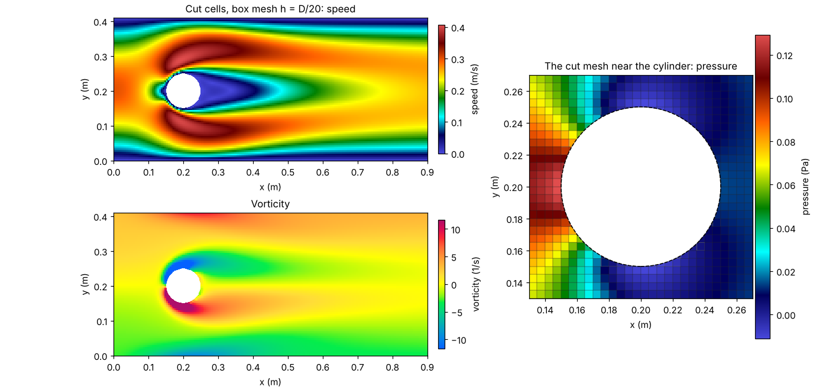
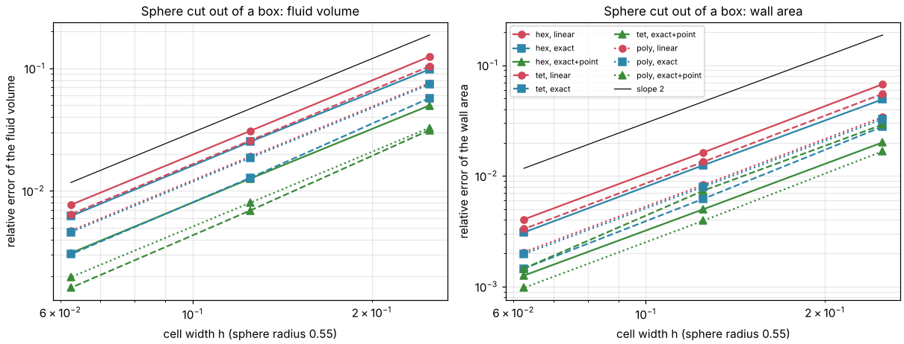

# Immersed bodies

Part of the [Example gallery](../gallery.md): bodies in the flow without a body-fitted mesh (L13; [staged plan](../requirements/l13-immersed-boundary-plan.md), D225 to D234).

| # | Example | Stage | Feature |
|---|---|---|---|
| 270 | [A cylinder put into a box mesh by Brinkman penalisation](#penalised-cylinder) | L13 stage 1 | `[immersed]`, `[[immersed.body]]`, solid fraction, body force, `solid-fraction` field |
| 291 | [Topology search of a pipe bend, and how accurate the penalised wall is](#topology-bend) | L13 stage 1 | `[immersed.topology]`, `shape = "field"`, `topology.stl`, K/h sweeps, Stokes sphere array, MMS, gradient check, iso-surface benchmark |
| 313 | [A cylinder cut out of a box mesh: sharp walls on cut cells](#cut-cylinder) | L13 stage 2 | `[immersed] method = "cut"`, `[immersed.cut]`, cut and merged cells, body walls as boundaries, cut benchmark (marching cubes, exact crossings, dual-contouring wall point) |
| 310 | [A dirty STL body: surface check, winding number and signed distance](#dirty-stl-winding) | L13 stage 0 | `mesh.surface`, IMM001 to IMM009, `foehncraft_mesh::surface` (winding number, signed distance, crossings) |
| 315 | [Signed distance by three methods, and a sphere cut exactly out of a mesh](#sdf-benchmark-cut) | L13 stage 0 | signed-distance benchmark (ours, fast sweeping, heat method), `Surface::cut_moments` (volume fractions, apertures, wall pieces) |
| 322 | [STL bodies cut out of a mesh: sharp edges, face points and the Stokes sphere array](#stl-cut) | L13 stage 2 | `shape = "stl"` (`file`, `scale`), `[immersed.cut] face_point`, dual-contouring wall points on sharp edges, the per-cell fallback, STL cut benchmark against the exact moments |
| 357 | [A turbulent plate tilted against the mesh: wall functions on cut cells](#cut-plate) | L13 stage 2c | `shape = "plane"` (`normal`), wall functions with the exact first-cell distance, `[immersed.cut] wall_sample`, y⁺ per body (LIM011) |

---

<a id="penalised-cylinder"></a>
## 270. A cylinder put into a box mesh by Brinkman penalisation


`immersed_cylinder_re20.toml` is the steady benchmark 2D-1 of Schäfer &
Turek (1996), the case of [gallery 15](flow.md#cylinder), on a plain box
mesh of 440 × 82 hexahedra (cell width h = D/20) that knows nothing of the
cylinder. The cylinder is one `[[immersed.body]]`: every cell gets its solid
fraction χ (the part of its volume inside the body, from 64 sample points per
tetrahedron of the cell), and the momentum rows get the Brinkman drag
−μ χ u / K with the permeability K = 10⁻⁸ m² (Angot, Bruneau & Fabrie 1999).
The drag is implicit and sits inside the momentum row before the
under-relaxation, so the Rhie–Chow flux sees it and the pressure does not
decouple in the solid. The force on the body is the momentum the sink takes
out of the fluid, Σ μ χ V u / K.

| Mesh | Cells | C_D | C_L | Δp (Pa) |
|---|---|---|---|---|
| box, h = D/10 (220 × 41) | 9 020 | 5.421 | 0.0163 | 0.1203 |
| box, h = D/20 (the case file) | 36 080 | 5.581 | 0.0147 | 0.1187 |
| box, h = D/40 (880 × 164) | 144 320 | 5.571 | 0.0140 | 0.1179 |
| body-fitted, [gallery 15](flow.md#cylinder) | 24 576 | 5.581 | 0.0104 | 0.1175 |
| reference range | | 5.57 – 5.59 | 0.0104 – 0.0110 | 0.1172 – 0.1176 |

Drag and pressure difference reach the reference range at h = D/20 to D/40;
the lift stays 27 % above it at D/40 and falls slowly (about first order).
SIMPLEC and the coupled solver give the same values to all printed digits
(D/10: 542 and 75 iterations; D/40: SIMPLEC does not converge in 3 000
iterations, the coupled solver needs 288).

**What this is for, and its flaws (D226).** Penalisation is the cheap first
look and the topology tool of L13, not the accurate immersed wall: the wall
is smeared over about one cell, so wall shear stress and lift are poor, and
the result depends on K and on the mesh width. Plane Poiseuille flow between
two penalised walls that do not lie on cell faces converges at about first
order (mass flow error 20, 8.5 and 2.3 % on 16, 32 and 64 cells across the
channel; with K = 10⁻⁴ m², √K about a third of a cell, the walls leak and
the flow is 3 % too large). Turbulence models, the energy equation and the
other settings that need a sharp wall are refused (IMM102). Sharp walls on
cut cells are stage 2.

Reproduce (about a minute each):

```sh
cargo build --release -p foehncraft-cli
target/release/foehn flow examples/cases/flow/immersed_cylinder_re20.toml --out output/imm
target/release/foehn flow examples/cases/flow/cylinder_re20.toml --out output/fitted
pip install matplotlib h5py numpy
python3 -m tools.plot.immersed_fields docs/figures/gallery output/imm output/fitted
```

Recipe: [270](../recipes/immersed.md#penalised-body). Case file: `examples/cases/flow/immersed_cylinder_re20.toml`.

---

<a id="topology-bend"></a>
## 291. Topology search of a pipe bend, and how accurate the penalised wall is


`immersed_topology_bend.toml` is the pipe bend of Borrvall & Petersson
(2003): Stokes flow in the unit square, fluid in on the left
(0.7 ≤ y ≤ 0.9, parabolic, 1 m/s at the middle) and out at the bottom
(0.7 ≤ x ≤ 0.9), walls elsewhere, a quarter of the square allowed to be
fluid. Every cell of the 60 × 60 mesh carries a fluid fraction γ, the
design variable; the momentum rows get the Brinkman sink μ χ(γ) V / K with
the interpolation χ = q (1 − γ)/(q + γ), q = 0.1 and μ/K = 2.5·10⁴.
The search minimises Φ, the power the flow takes from its boundaries
(the total-pressure flux into the domain, at the steady state the
dissipation), with optimality-criteria updates during the flow iterations
(one update every 20 iterations, D206 "one-shot"). The gradient needs no
adjoint solve: Stokes flow is self-adjoint (the velocity minimises the
dissipation), so ∂Φ/∂γ = (μ/K) χ′(γ) |u|² V in every cell.

The search stops after 28 updates (no γ changes by more than 0.01) and the
flow converges on the final design: 645 iterations and 3.5 s in all, Φ
from 4.69 W (grey start, γ = 0.25 everywhere) to 0.369 W, the grey level
4 γ (1 − γ) down to 0.04. The design is a straight channel from the
inlet to the outlet with rounded corners: in Stokes flow, with this much
fluid, the short straight pipe beats a curved one. The run writes
`topology.csv` (one row per update) and `topology.stl`, the surface
γ = ½ by marching tetrahedra, closed and manifold across cells, 2 792
triangles: the input of the cut cells of stage 2. A density filter
(`filter_radius = 1.5 h`) gives the same channel with Φ 1 % higher after
64 updates; the staircase of speeds along the walls is the diagonal wall
on square cells, not a checkerboard of the solution.

**The gradient (check of the plan).** A grey plug in a channel, one design
update after the converged flow: the self-adjoint gradient against central
differences of converged runs agrees to 3·10⁻⁶ (80 × 40 cells; 8·10⁻⁵ on
40 × 20, where the pressure-stabilising Rhie–Chow term, which makes the
discrete operator not quite self-adjoint, is larger). With convection at
Re = 20 the formula is an approximation, 0.5 % off.
(`tests/immersed.rs::topology_gradient_matches_central_differences`; the
dual numbers of D59 enter with the adjoint solver of L17, which would also
give exact gradients with convection.)

**The manufactured solution of the penalised equations**
(`immersed_mms.toml`, a smooth solid fraction χ = exp(−r²/0.05) as a
`field` body, the sink a hundred times the viscous term at the middle):
the L2 error of u falls at order 2.00 on hexahedra and 2.05 on polygons
(16² to 64²), as without penalisation. On triangular prisms and the mixed
2D mesh the error stalls at about 2 %; the same solution without the sink
stalls at 6 % there, so this is a gap of the flow discretisation on those
meshes, not of the penalisation (written in `features.toml`).


**How accurate the penalised wall is: the K/h sweeps.** In a plane
Poiseuille channel whose walls do not lie on cell faces, and for Stokes
flow through a simple cubic array of spheres (`immersed_stokes_sphere.toml`,
radius 0.2 of the box, solid fraction 0.0335), against the drag
coefficient 2.152 of the series of Hasimoto (1959) and Sangani & Acrivos
(1982), which agrees within 1 % with the lattice-Boltzmann value at the same
solid fraction of Bogner, Mohanty & Rüde (2015):

| Sphere array, cells per edge | K = 0.1 h² | K = 0.03 h² | K = 0.01 h² | K = 0.001 h² |
|---|---|---|---|---|
| 16³ | -17.0 % | -3.4 % | +6.2 % | +17.9 % |
| 24³ | -9.3 % | -0.2 % | +5.5 % | +12.0 % |
| 32³ | -6.7 % | +0.0 % | +3.9 % | +8.1 % |
| 48³ | -4.4 % | -0.0 % | +2.6 % | +5.6 % |

| Channel, cells across the box | K = 0.1 h² | K = 0.03 h² | K = 0.01 h² | K = 0.001 h² |
|---|---|---|---|---|
| 16 | +8.2 % (-0.16) | -7.9 % (+0.16) | -15.6 % (+0.32) | -19.9 % (+0.42) |
| 32 | +2.9 % (-0.12) | -3.9 % (+0.16) | -6.8 % (+0.27) | -8.4 % (+0.34) |
| 64 | +0.9 % (-0.07) | -1.2 % (+0.09) | -1.9 % (+0.15) | -2.3 % (+0.18) |
| 128 | +1.8 % (-0.28) | +1.2 % (-0.18) | +1.0 % (-0.15) | +0.9 % (-0.14) |
| 256 | +0.2 % (-0.06) | -0.4 % (+0.12) | -0.6 % (+0.18) | -0.7 % (+0.22) |

Drag coefficient error of the sphere array; mass flow error of the channel
with, in brackets, the position error of the effective wall in cells
(positive: the wall stands inside the fluid). All runs converged with the
coupled solver (`python3 -m tools.verification.immersed_sweeps run`). The
wall error stays within half a cell for every K; its sign and size follow
where the wall cuts its cell (at 0.08, 0.16, 0.32, 0.64 and 0.28 of a cell
from 16 to 256 cells), which is why the channel errors do not fall
monotonically. K = c h (dashed in the figure) behaves like K = c h² on
coarse meshes and leaks on fine ones (wall −0.33 cells at 256 for 10⁻³ h).

Two errors of opposite sign meet: a small K/h² smears the solid over the
cells around the wall (the body acts larger, the drag is high), a large one
lets the flow seep in over the depth √K (the body acts smaller). With K a
fixed fraction of h² both shrink with h, at about first order; around
K = 0.03 h² they cancel on these cases, which is luck of the geometry, not
a rule. The recipe takes K = 0.01 h² as the default advice (errors a few
per cent, one-signed on the sphere), with a halving of h to check.


**Iso-surface extraction, benchmarked against the graphics methods**
(`tools/bench/isosurface.py`, 24³ cubes, owner rule to benchmark the
computer-graphics algorithms):

| Field | Method | Triangles | Hausdorff (cells) | Area | Volume | Open / non-manifold edges | Intersecting pairs | Smallest angle |
|---|---|---|---|---|---|---|---|---|
| sphere | marching tets | 5880 | 0.05 | -0.5 % | -1.0 % | 0 / 0 | 0 | 0.6° |
| sphere | dual contouring | 1932 | 0.04 | +0.3 % | +0.2 % | 0 / 0 | 0 | 24.3° |
| sphere | subgrid marching tets | grid edges with ≥ 2 crossings: 0 | | | | | | |
| box | marching tets | 4288 | 0.47 | -6.2 % | -2.5 % | 0 / 0 | 0 | 0.0° |
| box | dual contouring | 1492 | 0.26 | -2.2 % | -0.9 % | 0 / 0 | 0 | 1.6° |
| box | subgrid marching tets | grid edges with ≥ 2 crossings: 10 | | | | | | |
| plate | marching tets | 0 (missed) | | | | | | |
| plate | dual contouring | 0 (missed) | | | | | | |
| plate | subgrid marching tets | grid edges with ≥ 2 crossings: 289 | | | | | | |
| fraction | marching tets | 5880 | 0.36 | +4.0 % | -0.9 % | 0 / 0 | 0 | 0.7° |
| fraction | dual contouring | 1932 | 0.10 | +0.3 % | +0.1 % | 0 / 0 | 0 | 21.3° |

`sphere` and `box` (a rotated box 1.1 × 0.76 × 0.54) are exact signed distances, `plate` a plate 0.3 cells thick, `fraction` the smeared solid fraction clamp(½ − d/h) of the sphere (what a penalised body or a design gives), compared with the exact sphere.

Dual contouring (Ju et al. 2002) is the more accurate on smooth and sharp
surfaces with a third of the triangles and no slivers, but its surfaces are
manifold only where no cell is ambiguous, and it needs normals; marching
tetrahedra is guaranteed closed, manifold and free of self-intersections on
any polyhedral mesh, which the cut of stage 2 needs, so the solver writes
marching tetrahedra. Subgrid marching tetrahedra (Baktash, Gillespie & Crane
2026, read in full) puts no lower bound on the feature size, but it needs
every crossing of the surface along an edge: on node values interpolated
linearly (a cell field) an edge has at most one, so it gives exactly the
marching-tets surface. Its gain is on exact fields: a plate 0.3 cells thick
crosses 289 grid edges twice, and both other methods miss it entirely. It is
the candidate for the signed distances of stage 0 and the layers of
stage 3, together with dual contouring on the cut of sharp CAD.

Reproduce:

```sh
cargo build --release -p foehncraft-cli
target/release/foehn flow examples/cases/flow/immersed_topology_bend.toml --out output/bend
pip install matplotlib h5py numpy
python3 -m tools.plot.immersed_topology docs/figures/gallery/immersed_topology_bend.png output/bend
python3 -m tools.verification.immersed_sweeps run target/release/foehn output/sweeps.json   # about an hour
python3 -m tools.verification.immersed_sweeps plot output/sweeps.json docs/figures/gallery/immersed_k_h_sweep.png
python3 -m tools.bench.isosurface --figure docs/figures/gallery/immersed_isosurface_benchmark.png
```

Recipe: [291](../recipes/immersed.md#topology-search). Case files: `examples/cases/flow/immersed_topology_bend.toml`, `immersed_stokes_sphere.toml`, `immersed_mms.toml`.

---

<a id="cut-cylinder"></a>
## 313. A cylinder cut out of a box mesh: sharp walls on cut cells



`immersed_cut_cylinder_re20.toml` is the case of [gallery 270](#penalised-cylinder)
(Schäfer & Turek 2D-1, Re = 20, the same box mesh of 440 × 82 hexahedra,
h = D/20) with `[immersed] method = "cut"`: the cylinder is cut out of the
mesh instead of penalised (L13 stage 2a and 2b, D227, D228). The mesh
operation `foehncraft_mesh::cut`

- takes the signed distance of the body at the nodes (negative inside),
- clips every face to its fluid part, with the crossing point of each mixed
  edge shared by all faces of the edge (so the cut is watertight),
- closes every cut cell with wall faces made of the chords of its faces,
  fanned around a point projected onto the surface,
- turns a cell whose fluid falls into separate pieces into one cell per piece,
- merges cut cells below `min_volume_fraction` (0.3) of their volume, or
  with a face the discretisation cannot take, into the neighbour with the
  largest shared face; the faces a merged cell shares with one neighbour are
  joined into one face where they lie in one plane and kept as separate
  faces where they do not (two cells may share several faces, see
  [gallery 322](#stl-cut)).

The body surface becomes the wall boundary `cylinder`: the forces are the
ordinary wall forces and the wall is sharp. The cut is serial on the global
mesh before renumbering, so the cut mesh is bitwise the same for any number
of threads. Plane Poiseuille flow between two cut walls off the cell faces
(the channel of [gallery 270](#penalised-cylinder)) has mass flow errors of
1.24, 0.29 and 0.066 % on 16, 32 and 64 cells across, second order (the
penalised walls: 20.5, 8.5, 2.3 %). On the cylinder mesh 84 cells are cut, 276 removed and 24 merged; the
area vectors of every cut cell close to 3·10⁻¹⁶ of its largest face, and the
wall area is 0.012 % below 2πr × depth (0.024 % without the face points of
[gallery 322](#stl-cut)).

| Mesh, method | Cells | C_D | C_L | Δp (Pa) | Iterations |
|---|---|---|---|---|---|
| box h = D/10, cut | 8 944 | 5.554 | 0.0078 | 0.1140 | 543 |
| box h = D/20, cut (the case file) | 35 780 | 5.588 | 0.0103 | 0.1160 | 1 627 |
| box h = D/40, cut | 143 088 | 5.595 | 0.0106 | 0.1171 | 4 000 (residual 1.1·10⁻⁷) |
| box h = D/20, penalised ([gallery 270](#penalised-cylinder)) | 36 080 | 5.581 | 0.0147 | 0.1187 | |
| body-fitted, [gallery 15](flow.md#cylinder) | 24 576 | 5.581 | 0.0104 | 0.1175 | |
| reference range | | 5.57 – 5.59 | 0.0104 – 0.0110 | 0.1172 – 0.1176 | |

At h = D/20 the drag is in the range, the lift 1.4 % below it (the penalised
wall: 35 % above), Δp 1 % below. At h = D/40 all three values meet the
range (C_D 0.09 % above its upper end, Δp 0.05 % below its lower end); the
penalised wall at D/40 still has the lift 27 % high. SIMPLEC stalls at a
residual of 10⁻⁷ on the D/40 mesh, as the penalised run does; the values do
not move in the last thousand iterations. The settings of the cut at h = D/20
(the rows run before the face points of [gallery 322](#stl-cut) became the
default; the last row is the default now):

| `[immersed.cut]` | C_D | C_L | Δp (Pa) |
|---|---|---|---|
| `min_volume_fraction` 0.1 | 5.580 | 0.0100 | 0.1158 |
| 0.2 | 5.583 | 0.0102 | 0.1160 |
| 0.3 (default) | 5.583 | 0.0102 | 0.1160 |
| 0.4 | 5.586 | 0.0104 | 0.1160 |
| `wall_point = false` (one non-planar wall face per cell) | 5.557 | 0.0099 | 0.1160 |
| `edge_root = "linear"`, `wall_point = false` (marching cubes) | 5.556 | 0.0099 | 0.1160 |
| 0.3 with `face_point = true` (default since #322) | 5.588 | 0.0103 | 0.1160 |



**Benchmark with the computer-graphics methods (maintainer rule).** The
crossing points can be put where the linear interpolant of the node values is
zero (marching cubes and marching tetrahedra), or at the root of the body's
own function on the edge, on the true surface; the wall face can stay one
polygon through the crossing points, or be fanned around a point projected
onto the surface (the vertex of dual contouring, which lets the wall bulge
with the body inside the cell). A sphere (r = 0.55) cut out of box meshes
of 8³ to 32³ cells (`cargo run --release -p foehncraft-mesh --example
cut_bench`): all three converge at second order in volume and area on
hexahedra, tetrahedra and polyhedra; exact crossings with the wall point are
2 to 4 times closer than the linear crossings (volume error at 32³: hex
7.7·10⁻³ → 3.1·10⁻³, tet 6.5·10⁻³ → 1.6·10⁻³, poly 4.7·10⁻³ → 2.0·10⁻³), so
they are the default. On the cylinder the wall point moves the drag from
0.3 % below the range into it. Cutting 33 000 polyhedra takes 1.7 s.

**What is not here yet.** STL bodies followed in [gallery 322](#stl-cut), wall functions
on cut bodies in [gallery 357](#cut-plate). Conjugate heat transfer through cut
cells (2d, refused with IMM202), named surface patches with other conditions
(2e) and the near-body refinement (2f) follow. One rank only.

Reproduce (about a minute and a half for the case, ten minutes for D/40):

```sh
cargo build --release -p foehncraft-cli
target/release/foehn flow examples/cases/flow/immersed_cut_cylinder_re20.toml --out output/cut
cargo run --release -p foehncraft-mesh --example cut_bench > output/cut_bench.md
pip install matplotlib h5py numpy
python3 -m tools.plot.immersed_cut docs/figures/gallery output/cut output/cut_bench.md
```

Recipe: [313](../recipes/immersed.md#cut-body). Case file: `examples/cases/flow/immersed_cut_cylinder_re20.toml`.
<a id="dirty-stl-winding"></a>
## 310. A dirty STL body: surface check, winding number and signed distance


The geometry kernel of L13 stage 0 (D225) on a surface with the defects
real STL files have: a lumpy ball of 25 443 triangles with a hole in its top
(37 open edges), a patch of flipped triangles (85 edges run the same way by
both triangles) and a second lump that overlaps it (335 pairs of
intersecting triangles). The surface check (`mesh.surface`, IMM001 to
IMM009) finds each of them with exact predicates and repairs nothing (Q2):

```text
IMM005 335 pairs of triangles intersect (first: [[9536, 20617], [9536, 20623], [9809, 21289]]); inside/outside comes from the winding number
IMM002 open surface: 37 edges with one triangle (holes); the winding number closes them smoothly
IMM004 85 edges whose two triangles run them in the same direction (inconsistent orientation)
```

**Winding number** (left): the solid angle the surface subtends, divided by
4π (Jacobson et al. 2013). It is 1 inside, 0 outside and 2 where the lumps
overlap; at the hole it falls smoothly and the half level closes the hole
with a cap close to the missing surface. The flipped patch cancels part of
the surface, so there the half level bulges into a small bubble: a defect
the check reports and the winding number only softens.

**Signed distance** (middle): the exact closest-point distance of the
surface hierarchy (D108) with the sign of the winding number, negative
inside. The overlapping lump keeps its buried surface, so inside the body
the distance falls to zero along it while the sign stays negative: what a
cut needs (φ < 0) is right, the magnitude inside a dirty body is not a
distance to the outer skin.

**Fast winding number** (right): the hierarchy replaces far groups of
triangles by a three-term expansion of the dipole kernel (Barill et al.
2018). With the default ratio β = 2 it differs from the exact sum by at most
3.9e-3 next to the surface and by 1e-6 to 1e-9 away from it, 211 times
faster (118 400 points: 0.07 s against 15.6 s on 4 threads); the inside test
re-evaluates points with |w − ½| < 0.05 with β = 8 (error 6e-6).

Verification (`crates/foehncraft-mesh/tests/surface.rs`): the signed
distance of icospheres converges to the sphere at second order (the sagitta
h²/8) and equals the brute-force closest point bitwise; the fast winding
number against the exact sum on 2000 points; holes, flips, duplicates,
degenerate and intersecting triangles detected; touching configurations
(corner on a face, edge through an edge, coplanar overlap, folds over a
shared edge, a corner 1e-300 above a face) decided exactly; crossings
through a surface edge counted once with the exact root; results bitwise
equal on 1, 2 and 4 threads (D93).

Reproduce:

```sh
cargo run --release -p foehncraft-mesh --example surface_slice -- output/surface
pip install matplotlib numpy
python3 -m tools.plot.surface_slice output/surface docs/figures/gallery/immersed_surface_winding.png
echo '{"input": "output/surface/body.stl"}' | target/release/foehn call mesh.surface --input -
```

Recipe: [310](../recipes/immersed.md#surface-check).

<a id="sdf-benchmark-cut"></a>
## 315. Signed distance by three methods, and a sphere cut exactly out of a mesh


**Signed distance, benchmarked against the graphics methods** (decision
Q11: the default is decided by this benchmark). Three methods on the nodes
of a grid over [−1.5, 1.5]³ (`examples/sdf_benchmark.rs`,
`tools/bench/sdf.py`): **ours**, the exact closest point on the surface
hierarchy with the winding-number sign (#310); **sweep**, fast sweeping for
the eikonal equation (Zhao 2005) from the exact distance within 1.5 cells,
sign by scan conversion (crossing parity along grid lines, as in Roosing et
al. 2019); **heat**, the signed heat method (Feng & Crane 2024: diffused
normals, normalised, integrated by a Poisson solve), on the grid with
conjugate gradients. Errors in cells against the exact distance (the clean
sphere for the dirty variants), 96³ nodes (Hausdorff of the marching-tets
zero level on 48³):

| Surface | Method | Near max | Near RMS | Wrong signs | Zero level Hausdorff (48³) | s per M nodes |
|---|---|---|---|---|---|---|
| sphere | ours | 0.009 | 0.006 | 0 | 0.026 | 1.8 |
| sphere | sweep | 0.041 | 0.016 | 0 | 0.026 | 0.27 |
| sphere | heat | 0.126 | 0.041 | 0 | 0.031 | 2.3 |
| torus | ours | 0.036 | 0.020 | 0 | 0.071 | 0.84 |
| torus | sweep | 0.098 | 0.034 | 0 | 0.071 | 0.46 |
| torus | heat | 0.474 | 0.218 | 0 | 0.342 | 2.4 |
| box (sharp) | ours | 0.000 | 0.000 | 0 | 0.485 | 0.11 |
| box (sharp) | sweep | 0.460 | 0.053 | 0 | 0.485 | 0.94 |
| box (sharp) | heat | 2.323 | 0.505 | 0 | 1.287 | 2.9 |
| holed | ours | 7.59 | 0.272 | 0 | 0.867 | 1.7 |
| holed | sweep | 7.94 | 0.402 | 0.22 % | 12.8 | 0.54 |
| holed | heat | 1.07 | 0.071 | 0 | 0.516 | 3.0 |
| flipped | ours | 6.38 | 0.674 | 0.39 % | 4.56 | 1.8 |
| flipped | sweep | 0.041 | 0.016 | 0 | 0.026 | 0.36 |
| flipped | heat | 4.75 | 0.712 | 0.35 % | 20.6 | 3.0 |
| soup | ours | 3.09 | 0.219 | 0.01 % | 1.06 | 2.0 |
| soup | sweep | 6.36 | 0.515 | 1.85 % | 15.0 | 0.54 |
| soup | heat | 5.82 | 2.96 | 2.30 % | 2.25 | 3.0 |

"Near": nodes within 0.1 m of the surface; "wrong signs": nodes more than
a cell from the surface; 4 threads. The sphere and torus errors of ours are
the facets of the STL (the reference is the smooth shape); the box is exact.

**Decision (Q11): the default is ours**, the exact closest point with the
winding-number sign: exact on clean surfaces including sharp edges, the
only method without sign errors on holes and soups, and with a narrow band
(3 cells) about four times cheaper than the full grid. Its weak case is a
patch of flipped triangles (the winding number subtracts it; IMM004 reports
it); scan conversion ignores orientation and wins there but leaks through
every hole. The heat method fills holes most smoothly (its zero level is the
best cap of the missing surface) but rounds sharp edges by about two cells,
loses accuracy away from the surface and is the slowest: it stays a
candidate for hole filling of the layered boundary (stage 3), not the
default. The zero levels of all three are limited by marching tetrahedra on
sharp edges (0.49 cells on the box, see gallery 291).


**Exact cut of a mesh by the surface** (`Surface::cut_moments`): for every
cell the volume and centroid of its part inside the body, for every face
the area and centroid of its part inside (the aperture, computed once per
face so both cells agree), and the surface clipped to each cell (wall
pieces with area vector, centroid and triangle). It works by Gauss–Green in
one dimension after the other: inside parts of edges from exact crossings,
inside parts of face triangles from those and the surface segments, cell
volumes from the face parts and the clipped surface. Nothing is meshed, so
there is no topology to break; ties where surface edges lie exactly in a
mesh face are decided by simulation of simplicity.

On a sphere of 327 680 triangles cut out of hexahedral meshes of 8³ to
64³ cells (`examples/cut_sphere.rs`):

| Cells per side | Cut cells | Fraction error, exact cut (max / mean) | Fraction error, linear level set (max / mean) | Time |
|---|---|---|---|---|
| 8 | 118 | 3.8e-5 / 1.7e-5 | 0.138 / 0.042 | 0.12 s |
| 16 | 432 | 8.0e-5 / 3.6e-5 | 0.068 / 0.023 | 0.16 s |
| 32 | 1744 | 1.6e-4 / 7.2e-5 | 0.034 / 0.012 | 0.36 s |
| 64 | 6968 | 3.3e-4 / 1.4e-4 | 0.018 / 0.0058 | 1.8 s |

The reference is the analytic sphere (sub-grid integration of each cut cell,
Richardson-extrapolated). The linear level-set cut (exact distance at the
nodes, interpolated linearly in six tetrahedra per cube, what a cut from
node values gives) is first order in the volume fraction. The exact cut is
exact for the STL: its error against the sphere is the facet error of the
triangles (2.8e-6 m), seen relative to the shrinking cells; its total
volume and wall area differ from the sphere by −3.4e-5 and −1.9e-5 on every
mesh, which is the icosphere's own volume and area to 1e-15.
`tests/surface_cut.rs` checks on hexahedra, tetrahedra, polyhedra and
mixed meshes that the inside volumes add up to the STL volume and the wall
pieces to its area to 1e-12, that every cell closes (inside face areas plus
wall area vector sum to zero, 1e-12), a torus whose ring of edges lies
exactly in a mesh plane, and bitwise equal results on 1, 2 and 4 threads.

Reproduce:

```sh
cargo run --release -p foehncraft-mesh --example sdf_benchmark -- output/sdf 48 96
python3 -m tools.bench.sdf output/sdf --figure docs/figures/gallery/immersed_sdf_benchmark.png
cargo run --release -p foehncraft-mesh --example cut_sphere -- output/cut
python3 -m tools.plot.cut_sphere output/cut docs/figures/gallery/immersed_cut_sphere.png
```

Recipe: [315](../recipes/immersed.md#cut-moments).

<a id="stl-cut"></a>
## 322. STL bodies cut out of a mesh: sharp edges, face points and the Stokes sphere array


`[[immersed.body]] shape = "stl"` reads a triangle surface (ASCII or binary
STL, `file` relative to the case file, `scale` for its unit) and makes it a
body for both methods of L13 (D227): penalised, with the exact cut volumes
of `Surface::cut_moments` as solid fractions ([gallery 315](#sdf-benchmark-cut)),
or cut out of the mesh. The file is read once per run, checked (IMM002 to
IMM009 go to the log as notes) and kept for the re-reads of
the case.

**How the cut sees a triangle surface** (`foehncraft_mesh::surface::SurfaceBody`):

- **node values**: the signed distance (closest point, winding-number sign,
  negative inside) in a narrow band: a node farther from the surface than
  its longest edge keeps only its sign;
- **crossing points**: the first exact crossing of the edge with the
  triangles from its fluid end (watertight segment–triangle test, D225),
  shared by all faces of the edge;
- **wall point**: where the normals of the triangles under a wall loop open
  by more than 15° (a sharp edge or corner runs through the cell, the
  feature test of Kobbelt et al. 2001), the vertex of dual contouring (the
  quadratic error function of the loop points and normals, Ju et al. 2002,
  solved about the mass point with small eigenvalues dropped, Lindstrom
  2000), kept when it lies on the surface; elsewhere the exact closest point
  to the loop centroid;
- **face points** (new key `[immersed.cut] face_point`, default true, for
  every shape): every straight chord of a clipped face is bent through the
  crossing of the surface with its perpendicular bisector in the face plane,
  or, where a sharp edge pierces the face, through that point (the crossing
  of the traces of its two sides). The clipped faces then follow the body
  too, not only the wall faces.


**Sharp edges.** A box turned against the mesh (left: the closest point,
right: dual contouring with face points): the closest point puts the fan
point on a side of the box and cuts every edge and corner off inside its
cells, so the wall area converges at first order only (−6.0 % at 16³); the
dual-contouring point puts it on the edge or corner, and the face points
keep the edge where it passes from cell to cell (−1.3 %).

**The merge and the fallback.** A cut cell with a face where d · S ≤ 0 is
refused by the discretisation. The merge picks the neighbour whose union
passes that check, preferring one whose faces to every other cell lie in
one plane and none of which the solver would count as skewed (above its
`skewness_limit` 0.9: that switches on the cell-quality remediation of the
whole run, D50). The faces a merged cell shares with a neighbour are joined
into one face where they lie in one plane and kept as separate faces where
they do not: one face joined across a bend (an L-shaped group of cells
around its neighbour) is fanned about one point, folds, and moves volume
from one cell into the other (48 such faces on the 32³ sphere array of
#322, the largest moving 11.5 % of the smaller cell). So two cells may
share several faces (owner decision; the mesh builder allows it for cut
meshes only, IMM203 counts the pairs), and the solver treats them as one
face: the two-point flux, the interpolation weight, the least-squares
stencil, the skewness and the d · S check take the summed area vector of
the pieces at their centroid projected onto its plane, while the volumes
stay exact. Where a face is still refused after
the merge, the input cells around it are cut again with fewer points: first
without face points, then without the sharp-edge point, then without a
wall point (one wall face per loop). Each step is a new round of the cut,
the rest of the mesh keeps the finest points. In all 162 cuts of the
benchmark below no refused face is left; the box on 32³ tetrahedra, the
hardest case, needs three rounds and simplifies 307 of its cells.


**Benchmark with the computer-graphics methods** (maintainer rule;
`cargo run --release -p foehncraft-mesh --example cut_stl_bench`): three
surfaces (an icosphere of 20 480 triangles, a box of 12 triangles turned by
0.35 and 0.6 rad, a torus of 24 576 triangles, tilted) cut out of box meshes
of 8³ to 32³ cells, against the exact moments of the same triangles. Relative
errors at 32³ cells per side:

| Surface, mesh | Marching cubes | Exact crossings | + closest point | + dual contouring | + face points (default) |
|---|---|---|---|---|---|
| icosphere, hex: volume | 7.7e-3 | 6.2e-3 | 3.1e-3 | 3.1e-3 | 1.6e-3 |
| icosphere, tet: volume | 6.5e-3 | 3.0e-3 | 1.6e-3 | 1.6e-3 | 7.2e-4 |
| icosphere, hex: face apertures (mean) | 4.1e-3 | 2.6e-3 | 2.6e-3 | 2.6e-3 | 6.6e-4 |
| box, hex: wall area | 5.3e-2 | 4.5e-2 | 3.1e-2 | 4.0e-3 | 4.2e-3 |
| box, tet: wall area | 3.9e-2 | 2.6e-2 | 1.6e-2 | 2.6e-3 | 1.6e-3 |
| box, poly: wall area | 4.2e-2 | 4.2e-2 | 2.4e-2 | 7.2e-3 | 4.5e-3 |
| box, hex: volume | 1.3e-2 | 1.0e-2 | 7.0e-3 | 4.0e-3 | 2.0e-3 |
| torus, tet: volume | 1.2e-2 | 6.1e-3 | 3.3e-3 | 3.3e-3 | 1.5e-3 |
| icosphere, poly: volume cell by cell (L1) | 5.1e-3 | 5.0e-3 | 2.7e-3 | 2.7e-3 | 2.2e-3 |

On smooth surfaces every method is second order and each step halves the
error; on the sharp box the wall area of everything without the
dual-contouring point is first order. The fluid volume of every group of
input cells that a merged cell covers is checked too (L1 over the body
volume): with the faces kept apart where they do not lie in one plane, it
equals the error of the total volume on hexahedra and tetrahedra (at most
1.06 times it in every cut; with the joined faces up to 4 times it, 6.9e-3
against 2.0e-3 for the box on 32³ hexahedra), so no volume moves from one
cell into another; on polyhedra it is 1.0 to 1.9 times the total and
converges at order 1.6 to 1.8 from 16³ to 32³ (with the joined faces up to
24 times the total, order 0.9). The default is the last column. Timings (busy machine): 0.3 to 0.4 s for 32³
hexahedra, 8 to 16 s for 196 608 tetrahedra with face points and the
fallback (1.5 to 2.0 s with the exact crossings alone).

**Stokes flow through an array of STL spheres** (top figure,
`immersed_cut_stl_sphere_array.toml`): the case of [gallery 291](#topology-bend)
with the sphere an icosphere of 5120 triangles cut out of the mesh. The
drag coefficient K = F/(6π μ a U) with F = G L³ against the series of
Hasimoto (1959) and Sangani & Acrivos (1982), 2.152:

| Mesh | Cells | K | Error | Wall force / G L³ |
|---|---|---|---|---|
| hex 16³ | 3 960 | 1.959 | −9.0 % | 1.044 |
| hex 24³ | 13 392 | 2.074 | −3.6 % | 1.015 |
| hex 32³ (the case file, 256 iterations, 51 s) | 31 752 | 2.111 | −1.9 % | 1.004 |
| hex 48³ | 107 144 | 2.132 | −0.9 % | 0.998 |
| tet 16³ | 23 856 | 2.188 | +1.7 % | 1.047 |
| tet 24³ | 80 340 | 2.254 | +4.8 % | 0.987 |
| poly 16³ (17³ polyhedra) | 4 820 | 2.021 | −6.1 % | 1.027 |
| poly 24³ (25³ polyhedra) | 15 212 | 2.066 | −4.0 % | 1.011 |
| hex 32³, primitive sphere cut | 31 752 | 2.108 | −2.0 % | 1.004 |
| hex 16³, 24³, 32³, penalised ([gallery 291](#topology-bend)) | | | +6.2, +5.5, +3.9 % | |

The cut converges at second order (16³ to 48³: order 2.1) where the
penalised wall converges at first order or less; on 32³ cells the cut is
closer than the penalised sphere on 32³ by 2.1 times. The STL sphere and the
primitive sphere differ by 0.13 %, of which the icosphere's own size (its
volume-equivalent radius is 0.07 % below 0.2 m) is part. The penalised STL
sphere matches the penalised primitive within 1 % (`tests/immersed.rs`).

**The cylinder of [gallery 313](#cut-cylinder) with face points** (the new
default): C_D 5.588 (in the range), C_L 0.01025 (1.4 % below it; 2.1 %
without face points), Δp 0.1160, and the wall area 0.012 % below 2πr ×
depth instead of 0.024 %.

**Several faces per cell pair (#329).** Keeping the faces at a bend
apart first cost the 32³ run its force balance: a small separate piece
nearly parallel to the line between the two cell centroids (84°) counted as
a face of skewness 5.2, which switched on the cell-quality remediation (D50:
Gauss pressure gradient, limiter, bounded face velocity) for the whole run,
and the wall carried only 0.94 of G L³. With the faces of one pair treated
as one face and the merge avoiding skewed faces, the 32³ run takes no
remediation, K is −1.9 % (−2.3 % with the folded faces of #322) and the
wall carries G L³ to 0.4 %; 288 pairs of cells share several faces there.
The merge threshold 0.4 instead of 0.3 gives −2.3 % on 32³ (24³ and the
2D cylinder at h = D/10: no change; at D/20 it puts C_L into the range,
0.01047, and C_D 0.06 % above it); the maintainer kept 0.3.

**What is not here yet.** The fallback cuts the whole mesh again per round.
On polyhedral meshes the faces are not planar, so the fan of a clipped face
is not that of the input face and the face apertures do not converge (the
cell-by-cell volumes now do). On tetrahedra the drag error grows from +1.7 %
on 16³ to +4.8 % on 24³ and the wall carries G L³ to 5 % on 16³ (1.3 % on
24³; the −1.8 % of #322 on 24³ ran with the cell-quality remediation on): the
cut cells of tetrahedra need a closer look (features.toml). A feature thinner than a cell can vanish between the
nodes. Wall functions on cut bodies followed in [gallery 357](#cut-plate);
conjugate heat transfer through cut cells (2d), named surface patches (2e)
and the near-body refinement (2f) follow. One rank only.

Reproduce (about a minute for the case, two for the benchmark):

```sh
cargo build --release -p foehncraft-cli
target/release/foehn flow examples/cases/flow/immersed_cut_stl_sphere_array.toml --out output/stl_sphere
for n in 16 24 48; do target/release/foehn flow examples/cases/flow/immersed_cut_stl_sphere_array.toml --out output/stl_sphere_$n --set "mesh.generate.cells=[$n,$n,$n]"; done
cargo run --release -p foehncraft-mesh --example cut_stl_bench -- output/cut_stl_bench.json > output/cut_stl_bench.md
cargo run --release -p foehncraft-mesh --example cut_stl_walls -- output/cut_stl_walls.json
pip install matplotlib h5py numpy
python3 -m tools.plot.immersed_stl fields docs/figures/gallery output/stl_sphere output/stl_sphere_16 output/stl_sphere_24 output/stl_sphere output/stl_sphere_48
python3 -m tools.plot.immersed_stl walls docs/figures/gallery output/cut_stl_walls.json
python3 -m tools.plot.immersed_stl bench docs/figures/gallery output/cut_stl_bench.json
```

The tetrahedral and polyhedral runs take `--set 'mesh.generate.type="tet"'`
(or `"poly"`) and are added to the `fields` call. Recipe:
[322](../recipes/immersed.md#stl-body). Case file:
`examples/cases/flow/immersed_cut_stl_sphere_array.toml`.

---

<a id="cut-plate"></a>
## 357. A turbulent plate tilted against the mesh: wall functions on cut cells


`immersed_cut_plate_keps.toml` is a turbulent flat plate (k-ε, scalable
wall functions, the free stream of the TMR plate of
[gallery 71](turbulence.md#k-epsilon), Re = 5·10⁶ per metre) that the mesh does not
know: the plate is the half-space below a plane rising at 2° (`shape =
"plane"`, `normal`), cut out of a 150 × 130 box mesh with 1 mm cells near
the wall (L13 stage 2c, D229). The plate crosses one cell row every 28.6 mm,
so the wall cells take every cut fraction between 0.3 (smaller ones are
merged into their neighbour) and 1, and their centroids every distance from
the wall between a fifth and one and a half cells. This is the hard case for
a wall function: on a body-fitted mesh all first cells along the plate have
the same height.

Three things make the wall functions of a cut body work:

- **The exact first-cell distance (D108).** The distance y_P of a cut or
  merged wall cell is the distance of its centroid to the body itself
  (closest point on the plane, cylinder, sphere, box or STL triangles, the
  same signed distance the cut uses), one value per cell, not the distance
  to the plane of each wall facet. On a cylinder cut out of a 2D mesh the
  facet distance is off by more than 10⁻³ R and differs between the facets
  of one cell; the exact distance is |r_P − R| to 10⁻¹² R (unit test). The
  wall distance of the turbulence models (`derived` `wall-distance`, SST,
  ζ-f) takes the same exact distance.
- **The sampled wall function** (`[immersed.cut] wall_sample = true`, the
  default). A cut cell's own velocity depends on how it was cut: a sliver
  of fluid next to the wall and a nearly whole cell both see the same
  outer flow. The wall function of each cut wall face takes its velocity,
  k and distance from the cell one layer out along the wall normal (the
  first cell whose centroid lies further from the body than the wall
  cell), whose distance does not depend on the cut, and solves the same
  log law there; the wall shear stress and the log-law production of k in
  the wall cell use that u_τ (Capizzano 2011, Tamaki, Harada & Imamura
  2017, Berger & Aftosmis 2012 sample the same way).
- **No non-orthogonal correction on the cut wall faces.** The wall
  diffusion of a cut face takes A / y_P with the exact distance, so the
  wall shear stress the momentum equation sees is the one the wall
  function computed.

| s along the plate (m) | 0.3 | 0.5 | 0.7 | 0.97 | 1.15 |
|---|---|---|---|---|---|
| White, c_f × 10³ (turbulent from the edge) | 3.496 | 3.203 | 3.030 | 2.875 | 2.798 |
| body-fitted plate, same cells | −3.5 % | +6.1 % | +0.8 % | −1.4 % | −2.3 % |
| cut, sampled (default), mean | +18.2 % | +7.5 % | +1.2 % | +3.6 % | +6.7 % |
| cut, sampled, single faces | +13 … +22 % | +4 … +13 % | −4 … +6 % | −16 … +12 % | −15 … +20 % |
| cut, wall cell itself (`wall_sample = false`), single faces | −26 … +58 % | −25 … +40 % | −25 … +25 % | −46 … +50 % | −44 … +6 % |

Sampling narrows the scatter of the skin friction of single faces to
between a tenth and a third of the unsampled one; the mean is within 7 % of White's correlation from s = 0.5 on.
LIM011 in the log and in `result.json` gives the y⁺ range of every cut body
(here 4 to 148, mean 83), the map is the `y_plus` column of `wall_plate.csv`
(right panel). A coarser test of the same plate (75 × 115 cells,
`cut_plate_wall_function_samples_one_layer_out`) gives −4.4 % with 9.9 %
scatter sampled and −3.9 % with 38 % scatter unsampled over 0.8 < s < 1.15.

**Benchmark with the computer-graphics methods (maintainer rule).** The wall
distance can be taken as the distance to the plane of the cell's wall
facets (what a mesh-only code has), or as the exact closest point on the
body through its bounding-volume hierarchy (the STL bodies) or its closed
form (the primitives). The closest point costs one BVH query per wall cell
and is exact; the facet plane is exact only on planar bodies and differs
between the facets of a curved cell. The heat method and fast sweeping
distances of [gallery 315](#sdf-benchmark-cut) are first order near the
surface and not used here.

**What is not here yet.** The first layer of cut cells makes about 30 to
60 % more k than the equilibrium in the first 2 mm and its velocity is 10 to
20 % below the log law; near the leading edge the cut plate is turbulent at
once (+18 % at s = 0.3) while the fitted plate has a short laminar run. The
sample has to lie in the log layer: with 2 mm first cells (75 × 65) it sits
at y/δ ≈ 0.25 and C_f comes out 17 % high. A uniform start along x pushes
fluid into the cut cells and diverges in the first iteration, so the case
starts with the velocity along the plate. The k residual stalls near
2·10⁻³ at the leading edge (the inlet corner) for both the cut and the
fitted plate. Resolved walls (low-Re treatments) take the exact distance
but no sample. One rank only.

Reproduce (about a minute per run on 4 cores):

```sh
cargo build --release -p foehncraft-cli
target/release/foehn flow examples/cases/flow/immersed_cut_plate_keps.toml --out output/cut_plate
target/release/foehn flow examples/cases/flow/immersed_cut_plate_keps.toml --out output/cut_plate_cell --set immersed.cut.wall_sample=false
target/release/foehn flow examples/cases/flow/immersed_cut_plate_fitted.toml --out output/cut_plate_fit
pip install matplotlib h5py numpy
python3 -m tools.plot.immersed_cut_plate docs/figures/gallery output/cut_plate output/cut_plate_fit output/cut_plate_cell
```

Recipe: [357](../recipes/immersed.md#cut-wall-functions). Case files:
`examples/cases/flow/immersed_cut_plate_keps.toml`,
`examples/cases/flow/immersed_cut_plate_fitted.toml`.
