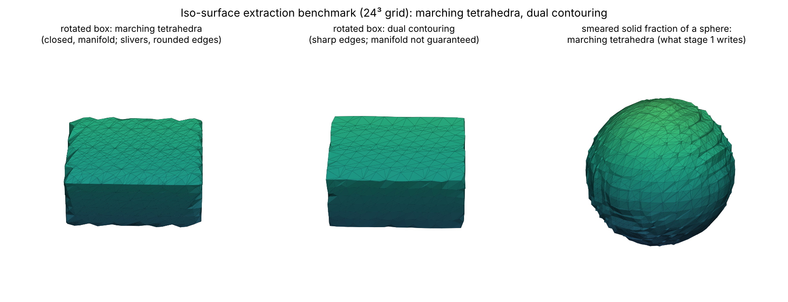

# Immersed bodies

Part of the [Example gallery](../gallery.md): bodies in the flow without a body-fitted mesh (L13; [staged plan](../requirements/l13-immersed-boundary-plan.md), D225 to D234).

| # | Example | Stage | Feature |
|---|---|---|---|
| 270 | [A cylinder put into a box mesh by Brinkman penalisation](#penalised-cylinder) | L13 stage 1 | `[immersed]`, `[[immersed.body]]`, solid fraction, body force, `solid-fraction` field |
| 291 | [Topology search of a pipe bend, and how accurate the penalised wall is](#topology-bend) | L13 stage 1 | `[immersed.topology]`, `shape = "field"`, `topology.stl`, K/h sweeps, Stokes sphere array, MMS, gradient check, iso-surface benchmark |
| 313 | [A cylinder cut out of a box mesh: sharp walls on cut cells](#cut-cylinder) | L13 stage 2 | `[immersed] method = "cut"`, `[immersed.cut]`, cut and merged cells, body walls as boundaries, cut benchmark (marching cubes, exact crossings, dual-contouring wall point) |

---

<a id="penalised-cylinder"></a>
## 270. A cylinder put into a box mesh by Brinkman penalisation


`immersed_cylinder_re20.toml` is the steady benchmark 2D-1 of Schäfer &
Turek (1996), the case of [gallery 15](flow.md#cylinder), on a plain box
mesh of 440 × 82 hexahedra (cell width h = D/20) that knows nothing of the
cylinder. The cylinder is one `[[immersed.body]]`: every cell gets its solid
fraction χ (the part of its volume inside the body, from 64 sample points per
tetrahedron of the cell), and the momentum rows get the Brinkman drag
−μ χ u / K with the permeability K = 10⁻⁸ m² (Angot, Bruneau & Fabrie 1999).
The drag is implicit and sits inside the momentum row before the
under-relaxation, so the Rhie–Chow flux sees it and the pressure does not
decouple in the solid. The force on the body is the momentum the sink takes
out of the fluid, Σ μ χ V u / K.

| Mesh | Cells | C_D | C_L | Δp (Pa) |
|---|---|---|---|---|
| box, h = D/10 (220 × 41) | 9 020 | 5.421 | 0.0163 | 0.1203 |
| box, h = D/20 (the case file) | 36 080 | 5.581 | 0.0147 | 0.1187 |
| box, h = D/40 (880 × 164) | 144 320 | 5.571 | 0.0140 | 0.1179 |
| body-fitted, [gallery 15](flow.md#cylinder) | 24 576 | 5.581 | 0.0104 | 0.1175 |
| reference range | | 5.57 – 5.59 | 0.0104 – 0.0110 | 0.1172 – 0.1176 |

Drag and pressure difference reach the reference range at h = D/20 to D/40;
the lift stays 27 % above it at D/40 and falls slowly (about first order).
SIMPLEC and the coupled solver give the same values to all printed digits
(D/10: 542 and 75 iterations; D/40: SIMPLEC does not converge in 3 000
iterations, the coupled solver needs 288).

**What this is for, and its flaws (D226).** Penalisation is the cheap first
look and the topology tool of L13, not the accurate immersed wall: the wall
is smeared over about one cell, so wall shear stress and lift are poor, and
the result depends on K and on the mesh width. Plane Poiseuille flow between
two penalised walls that do not lie on cell faces converges at about first
order (mass flow error 20, 8.5 and 2.3 % on 16, 32 and 64 cells across the
channel; with K = 10⁻⁴ m², √K about a third of a cell, the walls leak and
the flow is 3 % too large). Turbulence models, the energy equation and the
other settings that need a sharp wall are refused (IMM102). Sharp walls on
cut cells are stage 2.

Reproduce (about a minute each):

```sh
cargo build --release -p foehncraft-cli
target/release/foehn flow examples/cases/flow/immersed_cylinder_re20.toml --out output/imm
target/release/foehn flow examples/cases/flow/cylinder_re20.toml --out output/fitted
pip install matplotlib h5py numpy
python3 -m tools.plot.immersed_fields docs/figures/gallery output/imm output/fitted
```

Recipe: [270](../recipes/immersed.md#penalised-body). Case file: `examples/cases/flow/immersed_cylinder_re20.toml`.

---

<a id="topology-bend"></a>
## 291. Topology search of a pipe bend, and how accurate the penalised wall is


`immersed_topology_bend.toml` is the pipe bend of Borrvall & Petersson
(2003): Stokes flow in the unit square, fluid in on the left
(0.7 ≤ y ≤ 0.9, parabolic, 1 m/s at the middle) and out at the bottom
(0.7 ≤ x ≤ 0.9), walls elsewhere, a quarter of the square allowed to be
fluid. Every cell of the 60 × 60 mesh carries a fluid fraction γ, the
design variable; the momentum rows get the Brinkman sink μ χ(γ) V / K with
the interpolation χ = q (1 − γ)/(q + γ), q = 0.1 and μ/K = 2.5·10⁴.
The search minimises Φ, the power the flow takes from its boundaries
(the total-pressure flux into the domain, at the steady state the
dissipation), with optimality-criteria updates during the flow iterations
(one update every 20 iterations, D206 "one-shot"). The gradient needs no
adjoint solve: Stokes flow is self-adjoint (the velocity minimises the
dissipation), so ∂Φ/∂γ = (μ/K) χ′(γ) |u|² V in every cell.

The search stops after 28 updates (no γ changes by more than 0.01) and the
flow converges on the final design: 645 iterations and 3.5 s in all, Φ
from 4.69 W (grey start, γ = 0.25 everywhere) to 0.369 W, the grey level
4 γ (1 − γ) down to 0.04. The design is a straight channel from the
inlet to the outlet with rounded corners: in Stokes flow, with this much
fluid, the short straight pipe beats a curved one. The run writes
`topology.csv` (one row per update) and `topology.stl`, the surface
γ = ½ by marching tetrahedra, closed and manifold across cells, 2 792
triangles: the input of the cut cells of stage 2. A density filter
(`filter_radius = 1.5 h`) gives the same channel with Φ 1 % higher after
64 updates; the staircase of speeds along the walls is the diagonal wall
on square cells, not a checkerboard of the solution.

**The gradient (check of the plan).** A grey plug in a channel, one design
update after the converged flow: the self-adjoint gradient against central
differences of converged runs agrees to 3·10⁻⁶ (80 × 40 cells; 8·10⁻⁵ on
40 × 20, where the pressure-stabilising Rhie–Chow term, which makes the
discrete operator not quite self-adjoint, is larger). With convection at
Re = 20 the formula is an approximation, 0.5 % off.
(`tests/immersed.rs::topology_gradient_matches_central_differences`; the
dual numbers of D59 enter with the adjoint solver of L17, which would also
give exact gradients with convection.)

**The manufactured solution of the penalised equations**
(`immersed_mms.toml`, a smooth solid fraction χ = exp(−r²/0.05) as a
`field` body, the sink a hundred times the viscous term at the middle):
the L2 error of u falls at order 2.00 on hexahedra and 2.05 on polygons
(16² to 64²), as without penalisation. On triangular prisms and the mixed
2D mesh the error stalls at about 2 %; the same solution without the sink
stalls at 6 % there, so this is a gap of the flow discretisation on those
meshes, not of the penalisation (written in `features.toml`).


**How accurate the penalised wall is: the K/h sweeps.** In a plane
Poiseuille channel whose walls do not lie on cell faces, and for Stokes
flow through a simple cubic array of spheres (`immersed_stokes_sphere.toml`,
radius 0.2 of the box, solid fraction 0.0335), against the drag
coefficient 2.152 of the series of Hasimoto (1959) and Sangani & Acrivos
(1982), which agrees within 1 % with the lattice-Boltzmann value at the same
solid fraction of Bogner, Mohanty & Rüde (2015):

| Sphere array, cells per edge | K = 0.1 h² | K = 0.03 h² | K = 0.01 h² | K = 0.001 h² |
|---|---|---|---|---|
| 16³ | -17.0 % | -3.4 % | +6.2 % | +17.9 % |
| 24³ | -9.3 % | -0.2 % | +5.5 % | +12.0 % |
| 32³ | -6.7 % | +0.0 % | +3.9 % | +8.1 % |
| 48³ | -4.4 % | -0.0 % | +2.6 % | +5.6 % |

| Channel, cells across the box | K = 0.1 h² | K = 0.03 h² | K = 0.01 h² | K = 0.001 h² |
|---|---|---|---|---|
| 16 | +8.2 % (-0.16) | -7.9 % (+0.16) | -15.6 % (+0.32) | -19.9 % (+0.42) |
| 32 | +2.9 % (-0.12) | -3.9 % (+0.16) | -6.8 % (+0.27) | -8.4 % (+0.34) |
| 64 | +0.9 % (-0.07) | -1.2 % (+0.09) | -1.9 % (+0.15) | -2.3 % (+0.18) |
| 128 | +1.8 % (-0.28) | +1.2 % (-0.18) | +1.0 % (-0.15) | +0.9 % (-0.14) |
| 256 | +0.2 % (-0.06) | -0.4 % (+0.12) | -0.6 % (+0.18) | -0.7 % (+0.22) |

Drag coefficient error of the sphere array; mass flow error of the channel
with, in brackets, the position error of the effective wall in cells
(positive: the wall stands inside the fluid). All runs converged with the
coupled solver (`python3 -m tools.verification.immersed_sweeps run`). The
wall error stays within half a cell for every K; its sign and size follow
where the wall cuts its cell (at 0.08, 0.16, 0.32, 0.64 and 0.28 of a cell
from 16 to 256 cells), which is why the channel errors do not fall
monotonically. K = c h (dashed in the figure) behaves like K = c h² on
coarse meshes and leaks on fine ones (wall −0.33 cells at 256 for 10⁻³ h).

Two errors of opposite sign meet: a small K/h² smears the solid over the
cells around the wall (the body acts larger, the drag is high), a large one
lets the flow seep in over the depth √K (the body acts smaller). With K a
fixed fraction of h² both shrink with h, at about first order; around
K = 0.03 h² they cancel on these cases, which is luck of the geometry, not
a rule. The recipe takes K = 0.01 h² as the default advice (errors a few
per cent, one-signed on the sphere), with a halving of h to check.



**Iso-surface extraction, benchmarked against the graphics methods**
(`tools/bench/isosurface.py`, 24³ cubes, owner rule to benchmark the
computer-graphics algorithms):

| Field | Method | Triangles | Hausdorff (cells) | Area | Volume | Open / non-manifold edges | Intersecting pairs | Smallest angle |
|---|---|---|---|---|---|---|---|---|
| sphere | marching tets | 5880 | 0.05 | -0.5 % | -1.0 % | 0 / 0 | 0 | 0.6° |
| sphere | dual contouring | 1932 | 0.04 | +0.3 % | +0.2 % | 0 / 0 | 0 | 24.3° |
| sphere | subgrid marching tets | grid edges with ≥ 2 crossings: 0 | | | | | | |
| box | marching tets | 4288 | 0.47 | -6.2 % | -2.5 % | 0 / 0 | 0 | 0.0° |
| box | dual contouring | 1492 | 0.26 | -2.2 % | -0.9 % | 0 / 0 | 0 | 1.6° |
| box | subgrid marching tets | grid edges with ≥ 2 crossings: 10 | | | | | | |
| plate | marching tets | 0 (missed) | | | | | | |
| plate | dual contouring | 0 (missed) | | | | | | |
| plate | subgrid marching tets | grid edges with ≥ 2 crossings: 289 | | | | | | |
| fraction | marching tets | 5880 | 0.36 | +4.0 % | -0.9 % | 0 / 0 | 0 | 0.7° |
| fraction | dual contouring | 1932 | 0.10 | +0.3 % | +0.1 % | 0 / 0 | 0 | 21.3° |

`sphere` and `box` (a rotated box 1.1 × 0.76 × 0.54) are exact signed distances, `plate` a plate 0.3 cells thick, `fraction` the smeared solid fraction clamp(½ − d/h) of the sphere (what a penalised body or a design gives), compared with the exact sphere.

Dual contouring (Ju et al. 2002) is the more accurate on smooth and sharp
surfaces with a third of the triangles and no slivers, but its surfaces are
manifold only where no cell is ambiguous, and it needs normals; marching
tetrahedra is guaranteed closed, manifold and free of self-intersections on
any polyhedral mesh, which the cut of stage 2 needs, so the solver writes
marching tetrahedra. Subgrid marching tetrahedra (Baktash, Gillespie & Crane
2026, read in full) puts no lower bound on the feature size, but it needs
every crossing of the surface along an edge: on node values interpolated
linearly (a cell field) an edge has at most one, so it gives exactly the
marching-tets surface. Its gain is on exact fields: a plate 0.3 cells thick
crosses 289 grid edges twice, and both other methods miss it entirely. It is
the candidate for the signed distances of stage 0 and the layers of
stage 3, together with dual contouring on the cut of sharp CAD.

Reproduce:

```sh
cargo build --release -p foehncraft-cli
target/release/foehn flow examples/cases/flow/immersed_topology_bend.toml --out output/bend
pip install matplotlib h5py numpy
python3 -m tools.plot.immersed_topology docs/figures/gallery/immersed_topology_bend.png output/bend
python3 -m tools.verification.immersed_sweeps run target/release/foehn output/sweeps.json   # about an hour
python3 -m tools.verification.immersed_sweeps plot output/sweeps.json docs/figures/gallery/immersed_k_h_sweep.png
python3 -m tools.bench.isosurface --figure docs/figures/gallery/immersed_isosurface_benchmark.png
```

Recipe: [291](../recipes/immersed.md#topology-search). Case files: `examples/cases/flow/immersed_topology_bend.toml`, `immersed_stokes_sphere.toml`, `immersed_mms.toml`.

---

<a id="cut-cylinder"></a>
## 313. A cylinder cut out of a box mesh: sharp walls on cut cells


`immersed_cut_cylinder_re20.toml` is the case of [gallery 270](#penalised-cylinder)
(Schäfer & Turek 2D-1, Re = 20, the same box mesh of 440 × 82 hexahedra,
h = D/20) with `[immersed] method = "cut"`: the cylinder is cut out of the
mesh instead of penalised (L13 stage 2a and 2b, D227, D228). The mesh
operation `foehncraft_mesh::cut`

- takes the signed distance of the body at the nodes (negative inside),
- clips every face to its fluid part, with the crossing point of each mixed
  edge shared by all faces of the edge (so the cut is watertight),
- closes every cut cell with wall faces made of the chords of its faces,
  fanned around a point projected onto the surface,
- turns a cell whose fluid falls into separate pieces into one cell per piece,
- merges cut cells below `min_volume_fraction` (0.3) of their volume, or
  with a face the discretisation cannot take, into the neighbour with the
  largest shared face; the faces a merged cell shares with one neighbour are
  joined into one face.

The body surface becomes the wall boundary `cylinder`: the forces are the
ordinary wall forces and the wall is sharp. The cut is serial on the global
mesh before renumbering, so the cut mesh is bitwise the same for any number
of threads. Plane Poiseuille flow between two cut walls off the cell faces
(the channel of [gallery 270](#penalised-cylinder)) has mass flow errors of
1.24, 0.29 and 0.066 % on 16, 32 and 64 cells across, second order (the
penalised walls: 20.5, 8.5, 2.3 %). On the cylinder mesh 80 cells are cut, 274 removed and 26 merged; the
area vectors of every cut cell close to 3·10⁻¹⁶ of its largest face, and the
wall area is 0.024 % below 2πr × depth.

| Mesh, method | Cells | C_D | C_L | Δp (Pa) | Iterations |
|---|---|---|---|---|---|
| box h = D/10, cut | 8 944 | 5.542 | 0.0076 | 0.1140 | 543 |
| box h = D/20, cut (the case file) | 35 780 | 5.583 | 0.0102 | 0.1160 | 1 627 |
| box h = D/40, cut | 143 088 | 5.592 | 0.0105 | 0.1171 | 4 000 (residual 1.1·10⁻⁷) |
| box h = D/20, penalised ([gallery 270](#penalised-cylinder)) | 36 080 | 5.581 | 0.0147 | 0.1187 | |
| body-fitted, [gallery 15](flow.md#cylinder) | 24 576 | 5.581 | 0.0104 | 0.1175 | |
| reference range | | 5.57 – 5.59 | 0.0104 – 0.0110 | 0.1172 – 0.1176 | |

At h = D/20 the drag is in the range, the lift 2 % below it (the penalised
wall: 35 % above), Δp 1 % below. At h = D/40 all three values meet the
range (C_D 0.04 % above its upper end, Δp 0.06 % below its lower end); the
penalised wall at D/40 still has the lift 27 % high. SIMPLEC stalls at a
residual of 10⁻⁷ on the D/40 mesh, as the penalised run does; the values do
not move in the last thousand iterations. The settings of the cut at h = D/20:

| `[immersed.cut]` | C_D | C_L | Δp (Pa) |
|---|---|---|---|
| `min_volume_fraction` 0.1 | 5.580 | 0.0100 | 0.1158 |
| 0.2 | 5.583 | 0.0102 | 0.1160 |
| 0.3 (default) | 5.583 | 0.0102 | 0.1160 |
| 0.4 | 5.586 | 0.0104 | 0.1160 |
| `wall_point = false` (one non-planar wall face per cell) | 5.557 | 0.0099 | 0.1160 |
| `edge_root = "linear"`, `wall_point = false` (marching cubes) | 5.556 | 0.0099 | 0.1160 |


**Benchmark with the computer-graphics methods (maintainer rule).** The
crossing points can be put where the linear interpolant of the node values is
zero (marching cubes and marching tetrahedra), or at the root of the body's
own function on the edge, on the true surface; the wall face can stay one
polygon through the crossing points, or be fanned around a point projected
onto the surface (the vertex of dual contouring, which lets the wall bulge
with the body inside the cell). A sphere (r = 0.55) cut out of box meshes
of 8³ to 32³ cells (`cargo run --release -p foehncraft-mesh --example
cut_bench`): all three converge at second order in volume and area on
hexahedra, tetrahedra and polyhedra; exact crossings with the wall point are
2 to 4 times closer than the linear crossings (volume error at 32³: hex
7.7·10⁻³ → 3.1·10⁻³, tet 6.5·10⁻³ → 1.6·10⁻³, poly 4.7·10⁻³ → 2.0·10⁻³), so
they are the default. On the cylinder the wall point moves the drag from
0.3 % below the range into it. Cutting 33 000 polyhedra takes 1.7 s.

**What is not here yet.** The bodies are the primitive shapes and `field`
expressions; STL surfaces need the signed distance and the exact
segment–triangle crossings of the stage 0 geometry kernel. Wall functions
with the exact first-cell distance (2c), conjugate heat transfer through cut
cells (2d, refused with IMM202), named surface patches with other conditions
(2e) and the near-body refinement (2f) follow. One rank only.

Reproduce (about a minute and a half for the case, ten minutes for D/40):

```sh
cargo build --release -p foehncraft-cli
target/release/foehn flow examples/cases/flow/immersed_cut_cylinder_re20.toml --out output/cut
cargo run --release -p foehncraft-mesh --example cut_bench > output/cut_bench.md
pip install matplotlib h5py numpy
python3 -m tools.plot.immersed_cut docs/figures/gallery output/cut output/cut_bench.md
```

Recipe: [313](../recipes/immersed.md#cut-body). Case file: `examples/cases/flow/immersed_cut_cylinder_re20.toml`.
