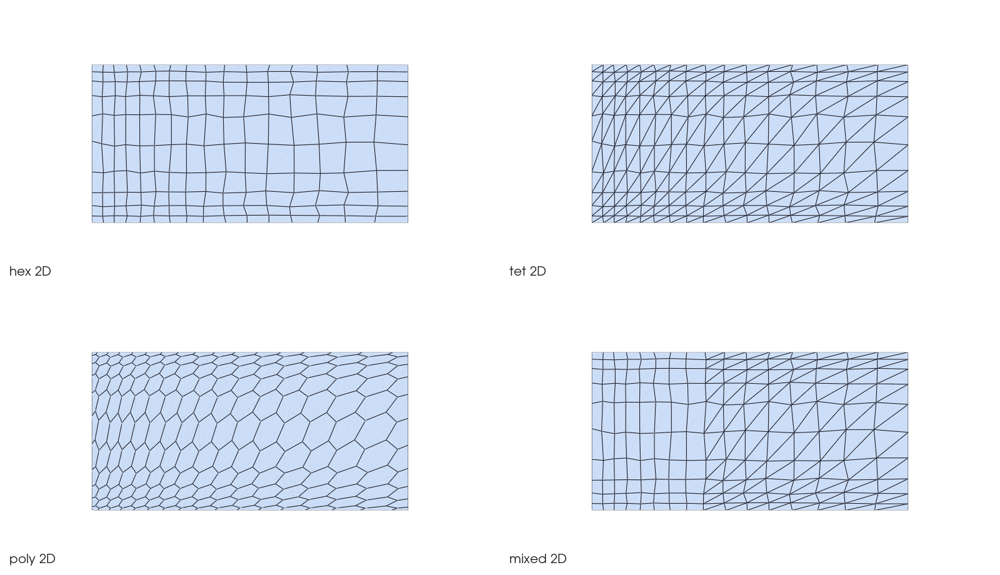
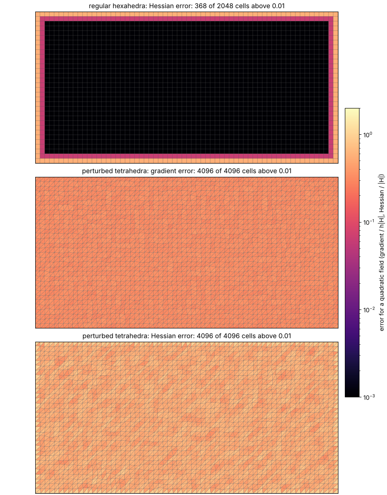
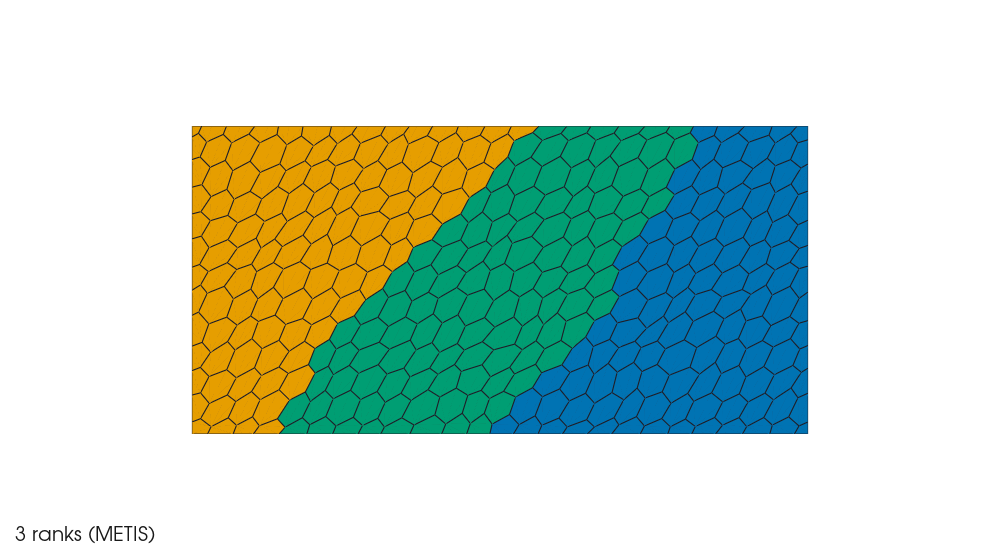
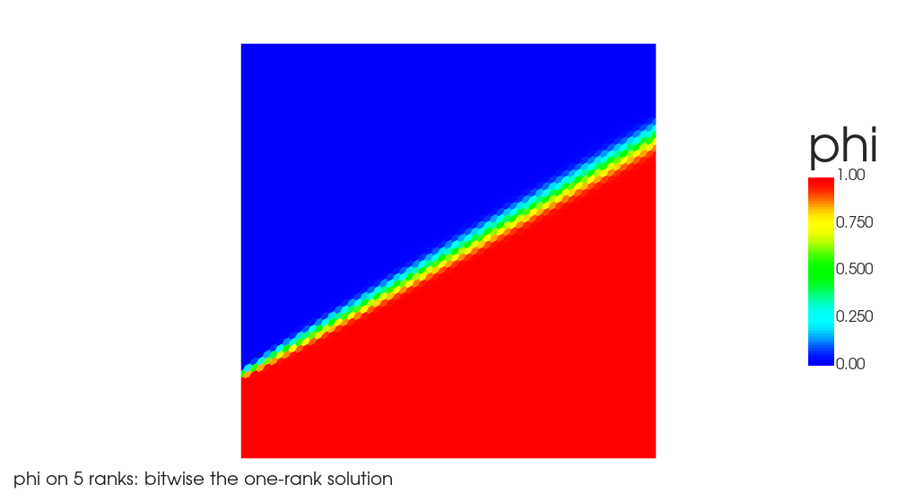
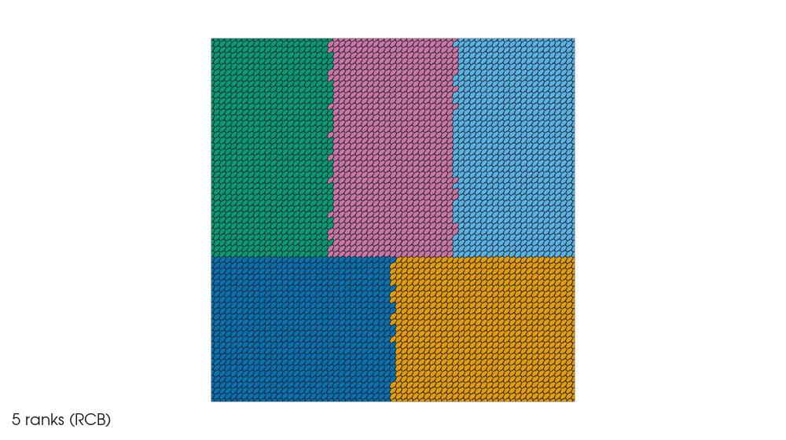
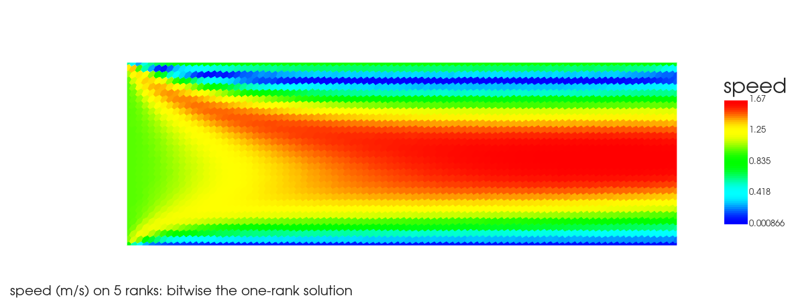
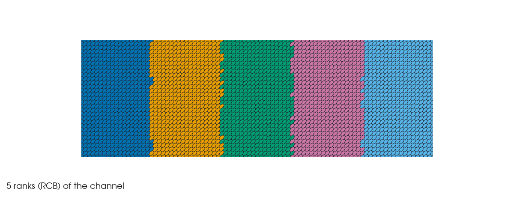
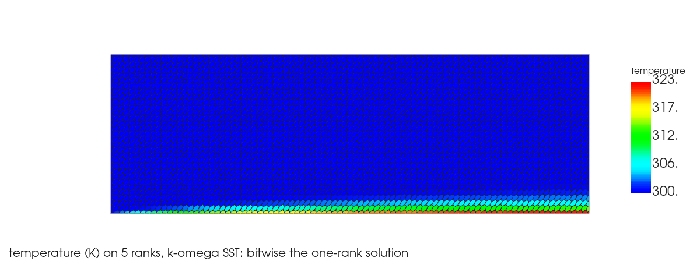
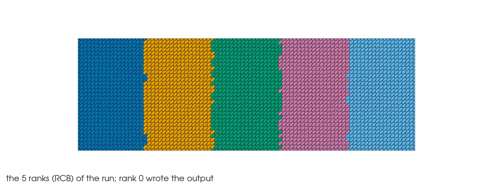

# Meshes

Part of the [Example gallery](../gallery.md): the built-in test mesher in 2D and 3D, partitioning, the Gmsh and SU2 readers and flow on poor Gmsh meshes.

| # | Example | Stage | Feature |
|---|---|---|---|
| 3 | [The four test-mesh types in 3D](#mesh-types-3d) | 1 | built-in mesher, grading, perturbation, quality report |
| 4 | [A polyhedral mesh in four parts](#poly-partition) | 1 | partitioning, halo layout, point location |
| 5 | [The four test-mesh types in 2D](#mesh-types-2d) | 1 | one-cell-thick 2D meshes, boundary renaming |
| 6 | [T-junction from Gmsh](#tjunction) | 1 | Gmsh reader, conversion to polyhedra, renumbering |
| 26 | [Flow on raw Gmsh tetrahedra: the cell-quality remediation](#skewed-tets) | 6 | skewed faces, Gauss pressure gradient, limiter, divergence report (D50, D63) |
| 127 | [A PyAero airfoil mesh from an SU2 file](#su2-airfoil) | 6 | SU2 reader, mesh-format layer, 2D files extruded one layer, markers as boundaries (D187) |
| 129 | [A polyhedral mesh from OpenFOAM and CGNS](#foam-cgns-polyhedra) | 6 | OpenFOAM and CGNS readers, polyhedral cells, one mesh through two formats (D188) |
| 134 | [One polyhedral mesh through five formats](#five-formats) | 6 | Fluent .msh and VTK readers, VTU writer, the same mesh as OpenFOAM, CGNS, .msh and VTU (D191, D192) |
| 138 | [Taylor–Couette sliding case from a two-zone SU2 file](#su2-zones) | 6 | multi-zone SU2 and CGNS, rotor and stator as cell zones, interface boundaries, `[[sliding]]` (D195) |
| 189 | [Which cells can the curvature correction and the QCR trust? The operator check](#operator-check) | 6 | gradient and Hessian on test fields, `MESH004`–`MESH006`, `LIM008`, `operators.csv` (D236) |
| 200 | [Three ranks, the bits of one: the canonical local mesh](#canonical-ranks) | 8 | flipped faces, cell faces in global order, `foehn mesh` check per rank (MPI step W1, D93) |
| 219 | [Sums that do not care how many ranks there are: exact reductions](#exact-reductions) | 8 | exact accumulator, sums over ranks bitwise one rank, the old rank-order sum for comparison (MPI step W2, D31, D93) |
| 230 | [Five ranks, one solution: the scalar solver on ranks](#scalar-ranks) | 8 | faces in global orientation, halo exchange before every read across a face, the whole scalar solver bitwise one rank (MPI step W3, D93) |
| 231 | [Five ranks, one hierarchy: multigrid on ranks](#multigrid-ranks) | 8 | replicated multigrid setup, distributed V-cycle with a halo exchange per level, CG + multigrid bitwise one rank (MPI step W4, D93) |
| 234 | [Five ranks, one flow: SIMPLEC on ranks](#flow-ranks) | 8 | the flow device on a local mesh, halo exchange after every kernel that writes cells, exact sums, steady SIMPLEC bitwise one rank (MPI step W5, D93) |
| 244 | [Five ranks, one turbulent heated flow: models on ranks](#flow-models-ranks) | 8 | k-ω SST, k-ε, energy, passive scalars, transient PISO and the coupled solver on ranks, every field bitwise one rank (MPI step W5, D93) |
| 262 | [Written on five ranks, read on any: restart files on ranks](#restart-ranks) | 8 | the restart gathered from the ranks has the bytes of the one-rank file; read on any rank count by global identity, the continuation bitwise one rank (MPI step W6, D84, D93) |
| 279 | [Solved on five ranks, written by one: a run on ranks](#run-ranks) | 8 | `foehn flow --ranks N`: every rank runs the loop, rank 0 writes; monitors, ledger, fields and restart from the gathered fields, every output file byte for byte one rank (MPI step W7, D84, D93) |

---

<a id="mesh-types-3d"></a>
## 3. The four test-mesh types in 3D


The built-in test mesher (D34) makes four mesh types of the same box
2 × 1 × 1: hexahedra, tetrahedra (six per hexahedron), polyhedra (the dual
of the tetrahedral mesh, one cell per node) and a mixed mesh of hexahedra,
prisms and tetrahedra, with polyhedra where a hexahedron meets the
triangles of its neighbours. All four are clustered towards the walls
y = 0 and y = 1 (middle-to-wall ratio 4) and have perturbed nodes (15 % of
the local interval), so the geometry is never trivially orthogonal. Every
run writes the quality report (`mesh_report.md` and `.json`): closure of
every cell, total volume against the enclosed volume, non-orthogonality,
skewness, face warp, aspect and volume ratio, inverted faces and negative
volumes. All four meshes have the exact volume 2 and closure below 1e-15.

| | |
|---|---|
| Meshes | hex 576, tet 3 456, poly 819, mixed 1 728 cells |
| Case files | `mesh/hex_box.toml`, `mesh/tet_box.toml`, `mesh/poly_box.toml`, `mesh/mixed_box.toml` |

```
cargo build --release -p foehncraft-cli
for t in hex tet poly mixed; do
  target/release/foehn mesh examples/cases/mesh/${t}_box.toml
done
# output/<case>/mesh_report.md, mesh_report.json, mesh.vtkhdf (open in ParaView)
python3 -m tools.mesh.render_mesh output/poly_box/mesh.vtkhdf poly_box.png --cut
```

[↑ back to top](#meshes)

---

<a id="poly-partition"></a>
## 4. A polyhedral mesh in four parts


A polyhedral mesh of the unit cube (2 197 cells, nodes perturbed by 20 %)
split into four parts with METIS (D32), one colour per rank. Each part is
laid out as solver ranks will see it: inner cells, then cells touching the
halo, then the halo cells by source rank, each group in reverse
Cuthill-McKee order; faces inner, processor, then boundary by boundary. The
report lists the cells, halo cells, processor faces and neighbours of each
rank (imbalance 1.001, 1 230 cut faces). The point-location test of D47
throws 5 000 random points and finds each one by walking from a random cell
through the faces; all 5 000 are found in the right cell.

| | |
|---|---|
| Mesh | poly, 12 × 12 × 12 base grid, 2 197 cells |
| Case file | `mesh/poly_partition.toml` |

```
target/release/foehn mesh examples/cases/mesh/poly_partition.toml
target/release/foehn mesh examples/cases/mesh/poly_partition.toml --method rcb --parts 6
python3 -m tools.mesh.render_mesh output/poly_partition/mesh.vtkhdf part.png --cut --field rank --categorical
```

[↑ back to top](#meshes)

---

<a id="mesh-types-2d"></a>
## 5. The four test-mesh types in 2D



2D meshes are one cell thick in z (D3): quadrilaterals become hexahedra,
triangles become prisms, polygons become prismatic polyhedra. The mixed
mesh combines both. Clustering towards x = 0 and towards the walls, nodes
perturbed in x and y. The case files rename the generator's boundaries
(`xmin` to `inlet` and so on) with a `[mesh.boundaries]` table; `zmin` and
`zmax` take the symmetry condition in a 2D case.

| | |
|---|---|
| Meshes | hex 160, tet 320, poly 187, mixed 240 cells |
| Case files | `mesh/hex_2d.toml`, `mesh/tet_2d.toml`, `mesh/poly_2d.toml`, `mesh/mixed_2d.toml` |

```
for t in hex tet poly mixed; do
  target/release/foehn mesh examples/cases/mesh/${t}_2d.toml
done
python3 -m tools.mesh.render_mesh output/poly_2d/mesh.vtkhdf poly_2d.png --top
```

[↑ back to top](#meshes)

---

<a id="tjunction"></a>
## 6. T-junction from Gmsh


The T-junction mixer of stage 7 (D45) meshed with Gmsh
(`examples/meshes/tjunction.geo`, main pipe 100 mm diameter, branch 50 mm)
and read by the Gmsh v4 reader (D33). Physical groups become boundaries
(`inlet_main`, `inlet_branch`, `outlet`, `wall`) and the cell zone `fluid`.
The second case converts the 77 776 tetrahedra into 15 927 polyhedra, one
per node; on the curved wall the boundary faces follow the triangles of
the tetrahedral mesh, so both meshes have the same volume to the last
digit (8.310580753620e-3 m³). Both are renumbered by reverse
Cuthill-McKee and split into four parts. The point-location walk stops at
the curved, non-convex wall for some points (176 of 1 195); the bin search
finds those, none lands in a wrong cell.

| | |
|---|---|
| Meshes | tet 77 776 cells, poly 15 927 cells (7 to 23 faces, mean 15) |
| Case files | `mesh/tjunction_tet.toml`, `mesh/tjunction_poly.toml` |

```
gmsh -3 examples/meshes/tjunction.geo -format msh41 -o examples/meshes/tjunction.msh
target/release/foehn mesh examples/cases/mesh/tjunction_tet.toml
target/release/foehn mesh examples/cases/mesh/tjunction_poly.toml
python3 -m tools.mesh.render_mesh output/tjunction_poly/mesh.vtkhdf tj.png \
    --field rank --categorical --half --top --crop 0.2 0.8 -0.06 0.31
```

[↑ back to top](#meshes)

---

<a id="skewed-tets"></a>
## 26. Flow on raw Gmsh tetrahedra: the cell-quality remediation


Gmsh's tetrahedra without its optimisation pass contain faces of a
skewness above 0.9: the face centroid lies almost as far from the line
through the two cell centroids as the centroids lie apart, mostly in
tetrahedra with two faces on a curved wall. On such faces the
least-squares pressure gradient (in the momentum source, the Rhie–Chow
flux and the wall pressure) drives the steady SIMPLEC iteration away
from the solution. The pipe of `examples/meshes/pipe_gmsh_raw.geo`
(D = 0.1 m, L = 1 m, Re = 100, 1 572 tetrahedra, 28 faces above 0.9, the
largest 1.23) shows it: with `solver.remediation = "off"` the residuals
stall at 0.1, and in iteration 91 the pressure-correction matrix stops
being positive definite. The divergence report (D63) names the skewed
faces as the first cause (`DIV003`) with the fix
`solver.remediation="auto"`.

With the default `solver.remediation = "auto"` the solver measures the
faces at start-up, reports them (`MESH001`), switches to the Gauss
pressure gradient (the face sum of the face pressures, with the boundary
pressures) and the Venkatakrishnan limiter on the velocity gradients, says
so (`MESH002`, `flow.log`, `flow.md`) and converges in 148 iterations (105 before the bounded face velocity of
2026-11-20, the run of the chart):

```
mesh quality: 28 faces with skewness above 0.9 (largest 1.233) in 44 cells; an optimised mesh avoids them (Gmsh: Mesh.OptimizeNetgen = 1)
cell-quality remediation (D50, solver.remediation = "auto"): solver.pressure_gradient: "least-squares" -> "gauss", solver.momentum.limiter: "none" -> "venkatakrishnan", solver.face_velocity: "interpolated" -> "bounded"
```

**Bounded face velocity (2026-11-20).** Turbulent MRF runs on raw Gmsh
tetrahedra (the stirred tank of the Engineering Gallery) still diverged
with the Gauss gradient and the limiter: the velocity in a few cells at
the blade–hub corner grew about twofold every 50 iterations until the
torque ran away. The growing term is the face velocity of the Rhie–Chow
flux, w u_P + (1 − w) u_N + ∇ū_f·(x_f − x_w): on a skewed face the shift
x_f − x_w is as long as the centroid distance, and the unlimited
gradients feed a velocity mode back into continuity with a gain above
one. The remediation now takes the mean of the two limited
extrapolations, w (u_P + ψ_P ∇u_P·r_P) + (1 − w)(u_N + ψ_N ∇u_N·r_N),
which is just as exact for a linear field and stays between the values
the two cells see (`solver.face_velocity = "bounded"`). On the ungraded
58k-cell tank this removes the blow-up (stable past iteration 500, torque
−1.03 N·m; before: runaway from iteration 330). A coarser version of the
tank (about 36k tetrahedra, faces up to skewness 1.3) is the test case:
`python3 examples/studies/skewed_tets.py` meshes it and runs both face
velocities for 300 iterations, a few minutes each:

```
iteration | bounded: residual     torque | interpolated: residual     torque
      100 |          1.20e-02      -1.13 |               1.18e-02      -1.09
      200 |          4.08e-03      -1.09 |               7.71e-02      -1.13
      300 |          1.73e-03      -1.11 |               1.23e-01       -177
```

The switch is global, not per cell: treating only the cells at the
skewed faces (first-order convection, a Gauss gradient or a damped
correction there) did not converge on these meshes, because the error of
the pressure gradient travels with the pressure correction through the
whole domain. The Gauss pressure gradient keeps second order on
tetrahedra (observed 2.00 on the Poiseuille sweep), but it is less
accurate than least squares on smooth meshes (the lift of the cylinder
at Re = 20 is 3.5 % lower), so it stays a remedy for poor meshes and
least squares the default. A mesh without faces above
`solver.skewness_limit` (0.9) runs bitwise as before; none of the
catalogue cases has such faces.

The better cure is the mesh: `Mesh.OptimizeNetgen = 1` in the .geo file
(as in `examples/meshes/tjunction_netgen.geo`) removes the skewed faces.
The T-junction of gallery 6 has 461 faces above 0.9 in Gmsh's raw mesh
and none after the Netgen pass; a laminar run on the raw mesh diverged
without the remediation and converges with it, and the optimised mesh
runs unchanged.

| | |
|---|---|
| Mesh | `examples/meshes/pipe_gmsh_raw.msh`, 1 572 tetrahedra (in the repository) |
| Case file | `flow/pipe_gmsh_raw.toml` |
| Keys | `solver.remediation`, `solver.skewness_limit`, `solver.pressure_gradient`, `solver.face_velocity`, `solver.transposed_stress` |

```
cargo build --release -p foehncraft-cli
target/release/foehn flow examples/cases/flow/pipe_gmsh_raw.toml --set solver.log_every=1
target/release/foehn flow examples/cases/flow/pipe_gmsh_raw.toml --set solver.remediation=off \
    --set solver.log_every=1 --out output/pipe_gmsh_raw_off
python3 -m tools.plot.residuals_chart pipe_gmsh_raw_residuals.svg \
    "output/pipe_gmsh_raw_off=remediation off" "output/pipe_gmsh_raw=remediation auto"
```

[↑ back to top](#meshes)

---

<a id="su2-airfoil"></a>
## 127. A PyAero airfoil mesh from an SU2 file


A NACA 0012 C-mesh made by [PyAero](https://github.com/chiefenne/PyAero)
in batch mode (27 297 quadrilaterals, orthogonal near the wall, a blunt
trailing edge of 0.4 % chord with its own block) and written in the SU2
format. Foehncraft reads it through the mesh-format layer (D187): the file
is 2D (`NDIME= 2`), so the reader extrudes it one cell layer in z, the
quadrilaterals become hexahedra and the planes the boundaries `zmin` and
`zmax`; the five markers `airfoil`, `inlet`, `outlet`, `top` and `bottom`
become boundaries by their names. The quality report finds the mesh valid
(every cell closed to 1e-16, the volume equal to the volume the boundary
encloses to 4e-16, non-orthogonality at most 35°, skewness at most 0.14).
The flow is laminar at Re = 1000 and 4° angle of attack (U = 1 m/s,
chord 1 m, ν = 1e-3 m²/s); the coupled solver converges in 56 iterations
and 10 s on four cores, with C_D = 0.128 and C_L = 0.209 (along and across
the free stream). The repository holds a coarser PyAero mesh of the same
airfoil (6 420 cells, `examples/meshes/naca0012.su2`) that the case file
uses and CI runs in about a second: C_D = 0.128, C_L = 0.213. The far field
is only 3.5 chords above and below the airfoil, so the run shows the
reader, not a validated lift.

| | |
|---|---|
| Meshes | PyAero: 27 297 hexahedra after the extrusion (pictures), 6 420 in the repository (case, CI) |
| Case files | `mesh/naca0012_su2.toml`, `flow/naca0012_su2_re1000.toml` |
| PyAero control files | `examples/meshes/naca0012_pyaero_fine.json` (pictures), `naca0012_pyaero.json` (the mesh in the repository) |

```
# in a PyAero clone (https://github.com/chiefenne/PyAero):
python src/PyAero.py -no-gui /path/to/Foehncraft/examples/meshes/naca0012_pyaero_fine.json
cp data/OUTPUT/NACA0012.su2 /path/to/Foehncraft/examples/meshes/naca0012_fine.su2
# in Foehncraft:
target/release/foehn mesh examples/meshes/naca0012_fine.su2
target/release/foehn flow examples/cases/flow/naca0012_su2_re1000.toml \
    --set mesh.file=../../meshes/naca0012_fine.su2 --out output/naca0012_fine
python3 -m tools.mesh.render_mesh output/naca0012_fine/fields.vtkhdf speed.png \
    --field speed --top --crop -1.2 3.5 -1.5 1.5 --no-edges --size 1200x600 --zoom 2.3
python3 -m tools.mesh.render_mesh output/naca0012_fine/fields.vtkhdf vorticity.png \
    --field vorticity_z --diverging --range -20 20 --top --crop -1.2 3.5 -1.5 1.5 \
    --no-edges --size 1200x600 --zoom 2.3
python3 -m tools.mesh.render_mesh output/naca0012_fine/fields.vtkhdf mesh.png \
    --top --crop -0.4 1.6 -0.6 0.6 --size 1200x600 --zoom 2.0
```

<a id="foam-cgns-polyhedra"></a>
## 129. A polyhedral mesh from OpenFOAM and CGNS

The dual of a tetrahedral unit cube (OpenFOAM's `polyDualMesh`, 81
polyhedral cells with 9 to 48 faces each) is read from the OpenFOAM
`polyMesh` directory and from a CGNS file of the same mesh (NGON_n faces and
NFACE_n cells, HDF5). Both readers give the same 81 cells and the same six
boundaries `xmin` to `zmax` with 40 faces each; the quality report finds the
mesh valid (volume 1 and the volume enclosed by the boundary equal to
4e-16, every boundary of area 1). The same two readers take hexahedral,
tetrahedral and prism meshes: the repository holds Gmsh CGNS files of a unit
cube in each type, and an OpenFOAM channel in ASCII and in binary that reads
alike.

```
target/release/foehn mesh crates/foehncraft-mesh/tests/data/openfoam/dual_polyhedra
target/release/foehn mesh crates/foehncraft-mesh/tests/data/cgns/dual_ngon.cgns
```

| | |
|---|---|
| Meshes | `crates/foehncraft-mesh/tests/data/openfoam/{channel_ascii,channel_binary,dual_polyhedra}`, `.../cgns/{box_hex,box_tet,box_prism,dual_ngon}.cgns` |
| Made by | OpenFOAM utilities and Gmsh; `tools/mesh/cgns_test_meshes.py`, `tools/mesh/cgns_ngon_fixture.py`, `tools/mesh/openfoam_test_meshes.md` |
| Recipe | [recipe 129](../recipes/meshes.md#mesh-cgns-openfoam) |

<a id="five-formats"></a>
## 134. One polyhedral mesh through five formats

The dual of a tetrahedral unit cube (81 polyhedral cells, 582 faces, made by
OpenFOAM's `polyDualMesh`) exists in the repository as an OpenFOAM
`polyMesh` (gallery 129), as a CGNS NGON/NFACE file, as a Fluent `.msh`
(`tests/data/fluent_msh/dual_polyhedra.msh`, and its binary
double-precision form `dual_polyhedra_binary.msh`) and, written by Foehncraft
itself, as a VTK XML grid. Every reader gives the same 81 cells, the same
six boundaries `xmin` to `zmax` of area 1 and the volume 1 (4e-16 closed);
a `.vtu` written with `output.vtu` reads back with the same names. A mixed
Gmsh mesh of hexahedra and wedges converted by an independent tool to
legacy ASCII, legacy binary, XML ASCII, XML base64 and zlib-compressed XML
reads as the mesh of the Gmsh file in all five encodings.

```
target/release/foehn mesh crates/foehncraft-mesh/tests/data/fluent_msh/dual_polyhedra.msh --vtu
target/release/foehn mesh output/dual_polyhedra/mesh.vtu
```

| | |
|---|---|
| Meshes | `crates/foehncraft-mesh/tests/data/fluent_msh/*.msh`, `.../vtk/channel_mixed_*.{vtk,vtu}` |
| Made by | `tools/mesh/fluent_msh_fixtures.py` (from the OpenFOAM fixtures), `tools/mesh/vtk_test_meshes.py` (meshio, generator only) |
| Recipe | [recipe 134](../recipes/meshes.md#mesh-msh-vtk) |

[↑ back to top](#meshes)

<a id="su2-zones"></a>
## 138. Taylor–Couette sliding case from a two-zone SU2 file

The gap between two coaxial cylinders, written the way a mesher writes a
machine: an SU2 file with two zones, the rotor (radius 0.05 to 0.075 m, 32
sectors) and the stator (0.075 to 0.10 m, 48 sectors), no shared nodes and an
interface that does not match. The reader puts both zones in one mesh (cell
zones `zone1` and `zone2`), the markers `rotor_interface` and
`stator_interface` are the two boundaries, and the sliding interface imprints
them at the rotor angle in every step, as in the generated case of the
imprinting study (same flow, Re = 50, same check against the analytic
Taylor–Couette solution). The run takes 4 s on 640 cells: the relative L2
error of the velocity is 1.3e-2 against the band of 3e-2.

```
target/release/foehn flow examples/cases/flow/taylor_couette_su2_zones.toml
```

| | |
|---|---|
| Case | `examples/cases/flow/taylor_couette_su2_zones.toml` |
| Mesh | `examples/meshes/taylor_couette_zones.su2`, made by `tools/mesh/taylor_couette_zones.py` |
| Recipe | [recipe 138](../recipes/meshes.md#mesh-multizone) |

[↑ back to top](#meshes)

---

<a id="operator-check"></a>
## 189. Which cells can the curvature correction and the QCR trust? The operator check



**What is checked.** Before the solve the run applies its velocity
gradient (least squares over the face neighbours, D24) and the gradient
of that gradient (the velocity Hessian behind DS_ij/Dt of the curvature
correction) to linear and quadratic test fields on its own mesh. The
gradient must be exact for a linear field on every cell; where it is also
exact for a quadratic field it is second order, and only there do the
operators that differentiate it once more (the divergence of the explicit
QCR stress, DS_ij/Dt) converge with the mesh. The errors per cell are
dimensionless: the gradient error over h |H| (h the longest stencil
distance), the Hessian error over |H|.

**Results.** On regular hexahedra (top) both operators are exact inside;
the cells at the walls have one-sided stencils, so the gradient is first
order in one layer and the Hessian in two. On tetrahedra with perturbed
vertices (middle, bottom) every cell is flagged: gradient errors of 0.2 to
0.4, Hessian errors near one. This is the reason why the curvature
correction and the QCR did not converge on tetrahedra in the manufactured
solutions of #184 (gallery 184). The run reports it before it starts:
`MESH005` (curvature correction) and `MESH006` (QCR) with the count and the
worst cells, `LIM008` in `result.json`, the 50 worst cells per operator in
`flow.json` and `foehn flow --check`, and the errors of every cell in
`operators.csv`. Nothing is reported where every operator the run uses is
exact, and the check changes no result. The next steps of D236 treat the
flagged cells (a quadratic least-squares fit over the neighbours of the
neighbours for the QCR gradient and the Hessian, then a local remesh of
the cells still flagged).

| | |
|---|---|
| Case file | `flow/cavity_sst_operator_check.toml` |
| Plot | `tools/plot/operator_check.py` |
| Recipe | [189](../recipes/meshes.md#operator-check) |

```
F=examples/cases/flow/cavity_sst_operator_check.toml
target/release/foehn flow $F --out output/ops_tet --set output.vtkhdf=true
target/release/foehn flow $F --out output/ops_hex --set output.vtkhdf=true \
    --set mesh.generate.type=\"hex\" --set mesh.generate.perturb=0
python3 -m tools.plot.operator_check docs/figures/gallery/operator_check.png output/ops_hex output/ops_tet
```

[↑ back to top](#meshes)

---

<a id="canonical-ranks"></a>
## 200. Three ranks, the bits of one: the canonical local mesh



A perturbed 2D polyhedral mesh (325 cells) in three ranks with METIS and two
halo layers. A rank's part is renumbered for locality. In MPI step W1 a
face whose global owner had the higher local index, or was a halo cell, was
stored flipped (208, 194 and 284 faces on ranks 0, 1 and 2 of this case),
its geometry evaluated in the node order of the global mesh with the sign
of the area vector reversed (exact). Since MPI step W3 (gallery 230) every
face keeps its global orientation, so there are no flipped faces and the
`flipped_faces` field is 0; the asymmetric face formulas of the solver
(the owner weight w against 1 − w) need that. Every cell sums its faces in
global face order and halo cells take volume and centroid from their
owner. The report of the run checks every face and cell of every rank
against the one-rank mesh bit for bit: 0 faces and 0 cells differ (the run
fails otherwise). Before W1, 30 to 40 % of the faces and all off-diagonal
matrix rows differed in the last bits (the MPI spike, #192).

| | |
|---|---|
| Mesh | poly 2D, 24 × 12 base grid, 325 cells, nodes perturbed by 25 % |
| Ranks | 3 (METIS), imbalance 1.006, 50 cut faces, two halo layers |
| Case file | `mesh/canonical_ranks.toml` |

```
target/release/foehn mesh examples/cases/mesh/canonical_ranks.toml
python3 -m tools.mesh.render_mesh output/canonical_ranks/mesh.vtkhdf rank.png \
    --field rank --categorical --top --size 1000x560 --title "3 ranks (METIS)"
```

[↑ back to top](#meshes)

---

<a id="exact-reductions"></a>
## 219. Sums that do not care how many ranks there are: exact reductions


A perturbed polyhedral box (1 280 cells) split into 2 to 16 ranks with
METIS. Every rank sums its own cells and boundary faces: the domain volume
Σ V, its first moment Σ V x and the boundary area Σ |S|. Floating-point
addition is not associative, so the old sum (a pairwise sum per rank, the
rank sums then combined in rank order) lands 0 to 2 units in the last place
away from the one-rank value, and which way it moves changes with every rank
count (coloured lines). Since MPI step W2 each rank adds its terms without
rounding into a long accumulator (the whole binary64 range as a 2176-bit
integer, Kulisch 1971, Collange et al. 2015), the ranks add the integers
(one all-reduce of 71 numbers), and the result is rounded once: the same
bits on any number of ranks, threads and in any cell order (black line).
The CPU solvers' dot products and residual norms, the balances, mass flows
and torques use the same sums, so a residual history no longer depends on
how the mesh is cut. Cost: about 2.3 to 3.5 ns per value on one core
against 0.6 to 0.9 ns for the block sum, partly hidden by the threads; per
outer iteration +2 to +7 % on a cavity of 970 225 polyhedra and +18 to
+25 % on a 4 096-cell cavity, where the solver's dot products weigh most.

| | |
|---|---|
| Mesh | poly 3D, 16 × 10 × 8 base grid, 1 280 cells, nodes perturbed by 20 % |
| Ranks | 2 to 16 (METIS), one halo layer, held in one process |
| Case file | `mesh/exact_reductions.toml` |

```
F=examples/cases/mesh/exact_reductions.toml
for n in $(seq 2 16); do
    target/release/foehn mesh $F --parts $n --no-vtkhdf --locate 0 --out output/exact_reductions/p$n
done
python3 -m tools.plot.exact_reductions exact_reductions_ulps.png output/exact_reductions
```

[↑ back to top](#meshes)

---

<a id="scalar-ranks"></a>
## 230. Five ranks, one solution: the scalar solver on ranks





The oblique step of gallery 9 (nearly pure convection at 30°, linear upwind
with the Venkatakrishnan limiter at K = 0, non-orthogonal correction,
BiCGStab with Jacobi) on a perturbed 2D polygonal mesh of 4 225 cells,
solved once on all cells and then on 2, 3 and 5 ranks. Every rank works on
its part with one layer of halo cells: before the gradient it receives φ
of its halo cells from their owners, before the face coefficients their
gradient and limiter value, before every matrix product the vector, and
every dot product and extremum is the exact sum or extremum over all ranks
(W2). Processor faces are computed on both of their ranks from the same
inputs, in the orientation of the global mesh. All 67 outer iterations,
their residuals and linear iteration counts, and the final φ are bitwise
those of the one-rank run on every rank count; the run fails otherwise.
The ranks are threads of one process here, each with its own communicator;
the same solver runs across MPI processes in CI (`mpi_scalar`, 1 to 4
ranks).

| | |
|---|---|
| Mesh | poly 2D, 64 × 64 base grid, 4 225 cells, nodes perturbed by 10 % |
| Ranks | 2, 3, 5 (recursive coordinate bisection), one halo layer |
| Solver | linear upwind, Venkatakrishnan K = 0, BiCGStab + Jacobi, 67 outer iterations |
| Case file | `scalar/ranks_oblique_step_2d.toml` |

```
target/release/foehn scalar examples/cases/scalar/ranks_oblique_step_2d.toml
python3 -m tools.mesh.render_mesh output/ranks_oblique_step_2d/fields.vtkhdf phi.png \
    --field phi --range 0 1 --top --no-edges --size 1000x560 \
    --title "phi on 5 ranks: bitwise the one-rank solution"
python3 -m tools.mesh.render_mesh output/ranks_oblique_step_2d/fields.vtkhdf rank.png \
    --field rank --categorical --top --size 1000x560 --title "5 ranks (RCB)"
```

[↑ back to top](#meshes)

---

<a id="multigrid-ranks"></a>
## 231. Five ranks, one hierarchy: multigrid on ranks


The manufactured Poisson problem of gallery 11 on a perturbed polyhedral
box of 3 375 cells, solved with CG and the smoothed-aggregation multigrid
(Chebyshev smoother of degree 2, mixed precision, non-orthogonal
correction) once on all cells and then on 2, 3 and 5 ranks. Every rank
gathers the matrix in global order and builds the whole hierarchy, so the
aggregates are those of the one-rank run; then it keeps the rows it owns
on every level (a coarse row belongs to the owner of the first fine row of
its aggregate) and works out, without communicating, which entries it
sends to and receives from every other rank. The V-cycle smooths,
restricts and prolongs the own rows, exchanges the ghosts of a level
before each read and gathers the coarsest level to solve it on every
rank. Every row keeps its terms in global order, so all 21 outer
iterations, the 99 CG iterations and the final φ are bitwise those of one
rank; the run fails otherwise. The same check runs across MPI processes in
CI (`mpi_scalar`, 1 to 4 ranks), also for the reduction multigrid of the
coupled momentum sweep (D179) on a convection matrix.

| | |
|---|---|
| Mesh | poly 3D, 14 × 14 × 14 base grid, 3 375 cells, nodes perturbed by 15 % |
| Ranks | 2, 3, 5 (recursive coordinate bisection), one halo layer |
| Solver | CG + smoothed-aggregation multigrid, Chebyshev degree 2, mixed precision, 21 outer iterations |
| Case file | `scalar/ranks_poisson_amg_poly_box.toml` |

```
target/release/foehn scalar examples/cases/scalar/ranks_poisson_amg_poly_box.toml
python3 -m tools.mesh.render_mesh output/ranks_poisson_amg_poly_box/fields.vtkhdf phi.png \
    --field phi --cut --size 1000x620 \
    --title "phi on 5 ranks, CG + multigrid: bitwise the one-rank solution"
python3 -m tools.mesh.render_mesh output/ranks_poisson_amg_poly_box/fields.vtkhdf rank.png \
    --field rank --categorical --cut --size 1000x620 --title "5 ranks (RCB) of the polyhedral box"
```

[↑ back to top](#meshes)

---

<a id="flow-ranks"></a>
## 234. Five ranks, one flow: SIMPLEC on ranks





A channel three heights long on a perturbed polygonal mesh: uniform
inflow from the left at 1 m/s, a pressure outlet on the right, the lower
wall at rest and the upper wall moving at 1 m/s against the inflow, which
drags the fluid near it backwards (Re = 100 on the height). The flow
starts from potential flow and converges with steady SIMPLEC (linear
upwind with the Venkatakrishnan limiter) in 103 outer iterations; then
the run solves it again on 2, 3 and 5 ranks, every rank a thread of the
process with its own local mesh and halo exchange. The flow device keeps
each cell field as own plus halo cells, exchanges the halo after every
kernel that writes cells (gradients, limiters, momentum and pressure
rows, the velocity correction), sums residuals and norms over the own
cells exactly across ranks and solves the linear systems with the scalar
backend on ranks of W3 and W4. Decisions that every rank must take alike
(the pressure reference, the mesh skewness) are taken globally. Velocity,
pressure, pressure gradient, limiter and residual history of every rank
are bitwise those of one rank; the run fails otherwise. The same check
runs across MPI processes in CI (`mpi_flow`, 1 to 4 ranks) on polyhedra,
mixed cells and tetrahedra.

| | |
|---|---|
| Mesh | poly 2D, 90 × 30 base grid, 2 821 cells, nodes perturbed by 10 % |
| Ranks | 2, 3, 5 (recursive coordinate bisection), one halo layer |
| Solver | steady SIMPLEC, potential-flow start, 103 outer iterations to 10⁻⁶ |
| Case file | `flow/ranks_channel_poly.toml` |

```
target/release/foehn flow examples/cases/flow/ranks_channel_poly.toml
python3 -m tools.mesh.render_mesh output/ranks_channel_poly/ranks.vtkhdf speed.png \
    --field speed --top --size 1200x460 --zoom 1.9 \
    --title "speed (m/s) on 5 ranks: bitwise the one-rank solution"
python3 -m tools.mesh.render_mesh output/ranks_channel_poly/ranks.vtkhdf rank.png \
    --field rank --categorical --top --size 1200x460 --zoom 1.9 --title "5 ranks (RCB) of the channel"
```

[↑ back to top](#meshes)

---

<a id="flow-models-ranks"></a>
## 244. Five ranks, one turbulent heated flow: models on ranks




The channel of gallery 234, now turbulent and heated: air-like fluid at
300 K enters at 1 m/s (Re = 10 000 on the height), the lower wall is held
at 330 K, the upper wall is adiabatic. SIMPLEC with the k-ω SST model and
the energy equation converges from potential flow in 70 outer iterations;
the run then solves the case again on 2, 3 and 5 ranks, every rank a
thread of the process with its own halo exchange, and compares every
cell of every rank with one rank: velocity, pressure, pressure gradient,
limiter, temperature, k, ω and ν_t, and the residual history, bit for
bit. To get there the turbulence cell kernels and the wall functions run
on the own cells and exchange ν_t, F1 and the wall values; the wall
distance comes from the whole mesh (a part may hold no wall); the energy
refresh reads the halo temperatures at processor faces; and every
decision a rank would take from its own cells (the pseudo-time length
and speed of the coupled solver, the reuse of a multigrid hierarchy) is
an exact sum or a maximum over all ranks. The tests and the MPI job of CI
(`mpi_flow`, 1 to 4 ranks) check nine cases this way: steady SIMPLEC on
three cell types, transient PISO with BDF2, a passive scalar, the energy
equation in a transient run, k-ω SST, k-ε with scalable wall functions
and the coupled solver.

| | |
|---|---|
| Mesh | poly 2D, 90 × 30 base grid, 2 821 cells, nodes perturbed by 10 % |
| Ranks | 2, 3, 5 (recursive coordinate bisection), one halo layer |
| Physics | k-ω SST, energy equation (Pr = 0.71), lower wall 330 K, upper wall adiabatic |
| Solver | steady SIMPLEC, potential-flow start, 70 outer iterations to 10⁻⁵ |
| Case file | `flow/ranks_heated_channel_sst.toml` |

```
target/release/foehn flow examples/cases/flow/ranks_heated_channel_sst.toml
python3 -m tools.mesh.render_mesh output/ranks_heated_channel_sst/ranks.vtkhdf temperature.png \
    --field temperature --top --size 1200x460 --zoom 1.9 \
    --title "temperature (K) on 5 ranks, k-omega SST: bitwise the one-rank solution"
python3 -m tools.mesh.render_mesh output/ranks_heated_channel_sst/ranks.vtkhdf nut.png \
    --field nu_t --top --size 1200x460 --zoom 1.9 --title "turbulent viscosity nu_t (m2/s) on 5 ranks"
```

[↑ back to top](#meshes)

---

<a id="restart-ranks"></a>
## 262. Written on five ranks, read on any: restart files on ranks


The channel of gallery 234 (the upper wall moves against the inflow,
Re = 100), now marched in time: 40 steps of BDF2 from potential flow.
After the run it is solved again on 2, 3 and 5 ranks, and the five ranks
write their restart together: each rank sends its own cells, the faces
whose owner cell it holds, its boundary faces and the own rows of every
multigrid matrix, and the file is assembled in the order of the global
mesh. Its bytes are those of the restart that one rank writes at the
same step (`ranks.restart.h5`; the run fails otherwise). Reading goes the
other way on any rank count: every rank takes its cells and faces by
global identity and its matrix rows from the sliced-ELL storage of the
whole mesh, so the multigrid hierarchy is rebuilt from the same matrix
and the continuation is bitwise the run of one rank that was never
interrupted. The tests check this for nine cases (steady SIMPLEC on
polyhedra, mixed cells and tetrahedra, PISO with BDF2, a passive scalar,
energy, k-ω SST, k-ε and the coupled solver with its momentum
multigrid): written on 4 ranks and continued on 2, written on 2 and
continued on 3.

| | |
|---|---|
| Mesh | poly 2D, 90 × 30 base grid, 2 821 cells, nodes perturbed by 10 % |
| Ranks | 2, 3, 5 (recursive coordinate bisection), one halo layer |
| Solver | transient PISO, BDF2, Δt = 0.05 s, 40 steps from potential flow |
| Restart | gathered from 5 ranks, byte for byte the one-rank file |
| Case file | `flow/ranks_restart_channel.toml` |

```
target/release/foehn flow examples/cases/flow/ranks_restart_channel.toml
python3 -m tools.mesh.render_mesh output/ranks_restart_channel/ranks.vtkhdf speed.png \
    --field speed --top --size 1200x460 --zoom 1.9 \
    --title "speed (m/s) at t = 2 s on 5 ranks: restart file byte for byte one rank"
python3 -m tools.mesh.render_mesh output/ranks_restart_channel/ranks.vtkhdf rank.png \
    --field rank --categorical --top --size 1200x460 --zoom 1.9 --title "5 ranks (RCB) that wrote one restart file"
```

[↑ back to top](#meshes)

---

<a id="run-ranks"></a>
## 279. Solved on five ranks, written by one: a run on ranks




The channel of gallery 234 (the upper wall moves against the inflow,
Re = 100), solved to convergence on five ranks as the run itself, not as a
check after it: `[run] rank_count = 5` (or `--ranks 5`). Every rank runs the
loop of the case on its part with one halo layer. Rank 0 reads the
control files, signals and limits and hands its decision to the others,
so all ranks stop, write a restart or re-read the case at the same
iteration. Only rank 0 writes the log, `run.jsonl` and the output. What
the output reads (the log columns with the probe in the eddy and the
largest speed, the boundary mass flows and forces, the wall values, the
ledger every 25 iterations, `fields.vtkhdf`, `restart.h5`) is computed on
the fields of all ranks gathered into the order of the whole mesh, with
the discretisation of the whole mesh, by the code of one rank. So every
file is byte for byte the file that one rank writes: the run converges in
372 outer iterations on both, and `residuals.csv`, `balance.csv`,
`boundaries.csv`, the wall files, `fields.vtkhdf` and `restart.h5` are
identical. Only the timings, the rank count in the provenance and the
extra `ranks.vtkhdf` (the rank of every cell, the second image) differ.
The test does the same on 2, 3 and 4 ranks with a mesh perturbed by 30 %,
comparing the whole `result.json`.

| | |
|---|---|
| Mesh | poly 2D, 90 × 30 base grid, 2 821 cells, nodes perturbed by 10 % |
| Ranks | 5 (recursive coordinate bisection), threads of one process; or MPI processes under `mpirun` |
| Solver | steady SIMPLEC from potential flow, 372 outer iterations to 1e-7 |
| Output | every file byte for byte the run on one rank |
| Case file | `flow/ranks_run_channel.toml` |

```
target/release/foehn flow examples/cases/flow/ranks_run_channel.toml
python3 -m tools.mesh.render_mesh output/ranks_run_channel/fields.vtkhdf speed.png \
    --field speed --top --size 1200x460 --zoom 1.9 \
    --title "speed (m/s), steady, solved on 5 ranks: every output file byte for byte one rank"
python3 -m tools.mesh.render_mesh output/ranks_run_channel/ranks.vtkhdf rank.png \
    --field rank --categorical --top --size 1200x460 --zoom 1.9 \
    --title "the 5 ranks (RCB) of the run; rank 0 wrote the output"
```

[↑ back to top](#meshes)
