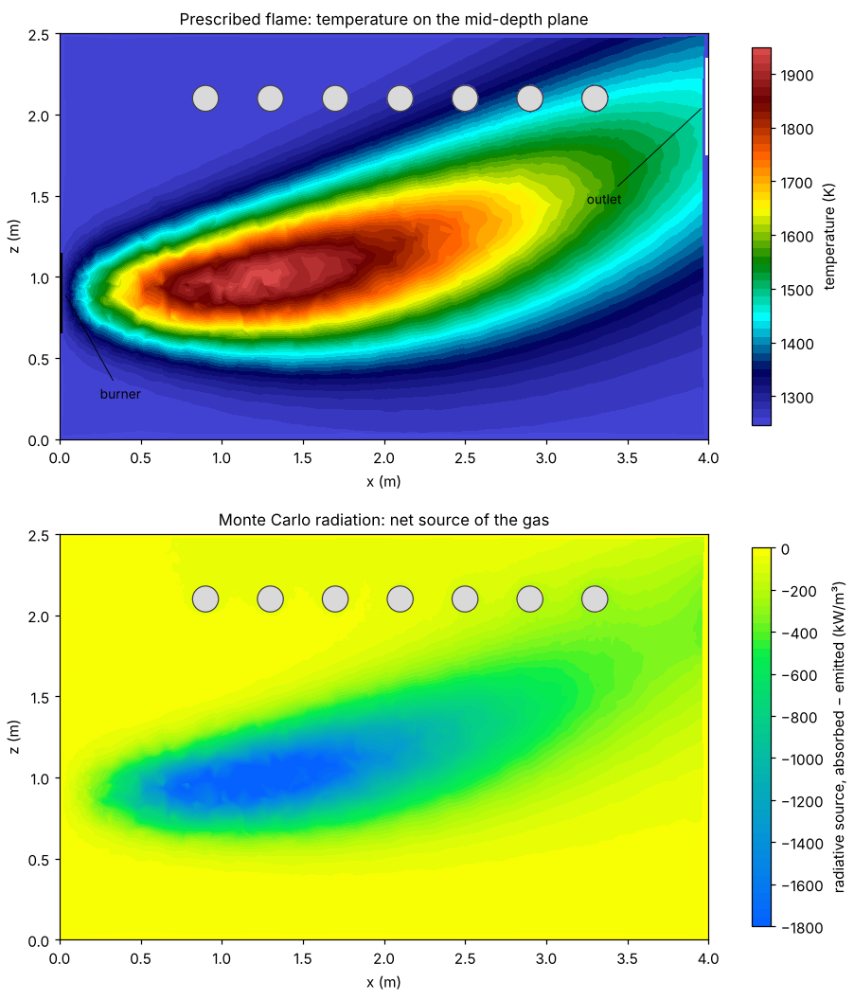
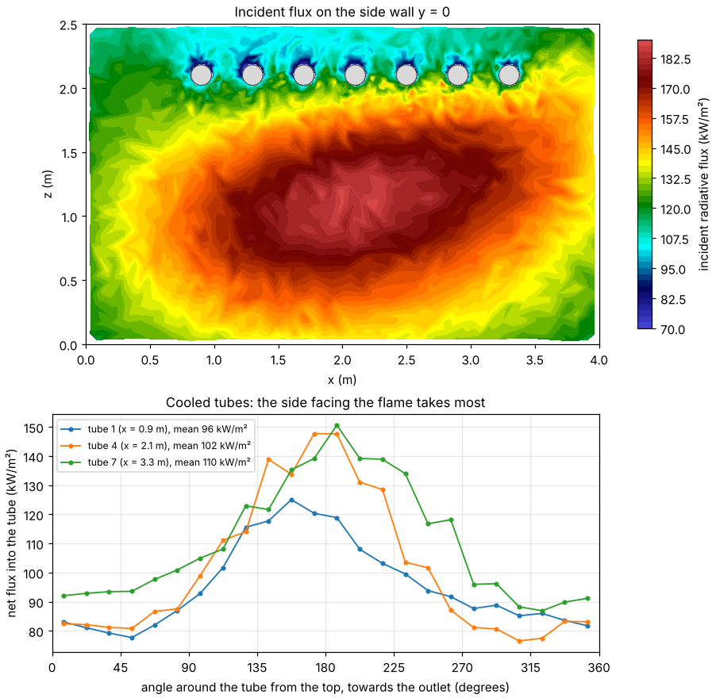

# Thermal radiation

Part of the [Example gallery](../gallery.md): thermal radiation by Monte Carlo transport of energy bundles (step 29, L15). R1a covers grey absorbing-emitting gas on a prescribed temperature field, grey diffuse walls, symmetry planes and open boundaries. Bundles follow the cell walk with exact path lengths per cell and carry integer tallies, so a call gives bitwise the same result on any number of threads and ranks and on the GPU (D255 to D259, D269). The specification is the [radiation page](../requirements/step29-radiation.md). The coupling to the energy equation and the `[radiation]` keys of the case file come with R1b.

| # | Example | Stage | Feature |
|---|---|---|---|
| 259 | [A box furnace with cooled tubes, and the cases with exact solutions](#furnace) | R1a | `foehncraft_radiation::Domain::solve`, `Settings::points`, `output::write_vtkhdf` |

---

<a id="furnace"></a>
## 259. A box furnace with cooled tubes, and the cases with exact solutions



**The furnace (D255).** `examples/meshes/furnace.py` builds the chamber
with Gmsh: 4 m long, 2 m deep and 2.5 m high, about 58 500 tetrahedra.
Seven tubes of 0.16 m diameter cross it under the roof, the burner is a
disc of 0.5 m in the front wall, and the flue gas leaves through an
opening under the roof of the back wall. The example `furnace` prescribes
the flame: the temperature peaks at 1 950 K about 1.2 m from the burner
and falls to the 1 250 K of the flue gas, and the absorption coefficient
(soot) rises from 0.3 1/m to 1.1 1/m in the core. The walls are grey
(ε = 0.75) at 1 150 K, the tubes grey (ε = 0.85) at 620 K, the burner
disc grey (ε = 0.8) at 1 100 K, and the opening is an open boundary.

With 16 million bundles the call takes about 5 minutes on 4 CPU threads.
Every bundle carries a whole number of quanta (the emitted power over
2⁵²), so the energy account closes exactly:

| Energy account | kW |
|---|---|
| emitted by the gas (4κσT⁴V) and the walls (εσT⁴A) | 10 243.2 |
| absorbed by the gas | 4 712.2 |
| absorbed by the walls, the tubes and the burner | 5 450.7 |
| escaped through the opening | 80.2 |
| removed by Russian roulette (net) | 0.001 |

| Boundary | Area (m²) | Incident (kW) | Net into the wall (kW) | Net (kW/m²) |
|---|---|---|---|---|
| tubes | 6.94 | 891.5 | 708.3 ± 0.5 | 102.0 |
| walls | 40.25 | 5 582.5 | 1 192.8 ± 1.1 | 29.6 |
| front wall | 4.80 | 640.9 | 123.3 ± 0.4 | 25.7 |
| burner | 0.20 | 31.7 | 12.4 ± 0.1 | 63.5 |
| opening (open) | 0.48 | 80.2 | – | – |



The tubes take 708 kW, about 102 kW/m² on average. The tubes
furthest downstream take the most (from 95 kW/m² on the second tube to 110 kW/m² on the seventh, as the flame leans up towards the outlet), and every tube takes most
on its underside, which faces the flame. The side wall sees the flame core
with up to 190 kW/m² and less under the tubes, which are cold and so send
little back.

**Verification (section 3 of the specification).** Every case runs in
`crates/foehncraft-radiation/tests/cases.rs` against an exact solution.
The statistical error σ is the batch-mean error of the call, which is
conservative because the scrambled Sobol points stratify all the bundles
of an emitter while the batches are only random subsets of them.

| Case | Exact solution | Result |
|---|---|---|
| 1. Isothermal grey slab between cold black plates, τ = 0.01 to 10 | wall flux σT⁴ (1 − 2 E₃(τ)), the source of every layer from E₂ | wall flux within 0.14 % for every τ; every layer source within 3σ |
| 2. Isothermal enclosure, black and grey walls | no net source, no net wall flux | mean \|source\| 1.6 to 2 % of the emission, mean z² 0.7 |
| 3. Transparent gas between opposed black plates | configuration factor of parallel rectangles (Howell's catalogue) | 0.19983 against 0.19982, and 0.50866 against 0.50899 |
| 4. Energy account, threads, ranks, GPU data path | emitted = absorbed + escaped + roulette, to the quantum | closes exactly; bitwise the same on 1, 2 and 4 threads, on 1 to 4 ranks (also with MPI in CI) and on the device path |
| 5. Cube of isothermal grey gas (κL = 1), cold black walls | flux into each wall face, the gas emission integrated over the five other walls (`exact::cube_wall_flux`, adaptive Gauss–Legendre to 1e-10) | 600 wall faces of 10³ hexahedra: mean z² 0.74, the largest \|z\| 3.2; every wall mean within 0.08 % on hexahedra and within 0.17 % on perturbed polyhedra |
| 6. Sobol against pseudo-random emission | cases 1 and 3 | below; at 512 000 bundles Sobol is 13 times (slab) and 8 times (plates) more accurate |


**Sobol against pseudo-random emission (case 6, the benchmark rule of
section 4).** The position and the direction of every bundle come from
one Owen-scrambled Sobol point per emitter (Burley 2020); a wall face
picks its triangle with the first coordinate and uses the rest of that
coordinate inside the triangle, so the position and the direction of a
wall bundle form one stratified point in four dimensions.
`Settings::points = Points::Random` gives the plain Monte Carlo estimate
with keyed pseudo-random numbers. Over 16 independent calls per point,
the error of the slab wall flux falls as N^-0.70 with the Sobol points
and as N^-0.52 with pseudo-random ones, and the error of the plate
exchange as N^-0.63 against N^-0.50. At 512 000 bundles the Sobol points
are 13 times (slab) and 8 times (plates) more accurate, which is the
accuracy of 180 and 60 times as many pseudo-random bundles.

**Speed.** On a cloud machine with 4 cores, one million bundles in the
furnace take 84 s on one thread, 44 s on two and 20 s on four, about
84 µs per bundle on one thread. A bundle there crosses the chamber
several times between the grey walls before Russian roulette ends it. On
MPI ranks with one thread each, the polyhedral case of the example
`mpi_radiation` (2 431 cells, one million bundles) takes 22.1 s on one
rank, 11.8 s on two and 6.2 s on four, with 1.8 million hand-overs
between the ranks, and the tallies are bitwise those of one rank. The
time on a GPU comes with the CPU = GPU check of the Colab notebook
`tools/notebooks/radiation_colab.ipynb`.

```
pip install gmsh matplotlib numpy
python3 examples/meshes/furnace.py --size 0.15 --out output/furnace.msh
cargo run --release -p foehncraft-radiation --example furnace -- \
    output/furnace.msh output/furnace 16000000
cargo run --release -p foehncraft-radiation --example sobol_study > output/sobol.csv
python3 -m tools.plot.radiation_furnace docs/figures/gallery output/furnace output/sobol.csv
cargo test --release -p foehncraft-radiation --test cases -- --nocapture
```

`output/furnace/furnace.vtkhdf` opens in ParaView with the source, its
error, the temperature and the absorption coefficient in the cells, and
the incident and net flux with its error on every boundary.

[↑ back to top](#thermal-radiation)
