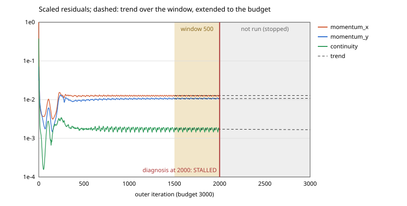
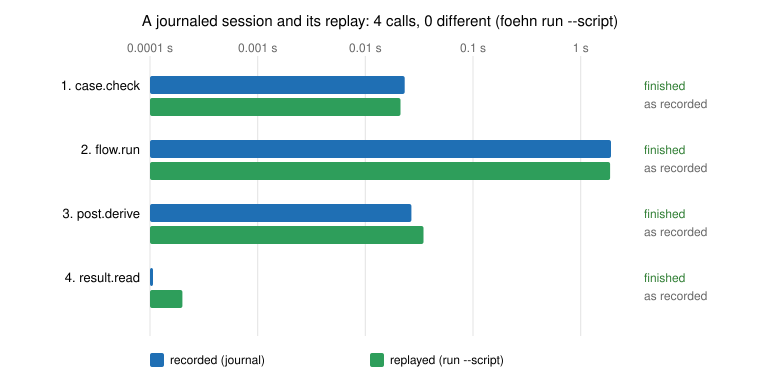
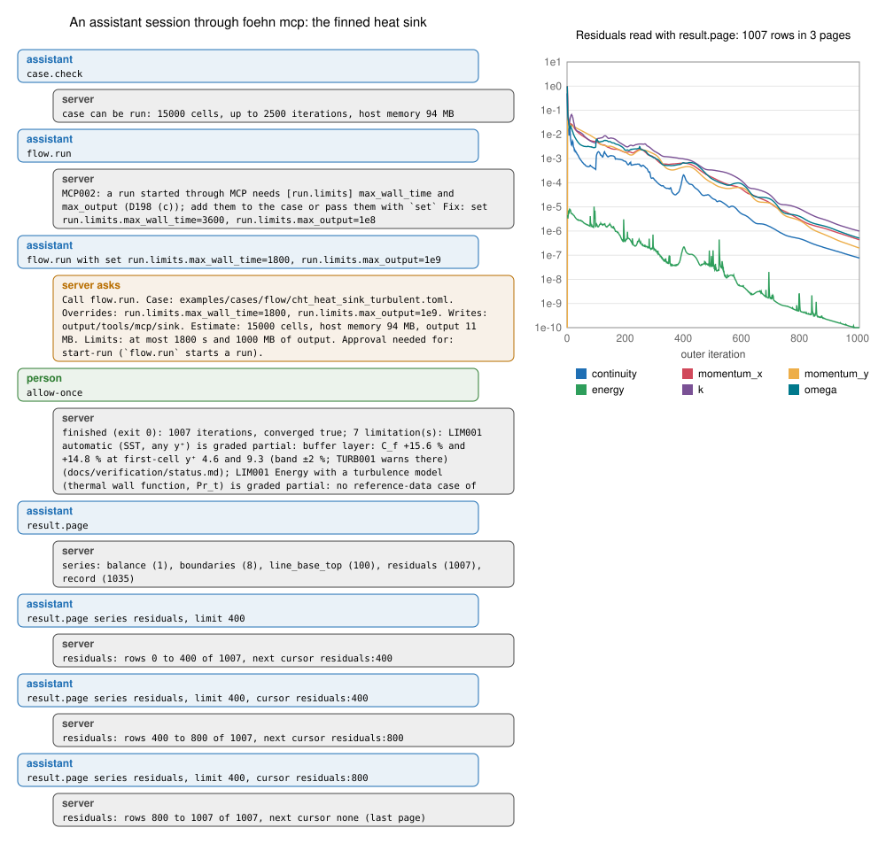
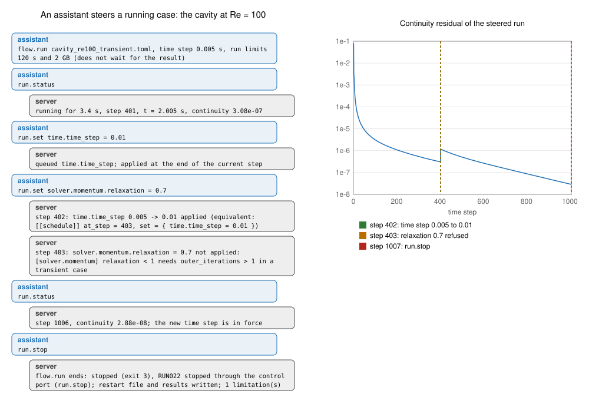
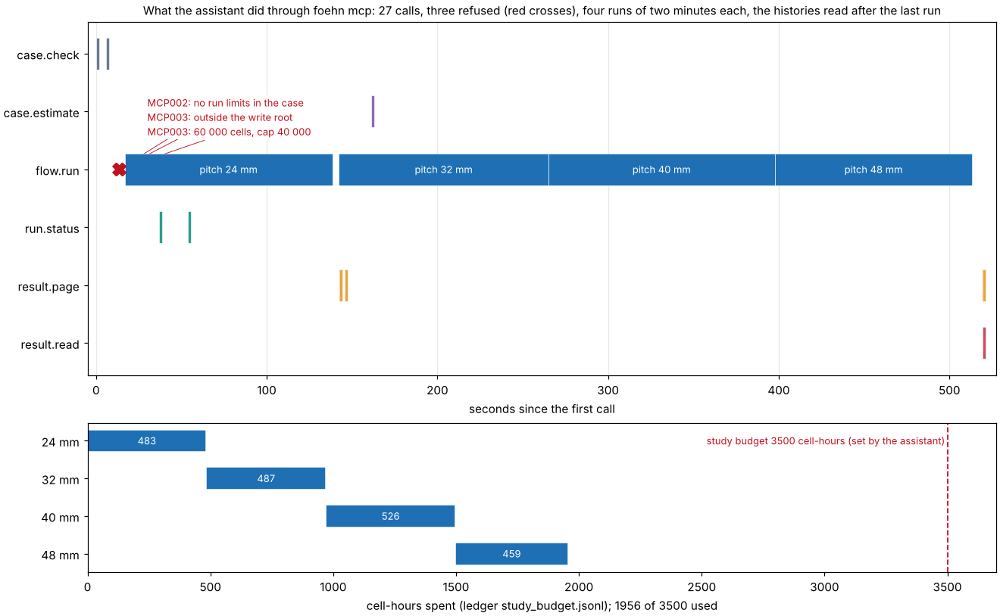
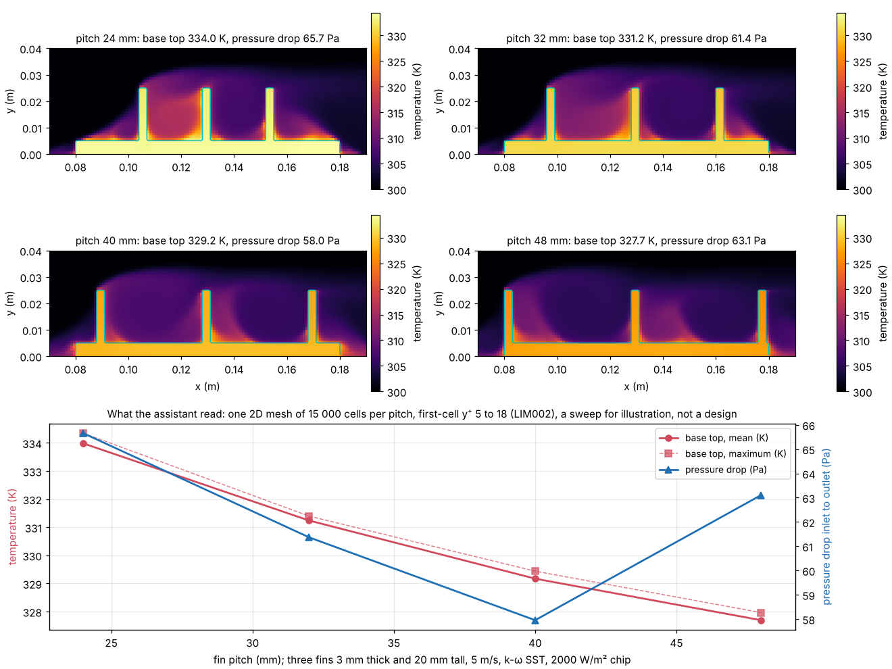
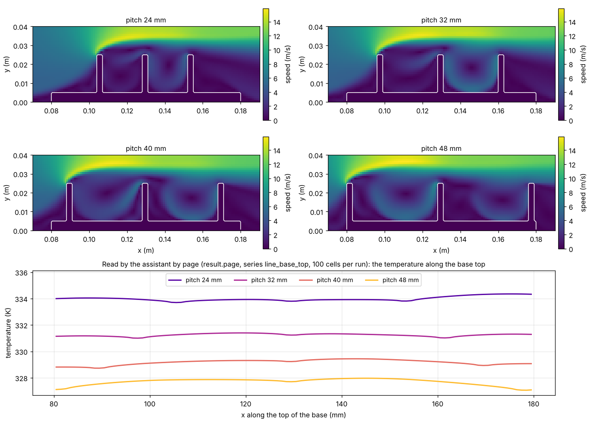

# Run control, health and adjoint readiness

Part of the [Example gallery](../gallery.md): adjoint-ready kernels, runs that a program drives, balances and the divergence report.

| # | Example | Stage | Feature |
|---|---|---|---|
| 17 | [Adjoint-ready kernels: derivatives and checkpointing](#adjoint-ready) | 5 | dual numbers through the kernel bodies, transposed matrices, binomial checkpointing |
| 18 | [A run that a program can drive](#run-contract) | 5 | `--json`, exit codes, `--set`, limits, signals, `--restart latest`, diagnostic codes, estimate before the run, byte-identical files |
| 19 | [Balances and the divergence report](#health) | 5 | mass and kinetic-energy ledger, numerical dissipation of the schemes (second law), divergence report with ranked causes |
| 27 | [A log that can be circulated](#log) | 5 | frames, blocks of settings, tables with headers, summaries, closing frame with exit code (D125) |
| 28 | [A table with the columns you choose](#log-columns) | 5 | `[log] columns`: probes, cells, extremes with their cells, boundary mass flow; the same content in `run.jsonl` (D125) |
| 29 | [Settings that change during the run](#schedule) | 5 | `[[schedule]]`: under-relaxation, tolerances and cadences change at prepared iterations, steps or times; every change in the log and in `run.jsonl` (D128) |
| 166 | [Iteration budget, diagnosis and study budgets](#budgets) | 7 | the iteration budget before the run, a steady run diagnosed at 2000 iterations (trend, verdict, advice, stop), cell-hour, GPU-hour and output budgets per study beside the D81 estimate (D198) |
| 171 | [Every function as a tool: the catalogue an agent reads](#tool-registry) | 7 | one registry of typed tools with ids, versions, JSON Schemas and action kinds; `foehn commands`, `foehn call`, `fc.call`; front ends checked by `cargo xtask layering` (D196, D203) |
| 172 | [A session that can be replayed: the journal of tool calls](#journal) | 7 | every tool call into a journal with its typed input, the call that started a run in `run.jsonl`, `foehn run --script` replays a journal or a run record and reports each call that ends otherwise (D197) |
| 175 | [An assistant at the controls: the MCP server](#mcp) | 7 | `foehn mcp`: every registry tool to an assistant over MCP, inside required roots, with an action table that allows, asks or refuses each kind of action, mandatory run limits, progress and cancellation, summaries first, histories paged by cursor, the session journaled for replay (L18, D198) |
| 177 | [An assistant steers a running case: the control port](#control-port) | 7 | a run listens on `127.0.0.1` with a token in a file only its user reads; `run.status` gives the live residuals, `run.set` changes run-time settings (never limits), `run.stop` stops with restart file and results; applied after an iteration or step, reported with the equivalent `[[schedule]]` entry (L19, D198 f) |
| 181 | [An assistant runs a study: the fin pitch of a heat sink](#heat-sink-study) | 7 | four fin pitches of the heat sink of gallery 158 run through `foehn mcp` by an assistant, under run limits and a study budget, with the refusals (no limits, a folder outside the write root, a mesh over the cell cap), live status, histories read in pages, a closing report with its limitations, and the journal a person replays (L18, L19, D197, D198) |
| 316 | [An assistant sizes a spray cooler from one question](#spray-cooler-chat) | 7 | one engineering question, answered through `foehn mcp`: the assistant writes the case and the nozzles, runs it, reads the outlet with `post.datums`, interpolates the water flow for 150 °C, checks it with a run, reports the hot layers at the walls and the limitations; the journal of the session (L18, D197, D198) |

---

<a id="adjoint-ready"></a>
## 17. Adjoint-ready kernels: derivatives and checkpointing


Preparation for a discrete adjoint solver (D59, L17). The kernel bodies are
generic over the floating-point type, so they also run on dual numbers and
return the exact derivatives of their results; matrices can be applied
transposed as a gather; and a transient run can be reversed with few
states in memory.

The chart shows the cost of reversing a transient run with binomial
checkpointing (Griewank & Walther 2000): with 20 snapshots, the reverse
sweep of 10 000 time steps runs each step 3.8 times on average and never
more than 4 times; with 40 snapshots, 100 000 steps cost 3.9 primal steps
each (values above 12 drawn at 12). The schedule is optimal: its count of
recomputed steps equals that of a dynamic program over all positions of
the snapshots.

| Check | Result |
|---|---|
| Jacobians of 11 face, cell and boundary kernels from dual numbers, every input array, against central differences | 320 580 derivatives, largest relative difference 5.0e-7 |
| Shape derivatives of areas, centroids and volumes from the node coordinates | 165 024 derivatives, 2.8e-7; total volume unchanged by interior nodes |
| ⟨Av, w⟩ = ⟨v, Aᵀw⟩ on the momentum and pressure matrices of a SIMPLEC solve | to 10⁻¹⁴; Aᵀ without storing it equals the stored Aᵀ bit for bit, on 1 and 4 threads |
| CG + multigrid and BiCGStab on Aᵀ | converged to 10⁻¹⁰ |
| Reverse sweep of 13 BDF2 steps with 2 snapshots | every level bitwise equal to the forward run, 24 primal steps (the optimum) |

| | |
|---|---|
| Code | `foehncraft_core::Dual`, `foehncraft_kernels::adjoint`, `foehncraft_flow::checkpoint`, `foehncraft_mesh::geometry` (generic over `Coord`) |
| Tests | `crates/foehncraft-flow/tests/adjoint.rs`, `crates/foehncraft-flow/src/adjoint_tests.rs`, `checkpoint.rs`, `geometry.rs` |
| Report | [stage 5, part 3](../verification/stage5.md#adjoint-ready-kernels-part-3) |

```
cargo test --release -p foehncraft-flow --test flow adjoint:: -- --nocapture   # Jacobians, one line per kernel
cargo test --release -p foehncraft-flow --lib -- adjoint_tests checkpoint   # transposed matrices, checkpointing
python3 -m tools.plot.checkpoint_chart checkpoint_steps.svg
```

[↑ back to top](#run-control-health-and-adjoint-readiness)

---

<a id="run-contract"></a>
## 18. A run that a program can drive


A parametric study, a batch job or an agent drives `foehn` without
reading its log: it sets keys with `--set`, reads one JSON object, acts on
the exit code and continues a stopped run with `--restart latest`. Before
it starts a run, `--check` tells it what the run will cost. The chart
shows that estimate against eleven runs of the catalogue, from 128 to
28 227 cells, hexahedra to polyhedra: peak memory within 6 %, field and
restart files within 9 %. The memory model is a base of 14 MB plus
1960 bytes per interior face and 710 per boundary face.

```
$ foehn --json flow cavity_re100_budget.toml --set run.limits.max_iterations=300; echo "exit $?"
{
  "format": "foehncraft.result",
  "format_version": "1.0",
  "status": "stopped",
  "exit_code": 3,
  "stop": { "code": "RUN004", "kind": "iterations", "message": "stopped at the limit of 300 outer iterations ([run.limits] max_iterations)" },
  ...
exit 3
$ foehn --json flow cavity_re100_budget.toml --restart latest; echo "exit $?"
  ...
  "status": "finished",
exit 0
```

| Check | Result |
|---|---|
| Stop at a limit or on SIGTERM, then `--restart latest` | fields and restart file bitwise equal to the run without the stop (steady and transient) |
| Two identical runs | `result.json`, `fields.vtkhdf`, `restart.h5` and every CSV byte for byte the same; only the log, the reports and `run.jsonl` (timings) differ |
| Exit codes | 0 finished, 1 error (as a JSON object with code and key), 2 failed check (`RUN006`, `RUN007`), 3 stopped (`RUN001`–`RUN005`) |
| A typo in the case file | `CASE002` with the key `mesh.generate.cels`, line 4, column 1 and "did you mean `cells`" |
| The 20 flow cases of the catalogue, this build against main | every field, CSV and JSON value bitwise equal; the resolved case gains the empty `[run.limits]` table |

| | |
|---|---|
| Code | `foehncraft_flow::engine` (run, check, estimate, limits, result, run record), `diag` (codes), `schema` (JSON Schema), `foehncraft-cli` |
| Tests | `crates/foehncraft-cli/tests/run_contract.rs`, unit tests in `engine.rs`, `diag.rs`, `schema.rs` |
| Formats | [interfaces.md](../interfaces.md), [keys.md](../keys.md) |
| Case | `examples/cases/flow/cavity_re100_budget.toml` |
| Recipe | [26](../recipes/runs.md#run-contract) |

```
cargo test --release -p foehncraft-cli --test run_contract
python3 -m tools.plot.estimate_chart estimate.svg
```

[↑ back to top](#run-control-health-and-adjoint-readiness)

---

<a id="health"></a>
## 19. Balances and the divergence report


Every run books mass and kinetic energy: what flows and works through
each boundary, what the body force adds, what viscosity dissipates, and what
is left, the dissipation of the numerical schemes. The second law asks
that this rest is not negative. In the steady lid-driven cavity the lid
works on the fluid and everything ends up as dissipation; the schemes take
about 1.5 % of it, falling slowly with the mesh because the two corners
where the lid meets the walls are singular. The ledger splits the rest in
two: the pressure part, which the momentum interpolation of the face
fluxes dissipates, and the part of the convection and time schemes. In
the cavity the pressure part is nearly all of it and stays of the same
size at the singular corners, while the linear-upwind correction gives
back a little, less with every refinement. On the smooth Taylor–Green
vortex both parts are positive: the numerical dissipation falls with
order 2.5, its pressure part with order 3.

```
$ foehn flow cavity_re100_energy.toml
      balance of the final state
        kinetic energy
          ymax viscous work in                         +2.919438e-3 W
          viscous dissipation                          +2.877098e-3 W
          storage                                       +0.000000e0 W
          numerical dissipation (+1.45e-2)             +4.234029e-5 W
            of it pressure                             +5.115046e-5 W
            of it schemes                              -8.810171e-6 W
```

When a run diverges it keeps its last valid state and says why:

```
$ foehn flow cavity_re1000.toml --set 'solver.algorithm="simple"' --set solver.momentum.relaxation=0.99 --set solver.pressure.relaxation=1.0
      DIVERGED in outer iteration 16: 1 failing cells, velocity first; report in divergence.md
        DIV002 under-relaxation (0.80): relaxation factors velocity 0.99, pressure 1 (SIMPLE); try --set solver.momentum.relaxation=0.69 --set solver.pressure.relaxation=0.31
        DIV006 linear solve (0.60): momentum BiCGStab at its limit of 50 iterations; try --set solver.momentum.max_iter=100
Error RUN014: the solution diverged in outer iteration 16 ...
```

| Check | Result |
|---|---|
| Cavity Re 100, 16² to 128² | numerical dissipation 2.05 %, 1.59 %, 1.45 %, 1.33 % of the lid power, positive; pressure part 7.6e-5 to 5.0e-5 W, scheme part −3.6e-5 to −4.4e-6 W; mass ledger zero |
| Taylor–Green, 16² to 64², fixed Courant number | numerical dissipation 4.1e-4, 7.4e-5, 1.2e-5 J over 0.4 s (pressure part 1.3e-4, 1.6e-5, 1.4e-6 J); mass imbalance at round-off |
| Steady divergence (SIMPLE, no relaxation) | `RUN014`, the first cause is the relaxation; its fix runs |
| Transient divergence (time step 100 times too large) | the first cause is the time step, with a smaller one as the fix |
| The catalogue against part 4a | fields, CSV files and report values bitwise equal; one new warning, `BAL003` on the Courant-10 Taylor–Green sweep |

| | |
|---|---|
| Code | `foehncraft_flow::balance` (ledger, tables, CSV, chart), `divergence` (analysis, snapshot, report), `simplec::Flow::keep_valid`, `rewind` |
| Tests | `crates/foehncraft-flow/tests/health.rs`, unit tests in `balance.rs`, `divergence.rs` |
| Formats | [interfaces.md](../interfaces.md#conservation-ledger-d88-d89-d90-part-4) |
| Case | `examples/cases/flow/cavity_re100_energy.toml` |
| Recipe | [27](../recipes/runs.md#health) |

```
cargo test --release -p foehncraft-flow --test flow health::
python3 -m tools.plot.energy_budget_chart energy_budget.svg
```

[↑ back to top](#run-control-health-and-adjoint-readiness)

---

<a id="log"></a>
## 27. A log that can be circulated

Part of what a run says about itself (D125): the log shows what the case file set, so a log mailed on its own is enough to see the run. The log opens with the name of the code in block letters ("Foehn" over "craft", the Alpha figlet font by Lennert Stock); every block is a box of asterisks as wide as its content, centred on the page (no colour, no fixed width: the banner is 133 columns, the other blocks fit their text); the console and `flow.log` are identical. Excerpt of the transient cavity (Re 100, 64 x 64, BDF2, three outer iterations), blocks between the banner and the table, most time steps and the lower summaries left out:

```
*************************************************************************************************************************************
*                                                                                                                                   *
*             _____                   _______                   _____                    _____                    _____             *
*            /\    \                 /::\    \                 /\    \                  /\    \                  /\    \            *
*           /::\    \               /::::\    \               /::\    \                /::\____\                /::\____\           *
*          /::::\    \             /::::::\    \             /::::\    \              /:::/    /               /::::|   |           *
*         /::::::\    \           /::::::::\    \           /::::::\    \            /:::/    /               /:::::|   |           *
*        /:::/\:::\    \         /:::/~~\:::\    \         /:::/\:::\    \          /:::/    /               /::::::|   |           *
*       /:::/__\:::\    \       /:::/    \:::\    \       /:::/__\:::\    \        /:::/____/               /:::/|::|   |           *
*      /::::\   \:::\    \     /:::/    / \:::\    \     /::::\   \:::\    \      /::::\    \              /:::/ |::|   |           *
*     /::::::\   \:::\    \   /:::/____/   \:::\____\   /::::::\   \:::\    \    /::::::\    \   _____    /:::/  |::|   | _____     *
*    /:::/\:::\   \:::\    \ |:::|    |     |:::|    | /:::/\:::\   \:::\    \  /:::/\:::\    \ /\    \  /:::/   |::|   |/\    \    *
*   /:::/  \:::\   \:::\____\|:::|____|     |:::|    |/:::/__\:::\   \:::\____\/:::/  \:::\    /::\____\/:: /    |::|   /::\____\   *
*   \::/    \:::\   \::/    / \:::\    \   /:::/    / \:::\   \:::\   \::/    /\::/    \:::\  /:::/    /\::/    /|::|  /:::/    /   *
*    \/____/ \:::\   \/____/   \:::\    \ /:::/    /   \:::\   \:::\   \/____/  \/____/ \:::\/:::/    /  \/____/ |::| /:::/    /    *
*             \:::\    \        \:::\    /:::/    /     \:::\   \:::\    \               \::::::/    /           |::|/:::/    /     *
*              \:::\____\        \:::\__/:::/    /       \:::\   \:::\____\               \::::/    /            |::::::/    /      *
*               \::/    /         \::::::::/    /         \:::\   \::/    /               /:::/    /             |:::::/    /       *
*                \/____/           \::::::/    /           \:::\   \/____/               /:::/    /              |::::/    /        *
*                                   \::::/    /             \:::\    \                  /:::/    /               /:::/    /         *
*                                    \::/____/               \:::\____\                /:::/    /               /:::/    /          *
*                                     ~~                      \::/    /                \::/    /                \::/    /           *
*                                                              \/____/                  \/____/                  \/____/            *
*                                                                                                                                   *
*               _____                    _____                    _____                    _____                _____               *
*              /\    \                  /\    \                  /\    \                  /\    \              /\    \              *
*             /::\    \                /::\    \                /::\    \                /::\    \            /::\    \             *
*            /::::\    \              /::::\    \              /::::\    \              /::::\    \           \:::\    \            *
*           /::::::\    \            /::::::\    \            /::::::\    \            /::::::\    \           \:::\    \           *
*          /:::/\:::\    \          /:::/\:::\    \          /:::/\:::\    \          /:::/\:::\    \           \:::\    \          *
*         /:::/  \:::\    \        /:::/__\:::\    \        /:::/__\:::\    \        /:::/__\:::\    \           \:::\    \         *
*        /:::/    \:::\    \      /::::\   \:::\    \      /::::\   \:::\    \      /::::\   \:::\    \          /::::\    \        *
*       /:::/    / \:::\    \    /::::::\   \:::\    \    /::::::\   \:::\    \    /::::::\   \:::\    \        /::::::\    \       *
*      /:::/    /   \:::\    \  /:::/\:::\   \:::\____\  /:::/\:::\   \:::\    \  /:::/\:::\   \:::\    \      /:::/\:::\    \      *
*     /:::/____/     \:::\____\/:::/  \:::\   \:::|    |/:::/  \:::\   \:::\____\/:::/  \:::\   \:::\____\    /:::/  \:::\____\     *
*     \:::\    \      \::/    /\::/   |::::\  /:::|____|\::/    \:::\  /:::/    /\::/    \:::\   \::/    /   /:::/    \::/    /     *
*      \:::\    \      \/____/  \/____|:::::\/:::/    /  \/____/ \:::\/:::/    /  \/____/ \:::\   \/____/   /:::/    / \/____/      *
*       \:::\    \                    |:::::::::/    /            \::::::/    /            \:::\    \      /:::/    /               *
*        \:::\    \                   |::|\::::/    /              \::::/    /              \:::\____\    /:::/    /                *
*         \:::\    \                  |::| \::/____/               /:::/    /                \::/    /    \::/    /                 *
*          \:::\    \                 |::|  ~|                    /:::/    /                  \/____/      \/____/                  *
*           \:::\    \                |::|   |                   /:::/    /                                                         *
*            \:::\____\               \::|   |                  /:::/    /                                                          *
*             \::/    /                \:|   |                  \::/    /                                                           *
*              \/____/                  \|___|                   \/____/                                                            *
*                                                                                                                                   *
*************************************************************************************************************************************
*   Version                            0.5.0  (build b2191c6-dirty)                                                                 *
*   Date and time                      2026-11-16 22:21:29 UTC                                                                      *
*   Host name                          vm                                                                                           *
*   Platform                           linux-x86_64, Intel(R) Xeon(R) Processor @ 2.30GHz                                           *
*   Features                           hdf5, metis                                                                                  *
*   Threads / backend                  4 / cpu                                                                                      *
*************************************************************************************************************************************

  ...

                                   **********************************************************************
                                   *         1. TIME STEP     TIME = 1.00000E-01     DT = 1.00000E-01   *
                                   *            COURANT NUMBER = 4.762     OUTER ITERATIONS = 3         *
                                   **********************************************************************

         -- scaled residuals ----------------- -- linear iterations
   Outer      ResU     ResV     ResW     ResM      U    V    W    P 
       1  1.00E+00 0.00E+00 0.00E+00 6.33E-02     37    0    0   22
       2  1.37E-02 1.03E-02 0.00E+00 1.56E-02     43   42    0   23
       3  2.94E-03 3.07E-03 0.00E+00 5.57E-03     41   43    0   22

         -- time ------------------- -- scaled residuals ----------------- -- solvers --
    Step    Time [s]   Dt [s] Cour.       ResU     ResV     ResW     ResM   Outer    CG 
       1  1.0000E-01 1.00E-01 4.762   1.00E+00 0.00E+00 0.00E+00 6.33E-02       3    67
      balance  mass +0.00e0  kinetic energy: dK/dt +9.912e-4 W, boundary +1.308e-2 W, dissipation 1.206e-2 W, numerical +3.204e-5 W (+2.4e-3)

  ...

                       **********************************************************************************************
                       *                                                                                            *
                       *   Time stepping:                                                                           *
                       *                                                                                            *
                       *   Status                             DONE: 500 steps to t = 5.00000E+01 s                  *
                       *   Time step                          1.000E-01 to 1.000E-01 s                              *
                       *   Largest Courant number             6.095                                                 *
                       *   Solve time                         21.74 s  (setup 0.02 s, 10618 ns per cell and step)   *
                       *                                                                                            *
                       **********************************************************************************************

          ************************************************************************************************************************
          *                                                                                                                      *
          *   Run finished: every check passed                                                                                   *
          *                                                                                                                      *
          *   Exit code                          0                                                                               *
          *   Elapsed time                       0:00:22                                                                         *
          *   Results in                         /tmp/claude-0/-home-user/8486083e-90f2-5e7f-b60b-e659997a40c3/scratchpad/run5   *
          *   Report                             flow.md, result.json                                                            *
          *                                                                                                                      *
          ************************************************************************************************************************
```

Before the table, the log lists the input and output files, the run control, the mesh information with its quality, the fluid properties, the solution settings as a matrix per equation and the boundary conditions with their values. After it come the summaries: convergence or time stepping, verification, results per boundary, the ledger, the run time and the warnings. Each time step that is logged starts with a box (step, time, time step, Courant number, outer iterations), followed by the residuals and the linear iterations of every outer iteration of that step (the heavier the transient run, the more there is to watch: *Residuen-gaffen*, see [sayings](../sayings.md)), the summaries are boxes with a heading, blank rows and dashed rules. Messages read ` %FOEHN-I-CASE, text` (`I`, `W` or `E`, then the capitalised name of the source file that writes the message), so `%FOEHN` finds them in the log and in the code; a failed run ends with `Run FAILED: <code>`, the reason and the exit code. `[log] style = "box"` draws the boxes with box characters.

| | |
|---|---|
| Code | `crates/foehncraft-flow/src/console.rs`, `logblocks.rs`, `case.rs`, `unsteady.rs` |
| Tests | `crates/foehncraft-flow/src/console.rs` (frames, tables), `tests/health.rs`, `tests/stage5.rs` |
| Case files | every file of `examples/cases/flow/` |

```
target/release/foehn flow examples/cases/flow/cavity_re100_transient.toml
less output/cavity_re100_transient/flow.log
```

**Shorter logs, columns that change, limitations and events (D214).** `[log] detail = "steps"` shows the box and the row of each logged time step without the table of its outer iterations, `"summary"` only the header blocks, messages, summaries and the closing frame; `run.jsonl` keeps every row either way. `log.columns` may change during the run (`[[schedule]]`, `run.set`, a re-read): the next row prints the new header. A block "Limitations known before the run" follows the settings blocks and a block "Events" before the closing frame lists every change made during the run, so a steered run can be reproduced from its log alone. Excerpt of `flow/cavity_re100_log_steps.toml` (32 x 32, 100 BDF2 steps, `detail = "steps"`, the columns changed at step 50):

```
               *******************************************************************************************************
               *   Limitations known before the run                                                                  *
               *******************************************************************************************************
               *   LIM001                             Settings that change on a schedule is graded partial: no       *
               *                                      exact or manufactured solution (docs/verification/status.md)   *
               *   LIM004                             one mesh only: the discretisation uncertainty is not           *
               *                                      estimated (a level sweep with `[verification] levels` gives    *
               *                                      the GCI)                                                       *
               *******************************************************************************************************

  ...

                               **********************************************************************
                               *        40. TIME STEP     TIME = 4.00000E+00     DT = 1.00000E-01   *
                               *            COURANT NUMBER = 2.881     OUTER ITERATIONS = 1         *
                               **********************************************************************

      40  4.0000E+00 1.00E-01 2.881   4.72E-04 4.19E-04 0.00E+00 4.22E-05       1    18
      balance  mass +0.00e0  kinetic energy: dK/dt +3.611e-5 W, boundary +4.926e-3 W, dissipation 4.812e-3 W, numerical +7.821e-5 W (+1.6e-2)
 %FOEHN-I-CASE, step 50: schedule (step 50): log.columns: (default) -> ["time.simulated", "time.courant", "residual.continuity", "max.velocity_magnitude"]

                               **********************************************************************
                               *        50. TIME STEP     TIME = 5.00000E+00     DT = 1.00000E-01   *
                               *            COURANT NUMBER = 2.885     OUTER ITERATIONS = 1         *
                               **********************************************************************

         -- time ---------- -- scaled residuals  -- extremes --------
    Step    Time [s] Cour.                 ResM        Umax     cell 
      50  5.0000E+00 2.885             2.38E-05    9.02E-01     1011
      balance  mass +0.00e0  kinetic energy: dK/dt +2.189e-5 W, boundary +4.915e-3 W, dissipation 4.816e-3 W, numerical +7.800e-5 W (+1.6e-2)

  ...

                ****************************************************************************************************
                *                                                                                                  *
                *   Events:                                                                                        *
                *                                                                                                  *
                *   Step   elapsed  code               what happened                                               *
                *   50     0:00:00  RUN015             schedule (step 50): log.columns: (default) ->               *
                *                                      ["time.simulated", "time.courant", "residual.continuity",   *
                *                                      "max.velocity_magnitude"]                                   *
                *                                                                                                  *
                ****************************************************************************************************
```

[↑ back to top](#run-control-health-and-adjoint-readiness)

---

<a id="log-columns"></a>
## 28. A table with the columns you choose

The table of iterations or time steps shows what the case asks for (D125). The cavity at Re = 100 with a probe in the lower-left vortex, the pressure in one cell, the largest velocity and the lowest pressure of the domain with the cell where each occurs, and the mass flow through the lid (`examples/cases/flow/cavity_re100_columns.toml`):

```
         -- scaled residuals --------------------- -- probe vortex -- cell 2000 -- extremes ----------------------------- -- mass flow -- run [s]
    Iter       ResU      ResV      ResW      ResM           Ux            P         Umax     cell       Pmin     cell         ymax      s/iter
       1  1.000E+00 0.000E+00 0.000E+00 1.453E-01   -6.842E-02   -2.911E-03    6.253E-01      248 -2.707E-01      240    0.000E+00           -
      10  3.704E-03 4.362E-03 0.000E+00 7.042E-03   -1.873E-01   -9.042E-03    7.868E-01      250 -2.703E-01      240    0.000E+00   1.796E-02
     ...
```

(The numbers are those of the 16 × 16 test cavity of the test suite, to show the layout; the case file runs on 64 × 64 cells.) A group heads the columns of one kind and target; an extreme gives two columns, its value and its cell. The table is as wide as the columns need; `[log] digits` sets the significant digits. The columns are read-only: the fields are not changed, so the run is bitwise the one without `[log] columns`.

The same content goes to `run.jsonl` (format 1.1): a `columns` row describes the table once, a `table_row` row carries the values of every line (an extreme carries its cell and the cell centre), and a `section` row carries every framed block of the log with label, value and unit. A monitor reads these rows and draws the blocks and the table without parsing text.

| | |
|---|---|
| Code | `crates/foehncraft-flow/src/logcols.rs`, `console.rs`, `case.rs`, `unsteady.rs` |
| Tests | `crates/foehncraft-flow/src/logcols.rs` (names), `crates/foehncraft-cli/tests/run_contract.rs` (`configurable_log_columns_change_no_result`) |
| Case files | `flow/cavity_re100_columns.toml` |

```
target/release/foehn flow examples/cases/flow/cavity_re100_columns.toml
tail -f output/cavity_re100_columns/run.jsonl      # the rows of a monitor
```

[↑ back to top](#run-control-health-and-adjoint-readiness)

---

<a id="schedule"></a>
## 29. Settings that change during the run

A whole run can be set up before it starts (D128). `[[schedule]]` lists the settings that change and the iteration, step or time from which the new value holds (`examples/cases/flow/cavity_re100_schedule.toml`):

```toml
[solver.momentum]
relaxation = 0.5               # cautious start

[[schedule]]
at_iteration = 100
set = { solver.momentum.relaxation = 0.9 }

[[schedule]]
at_iteration = 200
set = { solver.log_every = 10 }
```

The "Run control" frame lists the changes before the run, and every change is a line in the log when it takes effect:

```
 Scheduled: iteration 100          solver.momentum.relaxation = 0.9
 Scheduled: iteration 200          solver.log_every = 10
 ...
 [I] iteration 100: schedule (iteration 100): solver.momentum.relaxation: 0.5 -> 0.9
```

The same change is an `event` row of `run.jsonl` with the code `RUN015` and the fields `key`, `old` and `new`, so a monitor marks the iteration where the setting changed. The case file alone says what was run (the entries are part of the resolved case and of its hash), and a restart continues the schedule: entries before the restart point apply at once.

Which keys may be scheduled: those that a re-read of the case file may change during a run (D40) - relaxation factors, linear-solver tolerances and iteration limits, the stop and convergence criteria, the time step and its adaptive controls, the output, restart and balance cadences, `solver.log_every` - without the guard rails `run.limits.*` and `run.reread_every`. Anything that belongs to the state the run starts from (mesh, boundary values, schemes, fluid) is refused when the case is read, with the reason. A transient case uses `at_step` or `at_time` (the run lands a step on the time); steady `at_iteration`.

| | |
|---|---|
| Code | `crates/foehncraft-flow/src/schedule.rs`, `case.rs` (`schedule_step`), `unsteady.rs`, `control.rs` |
| Tests | `crates/foehncraft-flow/tests/schedule.rs`, `crates/foehncraft-cli/tests/run_contract.rs` (`schedule_changes_are_events_of_the_run_record`) |
| Case files | `flow/cavity_re100_schedule.toml` |

```
target/release/foehn flow examples/cases/flow/cavity_re100_schedule.toml
```

[↑ back to top](#run-control-health-and-adjoint-readiness)

---

<a id="budgets"></a>
## 166. Iteration budget, diagnosis and study budgets



A steady run must not go on for 10 000 iterations when it is not going
anywhere (D198 (d)). The iteration budget is a visible setting: `foehn flow
--check` and the log show it with the key it comes from
(`solver.max_iterations` or `[run.limits] max_iterations`), and at
`[run.limits] diagnose_at` (default 2000) a steady run that has not
converged is diagnosed from its residual history. For each equation the
trend over the last 500 iterations is fitted (decades per 1000 iterations
and the scatter about it), classified as falling, stalled, rising or
oscillating, and for a falling residual the iteration is projected at which
it reaches the tolerance. The verdict (on track, slow, stalled, rising,
oscillating) and advice go into the log and into the run record
(`run.jsonl`, row type `diagnosis`, event `RUN016`); with `diagnosis =
"stop"` a run off track stops there with its restart file and results (exit
code 3, `RUN017`).

The chart is `examples/cases/flow/cylinder_steady_diagnosis.toml`: the
cylinder in a channel of Schäfer & Turek at Re = 400 (24 576 cells), run
steady on purpose. The flow sheds vortices, so the residuals stall at
1e-2: the diagnosis says so at iteration 2000 (about 0.00 decades per 1000
iterations for momentum and continuity), advises to run it transient, and
stops it a third of its budget early. The same case at Re = 100 converges
in 993 iterations and is never diagnosed. The diagnosis only reads the
residuals: the fields and residuals of a run with and without it are
bitwise equal.

```
 Diagnosis at iteration 2000
   Verdict          STALLED
   Budget           3000 iterations
   Controlling      momentum_x
   Window           last 500 iterations
   momentum_x       1.27e-2, stalled, +0.00 decades per 1000 iterations
   momentum_y       1.06e-2, stalled, +0.00 decades per 1000 iterations
   continuity       1.72e-3, stalled, -0.01 decades per 1000 iterations
 %FOEHN-W-CASE, diagnosis at iteration 2000: momentum_x stalls at 1.3e-2: ... A stall this far
   above the tolerance often means the flow has no steady solution (vortex shedding): run it transient
```

**Study budgets** (D198 (c)). `[run.limits] study_cell_hours`,
`study_gpu_hours` and `study_output` bound what all runs of one study spend
together. A study is the set of output directories under one parent, as the
variants of `foehncraft.study.Study` are; each finished run adds a line with
its spend to `study_budget.jsonl` there. The run record shows, in its
`budget` row right after the header, the D81 estimate of the run (cells,
wall time, cell-hours, GPU-hours, output) beside each budget, what the
earlier runs spent and what is left. A run whose estimate does not fit warns
(`RUN020`), a run that spends the rest stops as at a limit (`RUN018`, exit
code 3), and the next run of a spent study does not start (`RUN019`, also
reported by `--check`). A cell-hour is one cell for one hour of wall time,
independent of the threads. Without these keys nothing changes.

| | |
|---|---|
| Code | `crates/foehncraft-flow/src/budget.rs`, `engine.rs` (`start_budgets`, `Steer::poll`, the estimate), `case.rs` (`[run.limits]`, the steady loop) |
| Tests | `crates/foehncraft-cli/tests/budgets.rs` (budget in `--check`, diagnosis recorded with bitwise equal fields, stop by the diagnosis, study ledger, stop and refusal), unit tests in `budget.rs` |
| Case files | `flow/cylinder_steady_diagnosis.toml` (CI set `long`, expected exit code 3) |
| Chart | `python3 -m tools.plot.diagnosis_chart docs/figures/gallery/diagnosis_cylinder.svg output/cylinder_steady_diagnosis` |

```
target/release/foehn flow examples/cases/flow/cylinder_steady_diagnosis.toml --check
target/release/foehn flow examples/cases/flow/cylinder_steady_diagnosis.toml
grep '"type":"diagnosis"' output/cylinder_steady_diagnosis/run.jsonl
```

[↑ back to top](#run-control-health-and-adjoint-readiness)

---

<a id="tool-registry"></a>
## 171. Every function as a tool: the catalogue an agent reads


Everything a front end can do is a tool of one registry (D196): a stable
id (`case.check`), a contract version, a typed input and output whose JSON
Schemas come from the same structs, and an action kind that says whether
it only reads, writes files or starts a run (the approvals of an agent
host follow it, D198). The chart is the catalogue of this version, drawn
from `foehn commands`: 20 tools in 11 categories, 12 that only read, 3
that write files and 5 that start a run (the replay of a journal, D197,
counts as one: it may start runs). The command line, the Python
package and later the MCP server (L18) and the desktop app (L7) reach
exactly these tools; `cargo xtask layering` fails when a front end calls
the engine past them.

An agent learns the tools from the catalogue and calls any of them with
JSON. The result is one envelope with the status and exit code of D64,
the tool's output and, for a call that failed, its diagnostic:

```
$ foehn call case.check --input examples/cases/tools/check_cavity.json
{
  "format": "foehn.tool-result",
  "version": 1,
  "tool": "case.check",
  "tool_version": 1,
  "status": "finished",
  "exit_code": 0,
  "result": {
    "format": "foehncraft.check",
    ...
    "ok": true,
    "diagnostics": [],
    "estimate": { "cells": 4096, ... }
  },
  "diagnostics": [],
  "limitations": []
}
$ foehn call case.chek
Error TOOL001: unknown tool `case.chek`; did you mean `case.check`? (`foehn commands` lists the tools)
```

The same call from Python, in process:

```python
import foehncraft as fc

r = fc.call("flow.run", case="examples/cases/flow/cavity_re100.toml", out="output/tools/cavity")
r["status"], r["result"]["solves"][0]["iterations"]      # ('finished', 439)
fc.call("post.derive", case="examples/cases/flow/cavity_re100.toml",
        out="output/tools/cavity", fields=["vorticity", "q-criterion"])
```

`foehn flow`, `foehn mesh`, `foehn materials` and the other commands are
the same tools with flags: their text, `--json` objects, exit codes and
results are unchanged (a test compares each command with `foehn call` of
its tool, and the runs give byte-identical files).

| | |
|---|---|
| Code | `crates/foehncraft-tools/` (registry, tools), `crates/foehncraft-cli/src/main.rs` (`commands`, `call`), `crates/foehncraft-py/src/lib.rs`, `python/foehncraft/tools.py`, `xtask/` (layering) |
| Tests | `crates/foehncraft-tools/src/lib.rs` (ids, schemas, envelope, `docs/tools.md` current), `crates/foehncraft-cli/tests/tools_contract.rs`, `python/tests/test_tools.py` (every tool once through `call`) |
| Case files | `tools/*.json` (inputs of `foehn call`) |
| Catalogue | [tools.md](../tools.md) |

```
target/release/foehn commands | head -40
target/release/foehn call flow.run --input examples/cases/tools/run_cavity.json
python3 -m tools.plot.tools_chart docs/figures/gallery/tool_catalogue.svg target/release/foehn
```

[↑ back to top](#run-control-health-and-adjoint-readiness)

---

<a id="journal"></a>
## 172. A session that can be replayed: the journal of tool calls



With `--journal FILE` (or `FOEHN_JOURNAL`, which the Python package reads
too), every tool call of a session goes into one JSON-lines file with its
typed input: the input after parsing, with every default filled in, so a
later version with other defaults still replays the same call (D197). A
person at the command line, a Python script and later an agent through
the MCP server (L18) leave the same journal. A run also writes the call
that started it into its run record, so `run.jsonl` alone says how the run
was started.

`foehn run --script` runs the calls again, in order and without a window,
and compares each with its record. The chart is the session of
`examples/cases/tools/cavity_session.jsonl`, each call recorded and then
replayed: the check, the lid-driven cavity at Re = 100 (439 iterations),
the vorticity and Q-criterion, and the result summary; every call ended as
recorded, and the replayed restart file is bitwise the recorded one (a
test checks it). A replay stops at the first call that ends otherwise
(`TOOL005`), unless `--keep-going`; calls refused when recorded (an
unknown id, a bad input) are skipped.

```
$ foehn --journal session.jsonl flow examples/cases/flow/cavity_re100.toml --out output/tools/cavity
$ head -c 400 session.jsonl
{"type":"header","format":"foehn.journal","format_version":1,"version":"0.6.0","commit":"…"}
{"type":"call","seq":1,"date":"…","via":"cli","tool":"flow.run","tool_version":1,
 "input":{"case":"examples/cases/flow/cavity_re100.toml","set":[],"out":"output/tools/cavity",
 "threads":null,…},"status":"finished","exit_code":0,"seconds":2.4}
$ foehn run --script session.jsonl
   1  flow.run
   …
      finished (exit 0), as recorded
replayed 1 of 1 calls, 0 skipped, 0 different
```

| | |
|---|---|
| Code | `crates/foehncraft-tools/src/journal.rs` (journal, `journal.replay`), `crates/foehncraft-tools/src/lib.rs` (`run_as`: every call through the journal), `crates/foehncraft-flow/src/engine.rs` (the call row of `run.jsonl`), `crates/foehncraft-cli/src/main.rs` (`--journal`, `foehn run --script`) |
| Tests | `crates/foehncraft-tools/src/journal.rs` (typed input, refused calls, nested calls, replay that differs), `crates/foehncraft-cli/tests/tools_contract.rs` (`journal_and_replay`: bitwise the same restart file), `python/tests/test_tools.py` (`FOEHN_JOURNAL` from Python) |
| Case files | `tools/cavity_session.jsonl` (a script of four calls) |
| Interfaces | [Journal and replay](../interfaces.md#journal-and-replay-d197) |

```
target/release/foehn --journal output/tools/session.jsonl run --script examples/cases/tools/cavity_session.jsonl
target/release/foehn run --script output/tools/cavity/run.jsonl
python3 -m tools.plot.journal_chart docs/figures/gallery/journal_replay.svg target/release/foehn
```

[↑ back to top](#run-control-health-and-adjoint-readiness)

---

<a id="mcp"></a>
## 175. An assistant at the controls: the MCP server



`foehn mcp` serves every tool of the registry to an assistant over the
Model Context Protocol, on standard input and output (L18). The MCP
tools are exactly the ids of `foehn commands`, with their input schemas,
and each call runs through the same `tools::call` as `foehn call`: there
is no logic of the server's own between the assistant and the engine.
What the server adds is the safety of D198:

- it refuses to start without `--read-root` and `--write-root`;
- before a call that writes or runs, it asks the tool what the call would
  write (its output folder, for a run the estimate of D81 and the
  `[run.limits]`) and the project's action table `foehn-mcp.toml` what to
  do with each kind of action: start a run, exceed the estimate caps,
  write outside the write roots, overwrite results, publish. Each kind is
  allowed, asked or refused; a question goes to the person through the
  host (MCP elicitation), answered once or always;
- a run must bound itself with `[run.limits] max_wall_time` and
  `max_output`;
- results come as summaries with their limitations (D199); the histories
  are paged by cursor with the new tool `result.page`; fields are named
  by path, never sent;
- every call, refused ones and the person's answers included, goes into
  the journal, which `foehn run --script` replays.

The figure is a session on the finned heat sink of gallery 158. A
scripted client stands in for the assistant here, so that the session is
the same at every run of the figure; with a real assistant the calls are
its own choice ([agents.md](../agents.md)). The check finds 15 000 cells
and the estimate; the first run is refused (`MCP002`) with the fix as
`set` overrides; with the limits the server asks, the person allows it
once, and the run converges in 1007 outer iterations (about 2 min on 4
threads) with its limitations listed first: the automatic wall treatment
and the energy equation with a turbulence model are graded partial, the
first-cell y⁺ leaves the validated range, and there is one mesh only. The
assistant then lists the series of the run and reads the residual
history in pages of 400 rows. The run gives the same files as
`foehn flow` (a test compares the residual history byte for byte).

| Call | Answer of the server |
|---|---|
| `case.check` | finished: 15 000 cells, the estimate |
| `flow.run` | `MCP002`: no `[run.limits]`; fix `run.limits.max_wall_time=…`, `run.limits.max_output=…` |
| `flow.run` with the limits | question: start-run; answer allow-once; finished, 1007 iterations, 7 limitations |
| `result.page` | the series: residuals, record, the line of the base top, boundaries, balance |
| `result.page` × 3 | the residual history, rows 0 to 1007, by cursor |

| | |
|---|---|
| Code | `crates/foehncraft-cli/src/mcp.rs` (protocol, questions, progress, cancellation), `crates/foehncraft-tools/src/approval.rs` (the action table), `crates/foehncraft-tools/src/lib.rs` (`effects`), `crates/foehncraft-tools/src/flow.rs` (`result.page`) |
| Tests | `crates/foehncraft-cli/tests/mcp.rs` (roots, the tool list against `foehn commands`, questions once and always, refusals, a host that cannot ask, cancellation, paging, the replay of the journal, the same residuals as the command line), `crates/foehncraft-tools/src/approval.rs` |
| Case files | `tools/mcp/foehn-mcp.toml`, `tools/mcp/heat_sink_session.jsonl`, `tools/page_cavity.json` |
| Guides | [Connect an assistant](../agents.md), [Troubleshooting](../troubleshooting.md), [Install and update](../install.md) |
| Interfaces | [MCP server](../interfaces.md#mcp-server-l18) |

```
cargo build --release -p foehncraft-cli
python3 -m tools.plot.mcp_session docs/figures/gallery/mcp_session.svg target/release/foehn
target/release/foehn run --script output/tools/mcp-journal.jsonl \
    --read-root examples/cases --read-root output/tools --write-root output/tools/mcp
```

[↑ back to top](#run-control-health-and-adjoint-readiness)

---

<a id="control-port"></a>
## 177. An assistant steers a running case: the control port



A run that an assistant (or a person) may steer listens on a port of the
loopback interface, `127.0.0.1`, and nowhere else (L19, D198 (f)). The
port number is in `control.json` in the output folder of the run, and a
random token in `control.token` next to it, readable by its user only on
Unix; both disappear when the run ends. `foehn flow --control-port` opens
the port for a person; every `flow.run` through `foehn mcp` opens it, and
`foehn mcp` answers calls of the kinds read and control while the run is
going, so the assistant need not wait for the result of `flow.run`:

- `run.status`: the last iteration or step with its residuals and linear
  iterations, the wall time, whether a stop is pending, and what the run
  did with the changes asked for so far.
- `run.set`: run-time settings, the keys that a re-read of the case file
  may change (D40): relaxation factors, linear-solver tolerances, time-step
  settings, output cadences. Never `run.limits.*`: the limits of a run are
  the person's, an assistant cannot raise its own.
- `run.stop`: stop at the end of the current iteration or step, with the
  restart file, the final output and the result summary, exit code 3
  (`RUN022`).

The changes take effect after an iteration or step, like the control files
of D40, so a result never depends on where in a step a request arrived. A
setting is checked against the case when it is applied: the figure shows the
time step changed at step 402 (`RUN023`) and a momentum relaxation of 0.7
that the case refuses at step 403, because a transient case with one outer
iteration would lag the solution with it (`RUN024`); the run goes on with
what it had. Every outcome is in the run record with the `[[schedule]]` entry
that reproduces it from a case file (`at_step = 403, set = { time.time_step
= 0.01 }`), so a steered run can be repeated without the port. The
journal holds the live calls; `foehn run --script` skips them, since they
act on a process that is gone.

The figure is a scripted client on the transient cavity of [gallery 12](flow.md#cavity) with
a small time step, so that the run lasts long enough to be steered; a real
assistant chooses its calls itself. The residual jumps at step 402, where the
step doubles, and falls on after.

| Call | Answer |
|---|---|
| `flow.run` (not waited for) | the run starts, `control.json` and `control.token` appear |
| `run.status` | running for 3.4 s, step 401, continuity 3.1e-7 |
| `run.set` time step 0.01 | queued; applied after step 402 (`RUN023`) |
| `run.set` relaxation 0.7 | queued; refused at step 403 (`RUN024`), reason in the status |
| `run.stop` | `flow.run` ends: stopped, exit code 3, `RUN022` |

| | |
|---|---|
| Code | `crates/foehncraft-flow/src/live.rs` (the port, the protocol, the token), `crates/foehncraft-flow/src/case.rs` and `unsteady.rs` (`apply_live_settings` after an iteration or step), `crates/foehncraft-tools/src/control.rs` (the tools), `crates/foehncraft-cli/src/mcp.rs` (the lane for read and control calls) |
| Tests | `crates/foehncraft-flow/src/live.rs` (token, refusals, the limits cannot be set, the files disappear), `crates/foehncraft-cli/tests/mcp.rs` (steer and stop a running case through `foehn mcp`, the replay skips live calls) |
| Case files | `tools/control/run_status.json`, `run_set.json`, `run_set_refused.json`, `run_stop.json` |
| Guides | [Watch and steer a running case](../agents.md#7-watch-and-steer-a-running-case) |
| Interfaces | [Live control port](../interfaces.md#live-control-port-l19) |

```
cargo build --release -p foehncraft-cli
python3 -m tools.plot.control_session docs/figures/gallery/control_port.svg target/release/foehn
```

[↑ back to top](#run-control-health-and-adjoint-readiness)

---

<a id="heat-sink-study"></a>
## 181. An assistant runs a study: the fin pitch of a heat sink



*What the assistant did:* its 27 calls over 8.7 minutes, the three refusals, and the budget it spent.



The heat sink of [gallery 158](energy.md#cht-turbulent), studied by an
assistant instead of a person: *how does the spacing of the three fins
change the temperature of the base and the pressure drop?* The assistant
(Claude) drove `foehn mcp` through a small host for scripts
([`tools/agent/stdio_host.py`](../../tools/agent/stdio_host.py)); the calls
are its own, and the only thing prepared is the project's action table:
runs may start, writes outside the write root, overwrites, publishing and
runs over 40 000 cells are refused. [agents.md](../agents.md#a-recorded-study-the-fin-pitch-of-a-heat-sink)
holds the transcript.

What happened, in the order of the calls:

- It checked the case (`case.check`): 15 000 cells, at most 2500
  iterations, 94 MB, and the diagnostic `THM005` (the channel walls are
  adiabatic), which it judged intended. The estimate has no wall time yet
  (`RUN012`, no benchmark of this machine).
- Its first run was **refused** for want of `[run.limits]` (`MCP002`, with
  the fix as `set`); a run into `/tmp/elsewhere` was **refused** (`MCP003`,
  `write-outside-root`); a run on a mesh twice as fine to check the mesh
  dependence was **refused** (`MCP003`, `exceed-estimate`: 60 000 cells over
  the cap of 40 000). It added its own limits and a study budget of 3500
  cell-hours and went on without the mesh study.
- It started the 24 mm run without waiting and looked at it twice with
  `run.status` (iteration 156, then 291, residuals falling): the control port
  of [gallery 177](runs.md#control-port).
- It read the series of each run with `result.page` (the pressure at the
  inlet and outlet, the temperature along the top of the base) and the
  result summaries, and closed with **"Finished with 7 limitations"**: the
  first-cell y⁺ of the walls (4.7 to 18.4) outside the validated range of
  the wall treatment (`LIM002`), one mesh only (`LIM004`, the refused mesh
  study is why), and the energy equation with a turbulence model, conjugate
  heat transfer with a turbulence model, the automatic wall treatment and
  the schedule graded partial (`LIM001`). It called the sweep a
  demonstration, not a design.

| Pitch (mm) | Iterations | Base top, mean (K) | Base top, maximum (K) | Pressure drop (Pa) | Spent (cell-hours) |
|---|---|---|---|---|---|
| 24 | 962 | 334.0 | 334.3 | 65.7 | 483 |
| 32 | 956 | 331.2 | 331.4 | 61.4 | 487 |
| 40 (as shipped) | 1007 | 329.2 | 329.4 | 58.0 | 526 |
| 48 | 937 | 327.7 | 328.0 | 63.1 | 459 |

The temperature falls with the pitch over the whole range, and 48 mm is the
widest the base allows, so the sweep did not find a minimum; the pressure
drop does (40 mm). With one mesh and a first-cell y⁺ outside the validated
range these are numbers to look at, not to build on.



The journal of the session replays without a window and gives the same
numbers: a replay of the 27 calls took 7 min 52 s on 4 threads (22 replayed, 5
skipped, none different), and the residual histories, tables, fields and
restart files of the four replayed runs are byte-identical to the originals.
The refused calls and the live calls are skipped.

| | |
|---|---|
| Code | `tools/agent/stdio_host.py` (the host), `tools/plot/heat_sink_study.py` and `tools/plot/heat_sink_agent.py` (the figures); no engine change |
| Case files | `tools/mcp/heat_sink_study/foehn-mcp.toml` (the action table), `journal.jsonl` (the session), `session.csv` (the 27 calls with time and outcome), `results.csv` (what it read) |
| Guides | [A recorded study](../agents.md#a-recorded-study-the-fin-pitch-of-a-heat-sink), [Connect an assistant](../agents.md) |

```
cargo build --release -p foehncraft-cli
mkdir -p output/agent/study
target/release/foehn run --script examples/cases/tools/mcp/heat_sink_study/journal.jsonl \
    --read-root examples/cases --read-root output/agent/study --write-root output/agent/study
python3 -m tools.plot.heat_sink_study docs/figures/gallery/heat_sink_study.png output/agent/study
python3 -m tools.plot.heat_sink_agent figures examples/cases/tools/mcp/heat_sink_study/session.csv output/agent/study docs/figures/gallery
```

[↑ back to top](#run-control-health-and-adjoint-readiness)

<a id="spray-cooler-chat"></a>
## 316. An assistant sizes a spray cooler from one question


One question, put to an assistant connected to `foehn mcp`:

> *"How much water do I need to spray to cool 300 °C air to 150 °C before
> the filter?"*

The assistant (Claude) drove `foehn mcp` through
[`tools/agent/stdio_host.py`](../../tools/agent/stdio_host.py), as in
[gallery 181](#heat-sink-study). The person prepared only the action table
(runs allowed, everything else that needs a rule refused, at most 40 000
cells). The assistant wrote the case and the nozzle file itself: a duct
3 m long and 0.2 m high (2D, 0.1 m deep), air at 300 °C and 5 m/s
(0.06 kg/s), k-ω SST, three nozzles 0.1 m behind the inlet spraying water
at 20 °C as droplets of 5 to 60 µm, evaporation into a vapour species
(Ranz–Marshall), the spray as steady streams ([gallery 292](sprays.md#spray-steady),
[306](sprays.md#spray-evaporation)). [agents.md](../agents.md#a-recorded-chat-sizing-a-spray-cooler)
holds the transcript.

What happened, in the order of the calls:

- `case.check` **refused** the case (`CASE007`): its output folder lay
  outside the write root. With `out` in the write root it passed: 3000
  cells, 30 MB.
- A first guess from the heat balance, 3 g/s, ran 2000 iterations
  (`flow.run`), with `run.status` looking in while it ran.
- The run has no outlet temperature in its tables: `[[datum]]` reports are
  written by transient runs only. The assistant added an outlet datum to
  the case and read it from the restart file with `post.datums`: 171.1 °C
  (mass-flow mean). A continuation of 1000 more iterations moved it by
  0.003 K, so 2000 iterations are enough for this number although the
  residuals stay at about 10⁻⁵ (`LIM003`). (Its first try at the
  continuation asked for 1000 iterations in all, below the 2000 of the
  restart file, so it ran none.)
- From 3 g/s it took 2.69 MJ per kg of water and ran 3.5 g/s: 151.3 °C.
  It interpolated 3.55 g/s and checked it with a run: 149.4 °C.
- Every run evaporates all its water (the last droplets at 2.7 m); none
  reaches a wall or the outlet.
- As a mesh check it ran 3.55 g/s on the mesh refined once (300 × 40,
  12 000 cells, under the cap of 40 000). The run stopped at its own
  wall-time limit of 900 s after 1977 iterations (`RUN003`), with its
  restart file: 150.3 °C at the outlet, 0.9 K above the coarse mesh, and
  104 to 228 °C across it.

| Water (g/s) | Iterations | Outlet, mass-flow mean (°C) | Vapour at the outlet, Y_H2O | Evaporated |
|---|---|---|---|---|
| 3.00 | 2000 | 171.1 | 0.052 | all |
| 3.50 | 2000 | 151.3 | 0.060 | all |
| 3.55 | 2000 | 149.4 | 0.061 | all |
| 3.55, mesh refined once | 1977 (wall-time limit) | 150.3 | 0.061 | 99.9 % |

And its answer, in its own words:

> **About 3.54 g/s of water per 0.1 m of duct depth, 5.9 % of the air mass
> flow**, interpolated between 3.50 g/s (151.3 °C) and 3.55 g/s (149.4 °C);
> all of it evaporates within 2.7 m. The heat balance is plausible: the
> air gives 2.66 MJ per kg of water, close to heating water from 20 °C,
> evaporating it at the wet-bulb temperature and heating the vapour.
> **But 150 °C is only the mean:** across the outlet the core is at about
> 104 °C and the layers at the walls at up to 225 °C, because three nozzles
> in the middle do not reach the wall layers within 3 m. If the filter
> needs 150 °C everywhere, spread the nozzles towards the walls or give the
> spray more length. On the mesh refined once the outlet is 0.9 K warmer,
> which asks for about 0.02 g/s more: **3.54 to 3.56 g/s**; two meshes
> give no GCI. Limitations: the steady solve
> stops at 2000 iterations with residuals near 10⁻⁵ (`LIM003`, the outlet
> moved 0.003 K in 1000 more iterations) and the spray source residual
> stalls at 0.006 to 0.009 against its tolerance of 0.001; first-cell y⁺ of
> 15 to 29, outside the validated range of the wall treatment (`LIM002`); SST,
> its automatic wall treatment and the energy equation with turbulence are
> graded partial (`LIM001`); the density is constant (0.6 kg/m³), so the
> cooled air does not slow down. A sizing estimate, not a design.

| | |
|---|---|
| Code | `tools/agent/stdio_host.py` (the host), `tools/plot/spray_cooler.py` (the figure); no engine change |
| Case files | `tools/mcp/spray_cooler/`: `foehn-mcp.toml` (the action table), `spray_cooler.toml` and the nozzle files the assistant wrote, `journal.jsonl` (the session), `results.csv` (what it read) |
| Guides | [A recorded chat](../agents.md#a-recorded-chat-sizing-a-spray-cooler), [Connect an assistant](../agents.md) |

The journal replays the session without a window; it runs the six flow
runs again, about 45 minutes on 4 threads. This entry's journal has not
been replayed yet.

```
cargo build --release -p foehncraft-cli
mkdir -p output/agent/spray_cooler
target/release/foehn run --script examples/cases/tools/mcp/spray_cooler/journal.jsonl \
    --read-root examples/cases/tools/mcp/spray_cooler --read-root output/agent/spray_cooler \
    --write-root output/agent/spray_cooler
python3 tools/plot/spray_cooler.py output/agent/spray_cooler docs/figures/gallery/spray_cooler_chat.png
```

[↑ back to top](#run-control-health-and-adjoint-readiness)
