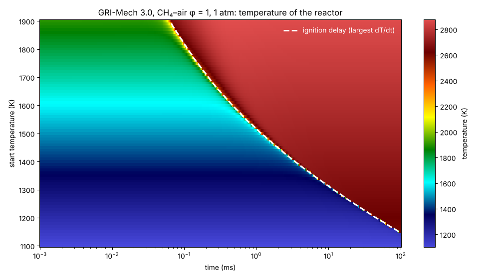

# Species and reacting flows

Part of the [Example gallery](../gallery.md): mixtures of ideal gases whose species are carried by the flow, the first stage (SF1) of the [development path to an industrial steam furnace](../assessments/steam-furnace-development-path.md). Gas-phase chemistry (SF2) follows; its coupling to the flow and the heat release in the cells come with SF2b and SF3.

| # | Example | Stage | Feature |
|---|---|---|---|
| 278 | [A methane jet in a coflow of air, and binary diffusion against the exact solution](#species-transport) | SF1 | `[species]`, `names`, `closure`, `initial`, `diffusion`, `schmidt`, `lewis`, `turbulent_schmidt`, `properties`, `[boundary.<name>.species]`, fields `Y_<species>` |
| 289 | [Methane ignites in a constant-pressure reactor and ends at its chemical equilibrium](#gas-chemistry) | SF2a | `foehn chemistry reactor`, `foehn chemistry equilibrium`, `[reactor]`, `mechanism` (`gri30`, `westbrook-dryer-2`, `jones-lindstedt-4`, YAML files), `[reactor.integrator]`, `[reactor.check]` |

---

## 278. A methane jet in a coflow of air, and binary diffusion against the exact solution

`species_coaxial_jet.toml` blows pure methane from a nozzle of radius
5 mm at 1 m/s into a coflow of air at 0.2 m/s, both at 300 K and
1 atm (Re = 590, laminar), on an axisymmetric wedge of 2°. The mixture has
three species: CH₄ and O₂ are transported, N₂ is the closure species,
Y_N2 = 1 − Y_CH4 − Y_O2 in every cell. The jet is isothermal, yet its
density varies by a factor of 1.8: ρ = p₀ M/(R T) with the molar mass of
the local mixture, 1/M = Σ Y_i/M_i, through the low-Mach variable density
of stage 7c. c_p, λ and μ are those of the local mixture: NASA-7
polynomials and kinetic theory (Chapman–Enskog with the collision
integrals of Neufeld et al. 1972, the Wilke and the Mathur mixing rules),
with the 53 species of GRI-Mech 3.0. Diffusion: ρ D_i = μ/Sc, Sc = 0.7.
The run converges in 154 outer iterations (9 s on one core). The carbon,
hydrogen, oxygen and nitrogen accounts of the ledger close to 6.4·10⁻⁹ of
their inflow (the solver tolerance 10⁻⁸).

`species_binary_diffusion.toml` checks the transport against an exact
solution: CH₄ in N₂ at rest in a closed slab, Y_CH4 = 0.5 + 0.4 cos(πx) at
the start, D = 10⁻³ m²/s. The mode decays as exp(−Dπ²t); after 50 s with
BDF2 on 100 cells the error is 9.5·10⁻⁶ (L2), 1.3·10⁻⁵ at worst. The
closure fraction is 1 − Y_CH4 exactly, and the accounts of both species
and of C, H and N close to 10⁻¹⁹ kg/s.

**How it is built.** Each transported species is a scalar field `Y_<name>`
of the generic transport equation (D116), solved with the density of the
flow in its time term and its convection, so the device kernels of the
scalars (CPU and GPU, one source) and their path on several ranks carry
it. The convection is bounded by the vertex limiter (MLP, D237); the mass
fractions are never clipped after a solve. Once per outer iteration the
mixture is evaluated per cell and face from the new mass fractions and
temperature (`foehncraft_kernels::species`, a cell-local body with a
fixed summation order): it gives the face diffusivities of the species,
c_p, λ and μ of the energy equation and the flow, and the molar mass of
the density. The ledger (D119) gets an account per species and per
chemical element: convected and diffused mass per boundary, and the
continuity defect Σ Y_P (∇·ṁ)_P V_P that the non-conservative form of the
equation carries, so each account closes to the solver tolerance.

**What this version does not do.** No chemistry and no heat release
(SF2, SF3), no enthalpy flux of the species diffusion Σ h_i J_i in the
energy equation (it matters with heat release; zero in an isothermal
mixture), no mixture-averaged or multicomponent diffusion with a
correction velocity (differential diffusion of hydrogen, SF2h): every
species has a Schmidt or a Lewis number. One fluid region: no solids,
porous regions or several fluids with species (SPE002). On ranks the variable density (7c) and the MLP limiter are
refused, so a species case runs there with a constant density. The mixture is
evaluated on the host from the device fields once per outer iteration
(the same round trip as the property refresh of the energy equation); a
device kernel of it follows with the chemistry (SF2). The MLP limiter
lets smooth extrema of ε = 1 % of the range pass, so a mass fraction may
leave [0, 1] by a few 10⁻⁶ (the jet: −5.9·10⁻⁷ and 1 + 3·10⁻⁶); a sum
above 1 + 10⁻⁴ is warned about (SPE003). The ledger takes the
linear-upwind reconstruction without the clip of `bounded = true`.

**What is checked.** The exact decay of binary diffusion (L2 error below
10⁻⁴); the element accounts of the jet (below 10⁻⁶ of the inflow) and the
jet density p₀ M_CH4/(R T); pure-gas viscosities of N₂, O₂, CH₄, Ar, H₂
and CO₂ at 300 K within 3 % of measured values and conductivities within
5 %; air as a mixture (M, c_p, μ, λ); the enthalpy of formation of CH₄; the
binary diffusion coefficient of CH₄–N₂; the species case (constant density, mixture
properties) on 1 to 4 ranks bitwise equal to one rank; the refusals SPE001.

Files: `fields.vtkhdf` (`Y_CH4`, `Y_O2`, `density`), `line_axis.csv`,
`line_x50mm.csv`, `result.json` (`balance.last.ledger`: `species …`,
`element …`). [Recipe 278](../recipes/species.md#species-transport),
cases in the [catalogue](../cases/flow.md#species), images by
`python3 -m tools.plot.species_fields`.

---

## 289. Methane ignites in a constant-pressure reactor and ends at its chemical equilibrium

`reactor_methane_air_gri30.toml` puts stoichiometric methane and air at
1 atm and 1400 K into the constant-pressure adiabatic reactor, the
chemistry of one cell without transport. With GRI-Mech 3.0 (53 species,
325 reactions with three-body, Lindemann and Troe fall-off rates, read from
its YAML file) the radical pool builds up for 3.4 ms, the mixture
ignites, and the state relaxes to the chemical equilibrium: at 100 ms the
temperature is 4·10⁻⁵ K and every mole fraction within 4·10⁻⁹ of the
Gibbs equilibrium at the same enthalpy and pressure (2697.7 K), and the
element masses have drifted by 2·10⁻¹³. The run takes 2 811 steps of the
stiff integrator and 0.38 s on one core. The two global mechanisms show
what they are for and what not: the four-step scheme of Jones & Lindstedt
(1988) ignites after 8 µs (it has no induction chemistry) and ends at the
equilibrium of its eight species, 120 K above that of GRI-Mech 3.0 because
it has no radicals and no dissociation; the two-step scheme of Westbrook &
Dryer (1981) ends at 3164 K, 277 K above the equilibrium of its own
species, because its reverse CO step (their eq. 11) is an Arrhenius rate
of its own and not the equilibrium constant. Global mechanisms predict
heat release and flame speed after calibration, not ignition delays or
end states; SF3 uses them only with that warning.

The same reactor from 1100 to 1900 K in steps of 10 K: the ignition delay
falls from 94 ms at 1150 K to 64 µs at 1900 K, three decades in 750 K,
with the burnt temperature at 100 ms rising from 2610 K (1150 K, just after
ignition) to 2870 K (1900 K). Below 1150 K the
mixture does not ignite within 100 ms.

The adiabatic flame temperature of stoichiometric methane and air from
298.15 K is 2224.9 K by Gibbs minimisation over the 53 species (2226 K in
Turns 2012, with the JANAF data), with CO 0.9 %, NO 0.19 % and OH 0.29 %
by mole: `foehn chemistry equilibrium` or
[`equilibrium_methane_air.json`](../cases/tools.md).

**How it is built.** The rates are the gas-phase slice of the chemistry
program D120: a mechanism is read once into flat arrays (reactions,
species terms, third-body efficiencies, SI rate constants) and the kernel
`foehncraft_kernels::chemistry` evaluates the rates of progress
(modified Arrhenius, three-body, Lindemann and Troe fall-off, reverse
rates from the equilibrium constants of the NASA-7 data) and their
**analytic Jacobian** with respect to the mass fractions and the
temperature, including the dependence of the density and the
concentrations on them; it agrees with central differences to 10⁻¹¹ for
GRI-Mech 3.0. The reactor is integrated by the L-stable Rosenbrock method
RODAS3 (order 3, Sandu et al. 1997) with an embedded error estimate and
step control; its linear systems are solved by an LU factorisation with
partial pivoting in a fixed column order, so the result depends only on
the bits of the state: the kernel is cell-local, allocation-free and the
same code for a CPU core and a GPU thread. Global orders below 1
(Westbrook & Dryer's −0.3 for methane) are regularised as
C (max(C, 0) + ε)^(a−1) with ε = 10⁻¹² of the total concentration, so the
rate and its derivative stay finite at C = 0. Reversible global reactions
take the reverse orders a′ − ν′ + ν″, which makes the ratio of the
two rates the equilibrium quotient. The equilibrium is the reduced Gibbs
iteration of Gordon & McBride (1994) with their damping, at fixed T and p
or, by a bracketed secant on h(T), at fixed h and p. The mechanism
importer reads the YAML format of D103 (units, phases, NASA-7 species,
elementary, three-body and fall-off reactions with efficiencies, orders);
species a file does not define come from the built-in GRI-Mech 3.0 data.

**What this version does not do.** No chemistry in the cells of a flow yet:
the source terms of the species and the heat release with the GPU and
rank paths come with SF2b, with the 1D laminar flame speed of methane and
air against measurements; turbulence–chemistry interaction is SF3.
Pressure-dependent Arrhenius (PLOG), Chebyshev and SRI fall-off rates and
specific colliders `(+N2)` are refused (CHM001). Only the elements H, C,
O, N and Ar. The ignition delay band of the GRI-Mech case is a regression
of this code, not a comparison with shock-tube measurements (a later
check).

**What is checked.** The analytic Jacobian against central differences
(GRI-Mech 3.0 at 900 and 1600 K, both global mechanisms); the third order
of RODAS3 and its error control on an exact exponential decay; the
detailed balance: every reversible reaction of GRI-Mech 3.0 has a net rate
below 10⁻⁶ of its forward rate at the Gibbs equilibrium (1500 and 2200 K);
the adiabatic flame temperature 2226 ± 10 K; the reactor end state at the
equilibrium and the element drift; the rate constants of the importer in
SI (GRI-Mech reactions 1 and 3; Jones & Lindstedt against the cm–mol table
of Si et al. 2020); refused unbalanced and unsupported reactions (CHM001).

Files: `output/<case>/reactor.csv` (time, temperature, mole fractions of
every species). [Recipe 289](../recipes/species.md#gas-chemistry), cases
in the [catalogue](../cases/chemistry.md), images by
`python3 -m tools.plot.reactor_traces`.

