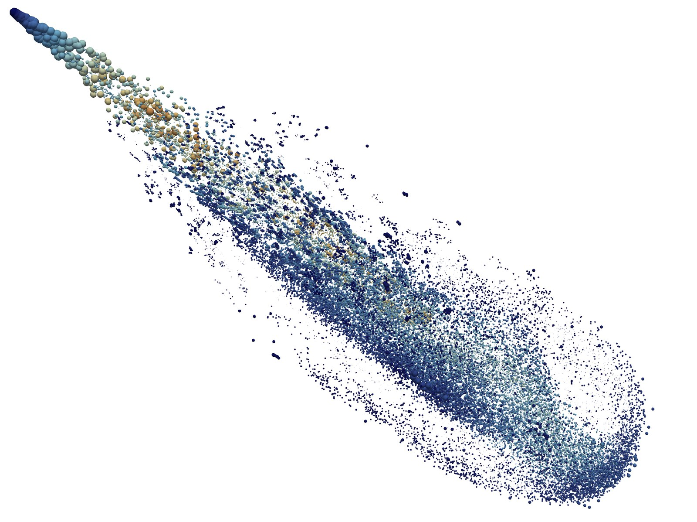
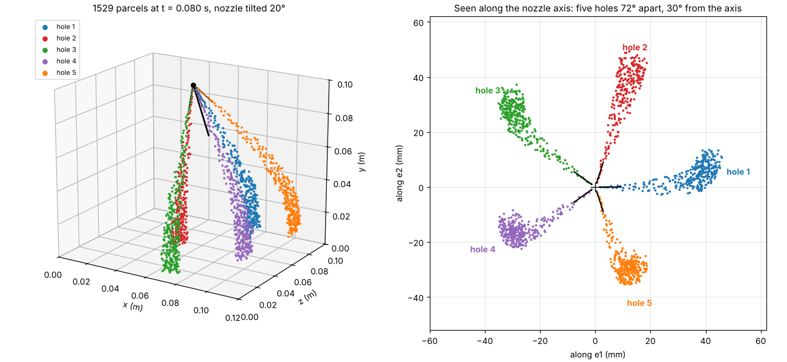

# Lagrangian sprays

Part of the [Example gallery](../gallery.md): droplets as Lagrangian parcels in the gas flow (L12, D240 to D246).

| # | Example | Stage | Feature |
|---|---|---|---|
| 242 | [Water droplets sprayed into an air duct](#spray-duct) | SP1 | `[spray]`, `[[injector]]`, `[liquid]`, drag of Schiller and Naumann, stick walls, mass book |
| 265 | [Where the liquid goes: datums and droplet statistics](#spray-datums) | SP1b | `[[datum]]` (cut plane, plane on faces, disc, STL surface, boundary, box), Rosin-Rammler sizes, `datums.csv`, histograms, D32 and Dv50, penetration, `series.json` |
| 280 | [A water spray that drives the air](#spray-two-way) | SP2 | `[spray.coupling] mode = "two-way"`, value-plus-slope momentum sources, passes inside the time step, coupling lag, momentum ledger pair, health numbers |
| 283 | [Water droplets cool a hot air stream](#spray-cooling) | SP2 | two-way sensible heat: droplet temperature, Ranz-Marshall heat transfer, energy sources in value-plus-slope form, temperature lag, enthalpy ledger pair |
| 285 | [Droplets spread by the turbulence of a duct](#spray-dispersion) | SP2 | `[spray] dispersion = "eddy-lifetime"` (Gosman and Ioannides), Gaussian eddies of variance 2k/3 keyed per parcel and eddy, eddy interaction time, crossing trajectories, spread by droplet size |
| 292 | [The spray-cooled duct as a steady state](#spray-steady) | SP2s | `[spray.steady]` (D260): parcel streams through the frozen steady gas, sources relaxed between passes, source residual in the convergence test, keyed streams, `spray/streams.vtkhdf` |
| 306 | [Water droplets evaporating in hot air](#spray-evaporation) | SP4, SP5 | `[spray.evaporation]` (Ranz-Marshall, Abramzon-Sirignano), `[spray.liquid] vapour`, vapour, mass and enthalpy sources in value-plus-slope form with the closing step (D250), vapour ledger pair, saturation limiter (D253) |
| 306b | [More water than the air can take, steady](#spray-saturation) | SP5, SP2s | evaporation in the steady spray mode, adiabatic saturation against the exact end state (V28.11, partly met) |
| 318 | [A fuel spray breaks up in dense nitrogen](#spray-breakup) | SP6 | `[spray.breakup]` KH-ACT and KH-RT, blob injection from `hole_diameter`, `area_contraction` and a `rate` table, child parcels, Rayleigh-Taylor beyond the breakup length, TAB distortion and dynamic drag, mirrored eddies |
| 314 | [A fuel droplet's surface at diesel pressure](#spray-a-surface) | SA1 | `[spray.evaporation] equilibrium = "peng-robinson"`, `[spray.evaporation.peng_robinson]`: Peng-Robinson phase equilibrium of the fuel and the ambient gas at the droplet surface, latent heat from the same equation, the critical mixing state (D311, D312, D314) |
| 320 | [Where the last liquid evaporates: the Spray A mixing line](#spray-a-mixing-line) | SA1 | `realfluid::Streams`: the adiabatic mixing line of fuel and gas (frozen, Peng-Robinson equilibrium, ideal), stability test and flash, the saturation mixture fraction, the liquid length of Siebers (1999) against the measured Spray A lengths (D319, VA.4, VA.5) |
| 319 | [Liquid length and vapour penetration as the ECN defines them](#spray-ecn) | SA3 | `[spray.ecn]` (D315): liquid length from the projected liquid volume at two thresholds and vapour penetration at 0.1 % fuel, per injector and step in `spray.csv` and `result.json` |
| 321 | [Fuel droplets with real liquid properties and the 1/3-rule film](#spray-liquid-library) | D320, D321 | `[spray.liquid] library` (water, n-heptane, n-dodecane, iso-octane), `[spray.evaporation] film = "one-third"` (default), single n-heptane droplets against measurements, an n-heptane spray in hot nitrogen |
| 325 | [A measured water spray, continued from its first plane](#spray-brno) | D322 | `[[spray.injector]] samples` and `sector`: parcels from measured droplets; the Brno air-blast spray against its phase Doppler data at 40 and 60 mm, per size class |
| 323 | [ECN Spray G: a gasoline injector against the measurements](#spray-g) | SP6, D309 | `[mesh.generate] wedge` with `dimension = 3` (a sector of the injector), thin slip core on the axis, injector from the measured rate, plume direction and cone, `flow_share`, the ECN liquid and vapour penetration (`tools/plot/spray_g_metrics.py`), library iso-octane, KH-ACT |
| 324 | [The gas film of a fuel droplet at diesel pressure](#spray-a-film) | SA2 | `[spray.evaporation.peng_robinson] film = "real-fluid"` (default), `critical_volume`: Peng-Robinson density and c_p, the dense-fluid viscosity and conductivity of Chung et al. (1988), the high-pressure diffusivity of Riazi and Whitson (1993) in the droplet film (D313) |
| 326 | [Flattened drops in ECN Spray A: the Corrected Distortion model](#spray-a-distortion) | SA4 | `[spray.breakup] drag = "corrected-distortion"` (D316): drag and evaporation of the TAB spheroid (Nguyen, Dahms, Pickett and Tagliante 2022), viscous-sphere circulation, ECN liquid length on a quarter domain with mirror images |
| 333 | [The drops take turbulence energy from the gas](#spray-turbulence) | D330 | `[spray.coupling] turbulence = "dispersion-work"`: the work of the dispersing eddies on the drops taken out of k with the ε or ω term of KIVA-II, booked from the part of the drop motion that follows the eddy; `gas_turbulence_w` in `spray.csv`; at most 32 eddies per parcel and step |
| 335 | [Colliding drops in ECN Spray G](#spray-collisions) | D331 | `[spray.collision] model = "ntc"`: no-time-counter sampling with O'Rourke's coalescence and grazing separation; G1 liquid lead at 0.8 ms from 19 % to 12 % |
| 341 | [A five-hole nozzle described by its device](#spray-device) | ID1, D340 to D342 | `[[spray.device]]` (mount, axis, reference, clocking), `[[device.hole]]`, `[[device.pattern]]`, `[[injector]] device`, `hole`, `hole = "all"`, `offset`, SPR010, tool `spray.devices` |

---

<a id="spray-duct"></a>
## 242. Water droplets sprayed into an air duct


`spray_duct.toml` blows air at 4 m/s through a duct (SST k-ω, transient). A
nozzle in the upper wall sprays 10 g/s of water as droplets of 150 µm with a
speed of 10 m/s in a cone of 10° half angle. The droplets are parcels, each
standing for the same share of the mass flow; the injector sits in
`spray_duct_injectors.toml`, which the case includes (D246).

Each parcel follows the exact solution of its relaxation equation over every
sub-step: the drag uses the correlation of Schiller and Naumann (1935), the
sub-step ends at every cell crossing, and a small droplet that follows the
gas needs no small step (D245: the kernel is one source for CPU and GPU).
Droplets that reach the lower wall stay there (`wall_mode = "stick"`); the
others leave through the outlet. About 70 % of the liquid lands on the wall
within the 1.5 s of the case.

**What this version does not do.** The gas does not feel the droplets
(one way); there is no turbulent dispersion, no evaporation and no
breakup. Gas properties are sampled at the start of each sub-step, so the
tracking is first order in the gas state. One process only (D241). The
next stage (SP2) adds the coupling to the gas and the size distributions.

**What is checked.** The run books every kilogram: injected = in the flow +
stuck + left + lost, and stops with SPR005 when the book does not close
(`spray.csv` has it in every row). The unit tests compare the tracker with
a reference trajectory on hexahedral, tetrahedral, polyhedral and mixed
meshes, the Stokes terminal velocity and the exponential relaxation to the
gas velocity, and require identical bits on 1, 2 and 4 threads and after a
restart.

Files: `spray/parcels_<step>.vtkhdf` (ParaView), `spray.csv`; the parcels
are part of the restart file. [Recipe 242](../recipes/sprays.md#spray-duct),
[case row](../cases/flow.md#lagrangian-sprays).

---

<a id="spray-datums"></a>
## 265. Where the liquid goes: datums and droplet statistics


`spray_datums.toml` is the duct of [242](#spray-duct) with a nozzle that
sprays 10 g/s of water with a Rosin-Rammler size distribution (X = 120 µm,
n = 2.5, from 10 to 400 µm; D242). Each parcel draws its diameter from the
mass distribution with the counter-based generator keyed by the parcel
identity (D121), so the sizes do not depend on threads or restarts.

Seven datums (`[[datum]]`, D262) ask where the liquid and the air go: a
plane cut through the cells at x = 0.6 m, the plane x = 1.2 m moved onto the
mesh faces, a disc of 0.1 m radius at x = 0.9 m, a surface file (STL) at
x = 1.6 m, the outlet, the lower wall and a box under the nozzle. Every
sub-step of a parcel that crosses a surface writes a crossing record; the
records are sorted by datum, parcel, sub-step and crossing and summed in
that order (D263), so the cumulative liquid through each datum has the same
bits on 1, 2 or 4 threads and after a restart.

After 1.5 s, of the 15 g injected, 8.3 g left through the outlet, 2.3 g
stick on the floor and 4.4 g are in the flow. The datum on the outlet is the
mass book's escaped liquid to the bit, the floor its deposited liquid. The
droplets sort by size: Dv50 is 91 µm at the outlet and 170 µm on the floor,
against 101 µm through the first plane (the input's Dv50 is 104 µm). The
Rosin-Rammler fit of the first plane's histogram gives X = 117 µm and
n = 2.6. In the flow the Sauter diameter D32 is 81 µm, and 95 % of the
liquid lies within 0.75 m of the nozzle along its axis (penetration, D265).

The gas side uses the same datums: through the cut plane the air mass flow
is 0.192 kg/s within 6 × 10⁻⁸ of the exact flow through the nearest face
layer (`cut_error`); the plane on the faces and the outlet are exact. The
disc (a 128-gon of equal area, of which the one-cell-thick 2D mesh holds the
middle strip) is cut through the cells, but its face layer is a staircase of
whole faces, so its `cut_error` is 4 %: here it measures the face layer, not
the cut. The STL surface is sampled finer than the cells and is within
0.1 % of the exact flow.

**What is checked** (V28.13 to V28.15). Planes, face layers, STL surfaces,
boundaries and boxes on hexahedral, tetrahedral and polyhedral meshes: the
liquid through every surface equals the liquid of the parcels that ended on
its far side, to round-off; the boundary datum equals the mass book. D32 of
the drawn sizes lies within four standard errors of the value of the
distribution, Dv50 within one bin; the sums are bitwise equal on 1, 2 and 4
threads and after a restart. In a flow run the outlet datum equals the
boundary mass flow bit for bit and the plane on the faces the inlet flow to
the solver tolerance.

**What this version does not do.** No measured anchor yet (V28.12, the
terminal velocity of Gunn and Kinzer, is still open); no enthalpy flow (the
energy equation with sprays comes with SP5); `datums.csv` only in transient
runs (steady runs report through `foehn call post.datums`); no size
classes, no time-averaged spray fields (D266, SP2) and no evaporation
numbers (SP5). Not with a sliding mesh. One process.

Files: `datums.csv`, `spray_hist_<datum>.csv`, `spray.csv` (penetration,
D32, centre of mass), `result.json` (all statistics with D20, D30, D43,
Dv10, Dv90, span, velocity statistics and the fit), `series.json`.
Picture: `python3 -m tools.plot.spray_datums OUT_DIR output/spray_datums`.
[Recipe 265](../recipes/sprays.md#spray-datums),
[case row](../cases/flow.md#lagrangian-sprays).

<a id="spray-two-way"></a>
## 280. A water spray that drives the air


`spray_two_way.toml` is a room of still air, 1.2 m wide and 1.5 m high
(2D, 60 × 75 cells, SST k-ω, Δt = 4 ms). A nozzle under the ceiling sprays
50 g/s of water downwards at 15 m/s in a cone of 12° half angle, with
Rosin-Rammler sizes from 50 to 400 µm (X = 150 µm, n = 2.5). With
`[spray.coupling] mode = "two-way"` the drag on the droplets is a
momentum source of the gas (D247 to D252): the falling spray pulls the air
down into a jet of up to 6 m/s, which spreads over the floor and comes back
up along the side walls to the vents in the ceiling. One way (SP1) the air
would stay at rest.

**How the coupling works.** A parcel pass tracks every parcel through one
frozen gas state; each sub-step, which ends at every cell face, writes a
record of the momentum the gas receives and its slope with respect to the
gas velocity of the cell. The records are sorted by cell, parcel and
sub-step and summed in that order, so the sources do not depend on the
storage order of the parcels or the number of threads. The gas takes them
as value plus slope, S = E − β (u − u*), like a porous sink: the slope sits
on the diagonal and in the pressure correction, so a dense spray cannot
push the gas past the droplets, however large the step. The passes run
inside the outer iterations of the PISO step until the coupling lag is
below 10⁻³ (at most three, the default). After the last gas solve a
closing step gives each parcel the correction the gas received, so both
books hold the same numbers.

In this run the spray hands the air a steady 0.77 N downwards after the
first half second. Of the 100 g injected, 85.7 g land on the floor
(`wall_mode = "stick"`), 14.2 g are in the air and 0.1 g leave through the
vents; no parcel is lost. The steps take 2.96 passes on average; 46 of the
500 steps stop at the third pass with the lag above the tolerance (at most
3.1 × 10⁻³; SPR006 warns once and `spray.csv` counts them). The strongest
coupling of a cell, β Δt / (ρ V), is 0.77; the liquid fills at most 0.5 %
of a cell, with at most 16 parcels in it. The run takes about 40 s on
four cores.

**What is checked** (V28.1 to V28.4). A cloud shot into one cell of gas
at rest, with liquid loadings of 0.1 to 10 and time steps of 0.1 to 100
droplet response times: gas and droplets reach one common velocity, the
mixture keeps the momentum it was given, the force on the gas never
changes sign, and the momentum the gas received plus the momentum of the
parcels equals the momentum injected to round-off. One fixed pass is
bounded and conservative too. Against a reference of the two-mass
relaxation integrated by RK4 with small steps, the error falls at order
0.99 and 0.96 as Δt halves from 2 ms to 0.5 ms. The sources are bitwise
equal with the parcels stored in reverse order and on one thread (hex,
tetrahedral and polyhedral meshes), whole runs on 1 and 4 threads; the
slopes of one parcel add up to at most its mass. A parcel on a cell face
with the gas of both cells pushing it back across the face is not lost.
In the ledger the exchange is a pair (`spray drag` on the gas momentum,
`from the gas` on the parcel momentum) whose residual is zero to the bit,
and the parcel momentum account closes with the weight, the injection, the
walls and the parcels that left. The gas momentum accounts hold only this
term for now, so their imbalance is the force of the walls and the
pressure on the gas.

**What this version does not do.** Momentum only: no heat exchange (SP2b),
no turbulent dispersion (SP2c), no evaporation (SP5). Not with the energy
equation, conjugate heat transfer or an algorithm other than PISO (SPR003; the
steady spray mode is SP2s). The slope is the diagonal of the coupling: a
parcel that crosses cells in one step couples the neighbour cells only
through the passes. First order in time (the gas state at the new time
level, D248). One process. No time-step study tool yet (D254 (4)).

Files: `spray.csv` (passes, coupling lag, gas force, power and the health
numbers per step), `result.json` (coupling summary and ledger).
Picture: `python3 -m tools.plot.spray_two_way OUT_DIR output/spray_two_way`.
[Recipe 280](../recipes/sprays.md#spray-two-way),
[case row](../cases/flow.md#lagrangian-sprays).

<a id="spray-cooling"></a>
## 283. Water droplets cool a hot air stream


`spray_cooling.toml` is a duct of 2 m by 0.4 m (2D, 100 × 20 cells,
SST k-ω, Δt = 2 ms) with air at 300 °C entering at 5 m/s. Walls are
adiabatic. A nozzle 0.15 m behind the inlet sprays 10 g/s of water at
20 °C along the duct at 15 m/s, in a cone of 15° half angle, with
Rosin-Rammler sizes from 20 to 200 µm (X = 60 µm, n = 3). This is the lead
application of the sprays (D240) with sensible heat only: with `[energy]`
and `[spray.coupling] mode = "two-way"` every parcel carries a temperature,
and the heat it takes up is a source of the gas energy in the cells it
passes (D247 to D252). The cold core of the spray is visible behind the
nozzle; the air leaves the duct about 50 K cooler.

**How the heat is coupled.** In each sub-step the parcel temperature
relaxes exactly towards the gas temperature of its cell,
T_p ← T_g + (T_p − T_g) e^(−δt/τ_h), with τ_h = ρ_p c_p d² / (6 Nu k) and
the Nusselt number of Ranz and Marshall, Nu = 2 + 0.6 Re^½ Pr^⅓. The record
of the sub-step holds the heat the gas gives and its slope with respect to
the gas temperature, found as for momentum (the slopes of one parcel add up
to at most m c_p). The records are sorted and summed per cell, and the
energy equation takes them as value plus slope, Q = E − G (T − T*): G sits
on the diagonal, so the gas cannot be cooled below the droplets, however
large the step. The passes stop when both the velocity lag and the
temperature lag (the change of the gas temperature of a spray cell against
the frozen state, over the largest temperature difference between gas and
droplets) are below the tolerance. The closing step gives each parcel the
heat the gas actually lost.

In this run the droplets take a steady 6.6 kW from the air after 0.3 s;
their mean temperature levels out near 150 °C. Of the 10 g injected,
7.4 g leave through the outlet and 2.6 g are in the duct at the end; no
parcel is lost. The steps take 3.7 passes on average, with `max_passes =
4`: the temperature lag falls by a factor of about 7 per pass, the
velocity lag by about 10, so at the default of three passes most steps of
this case end at a lag of 1 to 3 × 10⁻³ (SPR006). With four, one of the
500 steps ends above 10⁻³ (1.04 × 10⁻³). The strongest thermal coupling of
a cell, G Δt / (ρ c_p V), is 1.3. The run takes about 30 s.

**What is checked** (V28.1 to V28.4 for heat). A cloud of water at 300 K
in one cell of air at 400 K, at liquid loadings of 0.1 and 1 and time steps
of 0.03 to 23 thermal response times: gas and droplets reach the mixture
temperature to 10⁻⁹, the mixture keeps its enthalpy, the gas never gains
heat, and the enthalpy the parcels gained equals what the gas lost to
round-off. Against a fourth-order reference of the two-temperature
relaxation the error falls at order 1.03 and 1.04 as the step halves. The
heat sources are bitwise equal with the parcels stored in reverse order and
on one thread; whole runs give the same bits on 1 and 4 threads. In the
ledger the exchange is the pair 2804 (`spray heat` on the thermal energy
account of the energy equation, `from the gas` on the account `parcel
enthalpy`) whose residual is zero to the bit; the parcel enthalpy account
closes with the injection and what left the flow to 10⁻¹⁴, and the thermal
account of the gas, now with the spray term, to 2 × 10⁻¹² in the last
step.

**What this version does not do.** Sensible heat only: no evaporation,
latent heat or vapour (SP4, SP5), so a droplet can get hotter than the
boiling point; this case stops short of that. Constant liquid properties,
one temperature per droplet (no conduction inside it), no radiation to the
droplets. Not checked yet against the one-dimensional duct reference
(V28.16) or the plug-flow reference of the cooling duct (V28.21, with
evaporation). Not with conjugate heat transfer or an algorithm other than
PISO (SPR003). One process.

Files: `spray.csv` (adds `t_mean_k`, `gas_heat_w` and `coupling_heat_max`
per step), `result.json` (coupling summary with the heat totals, ledger),
parcel files with a `temperature` field.
Picture: `python3 -m tools.plot.spray_cooling OUT_DIR output/spray_cooling`.
[Recipe 283](../recipes/sprays.md#spray-cooling),
[case row](../cases/flow.md#lagrangian-sprays).

<a id="spray-dispersion"></a>
## 285. Droplets spread by the turbulence of a duct


`spray_dispersion.toml` is a duct of 3 m by 0.3 m (2D, 150 × 30 cells,
SST k-ω, Δt = 2 ms) with air entering at 10 m/s and 10 % turbulence
(k = 1.5 m²/s², viscosity ratio 2000, so the turbulence lives over the
length of the duct). A needle nozzle on the axis 0.2 m behind the inlet
shoots 2 g/s of water straight downstream at the speed of the air, without
a cone, as droplets of 20 to 300 µm (Rosin-Rammler, X = 120 µm, n = 2.5).
Gravity is left out, so every sideways movement of a droplet comes from
the turbulence: with `[spray] dispersion = "eddy-lifetime"` (D243) the
line of droplets widens into a plume that fills the duct after about 2 m.

**How the eddies work** (Gosman and Ioannides 1983). A parcel sees the
mean gas velocity plus a fluctuation u′ whose components are Gaussian with
variance 2k/3, drawn when it enters an eddy and kept while it stays in it.
The eddy has the length l_e = C_μ^¾ k^{3/2}/ε and the lifetime
τ_e = l_e/(2k/3)^½; the parcel leaves it after τ_e or, if it is heavy and
slips through the eddy, after the crossing time
t_cr = −τ_p ln(1 − l_e/(τ_p |u + u′ − v|)), whichever is shorter. A sub-step
ends where the eddy ends (D251). The random numbers come from the stream
`SPRAY_DISPERSION`, keyed by the parcel and the number of eddies it has
entered (D121): every pass of a time step and every thread count draws the
same numbers, so two-way coupling with dispersion stays bitwise
reproducible and its passes can converge. ε comes from the k-ε family or
as β* k ω from SST; in a 2D case the eddies have no z component.

In this run the spread after 1 m is 5.4 cm for the droplets of 20 to
60 µm, 4.4 cm for 60 to 150 µm and 2.9 cm for 150 to 300 µm: the large
droplets respond more slowly to each eddy. Towards the end of the duct the
walls limit the spread of all classes. Of the 1.2 g injected, 0.59 g leave
through the outlet, 0.07 g stick on the walls and 0.54 g are in the duct;
no parcel is lost. The coupling is two-way at a light loading (1.8 passes
per step, none above the tolerance). The run takes about 20 s.

**What is checked.** Tracers (1 µm) in turbulence at rest with uniform k
and ε spread as the random walk the model is: after a time
T = n τ_e + r the mean square displacement per component is
(2k/3)(n τ_e² + r²); for 20 000 tracers it is within 1.3 % of that in
each component (the band is four standard errors, 4 %), and the mean
displacement is zero within four standard errors. Droplets of 300 µm that
fall at 1.1 m/s through eddies of 5 cm cross them (16 eddies in 1 s
against 5 for a tracer) and spread a third as far sideways. The eddy times
of the kernel match the formulas, including the limit l_e/|w| for a parcel
not slowed in the eddy. Sources, closing step and parcel states with
eddies are bitwise equal with the parcels stored in reverse order and on
one thread (hex, tetrahedral and polyhedral meshes), whole runs on 1 and 4
threads; the momentum books close to round-off. A case without a
turbulence model is refused (SPR001).

**What this version does not do.** No continuous random walk yet (D243:
the second value of the same key, refused for now). Isotropic eddies: no
anisotropy near walls, where the model overestimates the wall-normal
fluctuation (a known flaw of the eddy-lifetime model; deposition rates on
walls are not to be trusted). The droplets do not change the turbulence
(no turbulence modulation). Not compared yet with the grid-turbulence
measurements of V28.17 (Snyder and Lumley 1971; Wells and Stock 1983).
One process.

Files: `spray.csv`, `result.json`, parcel files every 25 steps.
Picture: `python3 -m tools.plot.spray_dispersion OUT_DIR output/spray_dispersion`.
[Recipe 285](../recipes/sprays.md#spray-dispersion),
[case row](../cases/flow.md#lagrangian-sprays).

<a id="spray-steady"></a>
## 292. The spray-cooled duct as a steady state


`spray_cooling_steady.toml` is the duct of
[gallery 283](#spray-cooling) (2D, 100 × 20 cells, SST k-ω, air at 300 °C
and 5 m/s, 10 g/s of water at 20 °C from a nozzle 0.15 m behind the inlet,
20 to 200 µm) without `[time]`: the gas is solved as a steady state with
SIMPLE and the spray runs in the steady mode of D260. A parcel is a
*stream* here: it stands for a number of droplets per second, so its mass
is a mass flow (kg/s), and it is followed from the nozzle through the
frozen gas field until it leaves, sticks or reaches `max_time`. The 400
streams of the case share the 10 g/s; sizes, directions and (with
dispersion) the eddies are drawn from random numbers keyed by the seed and
the stream alone, so every pass follows the same streams and the iteration
has a fixed point.

**How the steady coupling works.** Every 10 outer iterations a stream pass
runs: the same pure parcel function, sorted per-cell sums and value-plus-slope
records as in the transient coupling (D247 to D251), with sub-steps along
the path in place of a time step. The gas does not take the sources of one
pass directly but holds them in the relaxed form S(u) = A − β u for
momentum and Q(T) = B − G T for heat, A ← A + α (A_new − A) with α = 0.5,
and the same for β, B and G. There is no closing step, since no parcel
state is carried from one pass to the next. The *source residual*, the
difference between the held sources and those of the last pass over the
sources of the last pass (summed over the spray cells, the larger of
momentum and heat), is part of the convergence test: the run is converged
only when the gas residuals are below the solver tolerance and the source
residual is below `[spray.steady] tolerance`. A run that ends above it
warns with SPR008 and is not reported as converged.

In this run the gas and the spray converge together in 526 outer
iterations and 58 passes (14 s on the 4 cores of the cloud machine); the source residual ends at
1.0 × 10⁻⁴ (momentum; heat 2.0 × 10⁻⁵). All 10 g/s leave through the
outlet, no stream is lost or unfinished; the droplets stay 0.26 s on
average and 0.33 s at most in the duct. The spray takes 6.39 kW from the
air, which leaves at a mass-flow mean of 249.1 °C. The health numbers are
β/ṁ up to 0.27 and G/(ṁ c_p) up to 0.39, where ṁ is the gas mass flow
through the cell, and a liquid volume fraction up to 3.4 × 10⁻⁴.

**Against the transient run** (V28.9, without evaporation). The transient
case of gallery 283 marched for 2 s takes 6.58 kW from the air as the time
mean after 0.3 s, with a standard error of 0.03 kW over seven windows of
0.25 s; halving its step to 1 ms adds about 1 %. The steady mode is 2.9 %
below that, more than the sampling and step errors of the transient run
explain, and its outlet is 1.5 K warmer. The reason is the flow: behind the
nozzle the transient duct does not come to rest (the mixed temperature of
its last step wavers by several kelvin around the steady curve, bottom
left), and the time mean of an unsteady flow need not be its steady state.
V28.9 is therefore *not met* in the strict form of section 5.9; the
difference is written down as a gap. Other seeds give 6.38 and 6.36 kW,
1600 streams 6.37 kW, so the sample of 400 streams is good to about 0.3 %.

**What is checked.** V28.10: `spray.csv` and the residuals of whole runs
are bitwise equal on 1 and 4 threads, with and without eddy-lifetime
dispersion. One stream of 50 µm in a uniform gas at 2 m/s needs the
residence time of a fourth-order integration of its equation of motion to
7 × 10⁻⁵, and the momentum it takes from the gas equals its mass flow
times the exit speed. Another seed draws other streams (other heat, within
10 %). In the ledger the stream pass books the pairs 2801 to 2803
(momentum) and 2804 (heat) on the gas and the parcel accounts with the
sources of the final pass on both sides, so the pairs are zero to the bit;
the gas accounts carry the difference to the held sources as the term
`spray source residual`, the parcel accounts close to about 10⁻¹⁶, the
thermal account of the gas to 10⁻⁶. A steady spray with `[time]` or with
injectors that start or end is refused (SPR002), as is the steady mode
with solid regions or two-way with the coupled algorithm (SPR003).

**What this version does not do.** No evaporation (SP5; V28.11, the duct
with more water than the gas can take, waits for it). V28.9 is 2.9 % apart
(above). The saturation limiter of D253 comes with evaporation; the
health numbers of D254 (with the gas mass flow through the cell in place
of the time step) are reported, not acted on. Datums report no liquid in the steady mode. Not with solid regions
(CHT) or the coupled algorithm; one process. The statistical error is
estimated by hand with other seeds, not yet by a study tool (D196).

Files: `spray.csv` (one row per pass: relaxation, source residuals, streams,
liquid per boundary, residence times, force and heat on the gas, health
numbers), `result.json` (`spray_steady` summary, ledger),
`spray/streams.vtkhdf` (the stream paths of the final pass as points with
velocity, diameter, temperature, droplet rate, residence time, stream id).
Picture:
`python3 -m tools.plot.spray_cooling_steady OUT_DIR output/spray_cooling_steady [output/spray_cooling]`.
[Recipe 292](../recipes/sprays.md#spray-steady),
[case row](../cases/flow.md#lagrangian-sprays).

---

<a id="spray-evaporation"></a>
## 306. Water droplets evaporating in hot air


`spray_evaporation.toml` blows air at 300 °C with a little water vapour
(Y_H2O = 0.005) at 5 m/s through a duct of 1 m by 0.2 m (2D, 100 × 20
cells, SST k-ω, transient). A nozzle 0.1 m behind the inlet sprays 2 g/s of
water at 20 °C as droplets of 10 to 80 µm (Rosin-Rammler). The liquid file
names the species it evaporates into, `vapour = "H2O"`, and
`[spray.evaporation] model = "ranz-marshall"` switches the evaporation on
(SP4, SP5).

**How the droplet evaporates.** Inside each sub-step the gas is frozen and
the droplet follows the classical film model: the surface holds the
saturation state of its temperature (vapour pressure of the IAPWS-95
auxiliary equation), the vapour leaves at the rate π d ρ D Sh ln(1 + B_M),
so d² falls linearly over the sub-step (Godsave 1953, Spalding 1953), and
the temperature relaxes exactly towards the wet-bulb balance of the
frozen coefficients (D251). `abramzon-sirignano` adds the film thickening
by the blowing (Abramzon and Sirignano 1989). A droplet whose life ends
inside a sub-step evaporates there completely.

**How the gas takes the vapour.** Each sub-step writes a record with the
vapour it gives the cell, the slope of that vapour with respect to the
vapour fraction of the cell (the chord to the saturation state at the
surface, D250), the heat and the momentum. The records are sorted and summed
per cell, so the sources do not depend on the parcel order or the thread
count (D247 to D249). The gas takes the vapour as S_v(Y) = E − β (Y − Y*):
into the species H2O (the other species are diluted), into the continuity
equation as mass, and with the enthalpy it carries into the energy
equation. After the passes of a step the closing step gives every droplet
back what the slope took or gave, as liquid at its temperature plus the
share of the latent heat the droplet's heat relaxation passes on in the
step. So the heat the droplet draws follows its evaporation, and a cell
that saturates ends at the adiabatic saturation, not below it.

**The safety net of D253.** When the evaporation of a cell is above what
brings the gas the cell holds and the gas that flows in during the step to
adiabatic saturation, every evaporating record of the cell is scaled by
one factor; the held-back vapour stays liquid in its parcel. The limiter
never acts silently: `spray.csv` counts the cells and the mass, and the run
warns with SPR009. In this run it acts in 50 cell-steps of the 200 steps,
holding back at most 5 × 10⁻⁷ kg/s.

In this run about 1.2 g/s of the 2 g/s evaporate in the duct; the air
leaves at a mass-flow mean of 246 °C and with 2.4 % vapour. (Since gallery
321 the gas properties are those of the film by the 1/3 rule; with the
far-field properties of the first version it was 1.25 g/s and 244 °C.) **Finding:**
the coupling lag falls more slowly with evaporation than with heat alone,
by a factor of about 1.6 per pass: with `max_passes = 4` most steps ended
at 1.5 to 7 × 10⁻³, so the case asks for 8 (6.8 passes per step on average,
30 of 200 steps end at 8 with a lag of about 1.2 × 10⁻³, SPR006).

**What is checked.** A single droplet of 100 µm at 300 K in still dry air
at 500 K follows the d² law at the wet-bulb temperature (local K within 1 %,
temperature within 0.05 K). A closed cell of air at 400 K with more water
than it can take ends at the exact adiabatic saturation within 0.003 K for
the gas and 0.1 K for the liquid, with water and energy of gas plus
parcels kept to 10⁻¹². 4000 parcels evaporating in one cell at 95 %
saturation never push the vapour past the droplet saturation or below
zero, and give the same bits on 1 and 4 threads with the storage reversed.
In the flow the ledger pairs 2801 to 2805 (momentum, heat, vapour) are zero
to the bit, the parcel accounts close to 10⁻¹², and `spray.csv` is bitwise
equal on 1 and 4 threads.

**What this version does not do.** No boiling, no multicomponent liquids
(other single liquids: gallery 321). The heat balance closes
to round-off with `[species] properties = "fluid"`; with the mixture
properties of the species the energy account keeps a few parts in a
thousand. Constant density in this example: the transient domain mass check
does not yet hold for heated variable-density cases. No GPU entry for the
evaporation kernel; one process.

Files: `spray.csv` (with `evaporated_kg`, `gas_vapour_kg_s`,
`vapour_lag_kg_s`, `coupling_vapour_max`, `limiter_cells`, `limiter_kg_s`),
`spray/parcels_<step>.vtkhdf`, `fields.vtkhdf` with `Y_H2O`.
[Recipe 306](../recipes/sprays.md#spray-evaporation),
[case row](../cases/flow.md#lagrangian-sprays).

---

<a id="spray-saturation"></a>
## 306b. More water than the air can take, steady


`spray_saturation_steady.toml` is check V28.11 of the spray plan: dry air
at 400 K (Y_H2O = 0.001) flows at 2 m/s through a duct of 1 m by 0.1 m
(2D, laminar, slip walls), and six nozzles across the height spray 2 g/s of
water at 310 K as droplets of 4 to 25 µm, three times what the 17.6 g/s of
air can take. The case has no `[time]`, so the spray runs as streams in the
steady mode of [292](#spray-steady), now with evaporation: the stream
passes hand the gas vapour, mass and enthalpy in the relaxed form
V − W Y, and the saturation limiter of D253 uses the mass flow through a
cell in place of the time step.

The exact end state is the adiabatic saturation of the inlet air from its
enthalpy balance, c_p dT = −L(T) dY/(1 − Y) up to Y = Y_s(T): 310.1 K and
Y = 0.0395, with 0.706 g/s evaporated.

**What the run shows.** The fine droplets evaporate within one or two
cells of the nozzles; behind them the air is saturated and stays flat to
the outlet (the mean vapour fraction varies by 3 × 10⁻⁴ of itself), and the
rest of the water leaves as liquid. The outlet is at 309.3 K and
Y = 0.0375, saturated at its own temperature, 0.8 K and 5 % in vapour below
the exact state. The source residual falls from 1 to about 0.12 in 20
passes and then stalls; it stalls at the same level with the relaxation
lowered to 0.1 and 0.03 (300 and 500 passes). The run therefore ends with
SPR008 (not converged), and the limiter still holds back about 0.14 g/s in
the final pass (SPR009). **V28.11 is partly met**: the outlet saturates
and the vapour fraction does not fall along the duct by more than
3 × 10⁻⁴ of itself, but the source residual does not keep falling and the end state is
below the exact one. Written down as a gap of the feature row.

Before this work the steady mode with evaporation failed in a different
way: the gas overcooled to below 200 K and the run diverged. Two changes
fixed that and apply to the transient mode as well: the heat the droplet
draws now follows a change of its evaporation (above), and the limiter
counts the gas that flows into a cell.

**What this version does not do.** The stall of the source residual is
not understood yet; candidates are the limiter acting in every pass and the
sub-step boundaries moving with the gas. Water only; one process.

[Recipe 306](../recipes/sprays.md#spray-evaporation),
[case row](../cases/flow.md#lagrangian-sprays).

---

<a id="spray-breakup"></a>
## 318. A fuel spray breaks up in dense nitrogen


`spray_breakup.toml` injects a diesel-like fuel (830 kg/m³, 0.027 N/m,
2.5 mPa s) at 60 MPa through one hole of 0.15 mm into nitrogen at rest at
15 kg/m³, for 1.5 ms with a measured-style rate of injection (a 50 µs ramp
to 4.46 g/s). The domain is a quarter of the chamber about the spray axis
(3D, 100 × 16 × 16 cells graded towards the axis, symmetry planes y = 0 and
z = 0), so the injector carries `flow_share = 0.25`. The gas is two-way
coupled and k-ε turbulent, and the eddies disperse the drops.

**How the jet breaks up.** The injector describes the hole, not the drops
(D306): parcels leave as blobs of √C_a d_hole = 139 µm at
ṁ/(ρ_l C_a A_hole) = 354 m/s on the plateau. With `model = "kh-act"`
(Som and Aggarwal 2010, D307) three mechanisms compete for each blob, and the
one with the largest ratio of length to time scale strips it:

- the **turbulence** the liquid brings out of the hole, here k₀ ≈ 240 m²/s²
  and ε₀ ≈ 6 × 10⁸ m²/s³ from the force balance of Huh and Gosman for a
  0.6 mm long hole with C_d = 0.8. It decays as in the k-ε model, so the
  blob loses radius at C_T,CAV √k and sheds children of the integral length
  scale (1 to 4 µm);
- the **cavities** of the contracted jet (C_a = 0.86, R_CAV = 28 µm), which
  burst at the jet surface;
- the **Kelvin-Helmholtz waves** of the gas stream (Reitz 1987), which take
  over once the turbulence has decayed; no blob of more than 50 µm is left
  4 mm from the nozzle.

Beyond the breakup length the Rayleigh-Taylor waves of the drag deceleration
break the drops (Beale and Reitz 1999). Every parcel carries the TAB
distortion, which raises its drag towards that of a disc (`drag =
"dynamic"`). The stripped liquid leaves as child parcels whose identity
comes from the blob, so the run gives the same bits on any thread count, and
the liquid is kept to round-off at every split.

**What the run shows.** After 1 ms, 97 % of the liquid is within 50.6 mm of
the nozzle. The correlation of Hiroyasu and Arai (1990) for this
injection pressure, gas density and hole gives 51.1 mm. Over the first
0.15 ms the spray lags behind the correlation's linear start, because of
the rate ramp. Between 0.2 and 0.4 ms it runs up to 24 % ahead, and from
0.8 ms on it is within 5 %. The same case with `--set
spray.breakup.model=kh-rt` (dashed) reaches 47.0 mm: without the nozzle
turbulence the blobs carry their momentum farther before the gas takes it.
In both runs nearly all of the liquid soon sits in drops of about 2 µm that
follow the gas, so the gas jet carries the tip. The gas on the axis moves
at 190 m/s 5 mm from the nozzle and at 44 m/s at 40 mm, where the jet has
a half-width of about 4 mm. The head of
the spray rolls up into a vortex ring, which pushes the drops at the tip off
the axis. 20 740 children were shed by 1 ms, 20 651 of them by the nozzle
turbulence; 1 882 drops broke by Rayleigh-Taylor waves. The coupling takes
2.9 passes per step on average; 106 of the 500 steps end at `max_passes = 3`
above the tolerance, mostly in the first 0.26 ms.

**Two findings on the way.** With the k-ω SST model of the first runs, the
turbulence of the thin gas jet did not build up in the still chamber
within the injection: k stayed near its start value and ω near 10⁴ 1/s. The
jet did not spread, and the tip ran 80 % ahead of the correlation. k-ε builds
it up (k of about 2000 m²/s² near the nozzle after 0.3 ms), so the case uses
k-ε. The eddy-lifetime dispersion also made the drops on the corner of the
two symmetry planes bounce millions of times, because the eddy kept pushing
them back into the plane. The parcel's eddy is now mirrored with it at
symmetry planes and slip walls (D308): 25 thousand rebounds instead of 47
million in 0.3 ms, the run 8 times faster, and the same penetration.

**What is checked.** Reitz's KH fits against our own dispersion relation of
a liquid column: the wavelength within 5 % everywhere, and the growth rate
within 3 % outside We_g 0.1 to 50 (up to 46 % high near We_g 2). The TAB
step against RK4. The decay of the nozzle turbulence against RK4 of the k-ε
equations to 10⁻⁹. A blob stripped by the turbulence alone loses exactly
C_T,CAV ∫√k dt of radius, to 10⁻¹² of its radius, whatever the sub-steps.
The KH radius of a blob follows its breakup equation integrated by RK4
within 2 %. The liquid is kept to 10⁻¹³. Runs give the same bits on 1 and 4
threads with the storage reversed, and a restart continues with the same
bits.

**What this version does not do.** The penetration is compared with a
correlation here; ECN Spray G (gallery 323) compares it with measurements.
The drop sizes are not validated here: a Sauter mean diameter of 2 µm is
small next to measured diesel sprays, and there are no collisions or
coalescence yet.
The inlet loss K_c = 0.5 and the area ratio s = 0 of the nozzle turbulence
estimate are our own choices (the papers give no values). Breakup is
refused in the steady spray mode. Surface tension and viscosity are
constant, children leave with the blob's velocity, and there is no GPU
entry of the breakup kernel. One process. The run takes about 4 minutes
on 4 threads, so the case is in the long CI set.

Files: `spray.csv` (with `child_parcels`, `rt_breakups`, `act_children`,
`hole.penetration_m`), `spray/parcels_<step>.vtkhdf` (with `distortion`),
`fields.vtkhdf`. [Recipe 318](../recipes/sprays.md#spray-breakup),
[case row](../cases/flow.md#lagrangian-sprays).
<a id="spray-a-surface"></a>
## 314. A fuel droplet's surface at diesel pressure


ECN Spray A injects n-dodecane at 363 K into nitrogen at 900 K and about
6 MPa. At that pressure Raoult's law (the fuel's vapour pressure over the
ambient pressure) no longer gives the fuel at the droplet surface: the
dense nitrogen dissolves in the liquid and pulls more fuel into the vapour.
`[spray.evaporation] equilibrium = "peng-robinson"` solves the phase
equilibrium of the fuel and the ambient gases at the surface with the
Peng-Robinson equation of state (D311) and takes the latent heat from the
same equation (D312), so it goes to zero where liquid and vapour become
one, the critical mixing state (D314).

The image comes from `cargo run --release -p foehncraft-particles --example
spray_a_surface` and `tools/plot/spray_a_surface.py`. **Left:** the fuel
vapour fraction at the surface over Raoult's value. At 1 MPa it stays close
to Raoult and ends at the boiling point; at 6 MPa it is 1.5 to 1.9 times
Raoult from 450 to 600 K and the two-phase surface ends at the critical
mixing temperature 651.3 K, which falls as the pressure rises. **Middle:**
the latent heat over its value at saturation (solid) falls by 11 to 15 %
at 6 MPa and to zero at the critical end; 8 to 20 mol % nitrogen is
dissolved in the surface liquid (dashed). **Right:** the bubble pressure
of nitrogen in n-dodecane against the measured points of García-Córdova et
al. (2011, doi 10.1021/je1012372).

```toml
[spray.liquid]
name = "n-dodecane"       # built-in high-pressure data (Ambrose and Walton 1989)

[spray.evaporation]
model = "abramzon-sirignano"
equilibrium = "peng-robinson"

[spray.evaporation.peng_robinson]
ambient = { N2 = 1.0 }    # mole fractions of the gas far from the droplets
# k_ij = { N2 = 0.205 }   # the built-in value, fitted to measured bubble points
```

**What is checked.** The n-dodecane vapour pressure with the fitted
Mathias-Copeman α is within 1 % of the measured Wagner equation of Ambrose
and Walton (1989) from 300 K to 655 K (VA.1); the plain κ(ω) of 1978 is
16 % off at 300 K, near the 363 K of the injected fuel. k_ij = 0.205 for
nitrogen is our fit to the 75 measured bubble points up to 20 MPa (mean
deviation 2.7 %, at most 9.1 %; VA.2). As the pressure goes to zero the
surface tends to Raoult's law (VA.3). The spray takes the table's surface
fraction and latent heat bit for bit, the gas receives the vapour at the
enthalpy the parcel gives up, so the books close, and parcels above the
critical mixing temperature are counted (`critical_parcels`,
`critical_mass`).

**What this version does not do.** Above 550 K one k_ij leaves the
bubble pressure 3 to 9 % low; the surface fuel fraction moves by 2 to 6 %
between the k_ij of the whole data set and of the hot isotherms. The
dissolved gas is not booked (the liquid stays pure fuel), and the gas
solver stays an ideal gas, so the departure enthalpy of the dense vapour
enters the gas as a small heat deficit (D317). Built-in high-pressure data
for n-dodecane only; any other liquid can give its critical point,
acentric factor and molar mass. The Spray A flow case is stage SA6 of
[the Spray A plan](../requirements/step28-spray-a.md).

[Recipe 314](../recipes/sprays.md#spray-a-surface),
[plan](../requirements/step28-spray-a.md).

<a id="spray-ecn"></a>
## 319. Liquid length and vapour penetration as the ECN defines them


The Engine Combustion Network compares spray simulations by two numbers
its modelling standard defines (ecn.sandia.gov, Modeling Standards): the
**liquid length**, the farthest axial position where the projected liquid
volume PLV = ∫ LVF dy, the liquid volume per area seen along a line of
sight across the spray, falls to a threshold (0.2·10⁻³ and
2·10⁻³ mm³/mm²), and the **vapour penetration**, the farthest axial
position where the fuel mass fraction is 0.1 %. `[spray.ecn]` (D315)
writes both for every injector and step. This is what the Spray A case
(SA6) will be compared by; here it is shown on water.

`spray_chamber_ecn.toml` sprays 12 mg/s of water at 20 °C and 40 m/s,
droplets of 4 to 30 µm in a cone of 4°, into a chamber of dry air at
300 °C at rest (2D, a slab 1 cm deep, standard k-ε). The droplets slow
down within a few centimetres and drag the air into a jet. They evaporate
only as fast as the jet brings in hot air: the core of the spray is
saturated (7 % vapour at about 326 K), the evaporation is limited by
mixing, the regime in which Siebers explained the liquid length of diesel
sprays. After about 100 ms the liquid stops: the length at 3·10⁻⁷ m stays
between 48 and 64 mm, the one at 3·10⁻⁸ m between 83 and 107 mm, with
3300 to 3800 parcels in the flow, while the vapour goes on to 163 mm at
200 ms. 97 % of the water injected has evaporated by then.

The image comes from `foehn flow examples/cases/flow/spray_chamber_ecn.toml`
(1.7 minutes on 4 cores) and `tools/plot/spray_chamber_ecn.py`.
**Left:** the vapour, the droplets and the three lengths at 200 ms.
**Middle:** the PLV along the axis, the largest across, recomputed from the
parcel file with the bins of the case; the lengths the solver wrote sit
where the profile crosses the thresholds. **Right:** the lengths over
time from `spray.csv`.

**What is checked.** Exact: parcels with a linearly falling liquid volume
give the PLV of every bin to 1e-12 and both lengths to 1e-12 m; volume
along the line of sight adds in one bin, volume across it does not; the
vapour penetration is the farthest cell at the threshold on a slanted
axis. The lengths are the same bits for any parcel order (and so any
thread count). Bad keys are refused with the key named.

**What this version does not do.** The thresholds of this planar slab are
chosen for it (a factor 10 apart, as the standard's): in 2D the PLV is
per metre of depth. The values are instantaneous; the standard's
ensemble or time averages are the user's, from the CSV. A single parcel
holds about 1·10⁻⁸ m of PLV here, so the lower threshold is three parcels
in a bin and the length jumps by a bin or two from step to step; with
too few parcels the length follows the farthest parcel (check the parcel
volume over `bin`² against the smaller threshold, [recipe
319](../recipes/sprays.md#spray-ecn)). Not built yet: the ECN5 path-averaged
liquid volume fraction (0.15 % on 0.5 × 0.5 mm paths), the averaged fields
on the ECN output grid, and any comparison with measurements (VA.8, stage
SA6). Not with `[spray.steady]`.
---

<a id="spray-a-mixing-line"></a>
## 320. Where the last liquid evaporates: the Spray A mixing line


A mixing-limited spray loses its last liquid where the entrained hot gas
has brought just enough enthalpy to evaporate all the fuel. Along the
adiabatic mixing line of the fuel and the ambient, that is the saturation
mixture fraction Z_sat, and the liquid length of Siebers (1999) follows
from it. Checking this line before any CFD (D319) separates the
thermodynamics from the spray model: an error in the Spray A liquid length
can then be traced to one or the other.

The image comes from `cargo run --release -p foehncraft-particles --example
spray_a_mixing_line` and `tools/plot/spray_a_mixing_line.py`. **Left:**
363 K n-dodecane into 900 K nitrogen at 6 MPa. Up to Z_sat the three lines
agree; the Peng-Robinson flash (equilibrium) reaches two phases at
Z_sat = 0.356, later than the ideal line (ideal gas, Raoult's law) at
0.320, because the dense nitrogen holds more fuel vapour. The frozen line
keeps one phase of the same equation where the flash splits and cools
further. **Middle:** the liquid mass fraction in the two-phase region; at
high Z the high-pressure liquid carries dissolved nitrogen, so it weighs
more than the fuel alone. **Right:** Siebers' liquid length with our
Z_sat at the four conditions where the ECN publishes a measured length.

```rust
use foehncraft_kernels::realfluid::{Mixing, Streams};
let line = Streams { mix: &mix, ideal: &h_ig, p: 6e6, t_fuel: 363.0, t_gas: 900.0, gas };
let pt = line.point(0.5, Mixing::Equilibrium);       // T, liquid fraction, density
let z_sat = line.saturation(Mixing::Equilibrium);    // Some(0.356)
let l = foehncraft_particles::siebers_liquid_length(z_sat.unwrap(), 703.71, 22.8, 0.95, 90e-6, 21.5);
```

**What is checked.** The isobaric, isenthalpic state is found by bisection
on the temperature; its enthalpy equals that of the mixed streams to
7e-16 of the stream difference on all three lines, and the ends are the
streams (VA.4). The stability test of Michelsen (1982) and the flash
(Rachford-Rice, successive substitution, Newton) give, for the binary, the
same coexisting phases as the droplet surface of gallery 314, and the
frozen line becomes unstable exactly where the flash splits. The ideal gas
of n-dodecane is Scott's (1974) c_p, n-decane plus two CH₂ increments,
within 0.11 % of the reference equation of Lemmon and Huber (2004).
within 0.11 % of the reference equation of Lemmon and Huber (2004). The
same record joins the species data of the flow solver as the vapour
species `NC12H26`, so a spray of n-dodecane can evaporate into a flow
(`[spray.liquid] vapour = "NC12H26"`).

**What this version does not do.** Siebers' scaling with C_L = 0.62 and
the measured 21.5° spreading angle (Pickett et al. 2011) gives lengths 30
to 48 % below the measured ones with the equilibrium Z_sat and 20 to 45 %
with the ideal one: the real fluid shortens the length by 5 to 14 % and
moves it away from the measurement, so the plan's expectation (the real
fluid closer, VA.5) is not met. C_L was set by Siebers with his own way of
computing B, which is not in an open paper; the trends with temperature
and density are right, the 700 K length 14 % too long relative to 900 K.
The mixing line is a check, not a model of the solver: the spray itself
evaporates droplet by droplet (gallery 314) and the Spray A flow case comes
in stage SA6.

[Recipe 320](../recipes/sprays.md#spray-a-mixing-line),
[plan](../requirements/step28-spray-a.md).
<a id="spray-liquid-library"></a>
## 321. Fuel droplets with real liquid properties and the 1/3-rule film


Water was the only liquid of the first evaporation version (gallery 306).
`[spray.liquid] library` now takes a liquid of the property library (D320):
water, n-heptane and n-dodecane, fitted to the saturation tables of the NIST
Chemistry WebBook (SRD 69), and iso-octane, fitted to published
correlations (iso-octane is not in the NIST fluid system). Each gives its
vapour pressure (Wagner form), density, specific heat, latent heat (Watson
form), surface tension and viscosity as functions of the temperature, from
the triple point region to the critical point. The vapour species of the
gas come with it: `NC7H16`, `IC8H18` and `NC12H26` (NASA-7 polynomials fitted to
published ideal-gas heat capacities, Lennard-Jones data from the critical
point) join the species data of the flow solver.

**The film state (D321).** The gas properties of the evaporation are now
those of the film around the droplet by the 1/3 rule (Hubbard, Denny and
Mills 1975; Yuen and Chen 1976): T_m = T_p + (T_g − T_p)/3,
Y_m = Y_s + (Y_g − Y_s)/3, with the viscosity, conductivity and specific
heat of the mixture of vapour and carrier gas from the species data (Wilke,
Mathur), the density of the ideal gas at T_m and the diffusivity of the
vapour in the carrier from kinetic theory (Chapman-Enskog, Blanc's law).
The carrier is the start composition of `[species]` without the vapour.
This is the default; `film = "far-field"` keeps the properties of the gas
at the droplet, the first version. A heptane vapour layer conducts heat
less and diffuses more slowly than hot nitrogen, so the far-field
properties overstate the evaporation of a fuel droplet by a lot.

**Single droplets against measurements.** The left image runs a droplet
of 0.37 mm through the evaporation of the spray solver (`Spray::evaporation`,
Abramzon-Sirignano) at rest in nitrogen at 0.1 MPa, as in the experiments of
Chauveau, Birouk, Halter and Gökalp (2019, microgravity, 14 µm cross
fibres). K is the slope of d²/d0² between 0.8 and 0.3:

| T_gas (K) | K, 1/3 rule (mm²/s) | K, far field | measured, microgravity fit | measured, fibre-free extrapolation (2008) |
|---|---|---|---|---|
| 473 | 0.104 (+59 %) | 0.126 (+93 %) | 0.065 | 0.075 (1/3 rule +38 %) |
| 548 | 0.143 (+54 %) | 0.183 (+98 %) | 0.093 | 0.109 (+31 %) |
| 623 | 0.178 (+48 %) | 0.239 (+99 %) | 0.120 | 0.143 (+25 %) |
| 698 | 0.211 (+43 %) | 0.292 (+98 %) | 0.147 | 0.176 (+20 %) |
| 748 | 0.231 (+39 %) | 0.326 (+97 %) | 0.166 | 0.199 (+16 %) |

The 1/3 rule halves the error. What is left is the known gap of this class
of model, not a fault of the implementation: Both, Mira and Lehmkuhl (2022,
1/3 rule, Abramzon-Sirignano, mixture-averaged properties) report the same
over-prediction against these data, and Chauveau's group writes that their
microgravity rates lie below quasi-steady theory, because the vapour
accumulates around a droplet without buoyancy (vapour residence about ten
times longer than in normal gravity). Thermal radiation and the heat
conducted along the fibre would raise the computed K, not lower it. Real-gas
effects in the film are small at 0.1 MPa (Z of 0.95 to 1).

**An n-heptane spray.** `spray_heptane_evaporation.toml` sprays 1 g/s of
n-heptane at 300 K (10 to 80 µm) into nitrogen at 600 K and 5 m/s in the
duct of gallery 306. The droplets evaporate within about 5 cm, the gas
takes the 1 g/s of vapour (ledger pair) and cools to 312 °C with 1.7 %
vapour by mass.

```toml
[spray.liquid]                # in the included injector file
library = "n-heptane"         # water, n-heptane, n-dodecane, iso-octane
temperature = 300.0
vapour = "NC7H16"

[spray.evaporation]           # in the case file
model = "abramzon-sirignano"
# film = "one-third"          # the default; "far-field" for the first version
```

**What is checked.** The fits reproduce the NIST tables (vapour pressure
within 0.3 %, density within 0.1 %, specific heat and latent heat within
1.5 %, surface tension within 1 % (n-dodecane 3.6 %), viscosity within
1.4 %, up to 0.9 T_c) and the normal boiling points within 0.5 K; iso-octane meets the
measured vapour pressure of Willingham et al. (1945) within 0.3 % and the
calorimetric latent heat of Majer and Svoboda within 0.6 %. The vapour
species meet the NIST ideal-gas heat capacity within 0.6 % and the
viscosity of heptane vapour within 5 %. A library liquid applied twice
keeps its values; a value given beside `library` and an unknown liquid are
refused with the names listed. The evaporation cases of gallery 306 run
with the new default.

**What this version does not do.** The density and specific heat of the
liquid stay constant in a run (taken at `property_temperature`, default the
injected temperature): the thermal expansion of a heated droplet is not
followed. Iso-octane density, specific heat, viscosity and surface tension
above about 400 K rest on extrapolated correlations. The single-droplet
comparison is a recorded gap (+16 to +59 %), not a pass. The film carrier is
the start composition of the case, not the local gas of the cell (enough
for an inert carrier, not for a reacting gas). Multicomponent liquids and
boiling are later stages.

[Recipe 321](../recipes/sprays.md#spray-liquid-library),
[case row](../cases/flow.md#lagrangian-sprays).

---

---

<a id="spray-brno"></a>
## 325. A measured water spray, continued from its first plane


The Brno University of Technology measured the droplets of an air-blast
atomizer with a phase Doppler anemometer and published every droplet
record (Rácz, Malý, Jedelský et al., Zenodo record 17935932, CC BY 4.0):
water, 1.28 kg/h, 1.2 bar air over-pressure, liquid at 100 °C at the
atomizer inlet, 90 points on two traverses at z = 20, 40 and 60 mm. The
data set has no nozzle geometry and no air flow rate, so the case starts
where the data start: at the plane z = 20 mm.

**Injection from measured droplets (D322).** `[[spray.injector]] samples`
names a table of droplets: radius, diameter, axial and radial velocity
(tangential velocity and a mass weight optional). Every parcel, or every
stream of the steady mode, takes one row, drawn by mass with the
counter-based generator keyed by its identity (D121), and starts at the
row's radius on a random azimuth with the row's velocity. A droplet of
40 µm at 6 mm from the axis keeps its own 36 m/s and its 5 m/s outwards;
a cone with a size law would give every size the same speed and
direction. `sector` limits the azimuth for a model of part of the spray
between symmetry planes. `examples/studies/brno_spray/pda_to_csv.py`
turns the raw files into the table: the droplets of the y traverse,
each standing for its liquid volume per sampling time and the ring area
of its point, drawn as 6000 rows of equal mass (d32 of the draw 15.6 µm).

**The gas.** The droplets below 5 µm follow the air (their response time
is below 0.1 ms), so their mean velocity and fluctuations at 20 mm give the
inlet of the jet: 109 m/s on the axis, half the speed at 2.2 mm, k up to
570 m²/s², ω from the eddy viscosity of the self-similar round jet
(0.028 U_c r_1/2, Pope 2000). Outside the measured jet 1 m/s of coflow; the
sides are openings at ambient pressure that let the jet entrain air.

**The case.** `spray_brno.toml` models a quarter of the spray between two
symmetry planes (26 × 26 × 55 cells, graded to the axis and the inlet):
steady SST k-ω gas with energy and water vapour, 6000 steady streams
(D260) with two-way coupling, eddy-lifetime dispersion and
Abramzon-Sirignano evaporation with the 1/3-rule film. It converges in
about 1500 iterations (27 min on 4 threads).
`examples/studies/brno_spray/compare.py` cuts the streams by the planes
40 and 60 mm and weights each crossing with its droplets per second, as
the probe counts the droplets that cross it.

| at 40 / 60 mm | model | measured |
|---|---|---|
| axial velocity per size class, 5 to 50 µm, r ≤ 10 mm | mostly within 10 % | |
| mean droplet velocity on the axis (m/s) | 68 / 40 | 71 / 48 |
| mean droplet velocity at r = 6 mm (m/s) | 22.9 / 25.3 | 23.9 / 26.4 |
| d32 at r = 2 to 4 mm (µm) | 12.2 / 12.0 to 12.4 | 14.3 / 14.8 |
| d32 at r = 10 mm (µm) | 22.3 / 17.1 | 20.1 / 15.2 |
| liquid evaporated between 20 and 80 mm | 13 % | not measured |

The velocities of the size classes, which carry the drag, the response
of each size to the decaying jet and the turbulent dispersion, agree
mostly within 10 %. The core Sauter diameter is 1 to 3 µm too small and the
edge too coarse: the model sorts the sizes radially more than the spray
does, and it evaporates the small droplets with the assumed droplet
temperature of 95 °C at 20 mm; most of the gap is the sorting, see
below.

**Where the d32 gap comes from.** The data set does not give the droplet
temperature at 20 mm; the case assumes 95 °C (a droplet of 15 µm cools
with a time constant of about 3 ms, its flight from the atomizer takes
about 0.2 ms). A second run with the droplets at 22 °C evaporates 4 % of
the liquid instead of 13 % and raises the core d32 by only 0.3 to 0.4 µm,
so evaporation is not the cause. The start is faithful: just behind the
inlet (z = 20.2 mm, rings of ± 0.5 mm) the model's d32 lies 0.3 to 0.7 µm
below the measured traverse it was drawn from. The rest grows on the way
downstream: the large droplets leave the core with the radial velocities
they were measured with (rms about 8 m/s at 20 mm) while the small ones
stay with the gas. The measurement itself differs by up to 1.5 µm between
its x and y traverses at 20 mm, and the turbulence of the inlet, taken
from the scatter of the droplets below 5 µm, may be too high. The gap is
recorded, not tuned away.

```toml
[[injector]]                    # in spray_brno_injectors.toml
name = "plane_z20"
position = [0.0, 0.0, 0.0201]
direction = [0.0, 0.0, 1.0]
mass_flow = 3.5556e-4           # 1.28 kg/h through the whole plane
samples = "spray_brno_samples.csv"
sector = 90.0
flow_share = 0.25
```

**What is checked.** The unit tests draw rows by mass (cumulative shares,
rows of no weight never drawn), start 4000 parcels on their rows' radius
inside the sector with the rows' velocity components, three quarters of
them in the row of three quarters of the mass, and refuse the keys a
table replaces. The case runs in the long CI set (books, convergence);
the comparison with the measurements is run by hand with `compare.py`.

**What this version does not do.** The plane is made axisymmetric from
one traverse; the tangential velocity and the size dependence of the probe
area are left out. The air and droplet temperatures and the humidity are
not in the data set and are assumed (22 °C, 95 °C, Y_H2O = 0.005). SST is
not corrected for the round-jet spreading anomaly. One process.

Files: `spray/streams.vtkhdf` (stream paths), `spray.csv`;
`brno_compare.csv` from `compare.py`. [Recipe 325](../recipes/sprays.md#spray-brno),
[case row](../cases/flow.md#lagrangian-sprays).

<a id="spray-a-film"></a>
## 324. The gas film of a fuel droplet at diesel pressure


At 6 MPa the nitrogen around an ECN Spray A droplet is a dense gas, about
22 kg/m³ at 900 K. Gallery 321 takes the gas properties of the droplet's
film at the 1/3 reference state as an ideal gas. With the Peng-Robinson
surface (gallery 314) the film is now a real fluid (D313, the default of
`[spray.evaporation.peng_robinson] film`):

- **Density and c_p** come from the Peng-Robinson equation of the film
  mixture: ρ = ρ_ig/Z on the vapour root, and c_p is the ideal-gas value
  plus ∂(h − h_ig)/∂T.
- **Viscosity and conductivity** are the kinetic-theory values of the
  ideal film times the dense-fluid factors η/η° and λ/λ° of Chung, Ajlan,
  Lee and Starling (1988), with their mixing rules. The low-pressure limit
  is therefore exactly the ideal film.
- **Diffusivity:** the low-pressure ρD times the factor of Riazi and
  Whitson (1993) on the same viscosity factor, without their constant 1.07,
  so that the factor is 1 at low pressure.

The image comes from `cargo run --release -p foehncraft-particles --example
spray_a_film` and `tools/plot/spray_a_film.py`.

- **Left:** the Chung factors of nitrogen along the Peng-Robinson isobars
  against the ratios of the NIST reference equations (Span et al. 2000,
  Lemmon and Jacobsen 2004) to 0.1 MPa. Viscosity is within 2 % and
  conductivity within 4 %, with the largest errors at 300 K and 15 MPa.
- **Middle:** the film of a droplet in 900 K nitrogen, with the fuel
  fraction of the Peng-Robinson surface. At 6 MPa the film moves by 1 to
  7 % from the ideal one: density −2 %, the transport properties and c_p
  −1 to +7 %, growing towards the critical mixing temperature. At 15 MPa it
  moves by 1 to 14 %, the density by −5 to −7 %.
- **Right:** a 10 µm droplet of 363 K n-dodecane in still 900 K nitrogen at
  6 MPa lives 0.548 ms with the real-fluid film against 0.566 ms with the
  ideal one (−3 %), and its temperature levels off 3 K higher (616 K).

```toml
[spray.evaporation]
model = "abramzon-sirignano"
equilibrium = "peng-robinson"

[spray.evaporation.peng_robinson]
film = "real-fluid"     # default; "ideal-gas" is the D321 film
```

**What is checked.** Chung's method with the NIST density reproduces the
NIST nitrogen viscosity within 1.3 % and the conductivity within 6.8 % from
0.1 to 15 MPa. The factors that the film takes are within 1.3 % and 4.8 %
of the NIST ratios. The factors are 1 at low density, and at 0.1 MPa the
real-fluid film is the ideal one within 1 %. The Peng-Robinson c_p and
density of nitrogen are within 1 % and 2.5 % of NIST. The vapour c_p that
books the enthalpy stays the ideal gas's. The film of a Spray A droplet at
450 to 600 K lies within recorded bands.

**Also fixed.** With a cold start of the surface table (250 K or below, the
lower end the spray takes for fuel injected at 363 K), Newton's method
stalled at round-off near 260 K. The table then ended there as "critical",
and every droplet above it took no latent heat. Now a stall is accepted as
converged, and the table retries from Wilson's K values. The table reaches
the critical mixing state at 651 K (6 MPa) from any start.

**What this version does not do.** The Chung coefficient tables were
transcribed from secondary sources and checked against the NIST nitrogen
data, not yet against the printed paper. For a liquid-like dense fuel
(n-dodecane at 6 MPa and 500 to 700 K) the factors are 9 to 17 % too high
on the viscosity and 40 to 55 % on the conductivity. The film of a Spray A
droplet is mostly nitrogen, where the method holds. The Riazi-Whitson
factor is used without its constant. The film gases are those of the
`ambient` key, not the local gas of the cell, and the gas solver itself
stays an ideal gas (D317).

[Recipe 324](../recipes/sprays.md#spray-a-film),
[plan](../requirements/step28-spray-a.md).
<a id="spray-g"></a>
## 323. ECN Spray G: a gasoline injector against the measurements




*Since #335 the case also lets the drops collide; the run and the numbers
of this entry are without collisions, the case as it is now is
[gallery 335](#spray-collisions).*

`spray_g_g1.toml` is condition G1 of Spray G of the Engine Combustion
Network: iso-octane at 363 K and 20 MPa from the 8-hole Spray G injector
(holes of 0.165 mm) into still nitrogen at 573 K and 3.5 kg/m³, for 0.78 ms
of injection. The measurements are the liquid penetration from extinction
imaging and the vapour penetration from schlieren imaging at Sandia, both
along the injector axis (Hwang et al. 2020), the gas velocity on the axis
by PIV (Sphicas et al. 2017), and the drop size 15 mm from the tip by
phase-Doppler interferometry at GM. The case uses the
breakup model of gallery 318 (KH-ACT, k-ε, two-way coupling) with the
library liquid iso-octane and the evaporation of Abramzon and Sirignano in
the 1/3-rule film (gallery 321).

**One eighth of the injector.** The 8 plumes repeat every 45° about the
injector axis, and each is mirror-symmetric about its own plane. The domain
is a sector of 22.5° (`[mesh.generate] wedge` with `dimension = 3`, D309)
with the plume of hole 1 on its side plane `zmin` and the plane half way
to the next plume as `zmax`, both symmetry planes, so the injector carries
`flow_share = 0.5`. The first runs, with the sector reaching the axis,
went unstable at 0.13 ms: the cells on the axis are prisms with faces of
skewness 5, and they were the first to fail once the plumes drew gas to
the axis. A thin slip core of 0.3 mm on the axis (`ymin`, symmetry), with
graded cells next to it, removes them, and the runs are clean.

**The injector from the measurements.** The rate of injection is our
17-point fit to the measured one of the ECN (10.16 mg in all). The plume
leaves at 33° from the axis, our mean of the plume direction of the ECN's
3D tomography (the holes are drilled at 37°; the plumes bend towards the
axis), in a full cone of 25°. The area contraction is C_a = 0.65 (measured
0.635 to 0.687), and the discharge coefficient C_d = 0.51 follows from the
measured rate. The KH-ACT constants are the defaults of the model papers
(B₁ = 10, C_T,CAV = 1), not tuned to these measurements.

**Measured as the ECN measures.** `tools/plot/spray_g_metrics.py` turns the
parcels of the sector into the whole injector and projects their liquid
volume along the line of sight of the extinction imaging. The liquid
penetration is the farthest distance along the injector axis where the
projected liquid volume exceeds 0.2e-3 mm³/mm² (and 2e-3 for the dense
liquid), the vapour penetration the farthest cell with more than 0.1 %
vapour.

**What the run shows.** Up to 0.4 ms the liquid is on the measured curve:
20.5 mm against 20.4 mm at 0.3 ms, 24.7 against 23.8 mm at 0.4 ms (in the
first 0.1 ms up to 1.7 mm ahead). Then the spray keeps going while the
measured liquid slows down: 12 % ahead at 0.6 ms, 19 % at the end of
injection, 33 % at 1.2 ms (51.7 against 38.9 mm). The vapour follows the
same course: 20.1 against 20.5 mm at 0.3 ms, 32.8 against 29.4 mm at
0.6 ms, 50.8 against 42.0 mm at 1.2 ms. The computed dense liquid runs with
the thin liquid, while the measured dense liquid stops at 27 mm and is gone
after 1 ms.

**The gas the plumes draw in is right.** The 8 plumes draw the gas between
them towards the injector along its axis. 15 mm from the tip the PIV of
the ECN measures −7.6 to −8.0 m/s from 0.3 to 0.7 ms and a return to zero
by 1.1 ms; the run gives −7.9 m/s at 0.3 ms, −6.1 to −6.6 m/s at 0.5 to
0.7 ms and the same return, within about 1.5 m/s of the measurement.

**The drop size is not the cause.** 15 mm from the tip, in the radial
range of the phase-Doppler scan, the computed Sauter mean diameter is
17 µm over 0.2 to 1.0 ms; the measured one is 9 µm. In KH-ACT the
cavitation and the nozzle turbulence strip the blobs here, and their
children have the radius of the cavity, r_hole (1 − C_a)^½ = 49 µm with
C_a = 0.65, and of the integral length scale of the turbulence (7 µm at the
exit, growing as it decays). Both are large for the short hole of Spray G
(length about one diameter); Magnotti (2017) reported KH-ACT little better
than KH below 7 kg/m³ and pointed to a smaller turbulence scale. The same
case with `--set spray.breakup.model=kh-rt` (thin curves) has drops of
7.4 µm at 15 mm, close to the measurement, and still reaches 51.1 mm of
liquid and 50.8 mm of vapour at 1.2 ms. The cause of the late lead lies in
the far field of the gas jet or in the evaporation of the dense plume, not
in the breakup: candidates are the cells, which grow from 0.6 mm to 2.5 mm
beyond 30 mm and are 2.8° wide, the gas density, which stays that of the
ambient nitrogen while a cooled plume full of vapour is denser, and the
constants of the k-ε model. We have not found it yet.

**What is checked.** The sector mesh: its volume against the exact volume
of the faceted sector to 10⁻¹², closed cells, and the refusal of
tetrahedra and `perturb` (mesh tests). The run against the measurements
above. The coupling converges in every step (`max_passes = 8`, about 4
passes on average). Each run takes about 18 minutes on 4 threads; the long
CI set runs the first 0.1 ms. The metrics script has no tests of its own.

**What this version does not do.** The penetration after 0.4 ms is a gap,
not a match, and its cause is open (above). KH-ACT makes drops twice the
measured size here. The KH-ACT constants are not calibrated to G1. The gas
density stays that of the ambient nitrogen (the vapour changes the
properties, not the density). There are no collisions in this run
(gallery 335 adds them) and no wall film,
and the penetration far from the tip is limited by the cell size (2.5 mm
at 50 mm). One process.

Files: `spray.csv`, `spray/parcels_<step>.vtkhdf`, `fields_<step>.vtkhdf`.
[Recipe 323](../recipes/sprays.md#spray-g-sector),
[case row](../cases/flow.md#lagrangian-sprays).

---

<a id="spray-a-distortion"></a>
## 326. Flattened drops in ECN Spray A: the Corrected Distortion model


The KH-ACT breakup of gallery 318 makes every drop a TAB oscillator: its
distortion y flattens it across the flow (y > 0) or stretches it along
the flow (y < 0). The standard dynamic drag (Liu, Mather and Reitz 1993)
raises the drag of a flat drop to 3.6 times a sphere and leaves its
evaporation alone. The Corrected Distortion model of Nguyen, Dahms,
Pickett and Tagliante (2022) treats the drop as the spheroid of its
distortion instead (`[spray.breakup] drag = "corrected-distortion"`):

- **Shape:** the axis along the flow l = d (1 − y/2) and the volume of the
  sphere; the surface, the sphericity and the crosswise sphericity follow
  (their eqs. 24 to 31).
- **Drag:** the viscous sphere of Feng and Michaelides (2001a) for the
  viscosity ratio λ = μ_l(T_p)/μ_g, times the shape ratio of Richter and
  Nikrityuk (2012). A fully flattened drop drags 1.0 to 1.9 times a solid
  sphere (right panel; the paper's fig. 19 gives 1.2 to 1.9).
- **Heat and mass transfer:** the Sherwood and Nusselt numbers of the sphere
  laws times the internal circulation (Feng and Michaelides 2001b), the
  shape ratio and the surface ratio. A flat drop evaporates 2 to 5 times
  faster than a solid sphere, a prolate one about as fast as a round drop
  of the same liquid.

The corrections are ratios to the solid sphere of the same correlations,
applied as factors on the sphere laws of the spray (Schiller-Naumann,
Ranz-Marshall or Abramzon-Sirignano with the film thickening). At y = 0
and λ → ∞ they are 1.

`spray_a_distortion.toml` is a first Spray A run with both laws: a quarter
of the vessel (50 × 12 × 12 mm, 40 000 cells, 0.5 mm along the axis),
n-dodecane at 363 K from the 90 µm hole (C_d 0.89, C_a 0.98, 3.46 mg in
1.5 ms) into nitrogen at 900 K and 22.8 kg/m³, KH-ACT, the Peng-Robinson
surface with the real-fluid film, two-way coupling, k-ε, 2·10⁷ parcels
per second (about 9000 in the flow). It runs to 0.6 ms in 27 minutes
(dynamic drag) and 36 minutes (Corrected Distortion) on 2 threads each.

| 0.3 to 0.6 ms | Dynamic drag | Corrected Distortion | Measured |
|---|---|---|---|
| Liquid length, PLV 0.2·10⁻³ mm³/mm² (mean ± s.d.) | 8.5 ± 0.3 mm | 7.6 ± 1.6 mm | 11.2 mm (PLV), 10.4 mm (Mie 3 %) |
| Vapour penetration (0.1 %) at 0.6 ms | 26.6 mm | 26.6 mm | – |
| Sauter mean diameter in the flow | 1.05 µm | 1.08 µm | – |

The Corrected Distortion model shortens the liquid length by about 1 mm,
the way it does in the paper (RANS: 12.5 mm standard, 10.5 mm Corrected
Distortion). Here both runs are already short of the measurement, by 24
and 32 %, so the model moves this run away from it. The vapour penetration
does not change.

```toml
[spray.breakup]
model = "kh-act"
drag = "corrected-distortion"
```

**Also fixed.** Two errors showed up in the first runs of this case:

- **The saturation limiter (D253) above the critical mixing temperature.**
  With the Peng-Robinson surface, the gas above 651 K (at 6 MPa) got no
  room for vapour, because the surface there takes no latent heat. The
  limiter then held back 35 times the vapour that still evaporated. Drops
  of 1 µm heated to 900 K without evaporating, and the liquid length grew
  with the vapour tip (35 mm at 1 ms). Such a gas now takes vapour up to
  the fuel fraction of the critical surface.
- **`[spray.ecn]` on a half or quarter domain.** Seen across a symmetry
  plane, the domain holds half of each line of sight, so the projected
  liquid volume was half and the liquid lengths too short. The projection
  now adds the mirror images of the parcels across the symmetry planes
  and slip walls that contain the injector axis (a quarter domain: four
  images). A sector whose images do not tile the whole spray (planes not
  at 180°/n) is refused.

**What is checked.**

- The spheroid surface against quadrature, and the sphere limits to
  1e-10.
- The viscous-sphere branches of Feng and Michaelides meet at λ = 2.
- The trends of the paper's figs. 18 and 19.
- The evaporation rate of a distorted drop is the sphere's times the
  Sherwood factor, to 1e-12.
- The factor the spray applies is the kernel's at the film state.
- The drag lies between the sphere and the dynamic drag.
- The same bits on 1 and 4 threads.
- Mirror images: a quarter spray with its images gives the whole spray's
  projection to 1e-12, and sectors of 90° and 60° are accepted while 50°
  and one radian are refused.
- The limiter: the capacity of a 900 K gas at 6 MPa is the critical
  fraction's, to 1e-12.

**What this version does not do.** This is one run per law on a coarse
mesh (ECN asks for 0.25 mm), without the ensemble or time averages of the
ECN fields. The KH-ACT constants of gallery 318 are untuned and give drops
of about 1 µm; the liquid length is 24 to 32 % short, so this case is not
yet the Spray A validation (SA6). The difference between the two laws
(0.9 mm) is within the scatter of the Corrected Distortion run (s.d. 1.6
mm). The correlations of Feng and Michaelides and of Richter and
Nikrityuk are taken as Nguyen et al. print them; the originals are still
to be checked. The liquid volume does not yet displace the gas, and the
sources are not yet spread over a fixed radius (SA4 part 2, D316).
Collisions are later work.

[Recipe 326](../recipes/sprays.md#spray-a-distortion),
[case row](../cases/flow.md#lagrangian-sprays),
[plan](../requirements/step28-spray-a.md).

---

<a id="spray-turbulence"></a>
## 333. The drops take turbulence energy from the gas


*Measured before the collision model of gallery 335 (D331), on the G1
set-up of this PR without collisions: k-ω SST as the main run and k-ε as
the comparison. The G1 case is now k-ε with collisions (gallery 335); the
term was not re-measured on it. The numbers below are those of the
collision-free runs, not current G1 results.*

The owner asked for the turbulence to be exchanged in both directions, as
momentum, heat and vapour are. Until now it went one way: the gas eddies
disperse the parcels (D243), and the parcels gave nothing back. With
`[spray.coupling] turbulence = "dispersion-work"` (D330) the gas loses the
work its eddies do on the drops they disperse, the term of KIVA-II
(Amsden, O'Rourke and Butler 1989): W = −Σ m Δv·u′ per cell and step,
with c_s (ε/k) W in the ε equation (c_s = 1.5) and, for SST, the same
source written with ε = β* k ω, (c_s − 1)(ω/k) W in the ω equation.

**Only the part that follows the eddy.** Δv·u′ sampled as it stands holds
the eddy times the drag change of the mean slip: zero on average, but near
the nozzle a hundred times the work itself. Its noise broke the first SST
run of Spray G at step 2. Every parcel therefore carries its response v′
to its current eddy, zero when it enters a new one and relaxed with the
exact drag of each sub-step, and books −m (1 − e^{−Δt/τ}) u′·(u′ − v′): the
work of the eddy on the parcel's own fluctuation. As the eddy is constant
over its life, u′ − v′ = u′ e^{−t/τ} and the booked work is never
positive, as KIVA-II states for the term. k and ε (ω) take it implicitly
where it takes away, so k stays positive at any loading.

**What is checked.** Drops born in still turbulent gas (k = 0.5 m²/s²) take
from their first eddies 0.88 times −2k times the injected mass in the first
step, as they should for drops that relax into eddies of variance 2k/3 per
component (less than 1 because the drops born late in the step relax only
partly); without dispersion nothing is booked (V28.22). In a lumped cell on
k-ε, k at the end of the run with the term is k without it less the booked
work over ρV, within 3 % (V28.23). The work enters the sums of a pass with
the other sources: bitwise the same with the parcels in reversed order and
on one thread.

**On ECN Spray G (G1, gallery 323), k-ω SST.** The drops of a fuel spray
are much smaller than the eddies and heavy against the gas: they take
energy from the eddies at a rate of about 2φ/τ times k, with φ the mass
loading of the liquid and τ the response time of the drops (a few tenths
of a millisecond here). In the first 5 mm from the tip φ is about 1 in
the median cell and up to 50 in the densest, so k there decays within a
tenth of a millisecond or much faster, before the jet can build its
turbulence up: the median k of the plume cells at 0.6 ms falls from 106 to
0.004 m²/s², and
the turbulence kinetic energy of the gas of the injector from 8.6 to
0.01 mJ. The drops took only 0.18 mJ over the whole run: the term removes
the seed near the nozzle from which the production of the jet would grow,
and with k near zero the model has nothing to grow from. On k-ε the term
is as strong and the spray runs further still: the median k of the plume
cells at 0.3 ms falls from 3.9 to 0.05 m²/s², and the liquid is 52 %
ahead at 1.1 ms against 30 % without it (49.1 and 57.5 mm; 66 969
eddies held). Without the
turbulence the plumes mix less and run further: the liquid is 33 % ahead
of the measurement at 1.1 ms (50.4 against 37.9 mm) instead of 15 %, the
vapour 26 % (50.8 against 40.2 mm) instead of 7 %. The coupling passes of
59 steps end above their tolerance (2 without the term), and the run takes
19 minutes instead of 16.

**On ζ-f0 the run with the term failed before #334.** On `k-epsilon-zeta-f0` with
`compound-2023` the run with the term stopped at step 24 (0.05 ms): the
conjugate-gradient solve of the pressure broke down (its matrix is not
positive definite) and the solution diverged in 226 cells. Without the term
the same case ran. This was before the start-of-step bound of #334 (the
start of k, ε and ζ floored at a tenth of the old value): with it, and
with collisions, the run with the term passes step 24 and runs to 0.1 ms
(50 steps, re-checked 2026-11-26). The full run on ζ-f0 with the term is
not done; the feature row records it.

**Short eddies.** With k near zero the eddies of the dispersion become
tiny, and a parcel with a large slip crosses one in nanoseconds; every
eddy ended a sub-step, the parcels spent thousands each and their records
filled the memory at 0.51 ms. A parcel now enters at most 32 eddies in a
step (`MAX_EDDIES_PER_STEP`) and keeps the last one to the end of the step,
as a code that samples the eddy once per step does; such eddies carry a
velocity of the order √k and do not matter. `held_eddies` in the tally of
`result.json` counts them: 65 632 in this run, none without the term (in
the 0.1 ms CI run of the case and in the unit test of developed
turbulence).

**What this version does not do.** Only damping: the wakes of drops larger
than the eddies, which can add turbulence (Skartlien, Palmer and
Skjæraasen 2022 review the measurements), are not modelled, and for drops
of 10 to 50 µm against eddies of about a millimetre the data show damping.
The term is off by default and in the Spray G case, where it moves the
result away from the measurement. Not in the steady spray mode. The eddies
are the isotropic Gaussian eddies of the eddy-lifetime model. One process.

Files: `spray.csv` (column `gas_turbulence_w`, W per step),
`result.json` (`gas_turbulence_work`, J over the run; `held_eddies`).
[Recipe 333](../recipes/sprays.md#spray-turbulence),
[case row](../cases/flow.md#lagrangian-sprays).

---

<a id="spray-collisions"></a>
## 335. Colliding drops in ECN Spray G


The case of [gallery 323](#spray-g), ECN Spray G condition G1, now with the
drops of the spray colliding (`[spray.collision] model = "ntc"`, D331).
Every reference set-up of the ECN for Spray G has a collision model (the
survey of our set-up against the leading groups, 2026-11-26), and Bestel
et al. (Fuel 2024) found that collisions "greatly affect" the liquid length
and the drop size. Our G1 had none.

**The model.** In each cell the drops of two parcels meet at the rate
q_i q_j σ v Δt / V, with q the drops a parcel stands for, σ = π (r_i +
r_j)² and v their relative speed. The no-time-counter method of Schmidt
and Rutland (2000) samples the colliding pairs at a cost that grows with
the collisions, not with the square of the parcels. O'Rourke's outcome
(1981, the KIVA-II model): below the critical impact parameter, which
depends on the collision Weber number and the size ratio, the drops
coalesce; above it they separate grazing, with their sizes, and their
velocities move towards each other. The injected blobs of the breakup model
take no part (they stand for the liquid core).

**What the collisions do in G1.** Near the nozzle the cells hold many slow
and fast drops, and most collisions there are coalescences (4.7 of the 5.6
million colliding pairs to 0.9 ms). The core of the spray loses speed and
the late lead shrinks:

| | 0.3 ms | 0.6 ms | 0.8 ms | 1.2 ms |
|---|---|---|---|---|
| liquid, measured (mm) | 20.4 | 29.3 | 33.8 | 38.9 |
| with collisions | 20.2 (−1 %) | 31.6 (+8 %) | 37.8 (+12 %) | 48.8 (+25 %) |
| without (thin curves) | 20.5 (0 %) | 32.9 (+12 %) | 40.2 (+19 %) | 51.7 (+33 %) |
| vapour, measured (mm) | 20.5 | 29.4 | 34.4 | 42.0 |
| with collisions | 19.5 (−5 %) | 31.1 (+6 %) | 37.8 (+10 %) | 49.0 (+17 %) |
| without | 20.1 (−2 %) | 32.8 (+11 %) | 40.2 (+17 %) | 50.8 (+21 %) |

The gas on the injector axis stays within about 1.5 m/s of the PIV. The
Sauter mean diameter 15 mm from the tip grows from 17.3 to 18.7 µm (the
measurement: 9 µm).

**The rest of the ECN set-up does not help here.** The same runs to 0.9 ms
with C1ε = 1.52 (the ECN raises it because standard k-ε penetrates short)
put the liquid 15 % ahead at 0.8 ms instead of 12 %: ours is long, so G1
keeps the standard 1.44. The published constants of Bestel et al. (KH-RT
with B₁ = 50 and no breakup length, the Corrected Distortion drag) gave
+26 % at 0.3 ms, where the case matched before, and drops of 23 µm; they
were tuned to another code. The numbers are in section 8 of
`docs/requirements/step28-sprays.md`.

**What is checked.** The collision rate of opposed groups of parcels
against the exact pair rate, within 3 % for equal and unequal drop counts;
mass, momentum and liquid enthalpy to 10⁻¹² through coalescence and
grazing; the same drops with the parcels in reverse order; O'Rourke's
critical impact parameter; the checks of the table. In G1 the cap on the
candidate pairs (20000 per parcel of a cell) is reached in 206 cell steps;
with a cap of 1000 (3553 capped cell steps) the penetration moved by less
than 1 %. The run takes 30 minutes on 4 threads.

**What this version does not do.** The liquid still runs ahead after
0.4 ms (25 % at 1.2 ms) and the drops are twice the measured size; the
cause of the rest of the lead is open (gallery 323). Only coalescence and
grazing separation, no stretching or reflexive separation (Post and
Abraham 2002); collisions only within a cell of the flow mesh and not with
the blobs; transient sprays only, CPU only, one process.

Files: `spray.csv` (with `collisions`, `coalescences`, `drop_collisions`,
`merged_parcels`, `collision_capped_cells`), `spray/parcels_<step>.vtkhdf`,
`fields_<step>.vtkhdf`.
[Recipe 335](../recipes/sprays.md#spray-collisions),
[case row](../cases/flow.md#lagrangian-sprays).

---

<a id="spray-device"></a>
## 341. A five-hole nozzle described by its device



`spray_multihole_device.toml` sprays water from a five-hole nozzle at the
top of a box of air that flows down at 0.3 m/s. The injector file does not
give five positions and five directions: it gives the nozzle as a device
(D340 to D342), the way it is mounted and drilled.

```toml
[[device]]
name = "nozzle"
mount = [0.06, 0.1, 0.05]                 # the tip
axis = [0.34202014, -0.93969262, 0.0]      # 20° from straight down
reference = [0.0, 0.0, 1.0]               # zero of the azimuth
clocking = 10.0                           # turn the ring by 10°

[[device.pattern]]
count = 5
polar = 30.0          # every hole 30° from the axis
radius = 1.5e-3       # exits on a circle of 1.5 mm
setback = 2e-3        # 2 mm below the tip point

[[injector]]
name = "water"
device = "nozzle"
hole = "all"          # five injectors, water/1 to water/5
speed = 8.0
# ...
```

The frame of the device is e₃ along the axis, e₁ the part of `reference`
normal to the axis and e₂ = e₃ × e₁; `clocking` turns e₁ and e₂ about the
axis. A hole at polar angle θ and azimuth φ leaves the exit
mount + setback e₃ + radius (cos φ e₁ + sin φ e₂) along
cos θ e₃ + sin θ (cos φ e₁ + sin φ e₂). The right picture looks along the
axis: the five plumes leave 72° apart, as drilled, and bend down with the
air and gravity. Each plume is one injector of the expanded list, and the
parcel files carry its index (`injector`).

**Old files are untouched.** An injector without `device` reads exactly as
before; its `position` and `direction` stay required. An injector may also
name a hole and keep its own position and direction: the device is then
only checked against them, and SPR010 warns when they are more than 5 % of
the exit radius plus 10 µm or 0.5° apart. The ECN Spray G file passes
that check against its device; its hole 1 from the device lands 2 µm from
the hand-written position, which is the nudge of the file into the
sector, and with that nudge as `offset` it matches to round-off.

**What is checked.** Every injector file of the examples reads to the
same positions and directions as before and has no device; the frame is
orthonormal and right-handed; a pattern turns its holes by equal steps;
`hole = "all"` gives the same injectors as the hand-written list of the
holes; refused: a device without holes, a reference along the axis, a
hole named twice, a hole that does not exist, `hole = "all"` with a
position. The tool `spray.devices` prints the frame, the holes and the
injectors without running the flow (D346).

**Not yet.** The picture of the device itself (its STL, standard or the
user's own) and the device in the output files come with the next stage
(ID2, D343, D345); the device is never a wall in this version (D344).

Files: `spray/parcels_<step>.vtkhdf` (field `injector`), `spray.csv` (per
injector `water/1` to `water/5`).
[Recipe 341](../recipes/sprays.md#spray-device),
[case row](../cases/flow.md#lagrangian-sprays).
