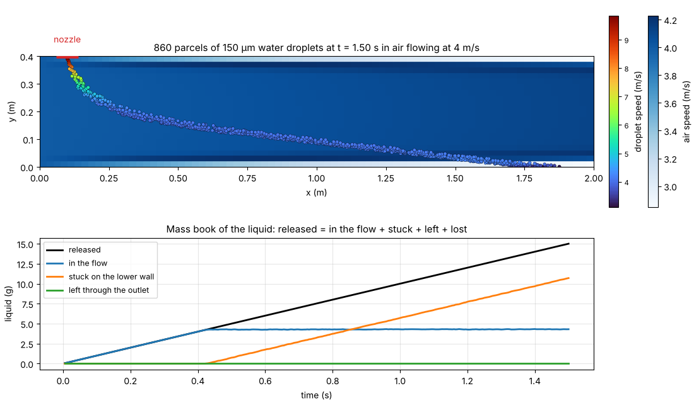

# Lagrangian sprays

Part of the [Example gallery](../gallery.md): droplets as Lagrangian parcels in the gas flow (L12, D240 to D246).

| # | Example | Stage | Feature |
|---|---|---|---|
| 242 | [Water droplets sprayed into an air duct](#spray-duct) | SP1 | `[spray]`, `[[injector]]`, `[liquid]`, drag of Schiller and Naumann, stick walls, mass book |
| 265 | [Where the liquid goes: datums and droplet statistics](#spray-datums) | SP1b | `[[datum]]` (cut plane, plane on faces, disc, STL surface, boundary, box), Rosin-Rammler sizes, `datums.csv`, histograms, D32 and Dv50, penetration, `series.json` |
| 280 | [A water spray that drives the air](#spray-two-way) | SP2 | `[spray.coupling] mode = "two-way"`, value-plus-slope momentum sources, passes inside the time step, coupling lag, momentum ledger pair, health numbers |
| 283 | [Water droplets cool a hot air stream](#spray-cooling) | SP2 | two-way sensible heat: droplet temperature, Ranz-Marshall heat transfer, energy sources in value-plus-slope form, temperature lag, enthalpy ledger pair |
| 285 | [Droplets spread by the turbulence of a duct](#spray-dispersion) | SP2 | `[spray] dispersion = "eddy-lifetime"` (Gosman and Ioannides), Gaussian eddies of variance 2k/3 keyed per parcel and eddy, eddy interaction time, crossing trajectories, spread by droplet size |
| 292 | [The spray-cooled duct as a steady state](#spray-steady) | SP2s | `[spray.steady]` (D260): parcel streams through the frozen steady gas, sources relaxed between passes, source residual in the convergence test, keyed streams, `spray/streams.vtkhdf` |
| 306 | [Water droplets evaporating in hot air](#spray-evaporation) | SP4, SP5 | `[spray.evaporation]` (Ranz-Marshall, Abramzon-Sirignano), `[spray.liquid] vapour`, vapour, mass and enthalpy sources in value-plus-slope form with the closing step (D250), vapour ledger pair, saturation limiter (D253) |
| 306b | [More water than the air can take, steady](#spray-saturation) | SP5, SP2s | evaporation in the steady spray mode, adiabatic saturation against the exact end state (V28.11, partly met) |
| 314 | [A fuel droplet's surface at diesel pressure](#spray-a-surface) | SA1 | `[spray.evaporation] equilibrium = "peng-robinson"`, `[spray.evaporation.peng_robinson]`: Peng-Robinson phase equilibrium of the fuel and the ambient gas at the droplet surface, latent heat from the same equation, the critical mixing state (D311, D312, D314) |
| 320 | [Where the last liquid evaporates: the Spray A mixing line](#spray-a-mixing-line) | SA1 | `realfluid::Streams`: the adiabatic mixing line of fuel and gas (frozen, Peng-Robinson equilibrium, ideal), stability test and flash, the saturation mixture fraction, the liquid length of Siebers (1999) against the measured Spray A lengths (D319, VA.4, VA.5) |

---

<a id="spray-duct"></a>
## 242. Water droplets sprayed into an air duct



`spray_duct.toml` blows air at 4 m/s through a duct (SST k-ω, transient). A
nozzle in the upper wall sprays 10 g/s of water as droplets of 150 µm with a
speed of 10 m/s in a cone of 10° half angle. The droplets are parcels, each
standing for the same share of the mass flow; the injector sits in
`spray_duct_injectors.toml`, which the case includes (D246).

Each parcel follows the exact solution of its relaxation equation over every
sub-step: the drag uses the correlation of Schiller and Naumann (1935), the
sub-step ends at every cell crossing, and a small droplet that follows the
gas needs no small step (D245: the kernel is one source for CPU and GPU).
Droplets that reach the lower wall stay there (`wall_mode = "stick"`); the
others leave through the outlet. About 70 % of the liquid lands on the wall
within the 1.5 s of the case.

**What this version does not do.** The gas does not feel the droplets
(one way); there is no turbulent dispersion, no evaporation and no
breakup. Gas properties are sampled at the start of each sub-step, so the
tracking is first order in the gas state. One process only (D241). The
next stage (SP2) adds the coupling to the gas and the size distributions.

**What is checked.** The run books every kilogram: injected = in the flow +
stuck + left + lost, and stops with SPR005 when the book does not close
(`spray.csv` has it in every row). The unit tests compare the tracker with
a reference trajectory on hexahedral, tetrahedral, polyhedral and mixed
meshes, the Stokes terminal velocity and the exponential relaxation to the
gas velocity, and require identical bits on 1, 2 and 4 threads and after a
restart.

Files: `spray/parcels_<step>.vtkhdf` (ParaView), `spray.csv`; the parcels
are part of the restart file. [Recipe 242](../recipes/sprays.md#spray-duct),
[case row](../cases/flow.md#lagrangian-sprays).

---

<a id="spray-datums"></a>
## 265. Where the liquid goes: datums and droplet statistics


`spray_datums.toml` is the duct of [242](#spray-duct) with a nozzle that
sprays 10 g/s of water with a Rosin-Rammler size distribution (X = 120 µm,
n = 2.5, from 10 to 400 µm; D242). Each parcel draws its diameter from the
mass distribution with the counter-based generator keyed by the parcel
identity (D121), so the sizes do not depend on threads or restarts.

Seven datums (`[[datum]]`, D262) ask where the liquid and the air go: a
plane cut through the cells at x = 0.6 m, the plane x = 1.2 m moved onto the
mesh faces, a disc of 0.1 m radius at x = 0.9 m, a surface file (STL) at
x = 1.6 m, the outlet, the lower wall and a box under the nozzle. Every
sub-step of a parcel that crosses a surface writes a crossing record; the
records are sorted by datum, parcel, sub-step and crossing and summed in
that order (D263), so the cumulative liquid through each datum has the same
bits on 1, 2 or 4 threads and after a restart.

After 1.5 s, of the 15 g injected, 8.3 g left through the outlet, 2.3 g
stick on the floor and 4.4 g are in the flow. The datum on the outlet is the
mass book's escaped liquid to the bit, the floor its deposited liquid. The
droplets sort by size: Dv50 is 91 µm at the outlet and 170 µm on the floor,
against 101 µm through the first plane (the input's Dv50 is 104 µm). The
Rosin-Rammler fit of the first plane's histogram gives X = 117 µm and
n = 2.6. In the flow the Sauter diameter D32 is 81 µm, and 95 % of the
liquid lies within 0.75 m of the nozzle along its axis (penetration, D265).

The gas side uses the same datums: through the cut plane the air mass flow
is 0.192 kg/s within 6 × 10⁻⁸ of the exact flow through the nearest face
layer (`cut_error`); the plane on the faces and the outlet are exact. The
disc (a 128-gon of equal area, of which the one-cell-thick 2D mesh holds the
middle strip) is cut through the cells, but its face layer is a staircase of
whole faces, so its `cut_error` is 4 %: here it measures the face layer, not
the cut. The STL surface is sampled finer than the cells and is within
0.1 % of the exact flow.

**What is checked** (V28.13 to V28.15). Planes, face layers, STL surfaces,
boundaries and boxes on hexahedral, tetrahedral and polyhedral meshes: the
liquid through every surface equals the liquid of the parcels that ended on
its far side, to round-off; the boundary datum equals the mass book. D32 of
the drawn sizes lies within four standard errors of the value of the
distribution, Dv50 within one bin; the sums are bitwise equal on 1, 2 and 4
threads and after a restart. In a flow run the outlet datum equals the
boundary mass flow bit for bit and the plane on the faces the inlet flow to
the solver tolerance.

**What this version does not do.** No measured anchor yet (V28.12, the
terminal velocity of Gunn and Kinzer, is still open); no enthalpy flow (the
energy equation with sprays comes with SP5); `datums.csv` only in transient
runs (steady runs report through `foehn call post.datums`); no size
classes, no time-averaged spray fields (D266, SP2) and no evaporation
numbers (SP5). Not with a sliding mesh. One process.

Files: `datums.csv`, `spray_hist_<datum>.csv`, `spray.csv` (penetration,
D32, centre of mass), `result.json` (all statistics with D20, D30, D43,
Dv10, Dv90, span, velocity statistics and the fit), `series.json`.
Picture: `python3 -m tools.plot.spray_datums OUT_DIR output/spray_datums`.
[Recipe 265](../recipes/sprays.md#spray-datums),
[case row](../cases/flow.md#lagrangian-sprays).

<a id="spray-two-way"></a>
## 280. A water spray that drives the air


`spray_two_way.toml` is a room of still air, 1.2 m wide and 1.5 m high
(2D, 60 × 75 cells, SST k-ω, Δt = 4 ms). A nozzle under the ceiling sprays
50 g/s of water downwards at 15 m/s in a cone of 12° half angle, with
Rosin-Rammler sizes from 50 to 400 µm (X = 150 µm, n = 2.5). With
`[spray.coupling] mode = "two-way"` the drag on the droplets is a
momentum source of the gas (D247 to D252): the falling spray pulls the air
down into a jet of up to 6 m/s, which spreads over the floor and comes back
up along the side walls to the vents in the ceiling. One way (SP1) the air
would stay at rest.

**How the coupling works.** A parcel pass tracks every parcel through one
frozen gas state; each sub-step, which ends at every cell face, writes a
record of the momentum the gas receives and its slope with respect to the
gas velocity of the cell. The records are sorted by cell, parcel and
sub-step and summed in that order, so the sources do not depend on the
storage order of the parcels or the number of threads. The gas takes them
as value plus slope, S = E − β (u − u*), like a porous sink: the slope sits
on the diagonal and in the pressure correction, so a dense spray cannot
push the gas past the droplets, however large the step. The passes run
inside the outer iterations of the PISO step until the coupling lag is
below 10⁻³ (at most three, the default). After the last gas solve a
closing step gives each parcel the correction the gas received, so both
books hold the same numbers.

In this run the spray hands the air a steady 0.77 N downwards after the
first half second. Of the 100 g injected, 85.7 g land on the floor
(`wall_mode = "stick"`), 14.2 g are in the air and 0.1 g leave through the
vents; no parcel is lost. The steps take 2.96 passes on average; 46 of the
500 steps stop at the third pass with the lag above the tolerance (at most
3.1 × 10⁻³; SPR006 warns once and `spray.csv` counts them). The strongest
coupling of a cell, β Δt / (ρ V), is 0.77; the liquid fills at most 0.5 %
of a cell, with at most 16 parcels in it. The run takes about 40 s on
four cores.

**What is checked** (V28.1 to V28.4). A cloud shot into one cell of gas
at rest, with liquid loadings of 0.1 to 10 and time steps of 0.1 to 100
droplet response times: gas and droplets reach one common velocity, the
mixture keeps the momentum it was given, the force on the gas never
changes sign, and the momentum the gas received plus the momentum of the
parcels equals the momentum injected to round-off. One fixed pass is
bounded and conservative too. Against a reference of the two-mass
relaxation integrated by RK4 with small steps, the error falls at order
0.99 and 0.96 as Δt halves from 2 ms to 0.5 ms. The sources are bitwise
equal with the parcels stored in reverse order and on one thread (hex,
tetrahedral and polyhedral meshes), whole runs on 1 and 4 threads; the
slopes of one parcel add up to at most its mass. A parcel on a cell face
with the gas of both cells pushing it back across the face is not lost.
In the ledger the exchange is a pair (`spray drag` on the gas momentum,
`from the gas` on the parcel momentum) whose residual is zero to the bit,
and the parcel momentum account closes with the weight, the injection, the
walls and the parcels that left. The gas momentum accounts hold only this
term for now, so their imbalance is the force of the walls and the
pressure on the gas.

**What this version does not do.** Momentum only: no heat exchange (SP2b),
no turbulent dispersion (SP2c), no evaporation (SP5). Not with the energy
equation, conjugate heat transfer or an algorithm other than PISO (SPR003; the
steady spray mode is SP2s). The slope is the diagonal of the coupling: a
parcel that crosses cells in one step couples the neighbour cells only
through the passes. First order in time (the gas state at the new time
level, D248). One process. No time-step study tool yet (D254 (4)).

Files: `spray.csv` (passes, coupling lag, gas force, power and the health
numbers per step), `result.json` (coupling summary and ledger).
Picture: `python3 -m tools.plot.spray_two_way OUT_DIR output/spray_two_way`.
[Recipe 280](../recipes/sprays.md#spray-two-way),
[case row](../cases/flow.md#lagrangian-sprays).

<a id="spray-cooling"></a>
## 283. Water droplets cool a hot air stream


`spray_cooling.toml` is a duct of 2 m by 0.4 m (2D, 100 × 20 cells,
SST k-ω, Δt = 2 ms) with air at 300 °C entering at 5 m/s. Walls are
adiabatic. A nozzle 0.15 m behind the inlet sprays 10 g/s of water at
20 °C along the duct at 15 m/s, in a cone of 15° half angle, with
Rosin-Rammler sizes from 20 to 200 µm (X = 60 µm, n = 3). This is the lead
application of the sprays (D240) with sensible heat only: with `[energy]`
and `[spray.coupling] mode = "two-way"` every parcel carries a temperature,
and the heat it takes up is a source of the gas energy in the cells it
passes (D247 to D252). The cold core of the spray is visible behind the
nozzle; the air leaves the duct about 50 K cooler.

**How the heat is coupled.** In each sub-step the parcel temperature
relaxes exactly towards the gas temperature of its cell,
T_p ← T_g + (T_p − T_g) e^(−δt/τ_h), with τ_h = ρ_p c_p d² / (6 Nu k) and
the Nusselt number of Ranz and Marshall, Nu = 2 + 0.6 Re^½ Pr^⅓. The record
of the sub-step holds the heat the gas gives and its slope with respect to
the gas temperature, found as for momentum (the slopes of one parcel add up
to at most m c_p). The records are sorted and summed per cell, and the
energy equation takes them as value plus slope, Q = E − G (T − T*): G sits
on the diagonal, so the gas cannot be cooled below the droplets, however
large the step. The passes stop when both the velocity lag and the
temperature lag (the change of the gas temperature of a spray cell against
the frozen state, over the largest temperature difference between gas and
droplets) are below the tolerance. The closing step gives each parcel the
heat the gas actually lost.

In this run the droplets take a steady 6.6 kW from the air after 0.3 s;
their mean temperature levels out near 150 °C. Of the 10 g injected,
7.4 g leave through the outlet and 2.6 g are in the duct at the end; no
parcel is lost. The steps take 3.7 passes on average, with `max_passes =
4`: the temperature lag falls by a factor of about 7 per pass, the
velocity lag by about 10, so at the default of three passes most steps of
this case end at a lag of 1 to 3 × 10⁻³ (SPR006). With four, one of the
500 steps ends above 10⁻³ (1.04 × 10⁻³). The strongest thermal coupling of
a cell, G Δt / (ρ c_p V), is 1.3. The run takes about 30 s.

**What is checked** (V28.1 to V28.4 for heat). A cloud of water at 300 K
in one cell of air at 400 K, at liquid loadings of 0.1 and 1 and time steps
of 0.03 to 23 thermal response times: gas and droplets reach the mixture
temperature to 10⁻⁹, the mixture keeps its enthalpy, the gas never gains
heat, and the enthalpy the parcels gained equals what the gas lost to
round-off. Against a fourth-order reference of the two-temperature
relaxation the error falls at order 1.03 and 1.04 as the step halves. The
heat sources are bitwise equal with the parcels stored in reverse order and
on one thread; whole runs give the same bits on 1 and 4 threads. In the
ledger the exchange is the pair 2804 (`spray heat` on the thermal energy
account of the energy equation, `from the gas` on the account `parcel
enthalpy`) whose residual is zero to the bit; the parcel enthalpy account
closes with the injection and what left the flow to 10⁻¹⁴, and the thermal
account of the gas, now with the spray term, to 2 × 10⁻¹² in the last
step.

**What this version does not do.** Sensible heat only: no evaporation,
latent heat or vapour (SP4, SP5), so a droplet can get hotter than the
boiling point; this case stops short of that. Constant liquid properties,
one temperature per droplet (no conduction inside it), no radiation to the
droplets. Not checked yet against the one-dimensional duct reference
(V28.16) or the plug-flow reference of the cooling duct (V28.21, with
evaporation). Not with conjugate heat transfer or an algorithm other than
PISO (SPR003). One process.

Files: `spray.csv` (adds `t_mean_k`, `gas_heat_w` and `coupling_heat_max`
per step), `result.json` (coupling summary with the heat totals, ledger),
parcel files with a `temperature` field.
Picture: `python3 -m tools.plot.spray_cooling OUT_DIR output/spray_cooling`.
[Recipe 283](../recipes/sprays.md#spray-cooling),
[case row](../cases/flow.md#lagrangian-sprays).

<a id="spray-dispersion"></a>
## 285. Droplets spread by the turbulence of a duct


`spray_dispersion.toml` is a duct of 3 m by 0.3 m (2D, 150 × 30 cells,
SST k-ω, Δt = 2 ms) with air entering at 10 m/s and 10 % turbulence
(k = 1.5 m²/s², viscosity ratio 2000, so the turbulence lives over the
length of the duct). A needle nozzle on the axis 0.2 m behind the inlet
shoots 2 g/s of water straight downstream at the speed of the air, without
a cone, as droplets of 20 to 300 µm (Rosin-Rammler, X = 120 µm, n = 2.5).
Gravity is left out, so every sideways movement of a droplet comes from
the turbulence: with `[spray] dispersion = "eddy-lifetime"` (D243) the
line of droplets widens into a plume that fills the duct after about 2 m.

**How the eddies work** (Gosman and Ioannides 1983). A parcel sees the
mean gas velocity plus a fluctuation u′ whose components are Gaussian with
variance 2k/3, drawn when it enters an eddy and kept while it stays in it.
The eddy has the length l_e = C_μ^¾ k^{3/2}/ε and the lifetime
τ_e = l_e/(2k/3)^½; the parcel leaves it after τ_e or, if it is heavy and
slips through the eddy, after the crossing time
t_cr = −τ_p ln(1 − l_e/(τ_p |u + u′ − v|)), whichever is shorter. A sub-step
ends where the eddy ends (D251). The random numbers come from the stream
`SPRAY_DISPERSION`, keyed by the parcel and the number of eddies it has
entered (D121): every pass of a time step and every thread count draws the
same numbers, so two-way coupling with dispersion stays bitwise
reproducible and its passes can converge. ε comes from the k-ε family or
as β* k ω from SST; in a 2D case the eddies have no z component.

In this run the spread after 1 m is 5.4 cm for the droplets of 20 to
60 µm, 4.4 cm for 60 to 150 µm and 2.9 cm for 150 to 300 µm: the large
droplets respond more slowly to each eddy. Towards the end of the duct the
walls limit the spread of all classes. Of the 1.2 g injected, 0.59 g leave
through the outlet, 0.07 g stick on the walls and 0.54 g are in the duct;
no parcel is lost. The coupling is two-way at a light loading (1.8 passes
per step, none above the tolerance). The run takes about 20 s.

**What is checked.** Tracers (1 µm) in turbulence at rest with uniform k
and ε spread as the random walk the model is: after a time
T = n τ_e + r the mean square displacement per component is
(2k/3)(n τ_e² + r²); for 20 000 tracers it is within 1.3 % of that in
each component (the band is four standard errors, 4 %), and the mean
displacement is zero within four standard errors. Droplets of 300 µm that
fall at 1.1 m/s through eddies of 5 cm cross them (16 eddies in 1 s
against 5 for a tracer) and spread a third as far sideways. The eddy times
of the kernel match the formulas, including the limit l_e/|w| for a parcel
not slowed in the eddy. Sources, closing step and parcel states with
eddies are bitwise equal with the parcels stored in reverse order and on
one thread (hex, tetrahedral and polyhedral meshes), whole runs on 1 and 4
threads; the momentum books close to round-off. A case without a
turbulence model is refused (SPR001).

**What this version does not do.** No continuous random walk yet (D243:
the second value of the same key, refused for now). Isotropic eddies: no
anisotropy near walls, where the model overestimates the wall-normal
fluctuation (a known flaw of the eddy-lifetime model; deposition rates on
walls are not to be trusted). The droplets do not change the turbulence
(no turbulence modulation). Not compared yet with the grid-turbulence
measurements of V28.17 (Snyder and Lumley 1971; Wells and Stock 1983).
One process.

Files: `spray.csv`, `result.json`, parcel files every 25 steps.
Picture: `python3 -m tools.plot.spray_dispersion OUT_DIR output/spray_dispersion`.
[Recipe 285](../recipes/sprays.md#spray-dispersion),
[case row](../cases/flow.md#lagrangian-sprays).

<a id="spray-steady"></a>
## 292. The spray-cooled duct as a steady state


`spray_cooling_steady.toml` is the duct of
[gallery 283](#spray-cooling) (2D, 100 × 20 cells, SST k-ω, air at 300 °C
and 5 m/s, 10 g/s of water at 20 °C from a nozzle 0.15 m behind the inlet,
20 to 200 µm) without `[time]`: the gas is solved as a steady state with
SIMPLE and the spray runs in the steady mode of D260. A parcel is a
*stream* here: it stands for a number of droplets per second, so its mass
is a mass flow (kg/s), and it is followed from the nozzle through the
frozen gas field until it leaves, sticks or reaches `max_time`. The 400
streams of the case share the 10 g/s; sizes, directions and (with
dispersion) the eddies are drawn from random numbers keyed by the seed and
the stream alone, so every pass follows the same streams and the iteration
has a fixed point.

**How the steady coupling works.** Every 10 outer iterations a stream pass
runs: the same pure parcel function, sorted per-cell sums and value-plus-slope
records as in the transient coupling (D247 to D251), with sub-steps along
the path in place of a time step. The gas does not take the sources of one
pass directly but holds them in the relaxed form S(u) = A − β u for
momentum and Q(T) = B − G T for heat, A ← A + α (A_new − A) with α = 0.5,
and the same for β, B and G. There is no closing step, since no parcel
state is carried from one pass to the next. The *source residual*, the
difference between the held sources and those of the last pass over the
sources of the last pass (summed over the spray cells, the larger of
momentum and heat), is part of the convergence test: the run is converged
only when the gas residuals are below the solver tolerance and the source
residual is below `[spray.steady] tolerance`. A run that ends above it
warns with SPR008 and is not reported as converged.

In this run the gas and the spray converge together in 526 outer
iterations and 58 passes (14 s on the 4 cores of the cloud machine); the source residual ends at
1.0 × 10⁻⁴ (momentum; heat 2.0 × 10⁻⁵). All 10 g/s leave through the
outlet, no stream is lost or unfinished; the droplets stay 0.26 s on
average and 0.33 s at most in the duct. The spray takes 6.39 kW from the
air, which leaves at a mass-flow mean of 249.1 °C. The health numbers are
β/ṁ up to 0.27 and G/(ṁ c_p) up to 0.39, where ṁ is the gas mass flow
through the cell, and a liquid volume fraction up to 3.4 × 10⁻⁴.

**Against the transient run** (V28.9, without evaporation). The transient
case of gallery 283 marched for 2 s takes 6.58 kW from the air as the time
mean after 0.3 s, with a standard error of 0.03 kW over seven windows of
0.25 s; halving its step to 1 ms adds about 1 %. The steady mode is 2.9 %
below that, more than the sampling and step errors of the transient run
explain, and its outlet is 1.5 K warmer. The reason is the flow: behind the
nozzle the transient duct does not come to rest (the mixed temperature of
its last step wavers by several kelvin around the steady curve, bottom
left), and the time mean of an unsteady flow need not be its steady state.
V28.9 is therefore *not met* in the strict form of section 5.9; the
difference is written down as a gap. Other seeds give 6.38 and 6.36 kW,
1600 streams 6.37 kW, so the sample of 400 streams is good to about 0.3 %.

**What is checked.** V28.10: `spray.csv` and the residuals of whole runs
are bitwise equal on 1 and 4 threads, with and without eddy-lifetime
dispersion. One stream of 50 µm in a uniform gas at 2 m/s needs the
residence time of a fourth-order integration of its equation of motion to
7 × 10⁻⁵, and the momentum it takes from the gas equals its mass flow
times the exit speed. Another seed draws other streams (other heat, within
10 %). In the ledger the stream pass books the pairs 2801 to 2803
(momentum) and 2804 (heat) on the gas and the parcel accounts with the
sources of the final pass on both sides, so the pairs are zero to the bit;
the gas accounts carry the difference to the held sources as the term
`spray source residual`, the parcel accounts close to about 10⁻¹⁶, the
thermal account of the gas to 10⁻⁶. A steady spray with `[time]` or with
injectors that start or end is refused (SPR002), as is the steady mode
with solid regions or two-way with the coupled algorithm (SPR003).

**What this version does not do.** No evaporation (SP5; V28.11, the duct
with more water than the gas can take, waits for it). V28.9 is 2.9 % apart
(above). The saturation limiter of D253 comes with evaporation; the
health numbers of D254 (with the gas mass flow through the cell in place
of the time step) are reported, not acted on. Datums report no liquid in the steady mode. Not with solid regions
(CHT) or the coupled algorithm; one process. The statistical error is
estimated by hand with other seeds, not yet by a study tool (D196).

Files: `spray.csv` (one row per pass: relaxation, source residuals, streams,
liquid per boundary, residence times, force and heat on the gas, health
numbers), `result.json` (`spray_steady` summary, ledger),
`spray/streams.vtkhdf` (the stream paths of the final pass as points with
velocity, diameter, temperature, droplet rate, residence time, stream id).
Picture:
`python3 -m tools.plot.spray_cooling_steady OUT_DIR output/spray_cooling_steady [output/spray_cooling]`.
[Recipe 292](../recipes/sprays.md#spray-steady),
[case row](../cases/flow.md#lagrangian-sprays).

---

<a id="spray-evaporation"></a>
## 306. Water droplets evaporating in hot air


`spray_evaporation.toml` blows air at 300 °C with a little water vapour
(Y_H2O = 0.005) at 5 m/s through a duct of 1 m by 0.2 m (2D, 100 × 20
cells, SST k-ω, transient). A nozzle 0.1 m behind the inlet sprays 2 g/s of
water at 20 °C as droplets of 10 to 80 µm (Rosin-Rammler). The liquid file
names the species it evaporates into, `vapour = "H2O"`, and
`[spray.evaporation] model = "ranz-marshall"` switches the evaporation on
(SP4, SP5).

**How the droplet evaporates.** Inside each sub-step the gas is frozen and
the droplet follows the classical film model: the surface holds the
saturation state of its temperature (vapour pressure of the IAPWS-95
auxiliary equation), the vapour leaves at the rate π d ρ D Sh ln(1 + B_M),
so d² falls linearly over the sub-step (Godsave 1953, Spalding 1953), and
the temperature relaxes exactly towards the wet-bulb balance of the
frozen coefficients (D251). `abramzon-sirignano` adds the film thickening
by the blowing (Abramzon and Sirignano 1989). A droplet whose life ends
inside a sub-step evaporates there completely.

**How the gas takes the vapour.** Each sub-step writes a record with the
vapour it gives the cell, the slope of that vapour with respect to the
vapour fraction of the cell (the chord to the saturation state at the
surface, D250), the heat and the momentum. The records are sorted and summed
per cell, so the sources do not depend on the parcel order or the thread
count (D247 to D249). The gas takes the vapour as S_v(Y) = E − β (Y − Y*):
into the species H2O (the other species are diluted), into the continuity
equation as mass, and with the enthalpy it carries into the energy
equation. After the passes of a step the closing step gives every droplet
back what the slope took or gave, as liquid at its temperature plus the
share of the latent heat the droplet's heat relaxation passes on in the
step. So the heat the droplet draws follows its evaporation, and a cell
that saturates ends at the adiabatic saturation, not below it.

**The safety net of D253.** When the evaporation of a cell is above what
brings the gas the cell holds and the gas that flows in during the step to
adiabatic saturation, every evaporating record of the cell is scaled by
one factor; the held-back vapour stays liquid in its parcel. The limiter
never acts silently: `spray.csv` counts the cells and the mass, and the run
warns with SPR009. In this run it acts in 50 cell-steps of the 200 steps,
holding back at most 5 × 10⁻⁷ kg/s.

In this run about 1.25 g/s of the 2 g/s evaporate in the duct; the air
leaves at a mass-flow mean of 244 °C and with 2.5 % vapour. **Finding:**
the coupling lag falls more slowly with evaporation than with heat alone,
by a factor of about 1.6 per pass: with `max_passes = 4` most steps ended
at 1.5 to 7 × 10⁻³, so the case asks for 8 (6.6 passes per step on average,
24 of 200 steps end at 8 with a lag of about 1.2 × 10⁻³, SPR006).

**What is checked.** A single droplet of 100 µm at 300 K in still dry air
at 500 K follows the d² law at the wet-bulb temperature (local K within 1 %,
temperature within 0.05 K). A closed cell of air at 400 K with more water
than it can take ends at the exact adiabatic saturation within 0.003 K for
the gas and 0.1 K for the liquid, with water and energy of gas plus
parcels kept to 10⁻¹². 4000 parcels evaporating in one cell at 95 %
saturation never push the vapour past the droplet saturation or below
zero, and give the same bits on 1 and 4 threads with the storage reversed.
In the flow the ledger pairs 2801 to 2805 (momentum, heat, vapour) are zero
to the bit, the parcel accounts close to 10⁻¹², and `spray.csv` is bitwise
equal on 1 and 4 threads.

**What this version does not do.** Water only (its vapour-pressure law and
latent heat); no boiling, no multicomponent liquids. The heat balance closes
to round-off with `[species] properties = "fluid"`; with the mixture
properties of the species the energy account keeps a few parts in a
thousand. Constant density in this example: the transient domain mass check
does not yet hold for heated variable-density cases. No GPU entry for the
evaporation kernel; one process.

Files: `spray.csv` (with `evaporated_kg`, `gas_vapour_kg_s`,
`vapour_lag_kg_s`, `coupling_vapour_max`, `limiter_cells`, `limiter_kg_s`),
`spray/parcels_<step>.vtkhdf`, `fields.vtkhdf` with `Y_H2O`.
[Recipe 306](../recipes/sprays.md#spray-evaporation),
[case row](../cases/flow.md#lagrangian-sprays).

---

<a id="spray-saturation"></a>
## 306b. More water than the air can take, steady


`spray_saturation_steady.toml` is check V28.11 of the spray plan: dry air
at 400 K (Y_H2O = 0.001) flows at 2 m/s through a duct of 1 m by 0.1 m
(2D, laminar, slip walls), and six nozzles across the height spray 2 g/s of
water at 310 K as droplets of 4 to 25 µm, three times what the 17.6 g/s of
air can take. The case has no `[time]`, so the spray runs as streams in the
steady mode of [292](#spray-steady), now with evaporation: the stream
passes hand the gas vapour, mass and enthalpy in the relaxed form
V − W Y, and the saturation limiter of D253 uses the mass flow through a
cell in place of the time step.

The exact end state is the adiabatic saturation of the inlet air from its
enthalpy balance, c_p dT = −L(T) dY/(1 − Y) up to Y = Y_s(T): 310.1 K and
Y = 0.0395, with 0.706 g/s evaporated.

**What the run shows.** The fine droplets evaporate within one or two
cells of the nozzles; behind them the air is saturated and stays flat to
the outlet (the mean vapour fraction varies by 3 × 10⁻⁴ of itself), and the
rest of the water leaves as liquid. The outlet is at 309.3 K and
Y = 0.0375, saturated at its own temperature, 0.8 K and 5 % in vapour below
the exact state. The source residual falls from 1 to about 0.12 in 20
passes and then stalls; it stalls at the same level with the relaxation
lowered to 0.1 and 0.03 (300 and 500 passes). The run therefore ends with
SPR008 (not converged), and the limiter still holds back about 0.14 g/s in
the final pass (SPR009). **V28.11 is partly met**: the outlet saturates
and the vapour fraction does not fall along the duct by more than
3 × 10⁻⁴ of itself, but the source residual does not keep falling and the end state is
below the exact one. Written down as a gap of the feature row.

Before this work the steady mode with evaporation failed in a different
way: the gas overcooled to below 200 K and the run diverged. Two changes
fixed that and apply to the transient mode as well: the heat the droplet
draws now follows a change of its evaporation (above), and the limiter
counts the gas that flows into a cell.

**What this version does not do.** The stall of the source residual is
not understood yet; candidates are the limiter acting in every pass and the
sub-step boundaries moving with the gas. Water only; one process.

[Recipe 306](../recipes/sprays.md#spray-evaporation),
[case row](../cases/flow.md#lagrangian-sprays).

---

<a id="spray-a-surface"></a>
## 314. A fuel droplet's surface at diesel pressure


ECN Spray A injects n-dodecane at 363 K into nitrogen at 900 K and about
6 MPa. At that pressure Raoult's law (the fuel's vapour pressure over the
ambient pressure) no longer gives the fuel at the droplet surface: the
dense nitrogen dissolves in the liquid and pulls more fuel into the vapour.
`[spray.evaporation] equilibrium = "peng-robinson"` solves the phase
equilibrium of the fuel and the ambient gases at the surface with the
Peng-Robinson equation of state (D311) and takes the latent heat from the
same equation (D312), so it goes to zero where liquid and vapour become
one, the critical mixing state (D314).

The image comes from `cargo run --release -p foehncraft-particles --example
spray_a_surface` and `tools/plot/spray_a_surface.py`. **Left:** the fuel
vapour fraction at the surface over Raoult's value. At 1 MPa it stays close
to Raoult and ends at the boiling point; at 6 MPa it is 1.5 to 1.9 times
Raoult from 450 to 600 K and the two-phase surface ends at the critical
mixing temperature 651.3 K, which falls as the pressure rises. **Middle:**
the latent heat over its value at saturation (solid) falls by 11 to 15 %
at 6 MPa and to zero at the critical end; 8 to 20 mol % nitrogen is
dissolved in the surface liquid (dashed). **Right:** the bubble pressure
of nitrogen in n-dodecane against the measured points of García-Córdova et
al. (2011, doi 10.1021/je1012372).

```toml
[spray.liquid]
name = "n-dodecane"       # built-in high-pressure data (Ambrose and Walton 1989)

[spray.evaporation]
model = "abramzon-sirignano"
equilibrium = "peng-robinson"

[spray.evaporation.peng_robinson]
ambient = { N2 = 1.0 }    # mole fractions of the gas far from the droplets
# k_ij = { N2 = 0.205 }   # the built-in value, fitted to measured bubble points
```

**What is checked.** The n-dodecane vapour pressure with the fitted
Mathias-Copeman α is within 1 % of the measured Wagner equation of Ambrose
and Walton (1989) from 300 K to 655 K (VA.1); the plain κ(ω) of 1978 is
16 % off at 300 K, near the 363 K of the injected fuel. k_ij = 0.205 for
nitrogen is our fit to the 75 measured bubble points up to 20 MPa (mean
deviation 2.7 %, at most 9.1 %; VA.2). As the pressure goes to zero the
surface tends to Raoult's law (VA.3). The spray takes the table's surface
fraction and latent heat bit for bit, the gas receives the vapour at the
enthalpy the parcel gives up, so the books close, and parcels above the
critical mixing temperature are counted (`critical_parcels`,
`critical_mass`).

**What this version does not do.** Above 550 K one k_ij leaves the
bubble pressure 3 to 9 % low; the surface fuel fraction moves by 2 to 6 %
between the k_ij of the whole data set and of the hot isotherms. The
dissolved gas is not booked (the liquid stays pure fuel), and the gas
solver stays an ideal gas, so the departure enthalpy of the dense vapour
enters the gas as a small heat deficit (D317). Built-in high-pressure data
for n-dodecane only; any other liquid can give its critical point,
acentric factor and molar mass. The Spray A flow case comes with the
breakup model and the n-dodecane vapour species (stages SA2 to SA6 of
[the Spray A plan](../requirements/step28-spray-a.md)).

[Recipe 314](../recipes/sprays.md#spray-a-surface),
[plan](../requirements/step28-spray-a.md).

---

<a id="spray-a-mixing-line"></a>
## 320. Where the last liquid evaporates: the Spray A mixing line


A mixing-limited spray loses its last liquid where the entrained hot gas
has brought just enough enthalpy to evaporate all the fuel. Along the
adiabatic mixing line of the fuel and the ambient, that is the saturation
mixture fraction Z_sat, and the liquid length of Siebers (1999) follows
from it. Checking this line before any CFD (D319) separates the
thermodynamics from the spray model: an error in the Spray A liquid length
can then be traced to one or the other.

The image comes from `cargo run --release -p foehncraft-particles --example
spray_a_mixing_line` and `tools/plot/spray_a_mixing_line.py`. **Left:**
363 K n-dodecane into 900 K nitrogen at 6 MPa. Up to Z_sat the three lines
agree; the Peng-Robinson flash (equilibrium) reaches two phases at
Z_sat = 0.356, later than the ideal line (ideal gas, Raoult's law) at
0.320, because the dense nitrogen holds more fuel vapour. The frozen line
keeps one phase of the same equation where the flash splits and cools
further. **Middle:** the liquid mass fraction in the two-phase region; at
high Z the high-pressure liquid carries dissolved nitrogen, so it weighs
more than the fuel alone. **Right:** Siebers' liquid length with our
Z_sat at the four conditions where the ECN publishes a measured length.

```rust
use foehncraft_kernels::realfluid::{Mixing, Streams};
let line = Streams { mix: &mix, ideal: &h_ig, p: 6e6, t_fuel: 363.0, t_gas: 900.0, gas };
let pt = line.point(0.5, Mixing::Equilibrium);       // T, liquid fraction, density
let z_sat = line.saturation(Mixing::Equilibrium);    // Some(0.356)
let l = foehncraft_particles::siebers_liquid_length(z_sat.unwrap(), 703.71, 22.8, 0.95, 90e-6, 21.5);
```

**What is checked.** The isobaric, isenthalpic state is found by bisection
on the temperature; its enthalpy equals that of the mixed streams to
7e-16 of the stream difference on all three lines, and the ends are the
streams (VA.4). The stability test of Michelsen (1982) and the flash
(Rachford-Rice, successive substitution, Newton) give, for the binary, the
same coexisting phases as the droplet surface of gallery 314, and the
frozen line becomes unstable exactly where the flash splits. The ideal gas
of n-dodecane is Scott's (1974) c_p, n-decane plus two CH₂ increments,
within 0.11 % of the reference equation of Lemmon and Huber (2004).

**What this version does not do.** Siebers' scaling with C_L = 0.62 and
the measured 21.5° spreading angle (Pickett et al. 2011) gives lengths 30
to 48 % below the measured ones with the equilibrium Z_sat and 20 to 45 %
with the ideal one: the real fluid shortens the length by 5 to 14 % and
moves it away from the measurement, so the plan's expectation (the real
fluid closer, VA.5) is not met. C_L was set by Siebers with his own way of
computing B, which is not in an open paper; the trends with temperature
and density are right, the 700 K length 14 % too long relative to 900 K.
The mixing line is a check, not a model of the solver: the spray itself
evaporates droplet by droplet (gallery 314) and the Spray A flow case comes
in stage SA6.

[Recipe 320](../recipes/sprays.md#spray-a-mixing-line),
[plan](../requirements/step28-spray-a.md).
