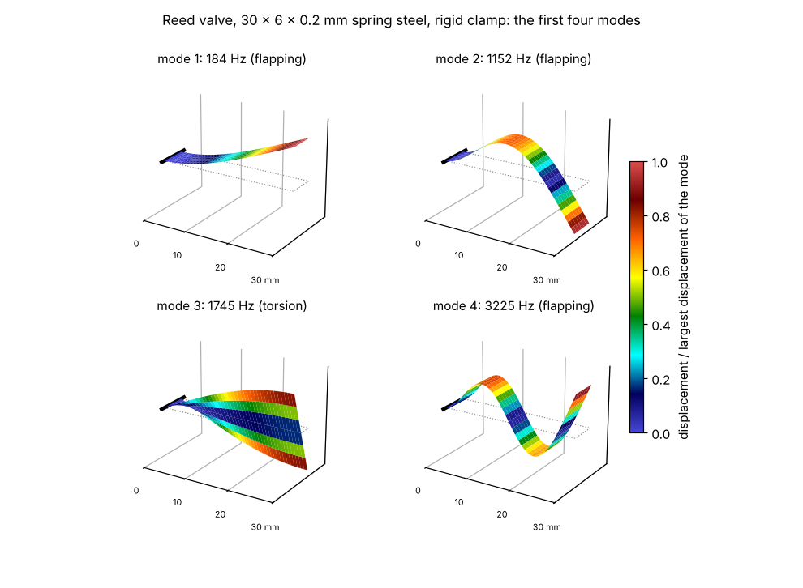
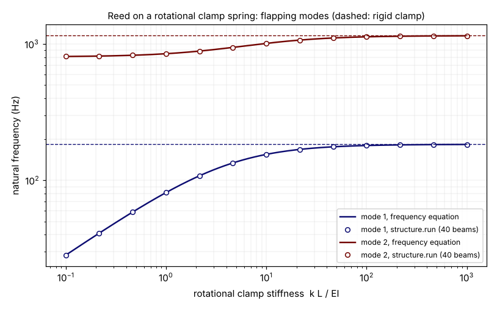
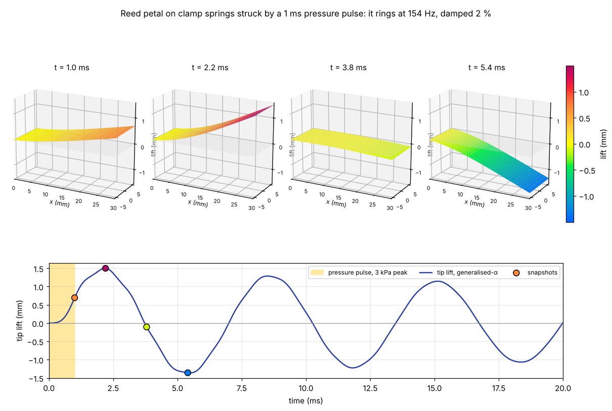
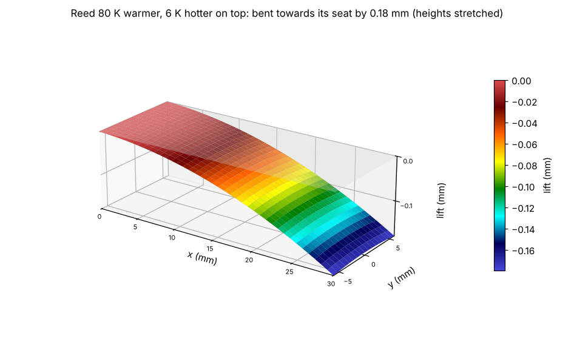
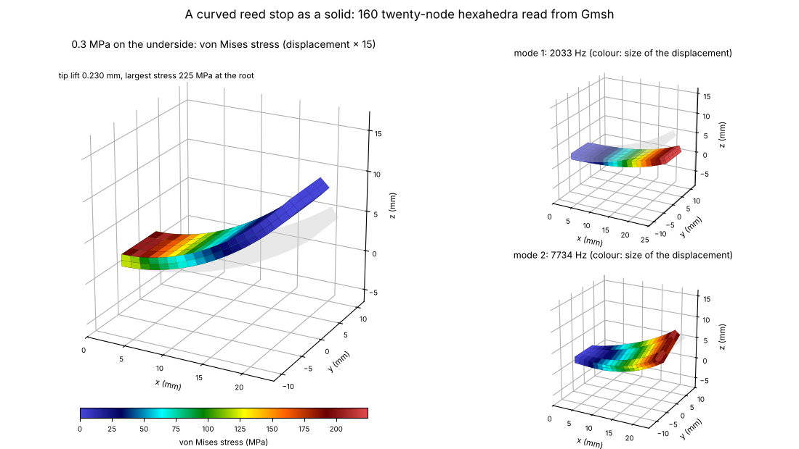
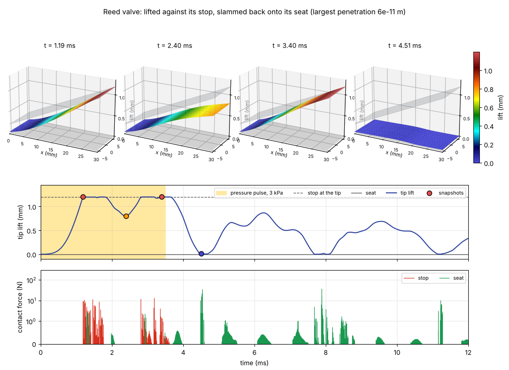

# Structures

Part of the [Example gallery](../gallery.md): the linear structural solver of the crate `foehncraft-structure` (L53, stage MS5 of the [moving solids plan](../assessments/moving-solids-reed-valves-plan.md)), made for reed valves and other parts that the flow moves. Part 1 has Euler–Bernoulli and Timoshenko beams, clamp springs per length of the clamp line (D290) with the fit to a measured frequency, static analysis and modes by shift-invert Lanczos with a Sturm check; part 2 adds MITC4 and MITC3+ shells for plates and reed petals; part 3 adds the response in time (generalised-α, mode superposition, Rayleigh and modal damping, Craig–Bampton reduction) and thermal strain loads from a temperature field. Solid elements and contact follow in the next parts of MS5; the coupling to the flow is MS6.

| # | Example | Stage | Feature |
|---|---|---|---|
| 295 | [A reed valve as a beam: modes, and the clamp spring against the frequency equation](#reed-beam) | MS5 | `structure.run`, `structure.fitclamp`, `[[beams]]`, `[[clamps]]` |
| 297 | [A reed petal as a shell: bending and twist on clamp springs](#reed-plate) | MS5 | `structure.run`, `[[plates]]`, `[[pressures]]`, `[[clamps]] along` |
| 299 | [A reed struck by a pressure pulse, and a hot reed](#reed-dynamics) | MS5 | `[transient]`, `[damping]`, `[histories]`, `[[temperatures]]` |

---

<a id="reed-beam"></a>
## 295. A reed valve as a beam: modes, and the clamp spring against the frequency equation



**The reed.** `examples/cases/structure/reed_beam.toml` is a reed of
spring steel (E = 206 GPa, ν = 0.3, ρ = 7850 kg/m³), 30 mm free length,
6 mm wide and 0.2 mm thick, as 40 Timoshenko beams along x, lifting along
z. The clamp at x = 0 holds every unknown of the root; with no springs
given it is rigid, and `result.json` says so (`"rigid": true` for the
translation and the rotation). The case asks for the static deflection
under 2 kPa over the width (12 N/m) and the first eight modes:

```sh
cargo build --release -p foehncraft-cli
target/release/foehn call structure.run --input examples/cases/tools/structure_reed_beam.json
```

```text
reed_beam: 8 modes, Sturm check passed
  mode   1      183.887139 Hz
  mode   2     1152.160832 Hz
  mode   3     1745.491401 Hz
  mode   4     3225.002430 Hz
  ...
reed_beam: static, largest displacement 1.474581e-3 m
```

The tip deflects 1.4746 mm, the deflection of the cantilever under a
uniform load qL⁴/(8EI) + qL²/(2κGA) to the printed digits (shear adds
0.005 %). The flapping modes 1, 2 and 4 are those of the clamped–free beam
(β_n L = 1.875, 4.694, 7.855, Blevins 1979). Mode 3 is the first torsion
mode, which the picture shows because every node of the beam carries its
6 mm section, moved by the axis and turned by the rotation. The Sturm
check counts the eigenvalues of K − σM below and above the modes found
from the signs of the pivots of its factorisation: no mode was skipped.



**The clamp spring (D290).** A real reed is held by a clamp plate that
gives a little: `[[clamps]]` takes a translational stiffness along the
lift (`k_translation`, N/m per metre of clamp line) and a rotational one
about the clamp line (`k_rotation`, N·m/rad per metre), times the clamp
width (the 6 mm of the section). The picture sweeps the rotational spring
from soft (kL/EI = 0.1) to stiff (1000): `structure.run` with 40
Euler–Bernoulli beams lies on the frequency equation of the beam with a
rotational root spring (w(0) = 0, EI w''(0) = k w'(0), free tip) within
1.3·10⁻⁷ for both flapping modes, and both approach the rigid clamp from
below. `reed_beam_clamp_springs.toml` mounts the reed on
k_rotation = 40 N·m/rad per m and k_translation = 2·10⁷ N/m per m: the
first mode falls from 184 Hz to 152 Hz.

**The fit.** `structure.fitclamp` finds the spring that gives a measured
frequency. A stiffer spring raises every natural frequency, so the root is
unique; the fit brackets it by factors of ten and refines it by the
Illinois method on ln k:

```sh
target/release/foehn call structure.fitclamp --input examples/cases/tools/structure_fit_clamp.json
```

```text
clamp 0 rotation: k = 3.693688e1 per metre of clamp line (2.216213e-1 in total), mode 1 at 150.000000 Hz (rigid clamp 183.709967 Hz), 11 modal solves
```

A measured frequency at or above the rigidly clamped model cannot be met
by any spring; the fit stops with `STR004` and says the model is too soft
(free length, thickness or modulus).

**Verification** (`crates/foehncraft-structure/tests/beams.rs`):

| Check | Exact solution | Result |
|---|---|---|
| Tip load on a cantilever, 1, 7 and 40 elements | PL³/(3EI) (+ PL/(κGA)), tip slope PL²/(2EI) | within 10⁻⁸ (rounding of a reed whose axial stiffness is 10⁸ times its bending one) |
| Uniform load, every node | qx²(6L² − 4Lx + x²)/(24EI) (+ shear) | within 10⁻¹⁰ of the tip value |
| Cantilever modes 1 to 5, Euler–Bernoulli | β_n L of Blevins (1979) | within 2·10⁻⁵ on 40 elements, fourth order (3.8 to 4.2); first mode 61.3 % effective mass |
| Pinned round bar, L/d = 10, Timoshenko | the frequency equation of the pinned Timoshenko beam (Han, Benaroya & Wei 1999) | within 10⁻⁵ on 120 elements, second order; below Euler–Bernoulli |
| Clamp springs, static | PL³/(3EI) + PL²/k_r + P/k_t | within 10⁻¹⁰ |
| Rotational clamp spring, kL/EI = 0.3 to 300 | the frequency equation solved by bisection | within 10⁻⁸ |
| Clamp fit | the spring of the frequency equation | recovered within 10⁻⁵ in fewer than 40 solves |
| Free–free beam, negative shift | six rigid modes at 0, β₁L = 4.730 | within 10⁻⁶; the rigid modes carry the whole mass |
| Unsupported static case, a support off the mesh | – | `STR002` naming the free unknown, `STR001` |

The Timoshenko element (interdependent interpolation, Friedman & Kosmatka
1993) has the exact static stiffness, but its consistent mass converges
at second order in the frequency of a thick beam; on a thin reed it is the
Euler–Bernoulli element to rounding. The pictures are made with
`python3 -m tools.plot.structure_reed` (the commands are in its header).

---

<a id="reed-plate"></a>
## 297. A reed petal as a shell: bending and twist on clamp springs


**The petal.** `examples/cases/structure/reed_plate.toml` is a reed petal
of spring steel, 30 mm free length, 12 mm wide and 0.2 mm thick, as a
`[[plates]]` of 40 × 16 MITC4 shell elements (Dvorkin & Bathe 1984). The
clamp runs `along` the edge x = 0: its rotational spring
(40 N·m/rad per m) and translational spring (2·10⁷ N/m per m) are spread
over the 17 nodes of the edge by the length each node stands for (D290).
A `[[pressures]]` of 2 kPa pushes the petal off its seat:

```sh
target/release/foehn call structure.run --input examples/cases/tools/structure_reed_plate.json
```

```text
reed_plate: 6 modes, Sturm check passed
  mode   1      153.998466 Hz
  mode   2      926.558218 Hz
  mode   3     1001.871055 Hz
  mode   4     2865.342344 Hz
  ...
reed_plate: static, largest displacement 2.098715e-3 m
```

The clamp springs carry the whole load: the reaction force is the 0.72 N
of 2 kPa on 30 × 12 mm. The beam of entry 295 on the same springs per
metre flaps at 152.0 Hz; the plate flaps at 154.0 Hz because a wide plate
bends stiffer than a beam, by up to 1/(1 − ν²) (anticlastic bending held
back). What the beam cannot show is mode 2: the petal twists at 927 Hz,
below its second bending mode, the motion that makes a wide reed leak
at one corner first. The picture is made with
`python3 -m tools.plot.structure_plate` (commands in its header).

**Two elements.** `element = "mitc4"` (default) is the four-node shell
with assumed transverse shear strains on the edge midpoints (Dvorkin &
Bathe 1984); `element = "mitc3+"` is the three-node shell with a cubic
bubble on the rotations and the assumed shear of Lee, Lee & Bathe (2014)
on a grid of triangles with alternating diagonals. Both pass the patch
tests, neither locks in shear at thickness ratios down to 10⁻⁴, and both
carry six unknowns per node (a small drilling spring holds the rotation
about the normal), so beams and shells use the same nodes.

**Verification** (`crates/foehncraft-structure/tests/shells.rs`):

| Check | Reference | MITC4 | MITC3+ |
|---|---|---|---|
| Membrane and bending patch tests, distorted five-element mesh | MacNeal & Harder (1985): a constant strain or curvature field exactly | to rounding | to rounding |
| Simply supported square plate under uniform load, a/t = 100 and 10⁴ | Navier series with the Mindlin shear term (Timoshenko & Woinowsky-Krieger 1959) | within 4·10⁻⁴ at 32 × 32, second order | within 4·10⁻³, second order |
| Square plate clamped on one edge, first five modes | Leissa (1969), NASA SP-160, table 4.30 | within 1 % on 24 × 24 | within 1 % |
| Scordelis–Lo roof, vertical lift at the free edge | 0.3024 (MacNeal & Harder 1985) | within 2 % on 16 × 16 | 0.961 and 0.987 of it on 16 and 32 per side, as Ko, Lee, Lee & Bathe (2017, table 10): 0.955 and 0.985 |
| Plate on clamp springs, ν = 0 | the beam: qL⁴/(8D) + qL²/(2κGt) + qL³/(2k_r) + qL/k_t | within 10⁻³ | – |
| Case errors | – | `STR001` for a clamp `along` an edge with a `width`, a pressure on a missing plate, a segment off the mesh | |

MITC3+ converges from below more slowly than MITC4 on the curved roof, as
published; MITC4 is the default. Stresses, a Gmsh reader for shell
meshes and beams joined to plates come later.

---

<a id="reed-dynamics"></a>
## 299. A reed struck by a pressure pulse, and a hot reed



**The pulse.** `examples/cases/structure/reed_plate_pulse.toml` is the reed
petal of entry 297 (30 × 12 × 0.2 mm, MITC4, clamp springs) under a
pressure that rises to 3 kPa in 0.5 ms and falls back to zero at 1 ms
(`[histories.pulse]`, a table). `[transient]` integrates 20 ms in 25 µs
steps with generalised-α (Chung & Hulbert 1993, ρ∞ = 0.9), from rest:

```sh
target/release/foehn call structure.run --input examples/cases/tools/structure_reed_plate_pulse.json
```

The reed lifts to 1.50 mm at 2.2 ms, after the pulse has ended, and then
rings at its first frequency, 154 Hz, with a ripple of the second bending
mode (1 kHz) on top. `[damping] ratios` sets the Rayleigh factors so that
both modes are damped by 2 %; the ripple dies out within a few periods,
the main swing slowly. `transient.csv` holds the tip lift and the kinetic
and strain energy at every kept step, and `structure.vtk` the whole field
at the four `snapshots` times.



**The hot reed.** A discharge reed runs hot, and its two sides are not
at the same temperature. `examples/cases/structure/reed_plate_hot.toml`
warms the reed by 80 K over its stress-free state and makes the side the
gas comes from 6 K hotter than the seat side (`[[temperatures]]`, with the
material's `expansion` α = 1.2·10⁻⁵ 1/K). The thermal strain α ΔT
lengthens the reed by 29 µm and bends it away from the hot side: the tip
moves 0.17 mm towards its seat, a preload the valve did not have cold.
The temperatures are given here; in a coupled run they come from the
energy equation of a solid region of the flow case (MS6).

**Verification** (`crates/foehncraft-structure/tests/dynamics.rs`,
`tests/thermal.rs`):

| Check | Exact solution | Result |
|---|---|---|
| Damped oscillator, step force, ρ∞ = 1, 0.8, 0.5, 0 | u = F/k [1 − e^(−ζωt)(cos ω_d t + ζω/ω_d sin ω_d t)] | second order (2.00 to 2.02) |
| High-frequency damping, Δt = 10⁴ periods | the amplification matrix of Chung & Hulbert has the triple eigenvalue −ρ∞ | its characteristic polynomial (λ + ρ∞)³ within 10⁻³ |
| Energy, ρ∞ = 1, undamped cantilever under a constant force | ½vᵀMv + ½uᵀKu − fᵀu = 0 | within 10⁻¹⁰ of the largest strain energy over 2000 steps |
| Mode superposition, the oscillator and a ramp | exact per mode for a load linear in each step (Nigam & Jennings 1969) | 10⁻¹² for any step; one step and 1000 steps agree to 10⁻¹⁰ |
| Mode superposition with every mode against generalised-α, Rayleigh-damped cantilever | the same discrete system | the direct method converges to it at second order, 5·10⁻⁶ at the finest step |
| Rayleigh factors from two ratios | ζ = α/(2ω) + βω/2 at both frequencies | to rounding; the oscillator's logarithmic decrement gives ζ within 0.2 % |
| Craig–Bampton, cantilever reduced to its tip | the full model | every interior mode: eigenvalues within 10⁻⁸; 2, 4, 8 modes: above the full ones, converging; static tip deflection exact (10⁻¹⁰) |
| Beam, uniform ΔT and a difference across the thickness, both theories | free expansion α ΔT L, tip lift −(α ΔT/h) L²/2 | within 10⁻⁹, no reaction |
| Bar held at both ends | force E A α ΔT | within 10⁻⁹ |
| Free plate, MITC4 and MITC3+ | expansion α ΔT x; a sphere w = −(α ΔT/h)(x² + y²)/2 | within 10⁻⁸ and 10⁻⁶ |
| Transient case, direct and modal (8 modes) on a ramped tip force | each other | within 0.2 % at 20 ms |

The pictures are made with `python3 -m tools.plot.structure_dynamics`
(commands in its header). Not yet: temperature-dependent moduli (give E
at the operating temperature), a start from a static state, base motion,
and the temperature mapping from the flow case (MS6).


---

<a id="reed-stop"></a>
## 300. A curved reed stop as a solid, read from Gmsh



**The stop.** Above a reed sits a stop that limits its lift: a strip of
steel bent on a circle, here 25 mm long on a 40 mm radius, 8 mm wide and
1.5 mm thick. A strip this thick and curved is a solid, not a plate.
`examples/cases/structure/reed_stop.toml` reads it from a Gmsh file of
second order, `reed_stop.msh` (160 twenty-node hexahedra, physical groups
`stop`, `mount`, `underside`, `top`, `tip`; written by
`python3 -m tools.mesh.reed_stop_msh`, so no Gmsh is needed). The stop is
bolted at its mounting face and loaded by the reed landing on its
underside, here as 0.3 MPa over the whole underside:

```sh
target/release/foehn call structure.run --input examples/cases/tools/structure_reed_stop.json
```

The tip rises 0.23 mm; the von Mises stress peaks at 225 MPa at the
clamped root, where a cantilever estimate gives 6M/(wt²) = 250 MPa. The
first mode is at 2033 Hz, far above the reed's 154 Hz: the stop does not
ring with the reed. The elements are the ten-node tetrahedron and the
twenty-node hexahedron, isoparametric, so the edge nodes on the arcs make
the curved faces; a part can also be a generated block (`block =`).

**Verification** (`crates/foehncraft-structure/tests/solids.rs`):

| Check | Exact solution | Result |
|---|---|---|
| Quadrature, shape functions, faces | ∫xᵃyᵇzᶜ over the tetrahedron for a + b + c ≤ 5; N_i(x_j) = δ_ij | to rounding; faces point outward |
| Face loads, six-node triangle and eight-node quadrilateral | 0 and A/3 at corners and edge nodes; −A/12 and A/3 | to rounding |
| Rigid motions and mass, curved elements | K u = 0 for 6 rigid motions; the mass ρV | 10⁻¹¹ of the largest entry; 10⁻¹³ |
| Patch test, distorted meshes of both elements (Irons & Razzaque 1972) | uniform tension: u linear | to rounding (10⁻⁹ of the largest displacement) |
| Cantilever 100 × 10 × 10 mm, ν = 0 | Timoshenko beam PL³/(3EI) + PL/(κGA) | hex20 −0.12 %, tet10 −0.01 % |
| Its first frequency | the Timoshenko beam (40 elements) | hex20 +0.09 %, tet10 +0.01 %; both bending pairs equal |
| Thick-walled cylinder under internal pressure, plane strain, quarter of it | Lamé (Timoshenko & Goodier 1970) | ν = 0.3: hex20 7·10⁻⁵, tet10 1.5·10⁻³; ν = 0.49 (MacNeal & Harder 1985): 1.0·10⁻³ and 7.8·10⁻³ |
| Free and fully held block, ΔT = 40 K | α ΔT x without stress; σ = −E α ΔT/(1 − 2ν) | to rounding; the reaction within 10⁻¹⁰ |
| A block written as a Gmsh file of second order (faces in reverse order) | the generated block | the same tip deflection to 10⁻¹² |

The picture is made with `python3 -m tools.plot.structure_solid`
(commands in its header). Not yet: solids joined to beams or shells (a
solid shares no nodes with them), stresses other than the von Mises
stress at the nodes, a temperature field per node, and Gmsh's complete
second-order elements (27-node hexahedra; use
`Mesh.SecondOrderIncomplete = 1`).


---

<a id="reed-valve-contact"></a>
## 302. A reed valve between its seat and its stop



**The valve.** A reed opens off its seat until it lies on its stop, and
closes by slamming back onto the seat; both are where it wears and
breaks. `examples/cases/structure/reed_valve_stop.toml` puts the reed
petal of gallery 299 (MITC4 shells on its clamp springs) between two
rigid planes: the seat under it, and the stop, a plane rising 1 mm over
the 30 mm of the reed. Both keep half the plate thickness from the
mid-surface (`offset = 0.1e-3`), so the faces touch. A pressure of 3 kPa
for 3 ms lifts it:

```sh
target/release/foehn call structure.run --input examples/cases/tools/structure_reed_valve_stop.json
```

The tip reaches the stop at 1.19 ms, springs back to 0.8 mm and settles
on it while the pressure holds; the stop takes up to 14 N. When the
pressure falls, the reed slams onto its seat at 4.5 ms, rebounds to
0.87 mm and lands again and again; the clamp end rocks on the seat
edge between the impacts (the small green humps). 2400 steps of 5 µs
take 20 s with 1990 factorisations (the active set changes in most
steps); the largest penetration is 6·10⁻¹¹ m.

**How.** A node touches a plane when its gap
g = (x + u − point)·n − offset falls to zero; the contact force pushes
along n and never pulls. A static solution is exact: the augmented
Lagrangian method (Simo & Laursen 1992; Wriggers 2006) iterates a
penalty and its multiplier until the penetration is below 10⁻⁹ of the
model size. In time, the penalty force acts at the end of each step and
enters the generalised-α balance α-averaged, like the other forces
(Erlicher, Bonaventura & Bursi 2002), with an active-set loop in each
step. Holding the α-point on the plane instead puts the end of the step
inside it and feeds energy into the next impact; a first version did,
and the reed bounced back to the stop after every slam. The penalty is
1000 times the stiffness of the stiffest contact node along the normal.

**Verification** (`crates/foehncraft-structure/tests/contact.rs`):

| Check | Exact solution | Result |
|---|---|---|
| Cantilever pressed by P onto a seat g = 1 mm below its tip | the propped cantilever with a settled support: R = P − 3EIg/L³ (Timoshenko & Gere) | the tip on the seat to 10⁻⁹ L; R within 10⁻⁶; the clamp takes P − R; short of the seat the free answer |
| Hex20 block pressed onto a seat by a uniform pressure | the block on rollers at the nodes that touch, every reaction pushing | to 10⁻⁶ of the largest displacement; the total force equals the load to 10⁻⁹ |
| Mass on a spring driven against a stop, elastic | the penalty model in continuous time: back at rest at the start after 2t₁ + τ; its penetration | 200 to 1600 steps converge to it (5.9·10⁻³ to 5.5·10⁻⁵ of the gap); the penetration within 5 % of the penalty model's, falling as 1/√penalty |
| Reed between a seat and a stop, the case keys | the tip between the planes | within the penetration; both planes carry force; a modal transient with contact is refused |

The block shows a property of the serendipity elements: a uniform
pressure gives the corner nodes of an eight-node face a pulling share
(−1/12), so on a seat these corners lift off (by 24 % of the largest
displacement here) and only the mid-side nodes carry the load. The
picture is made with `python3 -m tools.plot.structure_contact` (commands
in its header). Not yet: friction, curved or deformable seats and stops
(contact between parts), a coefficient of restitution (the impacts are
elastic; numerical damping, ρ∞ < 1, takes the energy of the high
frequencies they excite), and the flow through the closing gap (MS6).
