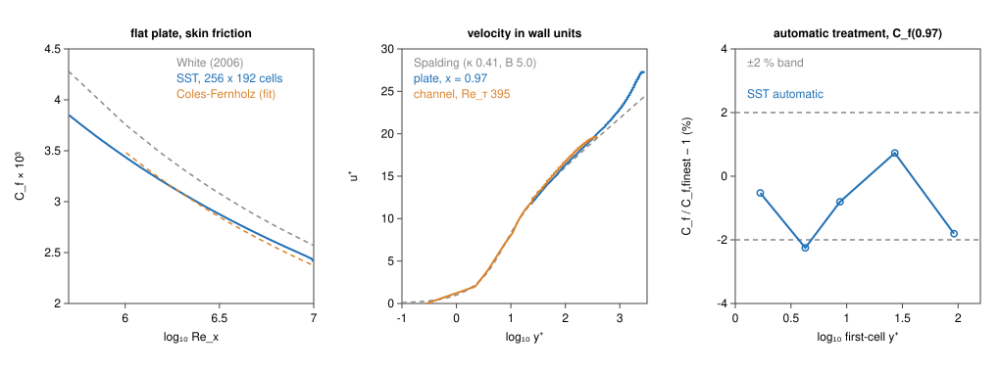
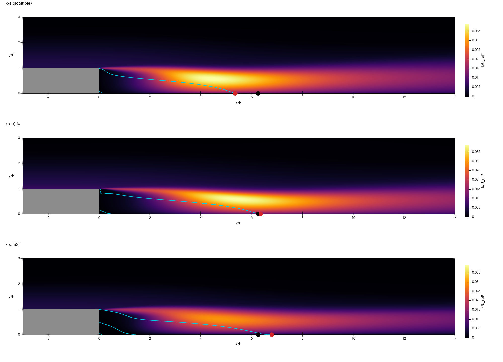
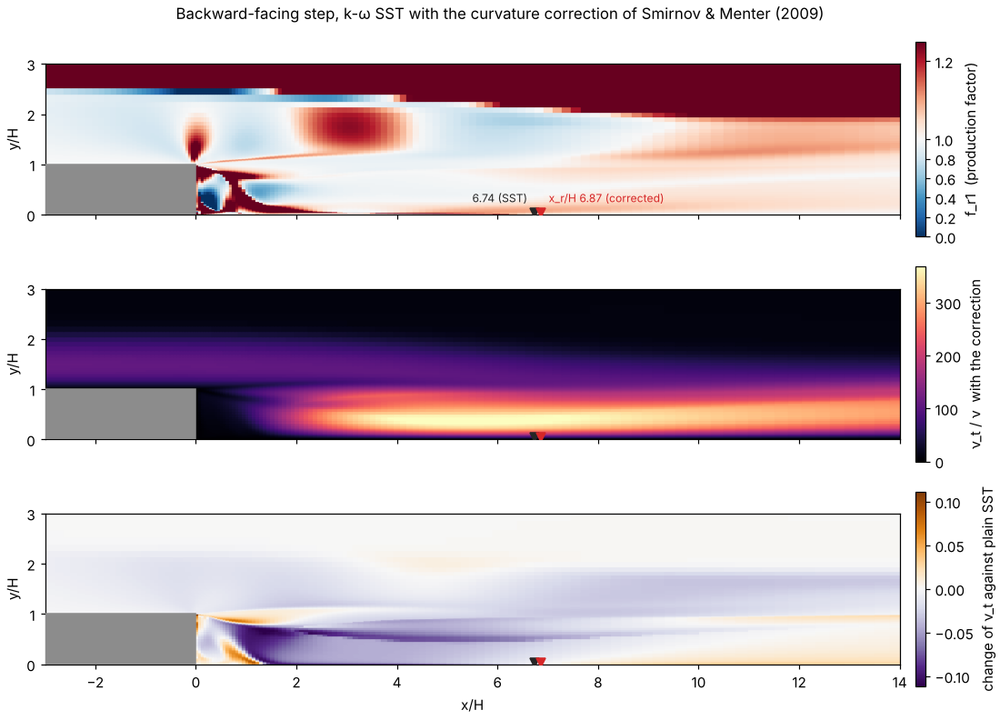
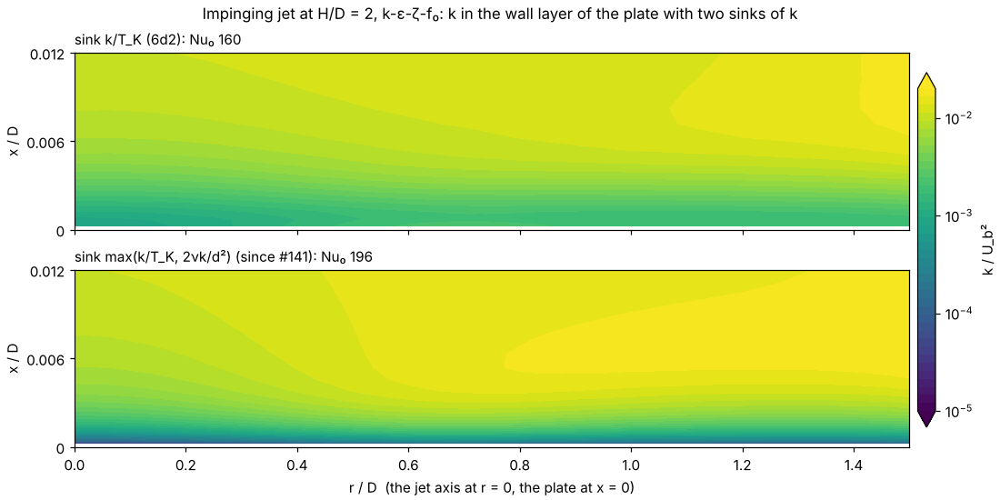
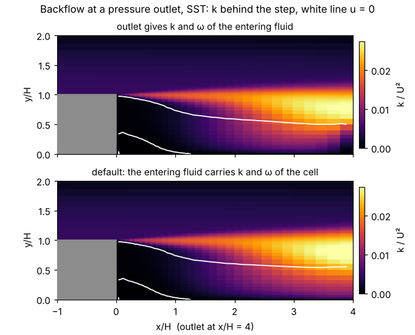

# Turbulence models

Part of the [Example gallery](../gallery.md): the RANS turbulence models of stage 6 with their wall treatments (D129–D139), checked against the NASA Turbulence Modeling Resource (TMR), DNS and correlations.

| # | Example | Stage | Feature |
|---|---|---|---|
| 68 | [k-ω SST on the TMR flat plate and in a channel](#sst) | 6 | `[turbulence] model = "k-omega-sst"`, `wall_treatment`, inlet turbulence values, `roughness`, derived field `turbulence-features` |
| 71 | [k-ε family with wall functions: flat plate, channel, Moody chart](#k-epsilon) | 6 | `model = "k-epsilon"`, `"realizable-k-epsilon"`, `wall_treatment = "scalable"`, `"standard"`, `"compound"`, `epsilon` at inlets, `roughness_constant` |
| 73 | [k-ε-ζ-f to the wall: channel and flat plate](#zeta-f) | 6 | `model = "k-epsilon-zeta-f"`, `wall_treatment = "compound"`, `"low-re"`, `zeta` at inlets and in `[initial]`, `[solver.elliptic]`, `solver.turbulence.preconditioner = "amg"` |
| 74 | [k-ε-ζ-f₀ at any y⁺: channel, flat plate, backward-facing step](#zeta-f0) | 6 | `model = "k-epsilon-zeta-f0"`, `wall_treatment = "compound-2023"`, `constants.n_zeta`, `a`, `mesh.generate.remove` |
| 88 | [Elliptic-blending k-ε: channel at three Re_τ, flat plate, backward-facing step](#elliptic-blending) | 6 | `model = "elliptic-blending-k-epsilon"`, `constants.c_epsilon4`, `zeta` as φ |
| 89 | [Backward-facing step against the experiment: six models, three meshes](#step-validation) | 6 | `[[output.wall_crossings]]` (`skip`, `kind`, `direction`, `width`), `verification.levels`, the TMR layout of the step, `examples/studies/backstep_validation.py` |
| 90 | [Impinging jet at H/D = 2: a pipe profile as the inlet, Nusselt number, the stagnation-point anomaly](#impinging-jet) | 6 | `profile = "table"` with `k`, `epsilon`/`omega`, `zeta` columns, `foehncraft.profiles`, wall probes with scalars, `production_limiter`, `examples/studies/impinging_jet.py` |
| 113 | [Curvature and rotation correction of SST: channel in spanwise rotation, backward-facing step](#curvature-correction) | 6 | `turbulence.curvature_correction`, `flow.frame_rotation`, constants `c_r1` … `c_r3`, derived field `curvature-correction` |
| 115 | [Quadratic constitutive relation of SST: secondary flow in a square duct](#qcr) | 6 | `turbulence.qcr`, constants `c_cr1`, `c_cr2` |
| 141 | [The sink of k near walls of the ζ-f models: grid convergence at the wall](#k-sink) | 6 | `turbulence.k_sink`, constants `c_epsilon1_zeta`, `c_epsilon1_power` |
| 140 | [Turbulence of the backflow at a pressure outlet: an outlet inside the recirculation](#outlet-backflow) | 6 | `k`, `omega`/`epsilon`, `turbulence_intensity`, `zeta` on `static-pressure-outlet` and `total-pressure-outlet` |

---

<a id="sst"></a>
## 68. k-ω SST on the TMR flat plate and in a channel



**The model.** The k-ω SST model of Menter, Kuntz & Langtry (2003): the
blend F₁ between k-ω near walls and k-ε away from them, the eddy
viscosity ν_t = a₁k/max(a₁ω, S F₂) and the production limiter
P̃ = min(ν_t S², 10 β* k ω). k and ω are two transport equations of the
generic scalar path of stage 6a, solved after each pressure correction
with a point-implicit (Newton) linearisation of the destruction, so k and ω
stay positive without clipping in a converging run. Two wall treatments:

```toml
[turbulence]
model = "k-omega-sst"
wall_treatment = "low-re"   # or "automatic" (the default)
```

`low-re` integrates to the wall (y⁺ ≲ 1): k = 0 and ω = 60ν/(β₁ d₁²) on
the wall face, d₁ the height of the wall cell, as in the TMR's own codes.
`automatic` takes any first-cell y⁺: the wall shear stress and ω in the
first cell are blended between their viscous-sublayer and log-law values,
and above the sublayer the first cell takes the equilibrium production of
the constant-stress layer (6g, PR #112).

**The TMR flat plate** (`tmr_plate_sst.toml`). The 2D zero-pressure-gradient
plate at Re = 5·10⁶ per metre with the TMR's free-stream values
(k = 2.25·10⁻⁷ U², ν_t/ν = 0.009), on the built-in mesher's copy
of the TMR grid family (point counts and stretching, not the TMR files):
four meshes from 32 × 24 to 256 × 192 cells, first-cell y⁺ 0.09 on the
finest. The skin friction at x = 0.97 converges monotonically:

| Cells | C_f(0.97) | against TMR | C_D (one side) | against TMR |
|---|---|---|---|---|
| 768 | 2.6937e-3 | +0.11 % | – | – |
| 3 072 | 2.6682e-3 | −0.83 % | 2.8259e-3 | −0.80 % |
| 12 288 | 2.6868e-3 | −0.14 % | 2.8477e-3 | −0.04 % |
| 49 152 | 2.7007e-3 | +0.37 % | 2.8606e-3 | +0.41 % |
| TMR, SST, finest grid | 2.6907e-3 | | 2.8488e-3 | |

The validation band of the specification, |C_f − C_f,TMR| ≤ 1 % plus
the numerical uncertainty, holds on every mesh but the first. The
verification band does not: the observed order of the three finest meshes
is 0.43 for C_f (GCI 1.87 %, extrapolated 2.741e-3) and 0.74 for C_D
(GCI 0.84 %), where the specification asks for p ≥ 1.5 and GCI ≤ 1 %.
This is recorded as a finding: on the coarsest mesh the stretched grid
puts only a few cells into the laminar leading-edge region, and the
convergence is not yet in its asymptotic range; the TMR itself reports
its finest-grid values after five grids. White's correlation lies 5 to 9 %
above the computed C_f along the plate, the TMR value of SST 6.4 % at
x = 0.97, so the model, not the code, sets that difference. u⁺ at x = 0.97
follows Spalding's law (κ = 0.41, B = 5.0) within 2.3 % for
1 ≤ y⁺ ≤ 300.

**The automatic treatment** on the second mesh with the wall grading
changed so that the first cell sits at y⁺ ≈ 2 to 100:

| First-cell y⁺ at x = 0.97 | 1.7 | 4.2 | 8.7 | 27 | 92 |
|---|---|---|---|---|---|
| C_f against the TMR value | −0.2 % | −1.9 % | −0.5 % | +1.1 % | −1.5 % |
| before 6g (PR #112) | +2.3 % | +15.6 % | +14.8 % | −0.2 % | −0.7 % |

The treatment now holds C_f within about 2 % from the sublayer to the
log layer. Its first version, with the quartic weight of Menter et al.
(2003) for ω and the log-layer production, gave a wall shear stress up to
16 % high in the buffer layer (3 ≲ y⁺ ≲ 20). Since PR #112 the near-wall
cell takes ω_P = (ω_vis^1.2 + ω_log^1.2)^{1/1.2} and the equilibrium
production of the constant-stress layer, with the weight tanh((y⁺/5)²).
The sweep with `examples/studies/sst_wall_sweep.py` over first-cell y⁺
0.24 to 85 stays within −2.6 to +2.4 % of the TMR value on this mesh and
the next finer one. TURB001 warns only above y⁺ 300.

**The channel** (`channel_sst.toml`). Fully developed flow between two
walls at Re_τ = 395 on one periodic module (stage 6p) driven by the bulk
velocity of the DNS of Moser, Kim & Mansour (1999), 96 cells across,
first-cell y⁺ 0.28. The driving force gives u_τ and with it
Re_τ = 397.8 and U_b⁺ = 17.43: −0.7 % from the DNS (17.55) and +1.1 %
from Dean's correlation C_f = 0.073 Re_b^−¼ (17.24), inside the ±3 %
band. On three meshes (96, 192 and 384 cells across) U_b⁺ is 17.427, 17.381 and 17.346: the observed order is 0.40, the extrapolated value 17.237 (Dean: 17.24) and GCI_fine 0.78 %, outside the verification band of the specification (finding, as for the plate: the convergence is slow). The fourth mesh did not reach its tolerance in 30 000 iterations and is left out. The centreline velocity U_c⁺ = 19.64 lies about 2.4 % below the DNS
(about 20.1), inside ±4 %.

| Check | Result |
|---|---|
| Homogeneous decay of k and ω (periodic box, no walls) against the exact ODE solution | BDF2 time order of k 1.92 and 1.96, of ω 2.07 and 2.03 (band 1.8–2.2) |
| Restart in the middle of a steady SST run | bit-identical to the run without restart |
| 1 against 4 threads on the flat plate | bit-identical |
| Wall distance by the Poisson PDE on a plane wall | exact to round-off |
| Bad input (unknown model, constants, central convection in a steady run, k without ω) | refused with CASE002/CASE004/CASE005/TURB006 |
| Inlet turbulence values out of range, defaulted, or given at an outlet | BC029, TURB009, BC028 |

| | |
|---|---|
| Code | kernels `turb::sst` (closure, blending, production), `turb::wall` (low-re, automatic and Aupoix wall values), `turb::invariants` (the D166 features), `scalar` (the fractional first-cell fix); `foehncraft_flow::turbulence` (`Turbulence`, settings, health counts, `summary`), `turbulence::wall` (thickness, Poisson distance), `turbulence::inlet` (intensity, length scale, viscosity ratio), `derived` (`turbulence-features`) |
| Tests | `tests/turbulence.rs`, `turbulence/inlet.rs`, `turbulence/wall.rs`, kernel tests of `turb::sst` and `turb::wall` |
| Case files | `flow/tmr_plate_sst.toml`, `flow/channel_sst.toml` |
| Recipe | [68](../recipes/turbulence.md#sst) |

```
target/release/foehn flow examples/cases/flow/tmr_plate_sst.toml --out output/plate \
    --set 'verification.levels=[0, 1, 2, 3]'
target/release/foehn flow examples/cases/flow/channel_sst.toml --out output/channel
for r in "2 7983.6" "5 2859.1" "10 1298.9" "30 361.1" "100 83.3"; do set -- $r
  target/release/foehn flow examples/cases/flow/tmr_plate_sst.toml --out output/yp$1 \
      --set 'turbulence.wall_treatment="automatic"' --set "mesh.generate.grading.y.ratio=$2"
done
python3 -m tools.plot.sst_chart docs/figures/gallery/sst.svg output/plate output/channel \
    output/yp2 output/yp5 output/yp10 output/yp30 output/yp100
```

[↑ back to top](#turbulence-models)

---

<a id="k-epsilon"></a>
## 71. k-ε family with wall functions: flat plate, channel, Moody chart


**The models.** The standard k-ε of Launder & Spalding (1974) and the
realizable k-ε of Shih et al. (1995), with its variable C_μ and the
destruction C₂ε²/(k + √(νε)), share one kernel. The standard model is
bounded by Durbin's realizability limit by default, which is inactive in
an equilibrium boundary layer and keeps the impulsive start of the
near-wall cells in check; the ε destruction is linearised in the Picard
form, which lets ε follow k when the free stream decays. Inlets take k
with ε or with ω (ε = C_μ k ω), and a run can start from an SST restart
file.

```toml
[turbulence]
model = "k-epsilon"            # or "realizable-k-epsilon"
wall_treatment = "scalable"    # "standard", "compound"
```

**The wall treatments.** All take the velocity scale u* = C_μ^¼ k^½ of
the first cell, so they need no iteration. `scalable` evaluates the log
law at max(y*, 11.06) and fixes ε and the production of the first cell
from it; `standard` falls back to the viscous sublayer below 11.06;
`compound` blends sublayer and log law with the function of Popovac &
Hanjalić. Rough walls shift the log law by ΔB of Cebeci & Bradshaw.

**The flat plate** (`tmr_plate_keps.toml`). The TMR plate of gallery 68
on 64 × 48 cells, its free-stream values held by the sustaining terms
(without them the free stream of the k-ε family decays before the plate).
With the wall grading changed so that the first cell sits at y⁺ 1 to 100
at x = 0.97, `scalable` gives C_f within −2.6 to −0.3 % of White's
correlation at every y⁺ (left). `compound` agrees from y⁺ 30
(−2.3 to −3.6 %) but overpredicts below, by 21 % at y⁺ 11 and 58 % at
y⁺ 1: the high-Re models have no damping in the buffer layer. This is a
finding, and TURB001 warns below y⁺ 30; walls resolved to y⁺ ≈ 1 are for
the ζ-f and EB models. The realizable model gives 3 to 7 % less friction
(finding).

**The channel** (`channel_keps.toml`). Re_τ = 395 on 12 uniform cells
(first-cell y⁺ 32): U_b⁺ = 18.31, +4.3 % from the DNS, inside the ±5 %
band of wall functions; +4.3 to +4.9 % for every y⁺ from 9 to 47.

**Rough pipes** (`pipe_rough_keps.toml`, `examples/studies/moody_study.py`).
A wedge pipe of one periodic module; the friction factor follows from the
driving force (right). Smooth pipes lie 2 to 5 % below Colebrook's
equation. Fully rough pipes lie 8 to 11 % above with the default
C_s = 0.5 and within 3 % with C_s = 0.4 (finding). In the transitional
range the Cebeci–Bradshaw shift follows Nikuradse's sand-grain dip and
lies below Colebrook's monotonic curve for commercial pipes.

| Check | Result |
|---|---|
| Plate, `scalable`, y⁺ 1 to 100: C_f(0.97) against White | −2.6 % to −0.3 % (band ±5 %) |
| Plate, `compound`, y⁺ 30 / 60 / 100 | −2.3 / −3.6 / −3.4 %; below y⁺ 30 up to +58 % (finding, TURB001) |
| Channel Re_τ 395, `scalable`, y⁺ 32: U_b⁺ | 18.31, +4.3 % (band ±5 %) |
| Realizable k-ε, plate and channel | 3 to 7 % low friction (finding) |
| Rough pipe Re 10⁶, k_s/D 10⁻³ | f 0.02081, +4.4 % from Colebrook |
| Moody study, 16 runs | smooth −5.0 to −1.7 %, fully rough +8 to +11 % (C_s 0.4: +1 to +3 %) |
| Homogeneous decay of k and ε, BDF2 | second order (asserted 1.8 to 2.2) |
| SST restart continued with k-ε; 1 against 4 threads | converted; bit-identical |
| Bad input (SST treatment with k-ε, realizable with a limiter, ω ambient, ω and ε at one inlet) | CASE005, BC029 |

| | |
|---|---|
| Code | kernels `turb::keps` (both closures, sources, Durbin bound), `turb::wall` (`keps_wall_face`, `roughness_shift`, `compound_gamma`), `entry` (`KepsCells`, the k-ε branch of `WallFaces`, the field update of `WallCells`); `foehncraft_flow::turbulence` (model and treatment keys, ω–ε conversion of inlets, initial values and restart files) |
| Tests | `tests/keps.rs`, kernel tests of `turb::keps` and `turb::wall`, `turbulence/inlet.rs` |
| Case files | `flow/tmr_plate_keps.toml`, `flow/channel_keps.toml`, `flow/pipe_rough_keps.toml`; study `examples/studies/moody_study.py` |
| Recipe | [71](../recipes/turbulence.md#k-epsilon) |

```
target/release/foehn flow examples/cases/flow/tmr_plate_keps.toml
target/release/foehn flow examples/cases/flow/channel_keps.toml
target/release/foehn flow examples/cases/flow/pipe_rough_keps.toml
python3 examples/studies/moody_study.py output/moody --jobs 4 --chart output/moody.svg
```

[↑ back to top](#turbulence-models)

---

<a id="zeta-f"></a>
## 73. k-ε-ζ-f to the wall: channel and flat plate

**The model.** The k-ε-ζ-f model of Hanjalić, Popovac & Hadžiabdić
(2004) adds ζ = v²/k, the wall-normal share of the turbulence, and the
elliptic relaxation f of its pressure-strain term to k and ε:
ν_t = C_μ ζ k T with C_μ = 0.22, the time scale
T = max[min(k/ε, 0.6/(√6 C_μ S ζ)), C_T (ν/ε)^½] and the length scale L
of the elliptic equation −∇·(L²∇f) + f = (C₁ − 1 + C₂′ P/ε)(2/3 − ζ)/T
bounded by realizability above and by the Kolmogorov scales below. ζ
falls to zero towards a wall by itself, so the model needs no damping
functions. One outer iteration solves k and ε, then f (CG with its own
multigrid hierarchy), then ζ with the new f. A solve may lower k, ε or ζ
by at most a factor 10 per iteration: an unconverged iterate that drops
ε to its floor would otherwise blow up T, L and P/ε in the source of f.

```toml
[turbulence]
model = "k-epsilon-zeta-f"
wall_treatment = "compound"    # or "low-re"
```

**The wall treatments.** `low-re` sets k = ζ = 0, ε_w = 2νk₁/d₁² and
f_w = −2νζ₁/d₁² on the wall faces and needs y⁺ ≲ 2 (TURB001).
`compound` (the default) takes k and ζ by zero gradient, which is exact
at the wall, fixes ε and P_k of the first cell and the wall value of f by
the blend of viscous sublayer and log law of Popovac & Hanjalić (2007),
and covers every y⁺.

**The channel** (`channel_zeta_f.toml`). Re_τ = 395 on 96 cells across
(first-cell y⁺ 0.27): U_b⁺ = 17.87, +1.8 % from the DNS of Moser, Kim &
Mansour with `compound`, +1.2 % with `low-re` (band ±3 %), in about 370
iterations of the coupled algorithm. The k⁺ peak and U⁺ up to y⁺ ≈ 25
follow the DNS.

**The flat plate** (`tmr_plate_zeta_f.toml`). The TMR plate on 64 × 48
cells at first-cell y⁺ 1: C_f(0.97) = 2.931·10⁻³, +2.0 % from White's
correlation, and +0.03 % / −0.4 % on 128 × 96 / 256 × 192 cells (GCI
0.15 %), every field converged. Since PR #141 (gallery 141) the sink of
k is max(k/T_K, 2νk/d²); with the published −ε the laminar part near
the leading edge had no positive steady k while T sat at its Kolmogorov
bound, the floor held k there (TURB002), and C_f came out at +5.1 %
with the k residual stalled at 7·10⁻⁶. A finding remains: from the
free stream of the TMR (ν_t/ν = 0.009) the model keeps the boundary
layer laminar over the whole plate, because the length scale of the
weak free stream exceeds the layer and f drives ζ to zero across it, so
the case starts from a turbulent field.

**The scalar multigrid.** The f equation is symmetric positive definite
and runs CG with the aggregation multigrid by default
(`[solver.elliptic]`). The transport equations take it with
`solver.turbulence.preconditioner = "amg"`: one hierarchy per equation,
built from the symmetric part ½(A + Aᵀ) of the convection matrix. All
hierarchies are rebuilt on the schedule of the pressure
(`solver.amg_rebuild`), which halved the run time of the channel
(56 s → 26 s) against a rebuild in every solve, and their matrices go
into the restart file, so a continued run is bit-identical.

| Check | Result |
|---|---|
| Channel Re_τ 395, y⁺ 0.27: U_b⁺, `compound` / `low-re` | 17.87 (+1.8 %) / 17.77 (+1.2 %) (band ±3 %) |
| Plate, `compound`, y⁺ 1: C_f(0.97) against White, 64 × 48 / 128 × 96 / 256 × 192 cells | +2.0 / +0.03 / −0.4 %, converged (band ±3 %; +5.1 % with the k floor before #141) |
| Plate from the TMR free-stream values | laminar, C_f = 3.0·10⁻⁴ (finding; turbulent start) |
| Homogeneous decay: k, ε (C_ε2 = 1.9) and the return of ζ to 2/3, BDF2 | second order (asserted 1.8 to 2.2) |
| Sustaining terms: k, ε held, ζ = 2/3 and f = 0 a fixed point | to 10⁻¹⁰ |
| Restart (multigrid of all four equations), 1 against 4 threads | bit-identical |
| k-ε restart continued with ζ-f | ζ = 2/3, f = 0 at the start |
| Bad input (wall functions of the k-ε family, a production limiter, ω ambient, ζ outside (0, 2]) | CASE005, CASE002, CASE004 |

| | |
|---|---|
| Code | kernels `turb::zeta_f` (scales, ν_t, source split, right-hand side of f), `turb::wall` (`zeta_f_wall_values`), `entry` (`ZetaFCells`, the ζ-f branches of `TurbFaces` and `WallFaces`, the relative bound of `Floor`); `foehncraft_fv` (hierarchy slots, `Csr::symmetric_part`, `setup_amg_with`); `foehncraft_flow::turbulence` (solve order, the elliptic solve, the multigrid schedule and its restart matrices) |
| Tests | `tests/zeta_f.rs`, kernel tests of `turb::zeta_f`, `amg_slots_keep_the_pressure_hierarchy` (fv `tests/stage3.rs`), `symmetric_part_of_a_convection_matrix` |
| Case files | `flow/channel_zeta_f.toml`, `flow/tmr_plate_zeta_f.toml` |
| Recipe | [73](../recipes/turbulence.md#zeta-f) |

```
target/release/foehn flow examples/cases/flow/channel_zeta_f.toml
target/release/foehn flow examples/cases/flow/tmr_plate_zeta_f.toml
```

[↑ back to top](#turbulence-models)

---

<a id="zeta-f0"></a>
## 74. k-ε-ζ-f₀ at any y⁺: channel, flat plate, backward-facing step

**The model.** Popovac (2023) solves f₀ = f + (N_ζ − 1)ζ/T in place of
the f of k-ε-ζ-f (gallery 73). With N_ζ = 2 its wall value is zero, so
the stiff wall value −2νζ/y² of f is gone, and with the compound wall
treatment of the same paper the model is meant to run on any near-wall
mesh. No code of the author is available, so Foehncraft takes its own
default, which keeps the constants of the paper (ν_t = (0.09/0.41) ζ k T)
and deviates where the validation asked for it (specification 3.3.1):
the sign of the (N_ζ − 1) term of the f₀ equation, which the paper
prints the other way round; ε/k in the (N_ζ − 1) terms; the k sink
max(k/T_K, 2νk/d²), which is ε at the wall and keeps k positive in
laminar regions (gallery 141); C_ε1 = 1.4(1 + 0.009/ζ) in place of the
printed 1.4(1 + 0.012/√ζ); and the realizability coefficient of T,
a = 0.6 √2 instead of 0.6.

```toml
[turbulence]
model = "k-epsilon-zeta-f0"
wall_treatment = "compound-2023"   # default; "compound", "low-re"
```

**The wall treatment.** `compound-2023` blends the viscous sublayer and
the log law in one profile, u⁺ = [y*^(−10/3) + u⁺_log^(−10/3)]^(−3/10)
with u* = C_μ^¼ k^½, and corrects the log law by ψ for the convection and
the pressure gradient next to the wall (non-equilibrium). ε and P_k of
the first cell follow from the slope of the blend; k and ζ have zero
flux through the wall and f₀,w = 0.

**The channel** (`channel_zeta_f0.toml`, Re_τ = 395). U_b⁺ = 17.34, −1.2 %
from the DNS at first-cell y⁺ 1 (band ±3 %), and 17.54, 17.58, 17.58 on
two, four and eight times the cells across (+0.2 %, mesh-converged). The
same channel at y⁺ 10 and 30: −3.4 and −1.2 %; ζ-f with its 2007
treatment gives −7.1 and +4.8 %. Every run converges.

**The flat plate** (`tmr_plate_zeta_f0.toml`). The run starts from the
free stream of the TMR (ν_t/ν = 0.009), and the boundary layer turns
turbulent on its own, which ζ-f does not do. C_f(0.97) = 2.926·10⁻³,
+1.8 % from White's correlation (+8.7 % from the TMR value of SST), and
+0.2 / −0.2 % on the two finer meshes; at y⁺ 10 and 30 −0.3 and −2.7 %.
Every field converges to 10⁻⁷ without a positivity floor, at all three
y⁺.

**The backward-facing step** (`backstep_zeta_f0.toml`). Driver &
Seegmiller (1985), Re_H = 36 000, the step cut out of the box by the
built-in mesher (`mesh.generate.remove`), the wall from x = −85 H so
that the boundary layer is about 1.5 H thick at x = −4 H. The
reattachment length x_r/H is 6.44, +3 % from the experiment's 6.26
(band ±10 %; 6.50 on 32 800 cells). With a = 0.6 the realizability bound of T is active in the
separated shear layer, halves ν_t there and the bubble grows to 7.4 H;
ζ-f of 2004 has the same bound and gives 7.82 (+25 %), and 6.80 with `constants = { a = 0.849 }`.

**Three models on the same step** (`examples/studies/backstep/`, the
fine mesh of 32 800 cells, 3 000 iterations). k-ε with scalable wall
functions reattaches at 5.36 H (−14 %), k-ε-ζ-f₀ at 6.35 H (+1.5 %; 6.50
H since PR #141, the figures are those of 6d2) and k-ω SST at 6.80 H
(+9 %). The streamwise velocity with streamlines, the
line U = 0 in white, the computed reattachment point in red and the
experiment's in black:


The turbulent kinetic energy on one scale, with the line U = 0 in
cyan. k-ε and ζ-f₀ reach the same peak, k/U_ref² = 0.039, k-ε at
x = 4.4 H and ζ-f₀ further downstream at 5.5 H; SST stays lower in the
shear layer (0.030), mixes less and has the longest bubble:



| Check | Result |
|---|---|
| Channel Re_τ 395, U_b⁺ at first-cell y⁺ 1 / 10 / 30 | −1.2 / −3.4 / −1.2 % (band ±3 % at y⁺ 1); +0.2 % mesh-converged (GCI 0.02 %) |
| Plate C_f(0.97) from White at y⁺ 1 / 10 / 30 | +1.8 / −0.3 / −2.7 %, all converged without a floor (band ±3 %); GCI 0.20 % |
| Plate from the TMR free stream | turbulent on its own, the same C_f |
| Step x_r/H, 8 200 / 32 800 cells | 6.44 (+3 %) / 6.50 (+3.8 %): within 1 % (band ±10 %) |
| Step x_r/H with a = 0.6 / ζ-f | 7.44 / 7.82 (6.80 with a = 0.849) |
| Step x_r/H, 32 800 cells: k-ε scalable / ζ-f₀ / SST | 5.36 (−14 %) / 6.35 (+1.5 %) / 6.80 (+9 %); SST 6.81 on 8 200 cells |
| Step iterations to x_r within 1 %, 8 200 / 32 800 cells (relaxation 0.5, then 0.8 from iteration 100) | k-ε 600 / 1 500, ζ-f₀ 550 / 1 750, SST 600 / 1 750 |
| 1 against 4 threads (plate, 20 480 cells) | bit-identical |
| Bad input (wall functions of the k-ε family, `compound-2023` with k-ε, `n_zeta` with ζ-f) | CASE005, CASE005, CASE002 |

| | |
|---|---|
| Code | kernels `turb::zeta_f` (`FORM_F0`, `ZetaFConstants::popovac_2023`), `turb::wall` (`compound_2023`, `COMPOUND_2023`), `entry` (C_U of `WallFaces`); `foehncraft_flow::turbulence` (model and treatment, the non-equilibrium inputs); `foehncraft_mesh::generate` (`RemoveBox`) |
| Tests | `tests/zeta_f0.rs`, kernel tests of `turb::zeta_f` and `turb::wall`, `removed_box_builds_a_step` |
| Case files | `flow/channel_zeta_f0.toml`, `flow/tmr_plate_zeta_f0.toml`, `flow/backstep_zeta_f0.toml`; the model comparison `examples/studies/backstep/{keps,zf0,sst}.toml` |
| Figures | `tools/plot/backstep_paraview.py` (ParaView), `tools/plot/backstep_chart.py` (matplotlib) |
| Recipe | [74](../recipes/turbulence.md#zeta-f0) |

```
target/release/foehn flow examples/cases/flow/channel_zeta_f0.toml
target/release/foehn flow examples/cases/flow/tmr_plate_zeta_f0.toml
target/release/foehn flow examples/cases/flow/backstep_zeta_f0.toml
```

The model comparison and its two figures (recipe 74):

```
target/release/foehn flow examples/studies/backstep/keps.toml --out output/backstep_keps
target/release/foehn flow examples/studies/backstep/zf0.toml --out output/backstep_zeta_f0
target/release/foehn flow examples/studies/backstep/sst.toml --out output/backstep_sst
pvpython tools/plot/backstep_paraview.py docs/figures/gallery/backstep \
    "k-ε (scalable)=output/backstep_keps" "k-ε-ζ-f₀=output/backstep_zeta_f0" "k-ω SST=output/backstep_sst"
```

[↑ back to top](#turbulence-models)

<a id="elliptic-blending"></a>
## 88. Elliptic-blending k-ε: channel at three Re_τ, flat plate, backward-facing step

**The model.** Billard & Laurence (2012), the BL-v²/k model: k, ε,
φ = v²/k and the blending parameter α, which solves α − L²∇²α = 1 with
α = 0 at walls and tends to 1 away from them. α³ blends the near-wall
and the homogeneous source of the φ equation, (1 − α³) f_w + α³ f_h, and
switches on two terms of the paper: the E term in the k equation, from
the second derivatives of the velocity near walls, and the variable
C*_ε2 = C_ε2 + α³(C_ε4 − C_ε2) tanh(|∇·(ν_t/σ_k ∇k)/ε|^{3/2}), which
lowers C_ε2 where the turbulent transport of k is large against ε. The
equations, the wall values (k = φ = α = 0, ε_w = νk/y²) and every
constant are those of the paper's Appendix A; the model runs on the
fields, solvers and wall treatments of k-ε-ζ-f (gallery 73), with φ in
the place of ζ and α in the place of f.

```toml
[turbulence]
model = "elliptic-blending-k-epsilon"
wall_treatment = "compound"   # default; "low-re"
```

**The channel** (`channel_eb.toml`). At the fixed mass flow of each DNS,
the driving force F is C_f over the C_f of the DNS (Moser, Kim & Mansour
1999). The DNS is the acceptance target:

| Re_τ | Cells, first-cell y⁺ | C_f / C_f,DNS | U_b⁺ |
|---|---|---|---|
| 180 | 96, 0.13 | 97.8 % | +1.1 % |
| 395 | 96 / 192, 0.28 / 0.14 | 99.0 % / 98.8 % | +0.5 % / +0.6 % |
| 590 | 128, 0.25 | 99.1 % | +0.5 % |

At Re_τ 180 the start of the case (I = 0.05, ν_t/ν = 100) lets the
channel turn laminar; I = 0.15 and ν_t/ν = 20 keep it turbulent.

**The flat plate** (`tmr_plate_eb.toml`). C_f(0.97) = 2.889·10⁻³,
+0.5 % from White's correlation, from the turbulent start of the ζ-f
plate. From the TMR free stream the layer turns turbulent on its own at
x ≈ 0.25 (ζ-f stays laminar) and C_f(0.97) is +2.5 %.

**The backward-facing step** (`backstep_eb.toml`, the case of gallery 74
with the model changed). x_r/H = 7.59, +21 % from the experiment's 6.26:
outside the band of ±10 %, close to ζ-f of 2004 (7.82). The variable
C*_ε2 makes the bubble long; with `constants = { c_epsilon4 = 1.83 }`
(C*_ε2 = C_ε2) x_r/H = 6.24, but the plate is then +4.9 % from White
and the channel C_f at Re_τ 395 101 % of the DNS.

| Check | Result |
|---|---|
| Channel C_f / C_f,DNS at Re_τ 180 / 395 / 590 (paper 100 / 98 / 100 %) | 97.8 / 99.0 / 99.1 % (band ±3 % on U_b⁺) |
| Plate C_f(0.97) from White: turbulent start / TMR free stream / C*_ε2 constant | +0.5 / +2.5 / +4.9 % (band ±3 %) |
| Step x_r/H, 8 200 cells, SIMPLEC / C*_ε2 constant | 7.59 (+21 %, finding) / 6.24 (−0.3 %) |
| Step x_r/H on 32 800 cells, SIMPLEC (converged) / coupled (not converged) | 7.68 (+23 %, 1.2 % from the coarse mesh) / 7.84 |
| Homogeneous decay: k, ε (C_ε2 = 1.83) and the return of φ to 2/3, BDF2 | second order (asserted 1.8 to 2.2) |
| k-ε restart continued with the elliptic blending; 1 against 4 threads | φ = 2/3, α = 1 at the start; bit-identical |
| Bad input (`compound-2023`, wall functions, a production limiter, `sigma_zeta`) | CASE005, CASE005, CASE002 |

| | |
|---|---|
| Code | kernels `turb::eb` (`eb_cell`, `eb_scales`), `turb::zeta_f` (`FORM_EB`, `ZetaFConstants::billard_laurence_2012`), `entry` (`squares_add`, `scale_vector`); `foehncraft_flow::turbulence` (the inputs of the E term and of C*_ε2) |
| Tests | `tests/eb.rs`, kernel tests of `turb::eb` |
| Case files | `flow/channel_eb.toml`, `flow/tmr_plate_eb.toml`, `flow/backstep_eb.toml` |
| Recipe | [88](../recipes/turbulence.md#elliptic-blending) |

```
target/release/foehn flow examples/cases/flow/channel_eb.toml
target/release/foehn flow examples/cases/flow/tmr_plate_eb.toml
target/release/foehn flow examples/cases/flow/backstep_eb.toml
```

[↑ back to top](#turbulence-models)

<a id="step-validation"></a>
## 89. Backward-facing step against the experiment: six models, three meshes

**The case** (`backstep_validation.toml`). The step of Driver &
Seegmiller (1985), Re_H = 36 000, in the layout of NASA's Turbulence
Modeling Resource (TMR): walls from x = −110 H, outlet at 50 H, and a
no-slip top wall at 9 H like the experiment's channel (expansion ratio
1.125). The step cases of gallery 74 and 88 have a slip top and walls
from −85 H; with the top wall the C_p of ζ-f₀ comes from an RMS
difference of 0.033 to 0.018 against the experiment, and x_r moves by
less than 1 %. The built-in mesher cuts the step out of the box: 11 040
cells, and `verification.levels = [0, 1, 2]` halves every interval once
and twice (44 160 and 176 640 cells).

**The reattachment length as a result.** A new output,
`[[output.wall_crossings]]`, finds the first point along a direction
where the wall shear changes sign: reattachment (from negative to
positive, the default) or separation. Its position is in the log and the
report, and in a level sweep it is a monitored quantity of the
discretisation uncertainty (D67), so x_r/H gets its observed order and
GCI without a script. `skip` starts the search 2 H behind the step: on
the finer meshes the corner vortices change the sign of the shear up to
x ≈ 1.5 H (SST on the finest mesh: negative to 0.14 H, positive to
1.44 H, then the main bubble), and their crossing would come first:

```toml
[output]
wall_crossings = [ { name = "xr", boundary = "ymin", from = [0.0, 0.0, 0.05], skip = 2.0 } ]
```

**Six models** (`examples/studies/backstep_validation.py`). k-ω SST,
k-ε and realizable k-ε with scalable wall functions and k-ε-ζ-f₀ run with
the coupled algorithm; k-ε-ζ-f and the elliptic-blending k-ε need
SIMPLEC (the coupled algorithm does not converge them). x_r/H on the
three meshes, the rest on the finest mesh against the experiment (ζ-f
and EB on the middle mesh), C_p shifted to zero at x/H = 37.5 and both
coefficients on the experiment's reference speed (u at x/H = −4,
y/H = 5):

| Model | x_r/H on 11 040 / 44 160 / 176 640 cells | From 6.26 | GCI_fine | C_p RMS | C_f RMS ×10³ |
|---|---|---|---|---|---|
| k-ω SST (`automatic`) | 6.793, 6.747, 6.747 | +7.8 % | < 0.01 %, oscillatory | 0.023 | 0.375 |
| k-ε (`scalable`) | 5.237, 5.321, 5.372 | −14.2 % (+0.5 % from the published k-ε) | 1.94 %, p 0.69 | 0.018 | 0.373 |
| realizable k-ε (`scalable`) | 6.274, 6.337, 6.407 | +2.4 % | – (steps grow) | 0.026 | 0.153 |
| k-ε-ζ-f₀ (`compound-2023`) | 6.329, 6.297, 6.296 | +0.6 % | < 0.01 %, p 4.8 | 0.017 | 0.463 |
| k-ε-ζ-f (`compound`, SIMPLEC) | 7.686, 7.741, – | +23.7 % | – | 0.037 | 0.593 |
| elliptic-blending k-ε (`compound`, SIMPLEC) | 7.446, 7.556, – | +20.7 % | – | 0.034 | 0.410 |

The bands of the specification (9.5): x_r/H within ±10 % of the
experiment for SST, ζ-f (both forms) and EB with GCI_fine ≤ 2 %, the
standard k-ε within ±5 % of a published k-ε result (5.22 and 5.47 from
two solvers, Mizukami, Georgiadis & Cannon 1993), and the C_p RMS
≤ 0.02 for SST, ζ-f and EB. ζ-f₀ is closest to the experiment, 6.296
(+0.6 %), with the lowest C_p RMS (0.017); its two finer meshes agree
to 0.02 %. SST is inside the x_r band and just outside the C_p band;
its sweep is oscillatory (the two finer meshes agree to 0.008 %). k-ε
meets its band. ζ-f and EB reattach 21 to 24 % late, as on the step of
gallery 74 and 88, and miss both bands; they need
SIMPLEC, and their finest mesh (an estimated 30 000 iterations) follows
in the next 6g PR. The k-ε models run their wall functions at first-cell
y⁺ 1.5 to 0.3, below the y⁺ ≥ 30 they are claimed for; their order of
0.69 and the growing steps of realizable k-ε may come from that.

C_p and C_f along the lower wall against the experiment (ζ-f and EB on
the middle mesh):


The velocity and the turbulent shear stress at the four stations of the
experiment; the models' −u'v' is ν_t ∂u/∂y:


| Check | Result |
|---|---|
| Step x_r/H, SST: three meshes, finest against 6.26 | 6.793, 6.747, 6.747; +7.8 % (band ±10 %); oscillatory, GCI < 0.01 % |
| Step x_r/H, k-ε: finest against the published 5.345 | 5.372, +0.5 % (band ±5 %); GCI 1.94 % (band 2 %), p 0.69 |
| Step x_r/H, realizable k-ε | 6.407, +2.4 %; steps 0.063, 0.070: no GCI (finding) |
| Step x_r/H, ζ-f₀ | 6.329, 6.297, 6.296; +0.6 % (band ±10 %); GCI < 0.01 %, p 4.8 |
| Step x_r/H, ζ-f / EB, two meshes, SIMPLEC | 7.741 (+23.7 %) / 7.556 (+20.7 %): outside ±10 % (finding) |
| C_p RMS on the lower wall (band 0.02 for SST, ζ-f, EB) | SST 0.023, k-ε 0.018, realizable 0.026, ζ-f₀ 0.017, ζ-f 0.037, EB 0.034 |
| Slip top (gallery 74) against the no-slip top wall, ζ-f₀, coarse mesh | C_p RMS 0.033 against 0.018, x_r within 1 % |
| Wall crossing against the sign change of the wall file (laminar step), upstream, `width`, `skip` | 10⁻¹² |
| A level sweep of the laminar step | GCI of x_r < 5 % |
| Bad input (a zero direction, `width = 0`, `skip < 0`, an unknown kind) | CASE004, CASE004, CASE004, the parse error |

| | |
|---|---|
| Code | `foehncraft_flow::case` (`WallCrossing`, `wall_crossings`), `uncertainty::quantities` (`wall_crossings.<name>.position`), `logblocks::flow_category` |
| Tests | `tests/wall_crossing.rs` |
| Case files | `flow/backstep_validation.toml`; the study `examples/studies/backstep_validation.py` with the TMR data in `examples/studies/backstep/data` (CC0) |
| Recipe | [89](../recipes/turbulence.md#step-validation) |

```
target/release/foehn flow examples/cases/flow/backstep_validation.toml
python3 examples/studies/backstep_validation.py output/backstep_validation --jobs 4 --chart docs/figures/gallery
```

[↑ back to top](#turbulence-models)

<a id="impinging-jet"></a>
## 90. Impinging jet at H/D = 2: a pipe profile as the inlet, Nusselt number, the stagnation-point anomaly

**The case** (`impinging_jet.toml`). A round jet leaves a long pipe of
diameter D and hits a heated plate two diameters away, Re = U D/ν =
23 750, the heat-transfer experiments of Baughn & Shimizu (1989) and
Baughn et al. (1991). Axisymmetric on a 0.5° wedge about the jet axis
(x): the plate is x = 0, the pipe exit the plane x = 2 D for r < D/2,
the rest of that plane lets ambient fluid in at the total pressure 0,
and the wall jet leaves at r = 6 D. 10 400 cells, the first cell at the
plate 5·10⁻⁴ D (y⁺ below 1), clustered at the pipe lip. k-ε-ζ-f₀ with
the coupled algorithm converges in 873 iterations (about a minute on
four cores).

**The developed pipe flow as the inlet.** The jet's turbulence comes
from the pipe, so the inlet carries the velocity, k, ε and ζ of a
developed pipe flow: a periodic wedge pipe at the same Re
(`jet_pipe_profile.toml`, Darcy f 0.0253 against 0.0255 of Blasius)
samples the radius, and `python3 -m foehncraft.profiles` writes the line
as a table with one row per cell and a wall row. The table's header now
names its columns, and the turbulence columns set the inlet face by
face:

```toml
[boundary.xmax]
type = "velocity-inlet"
profile = "table"
table = "impinging_jet_profile.csv"   # r, u_n, k, epsilon, zeta
table_coordinate = "radius"
table_direction = [1.0, 0.0, 0.0]
```

**The Nusselt number.** A passive temperature θ (Pr = 0.71) with a
uniform flux q through the plate and θ = 0 at both inlets gives
Nu(r) = q D/(Γ θ_w(r)), Γ = ν/Pr, from the wall file. A wall probe now
also reports the wall value and flux of each scalar, so the probe `stag`
at the axis gives Nu₀ and `r01` the Nu at r/D = 0.1, each with its GCI
in a level sweep:

```toml
[output]
wall_csv = true
wall_probes = [
  { name = "stag", boundary = "xmin", point = [0.0, 0.0, 0.0] },
  { name = "r01", boundary = "xmin", point = [0.0, 0.1, 0.0] },
]
```

**Six models on three meshes** (`examples/studies/impinging_jet.py`).
Each model runs its own pipe and then the jet with `verification.levels`
0, 1, 2 (2 600, 10 400 and 41 600 cells); ζ-f and EB with SIMPLEC, the
others coupled. Nu₀ is the probe `stag` at the axis, with the probe
`r01` at r/D = 0.1 next to it:

| Model | Nu₀ (axis) on 2 600 / 10 400 / 41 600 cells | Nu at r/D = 0.1 | GCI_fine at r/D = 0.1 | secondary maximum, r/D: Nu |
|---|---|---|---|---|
| k-ε-ζ-f₀ (`compound-2023`) | 166.1, 156.9, 151.6 | 164.2, 156.1, 151.7 | 5.3 %, p 0.74 | 1.95: 128.7 |
| k-ε-ζ-f (`compound`, SIMPLEC) | 178.6, 174.6, 173.8 | 177.7, 174.3, 173.9 | 0.03 %, p 3.2 | 2.27: 118.4 |
| elliptic-blending k-ε (`compound`, SIMPLEC) | 236.7, 247.3, 249.2 | 206.8, 205.6, 205.0 | 0.40 %, p 0.95 | 2.31: 93.4 |
| k-ω SST, Kato–Launder (`automatic`) | 151.9, 144.6, 141.2 | 149.5, 142.4, 141.1 | 0.31 %, p 2.3 | 1.84: 111.6 |
| k-ε, Durbin bound (`scalable`) | 155.0, 154.7, 155.0 | 154.7, 155.2, 155.6 | 0.67 %, p 0.52 | 1.55: 143.2 |
| realizable k-ε (`scalable`) | 208.3, 205.1, 207.2 | 208.6, 205.4, 207.8 | oscillatory (the two coarser meshes stall) | 1.65: 141.1 |


**What the runs show.** Nu is flat towards the axis with every model
except EB, and the stagnation value converges: Nu₀ at the axis has a GCI
of 0.12 % for ζ-f and 2.9 % for SST, and Nu at r/D = 0.1 of 0.03 to
0.40 % for ζ-f, EB and SST. ζ-f₀ is not yet in its asymptotic range
there (it falls 2.8 % from the middle to the finest mesh, GCI 5.3 %).
The first runs of this study had Nu of the face next to the axis low on
the finest mesh with every turbulence model (ζ-f₀ 7 %, ζ-f and SST 4 %): the symmetry
faces lacked the transposed part of the stress, which on the planes of
a wedge is half of the hoop stress (fixed in PR #91, finding 2 of the
verification page). EB's Nu peaks sharply at
the axis (249 at the face next to it, 238 at r/D 0.055) because its k
does. Without a limiter
the standard k-ε shows the stagnation-point anomaly, Nu₀ 211 and 6.6
times the k of ζ-f₀ on the axis; its default Durbin bound removes 71 % of
the excess k (Nu₀ 155) and Kato–Launder 111 % (Nu₀ 75). The realizable
k-ε has the anomaly as well (Nu₀ 207, 4.6 times the axis k of ζ-f₀). SST has no
anomaly to remove: its own bound ν_t = a₁k/(F₂S) holds along the whole
axis, so `none`, `menter` and `durbin` give the same Nu₀ (160.5) and
only Kato–Launder changes it (144.6). Against the
experiment (ERCOFTAC case 025, Nu/Re^0.7 of Baughn et al. scaled to Re
23 750, Nu₀ 141.4) Nu₀ is −0.2 % for SST and +7.2 % for ζ-f₀, but
+22.9 % for ζ-f and +76 % for EB (the band is ±15 %); the RMS difference
of Nu for 0 ≤ r/D ≤ 4 is 13.7 % for SST and 21 to 32 % for the others;
at r/D = 1, where the experiment has its dip, every model is 18 to 45 %
above (finding 8 of the verification page). The data are not in the
repository (the wiki of the database is licensed CC BY-NC-SA 4.0, which
does not fit the MIT licence here), so the charts show the models only; the study draws the experiment when its files are in
`examples/studies/impinging_jet/data`.

The radial velocity of the wall jet at the stations of Cooper et al.:


| Check | Result |
|---|---|
| Nu₀ at the axis, three meshes (band GCI ≤ 3 %) | ζ-f 0.12 %, SST 2.9 %, EB 0.19 %; ζ-f₀ 7.2 %, p 0.67 (finding) |
| Nu at r/D = 0.1, three meshes | ζ-f 0.03 %, EB 0.40 %, SST 0.31 %; ζ-f₀ 5.3 % (finding) |
| Nu₀ against the experiment (±15 % ζ-f, EB; ±20 % SST) | SST −0.2 %, ζ-f₀ +7.2 % (inside); ζ-f +22.9 %, EB +76 % (outside, findings) |
| RMS of Nu(r/D), 0 to 4, against the experiment (band 15 %) | SST 13.7 % (met); ζ-f₀ 23.7 %, ζ-f 31.5 %, EB 21.2 % (not met) |
| Secondary maximum (ζ-f, EB) | ζ-f 118.4 at r/D 2.27, EB 93.4 at 2.31 (weak); ζ-f₀ 128.7 at 1.95 |
| Anomaly, k-ε `none` / `durbin` / `kato-launder` (10 400 cells) | Nu₀ 210.7 / 154.7 / 74.5; excess k removed 71 % / 111 % |
| Anomaly, SST `none` / `menter` / `durbin` / `kato-launder` | Nu₀ 160.5 / 160.5 / 160.5 / 144.6; k on the axis below that of ζ-f₀, no excess |
| Symmetry and wedge planes with the full stress (`tests/symmetry_stress.rs`) | a linear flow with constant stress balances in every cell to 10⁻¹⁴ (without the transposed part on the planes 3.6 % and 65 % of a face flux) |
| Thermal law of the k-ε family in u* (section 5.2) | k-ε Nu₀ 37 with u_τ, 157 with u* |
| The coarse jet in CI (`tests/impinging_jet.rs`) | ζ-f₀ Nu₀ 166.1, secondary maximum 128.2 at r/D 2.01 |
| Inlet table with turbulence columns | constant columns = constant inlet bit for bit; BC029, BC019 |

| | |
|---|---|
| Code | `bc::ProfileTable::columns`, `turbulence::inlet::InletSpec::Table`, `case::WallProbeScalar`, `turb::wall` (`y_star` of the wall kernel), `python/foehncraft/profiles.py` |
| Tests | `tests/inlet_table.rs`, `tests/impinging_jet.rs`, `tests/thermal.rs`, `python/tests/test_profiles.py` |
| Case files | `flow/jet_pipe_profile.toml`, `flow/impinging_jet.toml` with `impinging_jet_profile.csv`; the study `examples/studies/impinging_jet.py` |
| Recipe | [90](../recipes/turbulence.md#impinging-jet) |

```
target/release/foehn flow examples/cases/flow/impinging_jet.toml
python3 examples/studies/impinging_jet.py output/impinging_jet_study --jobs 2 --no-experiment \
    --chart docs/figures/gallery
```

[↑ back to top](#turbulence-models)

---

<a id="curvature-correction"></a>
## 113. Curvature and rotation correction of SST: channel in spanwise rotation, backward-facing step



`turbulence.curvature_correction = true` multiplies the production of k
and ω of SST by the rotation function f_r1 of Spalart & Shur (1997) in
the form of Smirnov & Menter (2009), f_r1 = max[0, min(f_rotation,
1.25)], from the ratio r* = S/Ω of strain rate and vorticity and from r̃,
the rotation of the principal axes of the strain rate along a streamline
(the material derivative DS_ij/Dt, from the gradients of the six
components). In pure shear f_r1 = 1 and the model is SST. Behind the step
it damps the turbulence where the shear layer curves round the separation
bubble (the change of ν_t in the lower panel) and the bubble grows by
1.9 % (x_r/H 6.74 to 6.87, the experiment 6.26). In the free stream,
where the vorticity vanishes, r* is large and f_r1 sits at its limit 1.25,
which acts on a production that is zero there.

**System rotation.** `flow.frame_rotation = [0, 0, Ω]` solves the whole
domain in a frame that turns at Ω (the velocity is the relative one, the
Coriolis force −2ρ Ω × u acts, the centrifugal force stays in the
pressure). The channel at Re_b = 5 800 (the DNS of Kristoffersen &
Andersson 1993) turning about its spanwise axis at Ro = 2Ωh/U_b = 0.15:


Linear SST does not see the rotation: its production depends on S only,
so both walls keep the same shear stress (ratio 1.00). With the
correction the turbulence grows on the unstable (pressure) side, where
the mean vorticity opposes the rotation, and is damped on the stable
side; the core takes the slope dU/dy ≈ 2Ω of zero absolute vorticity,
and the wall shear stresses differ by a factor 1.63. The specification
compares that ratio with the DNS (band ±15 %, open: the data of the paper
are not in the repository).

| Check | Result |
|---|---|
| Pure shear: channel without rotation, with and without the correction (band 10⁻⁶) | equal driving force to the last digit (`tests/curvature.rs`) |
| f_r1 by hand in a rotating shear flow; the same flow in the inertial and in the turning frame | 10⁻¹² and 10⁻¹⁴ (kernel tests) |
| Rotating channel, Ro = 0.15, wall shear stress lower/upper | SST 1.000, corrected 1.627 |
| Backward-facing step, 44 160 cells, x_r/H | 6.743 (SST), 6.869 (corrected), experiment 6.26 |

| | |
|---|---|
| Code | `turb::sst::rotation_function`, `entry::{StrainCells, ConvectiveDerivative, CurvatureCells}`, `turbulence::Turbulence::curvature_inputs`, `frame::attach_rotating_domain`, `derived::Derived::CurvatureCorrection` |
| Tests | `tests/curvature.rs`, the kernel tests of `turb/sst.rs` |
| Case files | `flow/channel_rotating_sst.toml`; the step `flow/backstep_validation.toml` with `--set` |
| Recipe | [113](../recipes/turbulence.md#curvature-correction) |

```
target/release/foehn flow examples/cases/flow/channel_rotating_sst.toml --out output/rot_on
target/release/foehn flow examples/cases/flow/channel_rotating_sst.toml --out output/rot_off \
    --set turbulence.curvature_correction=false
python3 -m tools.plot.rotating_channel_chart docs/figures/gallery/rotating_channel.svg \
    output/rot_on output/rot_off
```

The step figure: the commands in `tools/plot/curvature_fields.py`.

[↑ back to top](#turbulence-models)

---

<a id="qcr"></a>
## 115. Quadratic constitutive relation of SST: secondary flow in a square duct


A linear eddy-viscosity model makes the Reynolds stress proportional to the
strain rate, so in a straight duct the normal stresses of the
cross-section are equal and nothing drives a secondary flow (left: the
in-plane velocity is zero to round-off). `turbulence.qcr = "qcr2000"` adds
the quadratic constitutive relation of Spalart (2000),

  τ_ij,QCR = τ_ij − C_cr1 (O_ik τ_jk + O_jk τ_ik),  O_ik = 2 W_ik / |∇u|,
  C_cr1 = 0.3,

an explicit stress in the momentum equations. The normal stresses now differ near the
walls, and the duct develops the secondary flow of Prandtl's second kind:
a pair of vortices in each corner that carries fluid into the corner
along the diagonal (right). The isotachs bulge towards the corners and
the wall shear stress evens out along the wall. `"qcr2013"` (Mani,
Babcock, Winkler & Spalart 2013) adds −C_cr2 μ_t √(2 S*:S*) δ_ij
(C_cr2 = 2.5). That term is isotropic, so in incompressible flow it only
shifts the pressure, and the velocity is the one of QCR2000.

| Check | Result |
|---|---|
| Linear SST in the duct | secondary velocity 0 (below 10⁻¹⁰ U_b, `tests/curvature.rs`) |
| QCR2000, quarter duct 2 × 48 × 48 and 2 × 72 × 72 cells | largest secondary velocity 1.55 % and 1.56 % of U_b, on the diagonal at 0.35 h and 0.33 h from the corner, towards the corner |
| QCR2013 against QCR2000 | the same velocity (the isotropic term goes into the pressure) |
| Driving force (wall friction), 72 × 72 | +1.9 % against linear SST |
| Kernel: the stress of a simple shear flow by hand | 10⁻¹² (`turb/sst.rs`) |

The specification compares the largest secondary velocity with the DNS
of Pinelli, Uhlmann, Sekimoto & Kawahara (2010) (band ±30 %). That
comparison is open, because the DNS data are not in the repository.

| | |
|---|---|
| Code | `turb::sst::qcr_stress`, `entry::{QcrCells, ExplicitStressFaces}`, `turbulence::Turbulence::add_explicit_stress` (called after the momentum face kernel) |
| Tests | `tests/curvature.rs` (`qcr_drives_the_secondary_flow_of_a_duct`, `qcr_is_refused_without_sst`), the kernel test `qcr_of_a_shear_flow` |
| Case file | `flow/square_duct_qcr.toml` |
| Recipe | [115](../recipes/turbulence.md#qcr) |

```
target/release/foehn flow examples/cases/flow/square_duct_qcr.toml --out output/duct_qcr
target/release/foehn flow examples/cases/flow/square_duct_qcr.toml --out output/duct_sst \
    --set turbulence.qcr=\"none\"
python3 -m tools.plot.square_duct_fields docs/figures/gallery/square_duct_qcr.png \
    output/duct_qcr output/duct_sst
```

[↑ back to top](#turbulence-models)

---

<a id="k-sink"></a>
## 141. The sink of k near walls of the ζ-f models: grid convergence at the wall

**The problem.** The grid-convergence study of the channel (gallery 25,
PR #128) showed that k-ε-ζ-f₀ did not converge with the mesh below a
first-cell y⁺ of 1: U_b⁺ rose from 17.79 to 18.39 over four meshes. Its
sink of k was k/T_K, with T_K = max(k/ε, C_T (ν/ε)^½). The Kolmogorov
bound keeps 1/T_K finite at the wall, so the sink is linear in k there
and k falls like y instead of y²; the wall value of ε, 2νk_P/y_P², then
grows with every refinement. The papers' sink −ε is right at the wall
but has no positive steady k in a laminar boundary layer, where it held
k of the ζ-f plate at its floor.

**The sink since PR #141**, for ζ-f and ζ-f₀:

  sink of k = max(k/T_K, 2νk/d²),  d the wall distance.

At the wall k = ε d²/(2ν), so the sink is ε and k falls like y²; away
from walls 2ν/d² is negligible and the sink is k/T_K, which keeps k
positive in laminar regions. It has no feedback from ε, unlike the
blends with −ε that were tried and drove a limit cycle in the wall jet
of the impinging jet. ζ-f₀ takes C_ε1 = 1.4 (1 + 0.009/ζ) with it: the
printed 1.4 (1 + 0.012/√ζ) gives U_b⁺ −11 % with a sink that is ε at the
wall (specification 3.3.2, maintainer decision 2026-11-20).

```toml
[turbulence]
model = "k-epsilon-zeta-f0"
k_sink = "wall"          # default; "epsilon" (the papers' −ε), "kolmogorov" (k/T_K, 6d2)
# constants = { c_epsilon1_zeta = 0.009, c_epsilon1_power = 1.0 }   # the defaults of ζ-f₀
```

**The flat plate with ζ-f.** k on the TMR plate near the leading edge:
with −ε (top) k sits at its floor of 10⁻⁹ U∞² from x = 0.03 to 0.24
and the run stops at its iteration limit; with the new sink (bottom) k
grows smoothly from the leading edge, the run converges in 1 364
iterations and C_f(0.97) moves from +5.1 % to +2.0 % of White's
correlation (+0.03 % on 128 × 96 cells):


**The wall layer of the impinging jet with ζ-f₀.** k within 0.012 D of
the plate, from the axis to r/D = 1.5, on a log scale. With k/T_K (top)
k of the wall cell stays near 10⁻³ U_b²; with the new sink (bottom) it
falls to 3·10⁻⁵, k falls like y² to the wall, and the buffer layer above
holds more k:



The jet converges with the mesh with the new sink (Nu₀ 198, 196, 196 on
2 600, 10 400 and 41 600 cells, GCI 0.01 %; before 166, 157, 152, GCI
7.2 %), but Nu₀ is +38 % from the experiment's 141 (finding): the k of
the buffer layer near the stagnation point raises the heat transfer.
ζ-f₀ has no production limiter at stagnation points; one is a follow-up.

| Check | Result |
|---|---|
| Channel Re_τ 395, ζ-f₀, 48 / 96 / 192 / 384 cells across (first-cell y⁺ 1 to 0.1) | U_b⁺ 17.34 / 17.54 / 17.58 / 17.58: p 2.2, GCI 0.02 %, +0.2 % from the DNS (before 17.79 to 18.39, divergent) |
| Channel, ζ-f, 96 to 768 cells across | 17.87 / 17.90 / 17.91 / 17.91: p 2.8, +2.1 % (before the finest did not converge) |
| Plate C_f(0.97), ζ-f₀ / ζ-f, 64 × 48 to 256 × 192 cells | +1.8 / +0.2 / −0.2 % (GCI 0.20 %) / +2.0 / +0.03 / −0.4 % (GCI 0.15 %), all converged |
| Step x_r/H, ζ-f₀, 8 200 / 32 800 cells | 6.44 / 6.50 (+3 / +3.8 %; before 6.38) |
| Jet Nu₀, ζ-f₀, three meshes | 198 / 196 / 196, GCI 0.01 % (finding: +38 %) |
| First-cell y⁺ 10 / 30, ζ-f₀ | channel −3.4 / −1.2 %, plate −0.3 / −2.7 % |
| The sink at the wall and away from it | ε at the wall to 1 %, k/T_K away (kernel test `wall_sink_is_epsilon_at_the_wall_and_k_over_t_away_from_it`) |
| Free stream (sustaining terms) | held for every sink: the ambient source is the sink at the ambient state |
| `k_sink` with EB, `c_epsilon1_power` other than 1 or ½ | CASE005, CASE004 (`bad_zeta_f0_input_is_refused`) |

| | |
|---|---|
| Code | kernels `turb::zeta_f` (`k_sink_rate`, `K_SINK_*`, `ZetaFConstants::c_e1_power`), `entry` (`ZetaFCellArgs::dist`); `foehncraft_flow::turbulence` (`KSink`, the wall distance of the cells) |
| Tests | kernel tests of `turb::zeta_f`, `tests/zeta_f.rs`, `tests/zeta_f0.rs`, `tests/coupled.rs`, `tests/impinging_jet.rs` |
| Case files | `flow/channel_zeta_f0.toml`, `flow/channel_zeta_f.toml` (both now coupled), `flow/tmr_plate_zeta_f0.toml`, `flow/tmr_plate_zeta_f.toml`, `flow/impinging_jet.toml` (inlet table remade) |
| Study | `examples/studies/plate_channel_gci.py` (channel with the coupled algorithm, at most 3 000 iterations) |
| Figures | `tools/plot/zeta_f_sink_fields.py` |
| Recipe | [141](../recipes/turbulence.md#k-sink) |

```
target/release/foehn flow examples/cases/flow/tmr_plate_zeta_f.toml --out output/pl_eps \
    --set output.vtkhdf=true --set turbulence.k_sink=\"epsilon\" \
    --set solver.max_iterations=3000 --set verification.require_convergence=false
target/release/foehn flow examples/cases/flow/tmr_plate_zeta_f.toml --out output/pl_wall \
    --set output.vtkhdf=true
target/release/foehn flow examples/cases/flow/impinging_jet.toml --out output/jet_kol \
    --set output.vtkhdf=true --set turbulence.k_sink=\"kolmogorov\" \
    --set turbulence.constants.c_epsilon1_zeta=0.012 --set turbulence.constants.c_epsilon1_power=0.5
target/release/foehn flow examples/cases/flow/impinging_jet.toml --out output/jet_wall \
    --set output.vtkhdf=true
python3 -m tools.plot.zeta_f_sink_fields plate docs/figures/gallery/zeta_f_sink_plate.png output/pl_eps output/pl_wall
python3 -m tools.plot.zeta_f_sink_fields jet docs/figures/gallery/zeta_f_sink_jet.png output/jet_kol output/jet_wall
python3 examples/studies/plate_channel_gci.py output/gci --cases channel --levels 0,1,2,3
<a id="outlet-backflow"></a>
## 140. Turbulence of the backflow at a pressure outlet: an outlet inside the recirculation



A domain that ends too close behind a body, a step or a jet has fluid
entering through part of its outlet. Without further data that fluid
carries the turbulence of the cell next to the outlet (bottom: the high k
of the shear layer is copied into the entering stream). An outlet can now
say what the entering fluid brings, with the same keys as an inlet:

```toml
[boundary.xmax]
type = "static-pressure-outlet"
pressure = 0.0
k = 1.5e-4          # or turbulence_intensity with turbulence_length_scale or viscosity_ratio
omega = 0.6         # epsilon for the k-ε family; zeta for ζ-f, ζ-f₀ and EB
```

On every outlet face where the flow enters (ṁ < 0) these values are fixed
values of k, ω or ε and ζ; where it leaves, the face stays zero gradient.
The state is set again face by face in every outer iteration from the
current fluxes, so the inflow part of the outlet can move. Top: the
entering band near the wall carries the free-stream k.

| Check | Result |
|---|---|
| Duct between two pressure outlets, the flow entering through one (`tests/turbulence.rs`, `outlet_backflow_takes_the_given_turbulence_values`) | entering faces hold k = 10⁻², ω = 20 exactly; the leaving outlet stays zero gradient; first-cell k more than 10 times that of the run without values |
| The same run continued from a restart of step 5 | bit for bit equal to the uninterrupted run (turbulence state, u, p) |
| The step of the figure, outlet at x/H = 4, 4 600 cells | both runs converge (1 005 and 1 312 iterations); entering band y/H < 0.51, k there 2.9·10⁻⁴ to 0.023 with the values, 4.2·10⁻³ to 0.024 without |

A finding on the way: after a restart, the prescribed modified pressure
p̂ = p + ⅔ρk of the pressure boundaries came from the start fields until
the first turbulence solve, so a continued turbulent run with pressure
boundaries was not bit-identical to the uninterrupted one (10⁻⁷ in u
in the test duct, 1 % with backflow values). The restart now sets p̂ from
the loaded k.

| | |
|---|---|
| Code | `turbulence::Turbulence::set_backflow`, `apply_backflow`, `turbulence::inlet::has_backflow_values`; `Simplec::load` (p̂ after a restart) |
| Tests | `tests/turbulence.rs` (`outlet_backflow_takes_the_given_turbulence_values`, `inlet_turbulence_checks`) |
| Case file | `flow/backstep_outlet_backflow.toml` |
| Recipe | [140](../recipes/turbulence.md#outlet-backflow) |

```
target/release/foehn flow examples/cases/flow/backstep_outlet_backflow.toml --out output/bf_values
# the same case without the lines k and omega of [boundary.xmax]:
target/release/foehn flow backstep_outlet_backflow_default.toml --out output/bf_default
python3 -m tools.plot.outlet_backflow docs/figures/gallery/outlet_backflow.png \
    output/bf_values/fields.vtkhdf output/bf_default/fields.vtkhdf
```

[↑ back to top](#turbulence-models)
