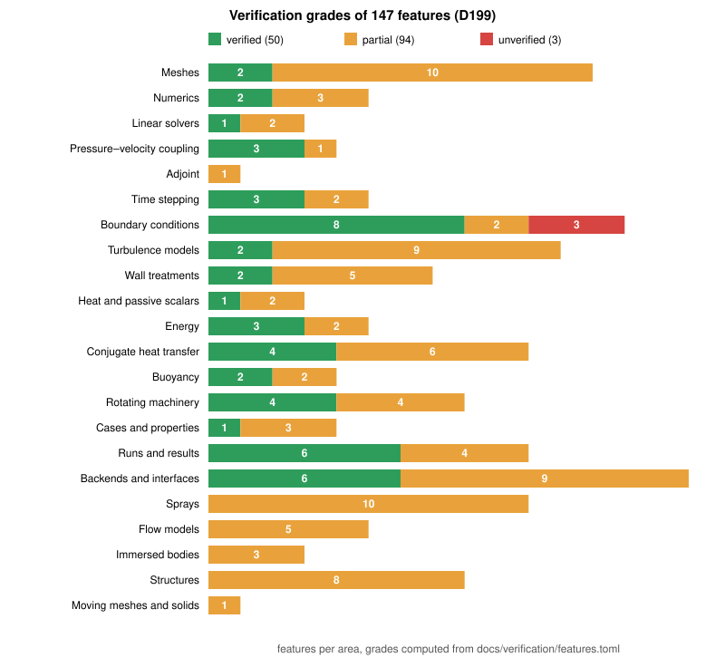

# Verification

Part of the [Example gallery](../gallery.md): the discretisation uncertainty of mesh and time-step sweeps (D67) and the verification manual generated from the cases (D68), and the grades of every feature with the limitations they give a run (D199), and the first stage of the adjoint (L17).

| # | Example | Stage | Feature |
|---|---|---|---|
| 25 | [Grid convergence index: Couette flow and the cylinder at Re = 20](#gci) | 5 | `[verification] levels` with three or more meshes, `uncertainty` in `result.json`, `tools/release/verification_manual.py` |
| 170 | [Verification grades and the limitations of a run: the raw Gmsh pipe](#limitations) | 7 | `docs/verification/status.md`, `features.toml`, `limitations` in `result.json`, LIM001 to LIM006 |
| 271 | [Adjoint stage A0: one steady residual for SIMPLEC and the coupled solver](#adjoint-a0) | L17 | `Flow::steady_residual`, `foehncraft_kernels::reverse`, example `adjoint_a0` |

---

<a id="gci"></a>
## 25. Grid convergence index: Couette flow and the cylinder at Re = 20


**What the report adds.** Every sweep of three or more meshes (or time
steps) now ends with a table of the discretisation uncertainty of its
monitored quantities: boundary mass flows, mean pressures and forces, the
drag and lift coefficients, the benchmark values and the viscous and
numerical dissipation. For each, the procedure of Celik et al. (2008)
takes the three finest solutions and gives the observed order p (by
fixed-point iteration, so the refinement ratios need not be equal), the
value extrapolated to zero cell size, the band φ1 ± U of the finest
solution with U = 1.25 |φ1 − φ2| / (r^p − 1), the grid convergence index
U / |φ1|, and a verdict: monotonic, oscillatory, divergent or unchanged.
The table is in `flow.md`; `result.json` has the same numbers under
`uncertainty` (also `Result.uncertainty` in Python).

**Left: a case with an exact answer.** `couette_viscosity.toml` (gallery
23) on 16 × 8, 32 × 16 and 64 × 32 cells: the force on the lower wall
converges at order 1.75. The finest mesh is 0.40 % below the exact
μ0 U a / ln(1 + a) times the area; the extrapolated value is 0.014 %
above it, and the band ± 2.6e-4 N of the finest mesh (GCI 0.52 %) holds
the exact value. This is the check of the estimate itself.

**Right: a benchmark without an exact solution.**
`cylinder_re20_gci.toml` runs the steady benchmark 2D-1 of Schäfer &
Turek (1996) on the built-in meshes of 6 144, 24 576 and 98 304
hexahedra. C_D falls from 5.5835 to 5.5808 and 5.5800 (order 1.81) and
extrapolates to 5.5797 ± 0.0004 (GCI 0.007 %), inside the reference range
5.57–5.59. C_L, 7 % below the range on the coarse mesh, converges at
order 2.03 to 0.01071 (GCI 0.77 %) inside 0.0104–0.0110; the pressure
difference Δp extrapolates to 0.11754 Pa (range 0.1172–0.1176). The mean
pressure on the cylinder changes by more from the medium to the fine
mesh than from the coarse to the medium one and is reported as
divergent, without an order. These are the SIMPLEC numbers (12 minutes
on four cores, 9 876 iterations on the finest mesh). Since PR 144 the
case runs the coupled algorithm, in 51, 90 and 225 outer iterations and
about a minute (in the `long` set): C_D 5.5800 extrapolates to 5.5796 ±
0.0004 (order 1.78) and Δp to 0.11754 Pa as before; C_L converges at
order 1.65 to 0.01073 (GCI 1.35 %). The lift is a force of 2·10⁻⁷ N and
depends on the pseudo-time step through the face velocity of the
pressure coupling (0.01037 on the medium mesh with the default
relaxation, 0.01041 with 0.9, 0.01044 with SIMPLEC).

```
target/release/foehn flow examples/cases/flow/cylinder_re20_gci.toml
python3 -m tools.plot.gci_chart docs/figures/gallery/gci.svg output/couette_viscosity output/cylinder_re20_gci
```

**The manual.** `tools/release/verification_manual.py` collects every
verification case with its pass bands, the value of its run and the
uncertainty tables of its sweeps into
[docs/verification/manual.md](../verification/manual.md) (with
`results.json` and a chart of the observed orders against their bands).

How to use it: [recipes 34 and 35](../recipes/verification.md).

---

<a id="limitations"></a>
## 170. Verification grades and the limitations of a run: the raw Gmsh pipe



**The grades.** Every feature a case can switch on has a row in
[features.toml](../verification/features.toml): the cases, tests and
recorded runs that check it, with their kind (exact, manufactured,
reference data, consistency), the known gaps and the validated range.
`tools/release/verification_status.py` computes the grade of every row
and writes the [verification status](../verification/status.md) page and
the chart above; CI refuses a table that names a case or test that does
not exist, or a page that is out of date. A gap written into the table,
or a case that fails in the verification manual, lowers the grade at
once.

**The limitations of a run.** At the end of a run the engine compares the
case with these grades and the result with the validated ranges. The raw
Gmsh pipe of [gallery 26](meshes.md) (`examples/cases/flow/pipe_gmsh_raw.toml`,
1 572 tetrahedra) finishes with every check passed, and the last frame of the
log says what to keep in mind:

```
******************************************************************************************************
*                                                                                                    *
*   Run finished with 3 limitations: every check passed                                              *
*                                                                                                    *
*   Exit code                          0                                                             *
*   Elapsed time                       0:00:00                                                       *
*   Results in                         output/pipe_gmsh_raw                                          *
*   Report                             flow.md, result.json                                          *
*   LIM001                             Gmsh v4 reader is graded partial: no exact or manufactured    *
*                                      solution (docs/verification/status.md)                        *
*   LIM004                             one mesh only: the discretisation uncertainty is not          *
*                                      estimated (a level sweep with `[verification] levels` gives   *
*                                      the GCI)                                                      *
*   LIM006                             automatic mesh remediation active (28 skewed faces, 44 poor   *
*                                      cells): solver.pressure_gradient: "least-squares" ->          *
*                                      "gauss", solver.momentum.limiter: "none" ->                   *
*                                      "venkatakrishnan", solver.face_velocity: "interpolated" ->    *
*                                      "bounded"; the scheme is first order on those faces           *
*                                                                                                    *
******************************************************************************************************
```

The same list is at the top of `flow.md`, in `result.json` under
`limitations` (code, feature, message) and in Python as
`Result.limitations`. The run is still `finished` with exit code 0: a
limitation is not a failed check (exit code 2 stays for those). A
k-ε channel refined to a first-cell y⁺ of 3.9
(`--set 'mesh.generate.cells=[2,96,1]'` on `channel_keps.toml`) adds
LIM002 for its scalable wall functions, validated from y⁺ 11.06 to 300,
and LIM003 when the solve stops at its iteration limit.

<a id="adjoint-a0"></a>
## 271. Adjoint stage A0: one steady residual for SIMPLEC and the coupled solver


**What it is.** The first stage of the adjoint solver (L17, plan
[step 27](../requirements/step27-adjoint-solver.md), stage A0). The
discrete adjoint (D220) differentiates the equations a converged steady
run satisfies, not the iterations that got there. `Flow::steady_residual`
evaluates them at the current fields as one callable:
R_u = b − A u per cell and component, R_c = Σ ±ṁ per cell, and
R_ṁ = (ṁ − ṁ*)/α_u per face, with ṁ* the Rhie–Chow flux. The face fluxes
are part of the state: the flux reads the momentum diagonal, which holds
the convection of the fluxes, so ṁ is defined only implicitly. Divided by
α_u, R does not depend on the relaxation.

**The picture.** `examples/cases/flow/adjoint_residual_cavity.toml` runs
twice, with SIMPLEC and with the coupled solver, and R is evaluated after
every outer iteration (right). Both algorithms drive the same R_u and R_ṁ
down to the stop at 10⁻¹¹ (SIMPLEC with α_u = 0.8 in 302 outer
iterations, the coupled solver in 479); R_c stays near round-off from the
start, since the pressure correction makes the fluxes conservative in
every iteration. What the adjoint will linearise is the same for either
solver. The middle panel shows where R is large after one iteration:
under the lid and in its two upper corners. A call leaves the run bitwise
unchanged.

**The reverse sweep.** `foehncraft_kernels::reverse` computes the
transposed Jacobian product of the momentum face kernel from local dual
Jacobians (D221, option A): the same kernel body on `Dual<26>` per face,
then a gather over the faces of each cell in stored order, with no atomics.
Dot-product test 6 × 10⁻¹⁷, central differences 1 × 10⁻¹², bitwise equal on 1
and 4 threads, 4.6 times a primal face evaluation with stored blocks and
38 times without. The compiler reverse mode (option B, nightly only) gives
the same numbers at 3.5 times. The measurements are in
[docs/verification/adjoint-a0.md](../verification/adjoint-a0.md); how to
repeat them is [recipe 271](../recipes/verification.md#adjoint-a0).
