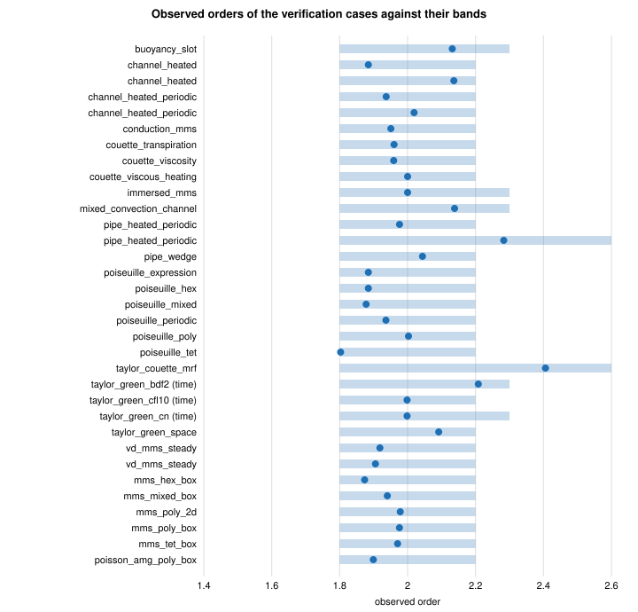

# Verification manual

<!-- generated by tools/release/verification_manual.py (D68); do not edit -->

Every verification case of the [case catalogue](../cases.md) with its pass bands and the result of its run. The cases check themselves (a run outside its band exits with code 1, R5); this page collects the bands and the values. The explanations stay on the stage pages ([stage 2](stage2.md), [stage 3](stage3.md), [stage 4](stage4.md), [stage 5](stage5.md), [stage 6](stage6.md)). The same data as JSON: [results.json](results.json).

Runs of Foehncraft 1.1.0 (b35bc269d4e1): 185 of 185 cases passed, 0 without a run.

## Flow cases (`foehn flow`)

| Case | What it checks | Cells | Check | Band | Value | |
|---|---|---|---|---|---|---|
| `adjoint_residual_cavity` | The steady residual of the adjoint (L17 stage A0, gallery 271) | 625 | net mass flow out of the domain | ≤ 1e-06 | 1.292e-36 relative | passed |
| `axial_stage_uniform` | Uniform axial flow through a sliding rotor whose interface is a surface of revolution (D186) | 2 090 | velocity error L2 (largest of the levels) | ≤ 0.003 | 0.002301 m/s | passed |
|  |  |  | net mass flow out of the domain | ≤ 1e-06 | 2.778e-15 relative | passed |
| `backstep_eb` | Backward-facing step of Driver & Seegmiller (1985), the elliptic-blending k-ε of Billard & Laurence (2012) with the compound wall treatment | 8 200 | net mass flow out of the domain | ≤ 1e-06 | 2.397e-15 relative | passed |
| `backstep_outlet_backflow` | Turbulence values of the backflow at a pressure outlet | 4 600 | net mass flow out of the domain | ≤ 1e-06 | 1.413e-11 relative | passed |
| `backstep_validation` | Backward-facing step of Driver & Seegmiller (1985) in the layout of NASA's Turbulence Modeling Resource (TMR), k-ε-ζ-f₀ with the coupled algorithm | 11 040 | net mass flow out of the domain | ≤ 1e-06 | 4.282e-15 relative | passed |
| `backstep_zeta_f0` | Backward-facing step of Driver & Seegmiller (1985), k-ε-ζ-f₀ (Popovac 2023) with its compound wall treatment | 8 200 | net mass flow out of the domain | ≤ 1e-06 | 2.611e-13 relative | passed |
| `backstep_zeta_f0_coupled` | Backward-facing step of Driver & Seegmiller (1985), k-ε-ζ-f₀, with the coupled pressure–velocity algorithm and pseudo-time steps | 8 200 | net mass flow out of the domain | ≤ 1e-06 | 2.866e-15 relative | passed |
| `buoyancy_box_at_rest` | A closed box at rest with a stable stratification | 256 | net mass flow out of the domain | ≤ 1e-06 | 1.520e-35 relative | passed |
| `buoyancy_channel_reduced` | A tall vertical channel with gravity, outlet given as reduced pressure | 1 000 | net mass flow out of the domain | ≤ 1e-06 | 1.047e-14 relative | passed |
| `buoyancy_channel_static` | A tall vertical channel with gravity, outlet given as static pressure | 1 000 | net mass flow out of the domain | ≤ 1e-06 | 1.055e-14 relative | passed |
| `buoyancy_enclosure_plume` | A warm strip on the floor of a small closed air enclosure | 6 000 | net mass flow out of the domain | ≤ 1e-06 | 1.967e-38 relative | passed |
| `buoyancy_open_box` | A box at rest with a tall opening | 400 | net mass flow out of the domain | ≤ 1e-06 | 0 relative | passed |
| `buoyancy_slot` | Natural convection between a hot and a cold vertical wall | 16 … 256 | observed order in space (finest pair) | 1.8 – 2.3 | 2.132 | passed |
|  |  |  | net mass flow out of the domain | ≤ 1e-06 | 1.706e-36 relative | passed |
| `cavity_heated` | Lid-driven cavity with a warm lid | 4 096 | every steady solve converged | converged | yes | passed |
|  |  |  | net mass flow out of the domain | ≤ 1e-06 | 0 relative | passed |
| `cavity_re100` | Lid-driven cavity at Re = 100 on 64 x 64 hexahedra | 4 096 | largest deviation from Ghia et al. (1982), Re = 100 | ≤ 0.02 | 0.009451 of U_lid | passed |
|  |  |  | every steady solve converged | converged | yes | passed |
|  |  |  | net mass flow out of the domain | ≤ 1e-06 | 0 relative | passed |
| `cavity_re1000` | Lid-driven cavity at Re = 1000 on 128 x 128 hexahedra | 16 384 | largest deviation from Ghia et al. (1982), Re = 1000 | ≤ 0.02 | 0.01356 of U_lid | passed |
|  |  |  | every steady solve converged | converged | yes | passed |
|  |  |  | net mass flow out of the domain | ≤ 1e-06 | 0 relative | passed |
| `cavity_re1000_coupled` | Lid-driven cavity at Re = 1000 on 128 x 128 hexahedra with the coupled pressure–velocity algorithm | 16 384 | largest deviation from Ghia et al. (1982), Re = 1000 | ≤ 0.02 | 0.01357 of U_lid | passed |
|  |  |  | every steady solve converged | converged | yes | passed |
|  |  |  | net mass flow out of the domain | ≤ 1e-06 | 0 relative | passed |
| `cavity_re1000_poly3d` | Lid-driven cavity at Re = 1000 on three-dimensional polyhedra | 28 227 | largest deviation from Ghia et al. (1982), Re = 1000 | ≤ 0.03 | 0.02388 of U_lid | passed |
|  |  |  | every steady solve converged | converged | yes | passed |
|  |  |  | net mass flow out of the domain | ≤ 1e-06 | 2.563e-22 relative | passed |
| `cavity_re100_budget` | Lid-driven cavity at Re = 100 with a budget | 4 096 | largest deviation from Ghia et al. (1982), Re = 100 | ≤ 0.02 | 0.009451 of U_lid | passed |
|  |  |  | every steady solve converged | converged | yes | passed |
|  |  |  | net mass flow out of the domain | ≤ 1e-06 | 0 relative | passed |
| `cavity_re100_columns` | Lid-driven cavity at Re = 100 with a chosen iteration table | 4 096 | largest deviation from Ghia et al. (1982), Re = 100 | ≤ 0.02 | 0.009451 of U_lid | passed |
|  |  |  | every steady solve converged | converged | yes | passed |
|  |  |  | net mass flow out of the domain | ≤ 1e-06 | 0 relative | passed |
| `cavity_re100_energy` | Lid-driven cavity at Re = 100: the energy budget | 4 096 | largest deviation from Ghia et al. (1982), Re = 100 | ≤ 0.02 | 0.009451 of U_lid | passed |
|  |  |  | every steady solve converged | converged | yes | passed |
|  |  |  | net mass flow out of the domain | ≤ 1e-06 | 0 relative | passed |
| `cavity_re100_log_steps` | Lid-driven cavity at Re = 100 in time, with a short log (D214) | 1 024 | net mass flow out of the domain | ≤ 1e-06 | 0 relative | passed |
| `cavity_re100_poly3d` | Lid-driven cavity at Re = 100 on three-dimensional polyhedra | 5 445 | largest deviation from Ghia et al. (1982), Re = 100 | ≤ 0.03 | 0.01327 of U_lid | passed |
|  |  |  | every steady solve converged | converged | yes | passed |
|  |  |  | net mass flow out of the domain | ≤ 1e-06 | 3.237e-21 relative | passed |
| `cavity_re100_schedule` | Lid-driven cavity at Re = 100 with settings prepared for the run | 4 096 | largest deviation from Ghia et al. (1982), Re = 100 | ≤ 0.02 | 0.009451 of U_lid | passed |
|  |  |  | every steady solve converged | converged | yes | passed |
|  |  |  | net mass flow out of the domain | ≤ 1e-06 | 0 relative | passed |
| `cavity_re100_tet3d` | Lid-driven cavity at Re = 100 on three-dimensional tetrahedra | 24 576 | largest deviation from Ghia et al. (1982), Re = 100 | ≤ 0.03 | 0.02542 of U_lid | passed |
|  |  |  | every steady solve converged | converged | yes | passed |
|  |  |  | net mass flow out of the domain | ≤ 1e-06 | 0 relative | passed |
| `cavity_re100_transient` | Lid-driven cavity at Re = 100, run in time to the steady state | 4 096 | largest deviation from Ghia et al. (1982), Re = 100 | ≤ 0.02 | 0.009454 of U_lid | passed |
|  |  |  | net mass flow out of the domain | ≤ 1e-06 | 0 relative | passed |
| `cavity_sst_operator_check` | The operator exactness check (D236) on a shallow lid-driven cavity (2:1) with k-ω SST, the curvature and rotation correction and QCR2000, on 2D tetrahedra (triangular prisms) with randomly perturbed vertices | 4 096 | net mass flow out of the domain | ≤ 1e-06 | 0 relative | passed |
| `channel_eb` | Fully developed turbulent channel flow at Re_τ ≈ 395, the elliptic-blending k-ε of Billard & Laurence (2012, "BL-v²/k") with the compound wall treatment | 192 | net mass flow out of the domain | ≤ 1e-06 | 6.788e-49 relative | passed |
| `channel_heated` | Laminar heated channel: a passive temperature in plane Poiseuille flow with a uniform heat flux into both walls | 512 … 8 192 | observed order in space (finest pair) | 1.8 – 2.2 | 1.885 | passed |
|  |  |  | observed order of scalar theta in space (finest pair) | 1.8 – 2.2 | 2.136 | passed |
|  |  |  | every steady solve converged | converged | yes | passed |
|  |  |  | net mass flow out of the domain | ≤ 1e-06 | 5.986e-13 relative | passed |
| `channel_heated_keps` | Heated turbulent channel, standard k-ε with scalable wall functions and the thermal wall function of Kader | 24 | net mass flow out of the domain | ≤ 1e-06 | 1.862e-49 relative | passed |
| `channel_heated_periodic` | Laminar heated channel, periodic | 512 … 8 192 | observed order in space (finest pair) | 1.8 – 2.2 | 1.937 | passed |
|  |  |  | observed order of scalar theta in space (finest pair) | 1.8 – 2.2 | 2.019 | passed |
|  |  |  | every steady solve converged | converged | yes | passed |
|  |  |  | net mass flow out of the domain | ≤ 1e-06 | 1.169e-36 relative | passed |
| `channel_heated_pr0025` | Heated turbulent channel of a liquid metal (Pr = 0.025), standard k-ε with scalable wall functions, the thermal wall function of Kader and the turbulent Prandtl number of Kays & Crawford | 24 | net mass flow out of the domain | ≤ 1e-06 | 4.563e-50 relative | passed |
| `channel_keps` | Fully developed turbulent channel flow at Re_τ ≈ 395, standard k-ε with scalable wall functions | 24 | net mass flow out of the domain | ≤ 1e-06 | 1.862e-49 relative | passed |
| `channel_ramp` | Start-up of a channel flow with the inflow ramped up in time by a table (D53) | 512 | velocity error L2 (largest of the levels) | ≤ 0.002 | 0.001592 m/s | passed |
|  |  |  | net mass flow out of the domain | ≤ 1e-06 | 4.644e-18 relative | passed |
| `channel_rotating_sst` | Fully developed channel flow in spanwise system rotation, k-ω SST with the curvature and rotation correction of Smirnov & Menter (2009) | 192 | net mass flow out of the domain | ≤ 1e-06 | 9.480e-38 relative | passed |
| `channel_slip` | Uniform flow between slip walls | 432 | velocity error L2 (largest of the levels) | ≤ 1e-09 | 1.537e-11 m/s | passed |
|  |  |  | every steady solve converged | converged | yes | passed |
|  |  |  | net mass flow out of the domain | ≤ 1e-06 | 2.151e-16 relative | passed |
| `channel_sst` | Fully developed turbulent channel flow at Re_τ ≈ 395, k-ω SST 2003 | 192 | net mass flow out of the domain | ≤ 1e-06 | 6.442e-49 relative | passed |
| `channel_zeta_f` | Fully developed turbulent channel flow at Re_τ ≈ 395, k-ε-ζ-f (Hanjalić, Popovac & Hadžiabdić 2004) with the compound wall treatment | 192 | net mass flow out of the domain | ≤ 1e-06 | 2.941e-47 relative | passed |
| `channel_zeta_f0` | Fully developed turbulent channel flow at Re_τ ≈ 395, k-ε-ζ-f₀ (Popovac 2023) with the compound wall treatment of the same paper | 96 | net mass flow out of the domain | ≤ 1e-06 | 2.265e-51 relative | passed |
| `cht_circuit_board` | A chip on a circuit board in an air channel | 3 040 | every steady solve converged | converged | yes | passed |
|  |  |  | net mass flow out of the domain | ≤ 1e-06 | 5.486e-15 relative | passed |
| `cht_composite_wall` | A composite wall of two solids and a fluid layer at rest | 40 | net mass flow out of the domain | ≤ 1e-06 | 0 relative | passed |
| `cht_contact_transient` | Two semi-infinite bodies brought into contact | 200 | L2 error of scalar temperature (finest mesh) | ≤ 0.01 | 0.004812 | passed |
|  |  |  | net mass flow out of the domain | ≤ 1e-06 | 0 relative | passed |
| `cht_counterflow_two_fluids` | Two fluids in one conjugate case | 3 200 | net mass flow out of the domain | ≤ 1e-06 | 4.471e-40 relative | passed |
| `cht_heat_sink_turbulent` | A finned heat sink in a turbulent air channel | 14 320 | every steady solve converged | converged | yes | passed |
|  |  |  | net mass flow out of the domain | ≤ 1e-06 | 2.713e-12 relative | passed |
| `cht_heated_wall` | A heated wall cooled by a channel flow | 2 000 | every steady solve converged | converged | yes | passed |
|  |  |  | net mass flow out of the domain | ≤ 1e-06 | 4.601e-14 relative | passed |
| `cht_heated_wall_accelerated` | The heated wall of `cht_heated_wall_transient` with thermal acceleration of the wall (D213, §9e of the stage 7 specification) | 2 000 | net mass flow out of the domain | ≤ 1e-06 | 2.357e-18 relative | passed |
| `cht_heated_wall_frozen` | The heated wall of `cht_heated_wall_transient` with a fluid whose viscosity falls with the temperature, warmed up with the frozen-flow march (D118, §9f of the stage 7 specification) | 2 000 | net mass flow out of the domain | ≤ 1e-06 | 2.434e-18 relative | passed |
| `cht_heated_wall_periodic_accelerated` | The heated wall of `cht_heated_wall_accelerated` with a periodic inlet temperature, 300 ± 50 K over a period of 50 s | 2 000 | net mass flow out of the domain | ≤ 1e-06 | 2.357e-18 relative | passed |
| `cht_heated_wall_transient` | The heated wall of `cht_heated_wall` with the heater switched on at t = 0 | 2 000 | net mass flow out of the domain | ≤ 1e-06 | 1.179e-18 relative | passed |
| `cht_orthotropic_patch` | Patch test of conjugate conduction on a skewed mesh | 80 | net mass flow out of the domain | ≤ 1e-06 | 0 relative | passed |
| `cht_pulsating_channel_cycle` | A pulsating laminar channel flow over a thick heated wall, coupled cycle-averaged (D204, §9d of the stage 7 specification, V7.39) | 800 | net mass flow out of the domain | ≤ 1e-06 | 1.630e-15 relative | passed |
| `cht_pulsating_channel_skin` | The pulsating channel of `cht_pulsating_channel_cycle.toml` over a wall whose skin is thin | 3 200 | net mass flow out of the domain | ≤ 1e-06 | 1.232e-14 relative | passed |
| `cht_pulsating_channel_warmup` | The pulsating channel of `cht_pulsating_channel_cycle` with a period ten times shorter (5 s against the wall's time constant of about 300 s), warmed up with the cycle-averaged loop and a transient solid phase (D204 with the march of D118, §9d of the stage 7 specification) | 800 | net mass flow out of the domain | ≤ 1e-06 | 2.169e-15 relative | passed |
| `cht_turbulent_channel` | A turbulent channel flow over a conducting wall | 1 200 | every steady solve converged | converged | yes | passed |
|  |  |  | net mass flow out of the domain | ≤ 1e-06 | 6.165e-14 relative | passed |
| `cht_two_fluids_absolute` | Absolute pressure values and two operating pressures in one case (D239) | 3 200 | net mass flow out of the domain | ≤ 1e-06 | 4.471e-40 relative | passed |
| `cht_two_fluids_start` | Start values per region and per fluid part (D238) | 3 200 | net mass flow out of the domain | ≤ 1e-06 | 4.618e-20 relative | passed |
| `conduction_mms` | Heat conduction with a temperature-dependent conductivity | 256 … 4 096 | observed order of scalar temperature in space (finest pair) | 1.8 – 2.2 | 1.951 | passed |
|  |  |  | every steady solve converged | converged | yes | passed |
|  |  |  | net mass flow out of the domain | ≤ 1e-06 | 0 relative | passed |
| `couette_derived` | Derived fields (D72) of plane Couette flow on perturbed poly cells | 153 | velocity error L2 (largest of the levels) | ≤ 1e-09 | 6.864e-11 m/s | passed |
|  |  |  | every steady solve converged | converged | yes | passed |
|  |  |  | net mass flow out of the domain | ≤ 1e-06 | 5.148e-45 relative | passed |
| `couette_hex` | Plane Couette flow on hexahedra, with convection | 128 | velocity error L2 (largest of the levels) | ≤ 1e-09 | 4.458e-11 m/s | passed |
|  |  |  | every steady solve converged | converged | yes | passed |
|  |  |  | net mass flow out of the domain | ≤ 1e-06 | 3.701e-18 relative | passed |
| `couette_mixed` | Plane Couette flow on perturbed mixed cells, Stokes flow | 192 | velocity error L2 (largest of the levels) | ≤ 1e-09 | 1.362e-10 m/s | passed |
|  |  |  | every steady solve converged | converged | yes | passed |
|  |  |  | net mass flow out of the domain | ≤ 1e-06 | 3.605e-18 relative | passed |
| `couette_poly` | Plane Couette flow on perturbed poly cells, Stokes flow | 153 | velocity error L2 (largest of the levels) | ≤ 1e-09 | 6.864e-11 m/s | passed |
|  |  |  | every steady solve converged | converged | yes | passed |
|  |  |  | net mass flow out of the domain | ≤ 1e-06 | 5.148e-45 relative | passed |
| `couette_tet` | Plane Couette flow on perturbed tet cells, Stokes flow | 256 | velocity error L2 (largest of the levels) | ≤ 1e-09 | 1.695e-10 m/s | passed |
|  |  |  | every steady solve converged | converged | yes | passed |
|  |  |  | net mass flow out of the domain | ≤ 1e-06 | 0 relative | passed |
| `couette_transpiration` | Plane Couette flow with transpiration | 128 … 2 048 | observed order in space (finest pair) | 1.8 – 2.2 | 1.96 | passed |
|  |  |  | every steady solve converged | converged | yes | passed |
|  |  |  | net mass flow out of the domain | ≤ 1e-06 | 1.604e-16 relative | passed |
| `couette_two_rotors` | Laminar Couette flow between two cylinders that turn in opposite senses, each a sliding rotor by imprinting (D182 variant B, D185) | 960 | velocity error L2 (largest of the levels) | ≤ 0.03 | 0.01759 m/s | passed |
|  |  |  | net mass flow out of the domain | ≤ 1e-06 | 6.572e-18 relative | passed |
| `couette_viscosity` | Plane Couette flow with a viscosity that grows linearly across the gap, given as an expression of y (D53, D94) | 128 … 2 048 | observed order in space (finest pair) | 1.8 – 2.2 | 1.959 | passed |
|  |  |  | every steady solve converged | converged | yes | passed |
|  |  |  | net mass flow out of the domain | ≤ 1e-06 | 9.857e-17 relative | passed |
| `couette_viscous_heating` | Plane Couette flow heated by its own friction | 128 … 2 048 | observed order of scalar temperature in space (finest pair) | 1.8 – 2.2 | 2 | passed |
|  |  |  | every steady solve converged | converged | yes | passed |
|  |  |  | net mass flow out of the domain | ≤ 1e-06 | 0 relative | passed |
| `cylinder_potential` | Potential-flow start around the cylinder of Schäfer & Turek | 24 576 | net mass flow out of the domain | ≤ 1e-06 | 5.706e-16 relative | passed |
| `cylinder_re100` | Flow around a cylinder in a channel at Re = 100 | 6 144 | C_D,max (Schäfer & Turek (1996) 2D-2, Re = 100) | 3.22 – 3.24 | 3.232 | passed |
|  |  |  | C_L,max (Schäfer & Turek (1996) 2D-2, Re = 100) | 0.99 – 1.01 | 0.9712 | passed |
|  |  |  | St (Schäfer & Turek (1996) 2D-2, Re = 100) | 0.295 – 0.305 | 0.2955 | passed |
|  |  |  | Δp (Pa) (Schäfer & Turek (1996) 2D-2, Re = 100) | 2.46 – 2.5 | 2.482 | passed |
|  |  |  | net mass flow out of the domain | ≤ 1e-06 | 4.374e-19 relative | passed |
| `cylinder_re100_convective` | Flow around a cylinder at Re = 100 in a short channel | 4 928 | C_D,max (Schäfer & Turek (1996) 2D-2, Re = 100) | 3.22 – 3.24 | 3.226 | passed |
|  |  |  | C_L,max (Schäfer & Turek (1996) 2D-2, Re = 100) | 0.99 – 1.01 | 0.9555 | passed |
|  |  |  | St (Schäfer & Turek (1996) 2D-2, Re = 100) | 0.295 – 0.305 | 0.2952 | passed |
|  |  |  | Δp (Pa) (Schäfer & Turek (1996) 2D-2, Re = 100) | 2.46 – 2.5 | 2.478 | passed |
|  |  |  | net mass flow out of the domain | ≤ 1e-06 | 7.972e-38 relative | passed |
| `cylinder_re100_short` | Flow around a cylinder at Re = 100 in a short channel | 4 928 | C_D,max (Schäfer & Turek (1996) 2D-2, Re = 100) | 3.22 – 3.24 | 3.234 | passed |
|  |  |  | C_L,max (Schäfer & Turek (1996) 2D-2, Re = 100) | 0.99 – 1.01 | 0.9713 | passed |
|  |  |  | St (Schäfer & Turek (1996) 2D-2, Re = 100) | 0.295 – 0.305 | 0.2951 | passed |
|  |  |  | Δp (Pa) (Schäfer & Turek (1996) 2D-2, Re = 100) | 2.46 – 2.5 | 2.482 | passed |
|  |  |  | net mass flow out of the domain | ≤ 1e-06 | 1.305e-18 relative | passed |
| `cylinder_re100_statistics` | Statistics of the vortex street behind a cylinder at Re = 100 (D71, gallery and recipe 110) | 6 144 | C_D,max (Schäfer & Turek (1996) 2D-2, Re = 100) | 3.22 – 3.24 | 3.232 | passed |
|  |  |  | C_L,max (Schäfer & Turek (1996) 2D-2, Re = 100) | 0.99 – 1.01 | 0.9712 | passed |
|  |  |  | St (Schäfer & Turek (1996) 2D-2, Re = 100) | 0.295 – 0.305 | 0.2955 | passed |
|  |  |  | Δp (Pa) (Schäfer & Turek (1996) 2D-2, Re = 100) | 2.46 – 2.5 | 2.482 | passed |
|  |  |  | net mass flow out of the domain | ≤ 1e-06 | 8.886e-19 relative | passed |
| `cylinder_re20` | Flow around a cylinder in a channel at Re = 20 | 24 576 | C_D (Schäfer & Turek (1996) 2D-1, Re = 20) | 5.57 – 5.59 | 5.581 | passed |
|  |  |  | C_L (Schäfer & Turek (1996) 2D-1, Re = 20) | 0.0104 – 0.011 | 0.01036 | passed |
|  |  |  | Δp (Pa) (Schäfer & Turek (1996) 2D-1, Re = 20) | 0.1172 – 0.1176 | 0.1175 | passed |
|  |  |  | every steady solve converged | converged | yes | passed |
|  |  |  | net mass flow out of the domain | ≤ 1e-06 | 1.013e-16 relative | passed |
| `cylinder_re20_gci` | Flow around a cylinder in a channel at Re = 20 on three meshes | 6 144 … 98 304 | C_D (Schäfer & Turek (1996) 2D-1, Re = 20) | 5.57 – 5.59 | 5.58 | passed |
|  |  |  | C_L (Schäfer & Turek (1996) 2D-1, Re = 20) | 0.0104 – 0.011 | 0.01061 | passed |
|  |  |  | Δp (Pa) (Schäfer & Turek (1996) 2D-1, Re = 20) | 0.1172 – 0.1176 | 0.1175 | passed |
|  |  |  | every steady solve converged | converged | yes | passed |
|  |  |  | net mass flow out of the domain | ≤ 1e-06 | 1.931e-13 relative | passed |
| `cylinder_steady_diagnosis` | Iteration budget and diagnosis of a steady run (D198 (d)) | 24 576 | net mass flow out of the domain | ≤ 1e-06 | 9.985e-08 relative | passed |
| `diffuser_channel_profile` | Developed channel flow for the inlet of the diffuser (diffuser_sst.toml) | 192 | net mass flow out of the domain | ≤ 1e-06 | 3.582e-49 relative | passed |
| `diffuser_sst` | Turbulent flow through the asymmetric plane diffuser of Buice & Eaton, k-omega SST 2003 with the low-Re wall treatment | 6 960 | net mass flow out of the domain | ≤ 1e-06 | 1.100e-14 relative | passed |
| `diffuser_sst_sharp` | The asymmetric plane diffuser of diffuser_sst.toml with SHARP corners (no radius) on both ends of the 10 degree wall, k-omega SST 2003 with the low-Re wall treatment | 8 400 | net mass flow out of the domain | ≤ 1e-06 | 4.319e-14 relative | passed |
| `flame_methane_air_gri30` | A laminar premixed methane-air flame in one dimension | 200 | net mass flow out of the domain | ≤ 1e-06 | 2.635e-09 relative | passed |
| `flame_methane_air_jl4` | A laminar premixed methane-air flame in one dimension | 200 | net mass flow out of the domain | ≤ 1e-06 | 4.047e-08 relative | passed |
| `immersed_cut_cylinder_re20` | Flow around a cylinder at Re = 20 on a cut-cell mesh | 35 780 | C_D (Schäfer & Turek (1996) 2D-1, Re = 20) | 5.57 – 5.59 | 5.588 | passed |
|  |  |  | C_L (Schäfer & Turek (1996) 2D-1, Re = 20) | 0.0104 – 0.011 | 0.01025 | passed |
|  |  |  | Δp (Pa) (Schäfer & Turek (1996) 2D-1, Re = 20) | 0.1172 – 0.1176 | 0.116 | passed |
|  |  |  | every steady solve converged | converged | yes | passed |
|  |  |  | net mass flow out of the domain | ≤ 1e-06 | 4.940e-16 relative | passed |
| `immersed_cut_stl_sphere_array` | Stokes flow through a simple cubic array of spheres, the sphere an STL surface cut out of the mesh (L13 stage 2, D227) | 31 752 | net mass flow out of the domain | ≤ 1e-06 | 0 relative | passed |
| `immersed_cylinder_re20` | Flow around a cylinder at Re = 20 without meshing the cylinder | 36 080 | C_D (Schäfer & Turek (1996) 2D-1, Re = 20) | 5.57 – 5.59 | 5.581 | passed |
|  |  |  | C_L (Schäfer & Turek (1996) 2D-1, Re = 20) | 0.0104 – 0.011 | 0.01473 | passed |
|  |  |  | Δp (Pa) (Schäfer & Turek (1996) 2D-1, Re = 20) | 0.1172 – 0.1176 | 0.1187 | passed |
|  |  |  | every steady solve converged | converged | yes | passed |
|  |  |  | net mass flow out of the domain | ≤ 1e-06 | 9.534e-16 relative | passed |
| `immersed_mms` | The manufactured solution of the penalised equations (L13 stage 1, D226) | 256 … 4 096 | observed order in space (finest pair) | 1.8 – 2.3 | 2 | passed |
|  |  |  | every steady solve converged | converged | yes | passed |
|  |  |  | net mass flow out of the domain | ≤ 1e-06 | 0 relative | passed |
| `immersed_stokes_sphere` | Stokes flow through a simple cubic array of spheres, the sphere a penalised body (L13 stage 1, D226) | 32 768 | net mass flow out of the domain | ≤ 1e-06 | 0 relative | passed |
| `immersed_topology_bend` | Topology search of a pipe bend with a density field (L13 stage 1, D226) | 3 600 | net mass flow out of the domain | ≤ 1e-06 | 3.170e-15 relative | passed |
| `impinging_jet` | Round jet from a pipe impinging on a heated plate at H/D = 2, Re = 23 750, k-ε-ζ-f₀ with the coupled algorithm on an axisymmetric wedge (stage 6 part 6g, specification 9.6 | 10 400 | net mass flow out of the domain | ≤ 1e-06 | 4.292e-16 relative | passed |
| `jet_pipe_profile` | Developed pipe flow at Re = 23 750 for the inlet of the impinging jet (impinging_jet.toml), k-ε-ζ-f₀ with the coupled algorithm | 96 | net mass flow out of the domain | ≤ 1e-06 | 3.050e-35 relative | passed |
| `mixed_convection_channel` | Fully developed mixed convection in a vertical channel with walls at different temperatures | 16 … 256 | observed order in space (finest pair) | 1.8 – 2.3 | 2.138 | passed |
|  |  |  | net mass flow out of the domain | ≤ 1e-06 | 1.820e-36 relative | passed |
| `motion_channel_ranks` | A channel whose mesh breathes, solved on ranks and continued from a restart file (stage MS0 part 2 | 768 | net mass flow out of the domain | ≤ 1e-06 | 2.166e-17 relative | passed |
| `motion_free_stream` | A uniform flow on a deforming mesh stays uniform | 200 | net mass flow out of the domain | ≤ 1e-06 | 6.939e-18 relative | passed |
| `motion_piston_adiabatic` | An evenly compressed cylinder: a piston compresses a closed volume of gas slowly and adiabatically and lets it expand again (L22) | 200 | net mass flow out of the domain | ≤ 1e-06 | 4.754e-36 relative | passed |
| `motion_piston_cooled_walls` | The piston of motion_piston_adiabatic.toml with walls held at 300 K | 3 200 | net mass flow out of the domain | ≤ 1e-06 | 2.467e-19 relative | passed |
| `naca0012_su2_re1000` | Laminar flow around a NACA 0012 at Re = 1000 and 4 degrees angle of attack, on the PyAero C-mesh read from an SU2 file (D187) | 6 420 | every steady solve converged | converged | yes | passed |
|  |  |  | net mass flow out of the domain | ≤ 1e-06 | 3.810e-15 relative | passed |
| `natural_convection_cavity_ra1e5` | Natural convection of air in a differentially heated square cavity | 1 024 … 16 384 | every steady solve converged | converged | yes | passed |
|  |  |  | net mass flow out of the domain | ≤ 1e-06 | 2.559e-38 relative | passed |
| `natural_convection_plate` | Laminar free convection along an isothermal vertical plate | 1 280 … 20 480 | every steady solve converged | converged | yes | passed |
|  |  |  | net mass flow out of the domain | ≤ 1e-06 | 1.935e-14 relative | passed |
| `pipe_gmsh_raw` | Developing laminar pipe flow on raw Gmsh tetrahedra | 1 572 | every steady solve converged | converged | yes | passed |
|  |  |  | net mass flow out of the domain | ≤ 1e-06 | 4.415e-11 relative | passed |
| `pipe_heated_keps` | Turbulent heated pipe, standard k-ε with scalable wall functions and the thermal wall function of Kader | 72 | net mass flow out of the domain | ≤ 1e-06 | 1.922e-35 relative | passed |
| `pipe_heated_periodic` | Short periodic heated pipe, laminar | 64 … 1 024 | observed order in space (finest pair) | 1.8 – 2.2 | 1.976 | passed |
|  |  |  | observed order of scalar theta in space (finest pair) | 1.8 – 2.6 | 2.283 | passed |
|  |  |  | every steady solve converged | converged | yes | passed |
|  |  |  | net mass flow out of the domain | ≤ 1e-06 | 2.403e-23 relative | passed |
| `pipe_rough_keps` | Fully developed flow in a rough pipe, standard k-ε with scalable wall functions and the roughness shift of Cebeci & Bradshaw | 80 | net mass flow out of the domain | ≤ 1e-06 | 2.269e-34 relative | passed |
| `pipe_turbulent_sst` | Fully developed turbulent pipe flow at Re_b = 5300 (Re_tau about 181), k-omega SST 2003 with the low-Re wall treatment | 96 | net mass flow out of the domain | ≤ 1e-06 | 1.844e-34 relative | passed |
| `pipe_wedge` | Hagen–Poiseuille flow in a pipe on an axisymmetric wedge | 256 … 4 096 | observed order in space (finest pair) | 1.8 – 2.2 | 2.044 | passed |
|  |  |  | every steady solve converged | converged | yes | passed |
|  |  |  | net mass flow out of the domain | ≤ 1e-06 | 1.011e-14 relative | passed |
| `plate_heated_keps` | Heated flat plate, standard k-ε with scalable wall functions and the thermal wall function of Kader | 3 072 | every steady solve converged | converged | yes | passed |
|  |  |  | net mass flow out of the domain | ≤ 1e-06 | 9.321e-14 relative | passed |
| `poiseuille_expression` | Plane Poiseuille flow with the inlet profile, the outlet pressure and the body force given as expressions (D53) | 512 … 8 192 | observed order in space (finest pair) | 1.8 – 2.2 | 1.885 | passed |
|  |  |  | every steady solve converged | converged | yes | passed |
|  |  |  | net mass flow out of the domain | ≤ 1e-06 | 5.987e-13 relative | passed |
| `poiseuille_hex` | Plane Poiseuille flow on hex cells | 512 … 8 192 | observed order in space (finest pair) | 1.8 – 2.2 | 1.885 | passed |
|  |  |  | every steady solve converged | converged | yes | passed |
|  |  |  | net mass flow out of the domain | ≤ 1e-06 | 5.986e-13 relative | passed |
| `poiseuille_mixed` | Plane Poiseuille flow on mixed cells | 768 … 12 288 | observed order in space (finest pair) | 1.8 – 2.2 | 1.878 | passed |
|  |  |  | every steady solve converged | converged | yes | passed |
|  |  |  | net mass flow out of the domain | ≤ 1e-06 | 8.387e-14 relative | passed |
| `poiseuille_periodic` | Periodic plane Poiseuille flow driven by the mass flow | 512 … 8 192 | observed order in space (finest pair) | 1.8 – 2.2 | 1.936 | passed |
|  |  |  | every steady solve converged | converged | yes | passed |
|  |  |  | net mass flow out of the domain | ≤ 1e-06 | 4.401e-37 relative | passed |
| `poiseuille_poly` | Plane Poiseuille flow on poly cells | 561 … 8 385 | observed order in space (finest pair) | 1.8 – 2.2 | 2.003 | passed |
|  |  |  | every steady solve converged | converged | yes | passed |
|  |  |  | net mass flow out of the domain | ≤ 1e-06 | 2.844e-13 relative | passed |
| `poiseuille_table` | Plane Poiseuille flow with the inlet profile read from a table | 512 | velocity error L2 (largest of the levels) | ≤ 0.002 | 0.001592 m/s | passed |
|  |  |  | every steady solve converged | converged | yes | passed |
|  |  |  | net mass flow out of the domain | ≤ 1e-06 | 1.272e-14 relative | passed |
| `poiseuille_tet` | Plane Poiseuille flow on tet cells | 1 024 … 16 384 | observed order in space (finest pair) | 1.8 – 2.2 | 1.803 | passed |
|  |  |  | every steady solve converged | converged | yes | passed |
|  |  |  | net mass flow out of the domain | ≤ 1e-06 | 2.549e-13 relative | passed |
| `poiseuille_water` | Plane Poiseuille flow of water at 40 °C from the material database (D94-D102) | 2 048 | velocity error L2 (largest of the levels) | ≤ 0.001 | 3.998e-04 m/s | passed |
|  |  |  | every steady solve converged | converged | yes | passed |
|  |  |  | net mass flow out of the domain | ≤ 1e-06 | 2.209e-13 relative | passed |
| `porous_darcy_block` | Gas through a porous block in a duct | 400 | every steady solve converged | converged | yes | passed |
|  |  |  | net mass flow out of the domain | ≤ 1e-06 | 1.779e-14 relative | passed |
| `porous_honeycomb_channel` | A ceramic honeycomb block in an air channel, its channels along the flow, beside a block of the same resistance in every direction | 19 200 | net mass flow out of the domain | ≤ 1e-06 | 2.571e-14 relative | passed |
| `porous_schumann` | Schumann's bed: hot air into a cold porous bed, gas and matrix with temperatures of their own (D271, porous plan PM2, check V4) | 100 | net mass flow out of the domain | ≤ 1e-06 | 4.447e-49 relative | passed |
| `porous_storage_charge` | Charging a honeycomb heat store | 4 000 | net mass flow out of the domain | ≤ 1e-06 | 1.249e-14 relative | passed |
| `pot_solid_body` | Solid-body rotation in a closed vessel with a sliding rotor pot whose interface passes through the axis (D186) | 2 896 | velocity error L2 (largest of the levels) | ≤ 0.03 | 0.006872 m/s | passed |
|  |  |  | net mass flow out of the domain | ≤ 1e-06 | 1.238e-18 relative | passed |
| `pot_solid_body_viscous` | Solid-body rotation at high viscosity in a closed vessel with a sliding rotor pot whose interface passes through the axis | 2 896 | velocity error L2 (largest of the levels) | ≤ 0.01 | 0.001172 m/s | passed |
|  |  |  | net mass flow out of the domain | ≤ 1e-06 | 1.236e-18 relative | passed |
| `ranks_channel_poly` | A channel whose upper wall runs against the inflow, solved on 2, 3 and 5 ranks | 2 821 | net mass flow out of the domain | ≤ 1e-06 | 1.053e-10 relative | passed |
| `ranks_cylinder_species_statistics` | The vortex street behind a cylinder at Re = 100 with methane diffusing from its surface into the wake, solved on four ranks with species transport and the statistics of the fields (MPI step W7, gallery and recipe of the pull request that put species, the variable density and `[output.statistics]` on ranks) | 6 144 | C_D,max (Schäfer & Turek (1996) 2D-2, Re = 100) | 3.22 – 3.24 | 3.232 | passed |
|  |  |  | C_L,max (Schäfer & Turek (1996) 2D-2, Re = 100) | 0.99 – 1.01 | 0.9712 | passed |
|  |  |  | St (Schäfer & Turek (1996) 2D-2, Re = 100) | 0.295 – 0.305 | 0.2955 | passed |
|  |  |  | Δp (Pa) (Schäfer & Turek (1996) 2D-2, Re = 100) | 2.46 – 2.5 | 2.482 | passed |
|  |  |  | net mass flow out of the domain | ≤ 1e-06 | 4.374e-19 relative | passed |
| `ranks_heated_channel_sst` | A turbulent channel with a heated lower wall, solved on 2, 3 and 5 ranks | 2 821 | net mass flow out of the domain | ≤ 1e-06 | 1.109e-10 relative | passed |
| `ranks_restart_channel` | A transient channel flow on ranks with its restart file gathered from five ranks | 2 821 | net mass flow out of the domain | ≤ 1e-06 | 1.826e-16 relative | passed |
| `ranks_run_channel` | A steady channel flow solved on ranks (MPI step W7) | 2 821 | net mass flow out of the domain | ≤ 1e-06 | 8.271e-13 relative | passed |
| `ranks_run_imprint_couette` | A sliding rotor by imprinting solved on ranks (MPI step W7, turning zones) | 640 | net mass flow out of the domain | ≤ 1e-06 | 1.013e-19 relative | passed |
| `ranks_run_mrf_couette` | Taylor-Couette flow with a rotating zone (`[[mrf]]`, D55) solved on ranks (MPI step W7, turning zones) | 1 024 | velocity error L2 (largest of the levels) | ≤ 0.01 | 0.00694 m/s | passed |
|  |  |  | net mass flow out of the domain | ≤ 1e-06 | 2.231e-18 relative | passed |
| `ranks_run_sliding_couette` | A sliding rotor in conformal stepping solved on ranks (MPI step W7, turning zones) | 4 096 | net mass flow out of the domain | ≤ 1e-06 | 1.626e-18 relative | passed |
| `ranks_run_transient_sst` | A transient, turbulent, heated channel flow solved on ranks (MPI step W7 part 2) | 2 821 | net mass flow out of the domain | ≤ 1e-06 | 1.913e-36 relative | passed |
| `ranks_water_if97_channel` | Pressurised water heated in a channel with IAPWS-IF97 properties, solved on 2, 3 and 4 ranks | 2 880 | net mass flow out of the domain | ≤ 1e-06 | 6.641e-13 relative | passed |
| `scalar_front_bdf2` | A front of a bounded scalar entering a uniform flow | 40 | net mass flow out of the domain | ≤ 1e-06 | 0 relative | passed |
| `scalar_oblique_step_mlp` | Oblique step of a passive scalar on perturbed polyhedra | 625 | every steady solve converged | converged | yes | passed |
|  |  |  | net mass flow out of the domain | ≤ 1e-06 | 2.011e-50 relative | passed |
| `species_binary_diffusion` | Diffusion of methane in nitrogen at rest | 200 | L2 error of scalar Y_CH4 (finest mesh) | ≤ 0.0001 | 9.478e-06 | passed |
|  |  |  | net mass flow out of the domain | ≤ 1e-06 | 0 relative | passed |
| `species_coaxial_jet` | A laminar methane jet in a coflow of air | 3 600 | every steady solve converged | converged | yes | passed |
|  |  |  | net mass flow out of the domain | ≤ 1e-06 | 1.364e-16 relative | passed |
| `spray_a_distortion` | An n-dodecane spray at ECN Spray A conditions with the Corrected Distortion model of the drops (Spray A, SA4, D316) | 40 000 | net mass flow out of the domain | ≤ 1e-06 | 1.426e-16 relative | passed |
| `spray_breakup` | A fuel spray that breaks up in dense still gas (Lagrangian sprays, SP6, D300 to D308) | 25 600 | net mass flow out of the domain | ≤ 1e-06 | 1.904e-18 relative | passed |
| `spray_chamber_ecn` | Water sprayed into a chamber of hot, dry, still air, with the liquid length and the vapour penetration of the ECN modelling standard (Lagrangian sprays, [spray.ecn], Spray A stage SA3, D315) | 6 400 | net mass flow out of the domain | ≤ 1e-06 | 1.587e-16 relative | passed |
| `spray_cooling` | Hot air cooled by a water spray (Lagrangian sprays, two-way coupling with sensible heat, SP2b; the lead application of D240) | 2 000 | net mass flow out of the domain | ≤ 1e-06 | 3.203e-17 relative | passed |
| `spray_cooling_steady` | Hot air cooled by a water spray, in the steady spray mode (D260, SP2s) | 2 000 | net mass flow out of the domain | ≤ 1e-06 | 2.967e-11 relative | passed |
| `spray_datums` | Liquid and gas through datums of a sprayed duct (sprays SP1b, D262 to D267) | 1 600 | net mass flow out of the domain | ≤ 1e-06 | 6.839e-18 relative | passed |
| `spray_dispersion` | Droplets spread by the turbulence of a duct (Lagrangian sprays, eddy- lifetime dispersion, SP2c, D243) | 4 500 | net mass flow out of the domain | ≤ 1e-06 | 1.482e-17 relative | passed |
| `spray_duct` | Water droplets sprayed into an air duct (Lagrangian sprays, L12, SP1, D240) | 1 600 | net mass flow out of the domain | ≤ 1e-06 | 6.839e-18 relative | passed |
| `spray_evaporation` | Water droplets evaporating in hot air (Lagrangian sprays, SP4 and SP5) | 2 000 | net mass flow out of the domain | ≤ 1e-06 | 6.194e-17 relative | passed |
| `spray_g_g1` | ECN Spray G, condition G1 (D309) | 37 440 | net mass flow out of the domain | ≤ 1e-06 | 2.970e-17 relative | passed |
| `spray_heptane_evaporation` | n-heptane droplets evaporating in hot nitrogen (D320, the liquid library) | 2 000 | net mass flow out of the domain | ≤ 1e-06 | 2.034e-15 relative | passed |
| `spray_saturation_steady` | More water than the air can take, in the steady spray mode (V28.11 of docs/requirements/step28-sprays.md; SP5 with D260) | 720 | net mass flow out of the domain | ≤ 1e-06 | 1.536e-10 relative | passed |
| `spray_two_way` | A water spray that drives the air it falls through (Lagrangian sprays, two-way coupling, SP2, D247 to D252) | 4 500 | net mass flow out of the domain | ≤ 1e-06 | 4.082e-17 relative | passed |
| `square_duct_qcr` | Fully developed flow in a square duct, k-ω SST with the quadratic constitutive relation QCR2000 of Spalart (2000) | 10 368 | net mass flow out of the domain | ≤ 1e-06 | 2.597e-21 relative | passed |
| `steam_heated_duct` | Superheated steam heated on its way through a duct | 400 | every steady solve converged | converged | yes | passed |
|  |  |  | net mass flow out of the domain | ≤ 1e-06 | 1.165e-23 relative | passed |
| `steam_superheater_channel` | Steam superheated between two hot plates | 9 600 | net mass flow out of the domain | ≤ 1e-06 | 3.126e-14 relative | passed |
| `taylor_couette_imprint` | Laminar Taylor-Couette flow with a sliding mesh by imprinting (D58, D182, variant B) | 640 | velocity error L2 (largest of the levels) | ≤ 0.03 | 0.01285 m/s | passed |
|  |  |  | net mass flow out of the domain | ≤ 1e-06 | 1.264e-18 relative | passed |
| `taylor_couette_mrf` | Laminar Taylor-Couette flow with a rotating zone, the moving reference frame of D55 | 256 … 4 096 | observed order in space (finest pair) | 1.8 – 2.6 | 2.406 | passed |
|  |  |  | every steady solve converged | converged | yes | passed |
|  |  |  | net mass flow out of the domain | ≤ 1e-06 | 2.231e-18 relative | passed |
| `taylor_couette_sliding` | Laminar Taylor-Couette flow with a sliding mesh, conformal stepping (D56, D182) | 512 | velocity error L2 (largest of the levels) | ≤ 0.02 | 0.01354 m/s | passed |
|  |  |  | net mass flow out of the domain | ≤ 1e-06 | 3.849e-19 relative | passed |
| `taylor_couette_su2_zones` | Laminar Taylor-Couette flow with an imprinted sliding interface, the mesh from a two-zone SU2 file (D195) | 640 | velocity error L2 (largest of the levels) | ≤ 0.03 | 0.01285 m/s | passed |
|  |  |  | net mass flow out of the domain | ≤ 1e-06 | 1.379e-18 relative | passed |
| `taylor_green_bdf2` | Taylor–Green vortex, time order of BDF2 with plain PISO | 4 096 | observed order in time (finest pair) | 1.8 – 2.3 | 2.208 | passed |
|  |  |  | net mass flow out of the domain | ≤ 1e-06 | 5.860e-18 relative | passed |
| `taylor_green_cfl10` | Taylor–Green vortex at Courant number 9 with outer correctors | 4 096 | observed order in time (finest pair) | 1.8 – 2.2 | 1.999 | passed |
|  |  |  | net mass flow out of the domain | ≤ 1e-06 | 3.466e-18 relative | passed |
| `taylor_green_cn` | Taylor–Green vortex, time order of Crank–Nicolson with plain PISO | 4 096 | observed order in time (finest pair) | 1.8 – 2.3 | 1.998 | passed |
|  |  |  | net mass flow out of the domain | ≤ 1e-06 | 5.860e-18 relative | passed |
| `taylor_green_error` | Taylor–Green vortex with the time step from the time-integration error and output at exact simulated times (D66) | 4 096 | net mass flow out of the domain | ≤ 1e-06 | 5.859e-18 relative | passed |
| `taylor_green_expression` | Taylor–Green vortex with the exact velocity on the sides written as expressions of x, y and t (D53) | 4 096 | velocity error L2 (largest of the levels) | ≤ 0.002 | 5.481e-04 m/s | passed |
|  |  |  | net mass flow out of the domain | ≤ 1e-06 | 6.450e-18 relative | passed |
| `taylor_green_space` | Taylor–Green vortex, space order of the transient solver | 256 … 16 384 | observed order in space (finest pair) | 1.8 – 2.2 | 2.092 | passed |
|  |  |  | net mass flow out of the domain | ≤ 1e-06 | 3.373e-17 relative | passed |
| `tjunction_mixing` | Laminar T-junction mixer with a passive scalar on a polyhedral mesh | 4 852 | net mass flow out of the domain | ≤ 1e-06 | 1.180e-12 relative | passed |
| `tmr_plate_eb` | Turbulent flat plate of the NASA Turbulence Modeling Resource (TMR, 2D zero-pressure-gradient case), the elliptic-blending k-ε of Billard & Laurence (2012) with the compound wall treatment | 3 072 | net mass flow out of the domain | ≤ 1e-06 | 2.168e-17 relative | passed |
| `tmr_plate_keps` | Turbulent flat plate of the NASA Turbulence Modeling Resource (TMR, 2D zero-pressure-gradient case), standard k-ε with scalable wall functions | 3 072 | every steady solve converged | converged | yes | passed |
|  |  |  | net mass flow out of the domain | ≤ 1e-06 | 9.321e-14 relative | passed |
| `tmr_plate_sst` | Turbulent flat plate of the NASA Turbulence Modeling Resource (TMR, 2D zero-pressure-gradient case), k-ω SST 2003 | 3 072 | every steady solve converged | converged | yes | passed |
|  |  |  | net mass flow out of the domain | ≤ 1e-06 | 1.743e-13 relative | passed |
| `tmr_plate_zeta_f` | Turbulent flat plate of the NASA Turbulence Modeling Resource (TMR, 2D zero-pressure-gradient case), k-ε-ζ-f with the compound wall treatment | 3 072 | every steady solve converged | converged | yes | passed |
|  |  |  | net mass flow out of the domain | ≤ 1e-06 | 3.615e-14 relative | passed |
| `tmr_plate_zeta_f0` | Turbulent flat plate of the NASA Turbulence Modeling Resource (TMR, 2D zero-pressure-gradient case), k-ε-ζ-f₀ (Popovac 2023) with its compound wall treatment | 3 072 | every steady solve converged | converged | yes | passed |
|  |  |  | net mass flow out of the domain | ≤ 1e-06 | 3.245e-15 relative | passed |
| `ubend_channel_profile` | Developed channel flow for the inlet of the U-bend (ubend_sst.toml) | 256 | net mass flow out of the domain | ≤ 1e-06 | 1.763e-48 relative | passed |
| `ubend_sst` | Turbulent flow through the two-dimensional U-duct of Monson, Seegmiller & McConnaughey (1990, AIAA 90-1484), k-omega SST 2003 with the low-Re wall treatment | 8 832 | net mass flow out of the domain | ≤ 1e-06 | 1.408e-14 relative | passed |
| `ubend_sst_sharp` | Turbulent flow through the two-dimensional U-duct of Monson, Seegmiller & McConnaughey (1990, AIAA 90-1484), k-omega SST 2003 with the low-Re wall treatment | 12 624 | net mass flow out of the domain | ≤ 1e-06 | 6.770e-12 relative | passed |
| `vd_cavity_large_dt` | Natural convection of air in a square cavity with walls 960 K and 240 K | 1 024 … 16 384 | every steady solve converged | converged | yes | passed |
|  |  |  | net mass flow out of the domain | ≤ 1e-06 | 2.018e-37 relative | passed |
| `vd_closed_box_heating` | A closed box of gas heated uniformly | 100 | net mass flow out of the domain | ≤ 1e-06 | 3.853e-36 relative | passed |
| `vd_closed_box_side_heated` | A closed box of air heated through one wall | 1 024 | net mass flow out of the domain | ≤ 1e-06 | 5.908e-37 relative | passed |
| `vd_heated_duct` | Gas heated on its way through a duct | 400 | every steady solve converged | converged | yes | passed |
|  |  |  | net mass flow out of the domain | ≤ 1e-06 | 4.138e-18 relative | passed |
| `vd_mms_steady` | The manufactured solution of the variable density | 256 … 4 096 | observed order in space (finest pair) | 1.8 – 2.2 | 1.918 | passed |
|  |  |  | observed order of scalar temperature in space (finest pair) | 1.8 – 2.2 | 1.905 | passed |
|  |  |  | every steady solve converged | converged | yes | passed |
|  |  |  | net mass flow out of the domain | ≤ 1e-06 | 0 relative | passed |
| `vof_dam_break` | The collapse of a water column in air (volume of fluid, L3 stage MP1), against the measurements of Martin & Moyce (1952, Phil | 7 560 | net mass flow out of the domain | ≤ 1e-06 | 0 relative | passed |
| `vof_static_drop` | A water drop at rest in air (volume of fluid, L3 stage MP1) | 1 600 | net mass flow out of the domain | ≤ 1e-06 | 0 relative | passed |

### Discretisation uncertainty of `buoyancy_slot`

Three finest solutions, Celik et al. (2008) (D67): observed order p, the extrapolated value, the band φ1 ± U with U = 1.25 |φ1 − φ2| / (r^p − 1) and the GCI U / |φ1| where |φ1| is larger than U.

| Quantity | φ1 (finest) | p | Extrapolated | ± U | GCI | Verdict |
|---|---|---|---|---|---|---|
| boundaries.xmin.mean_pressure | -4.378875e-06 | - | - | - | - | divergent |
| boundaries.xmin.force_x | 5.873489e-08 | - | - | - | - | divergent |
| boundaries.xmin.force_y | 1.039328e-05 | 2.374 | 1.040016e-05 | 8.61e-09 | 0.083 % | monotonic |
| boundaries.xmax.mean_pressure | -4.531288e-06 | - | - | - | - | divergent |
| boundaries.xmax.force_x | -5.616262e-08 | - | - | - | - | divergent |
| boundaries.xmax.force_y | -1.039208e-05 | 2.120 | -1.040175e-05 | 1.21e-08 | 0.116 % | monotonic |
| boundaries.zmin.mean_pressure | -4.875442e-06 | - | - | - | - | divergent |
| boundaries.zmin.force_z | 1.218860e-06 | - | - | - | - | divergent |
| boundaries.zmax.mean_pressure | -4.875442e-06 | - | - | - | - | divergent |
| boundaries.zmax.force_z | -1.218860e-06 | - | - | - | - | divergent |
| periodic.ymax.mass_flow | -4.571490e-08 | 0.955 | 1.130359e-06 | 1.47e-06 | - | monotonic |
| scalars.temperature.xmin.heat_flow | 1.250031e-02 | - | - | - | - | divergent |
| scalars.temperature.xmax.heat_flow | -1.250031e-02 | - | - | - | - | divergent |
| balance.viscous_dissipation | 1.749661e-07 | 2.155 | 1.735090e-07 | 1.82e-09 | 1.041 % | monotonic |
| balance.numerical_dissipation | 2.088828e-10 | 2.624 | 2.114691e-10 | 3.23e-12 | 1.548 % | monotonic |

### Discretisation uncertainty of `channel_heated`

Three finest solutions, Celik et al. (2008) (D67): observed order p, the extrapolated value, the band φ1 ± U with U = 1.25 |φ1 − φ2| / (r^p − 1) and the GCI U / |φ1| where |φ1| is larger than U.

| Quantity | φ1 (finest) | p | Extrapolated | ± U | GCI | Verdict |
|---|---|---|---|---|---|---|
| boundaries.xmin.mass_flow | -1.000128e-01 | 1.967 | -9.999949e-02 | 1.66e-05 | 0.017 % | monotonic |
| boundaries.xmin.mean_pressure | 2.402140e+00 | 1.918 | 2.403505e+00 | 1.71e-03 | 0.071 % | monotonic |
| boundaries.xmin.force_x | -2.402140e-01 | 1.918 | -2.403505e-01 | 1.71e-04 | 0.071 % | monotonic |
| boundaries.xmax.mass_flow | 1.000128e-01 | 1.967 | 9.999949e-02 | 1.66e-05 | 0.017 % | monotonic |
| boundaries.ymin.mean_pressure | 1.201131e+00 | 1.767 | 1.201817e+00 | 8.58e-04 | 0.071 % | monotonic |
| boundaries.ymin.force_x | 1.199341e-01 | 1.774 | 1.200080e-01 | 9.24e-05 | 0.077 % | monotonic |
| boundaries.ymin.force_y | -2.402291e-01 | 1.757 | -2.403642e-01 | 1.69e-04 | 0.070 % | monotonic |
| boundaries.ymax.mean_pressure | 1.201130e+00 | 1.656 | 1.201934e+00 | 1.01e-03 | 0.084 % | monotonic |
| boundaries.ymax.force_x | 1.199372e-01 | 1.967 | 1.199984e-01 | 7.65e-05 | 0.064 % | monotonic |
| boundaries.ymax.force_y | 2.402309e-01 | 1.708 | 2.403768e-01 | 1.82e-04 | 0.076 % | monotonic |
| boundaries.zmin.mean_pressure | 1.201186e+00 | 1.757 | 1.201833e+00 | 8.08e-04 | 0.067 % | monotonic |
| boundaries.zmin.force_z | -2.402372e+00 | 1.757 | -2.403665e+00 | 1.62e-03 | 0.067 % | monotonic |
| boundaries.zmax.mean_pressure | 1.201186e+00 | 1.757 | 1.201833e+00 | 8.08e-04 | 0.067 % | monotonic |
| boundaries.zmax.force_z | 2.402372e+00 | 1.757 | 2.403665e+00 | 1.62e-03 | 0.067 % | monotonic |
| balance.viscous_dissipation | 2.399420e-01 | 1.978 | 2.399988e-01 | 7.10e-05 | 0.030 % | monotonic |
| balance.numerical_dissipation | 3.491461e-04 | 6.831 | 3.491434e-04 | 3.30e-09 | 0.001 % | monotonic |

### Discretisation uncertainty of `channel_heated_periodic`

Three finest solutions, Celik et al. (2008) (D67): observed order p, the extrapolated value, the band φ1 ± U with U = 1.25 |φ1 − φ2| / (r^p − 1) and the GCI U / |φ1| where |φ1| is larger than U.

| Quantity | φ1 (finest) | p | Extrapolated | ± U | GCI | Verdict |
|---|---|---|---|---|---|---|
| boundaries.ymin.mean_pressure | 4.893392e-05 | - | - | - | - | divergent |
| boundaries.ymin.force_x | 1.199415e-01 | 1.911 | 1.200073e-01 | 8.23e-05 | 0.069 % | monotonic |
| boundaries.ymin.force_y | -8.448284e-06 | - | - | - | - | divergent |
| boundaries.ymax.mean_pressure | 5.719053e-05 | - | - | - | - | divergent |
| boundaries.ymax.force_x | 1.199427e-01 | 1.983 | 1.200016e-01 | 7.37e-05 | 0.061 % | monotonic |
| boundaries.ymax.force_y | 1.178994e-05 | - | - | - | - | divergent |
| boundaries.zmin.mean_pressure | 4.075113e-05 | - | - | - | - | divergent |
| boundaries.zmin.force_z | -8.150226e-05 | - | - | - | - | divergent |
| boundaries.zmax.mean_pressure | 4.075113e-05 | - | - | - | - | divergent |
| boundaries.zmax.force_z | 8.150226e-05 | - | - | - | - | divergent |
| periodic.xmin.mass_flow | 1.000000e-01 | - | - | - | - | unchanged |
| periodic.xmin.driving_force | 1.201087e+00 | 1.918 | 1.201731e+00 | 8.05e-04 | 0.067 % | monotonic |
| balance.viscous_dissipation | 2.398806e-01 | 1.968 | 2.400017e-01 | 1.51e-04 | 0.063 % | monotonic |
| balance.numerical_dissipation | 3.369845e-04 | 2.495 | 3.380643e-04 | 1.35e-06 | 0.401 % | oscillatory |

### Discretisation uncertainty of `conduction_mms`

Three finest solutions, Celik et al. (2008) (D67): observed order p, the extrapolated value, the band φ1 ± U with U = 1.25 |φ1 − φ2| / (r^p − 1) and the GCI U / |φ1| where |φ1| is larger than U.

| Quantity | φ1 (finest) | p | Extrapolated | ± U | GCI | Verdict |
|---|---|---|---|---|---|---|
| scalars.temperature.xmin.heat_flow | -5.001409e+00 | 2.334 | -5.000670e+00 | 9.24e-04 | 0.018 % | monotonic |
| scalars.temperature.xmax.heat_flow | -5.001095e+00 | 0.841 | -4.995094e+00 | 7.50e-03 | 0.150 % | monotonic |
| scalars.temperature.ymin.heat_flow | -5.000867e+00 | 3.831 | -5.000802e+00 | 8.18e-05 | 0.002 % | monotonic |
| scalars.temperature.ymax.heat_flow | -5.000781e+00 | 1.964 | -4.999471e+00 | 1.64e-03 | 0.033 % | monotonic |

### Discretisation uncertainty of `couette_transpiration`

Three finest solutions, Celik et al. (2008) (D67): observed order p, the extrapolated value, the band φ1 ± U with U = 1.25 |φ1 − φ2| / (r^p − 1) and the GCI U / |φ1| where |φ1| is larger than U.

| Quantity | φ1 (finest) | p | Extrapolated | ± U | GCI | Verdict |
|---|---|---|---|---|---|---|
| boundaries.xmin.mass_flow | -2.311747e-02 | 1.992 | -2.313377e-02 | 2.04e-05 | 0.088 % | monotonic |
| boundaries.xmin.mean_pressure | 2.334540e-04 | 1.857 | -1.662117e-04 | 5.00e-04 | - | monotonic |
| boundaries.xmin.force_x | -2.334540e-05 | 1.857 | 1.662117e-05 | 5.00e-05 | - | monotonic |
| boundaries.xmax.mass_flow | 2.311747e-02 | 1.992 | 2.313377e-02 | 2.04e-05 | 0.088 % | monotonic |
| boundaries.ymin.mass_flow | -4.000000e-02 | - | - | - | - | unchanged |
| boundaries.ymin.mean_pressure | -2.840277e-05 | 3.005 | -5.309377e-05 | 3.09e-05 | - | monotonic |
| boundaries.ymin.force_x | 7.528606e-04 | 2.082 | 7.457203e-04 | 8.93e-06 | 1.186 % | monotonic |
| boundaries.ymin.force_y | 5.798756e-06 | 3.020 | 1.064763e-05 | 6.06e-06 | - | monotonic |
| boundaries.ymax.mass_flow | 4.000000e-02 | - | - | - | - | unchanged |
| boundaries.ymax.mean_pressure | 1.128960e-04 | 2.517 | 2.529450e-05 | 1.10e-04 | 96.994 % | monotonic |
| boundaries.ymax.force_x | -4.053556e-02 | 1.829 | -4.073883e-02 | 2.54e-04 | 0.627 % | monotonic |
| boundaries.ymax.force_y | 1.121857e-05 | 2.532 | -2.157497e-06 | 1.67e-05 | - | monotonic |
| boundaries.zmin.mean_pressure | -1.692049e-05 | 2.918 | -4.924790e-05 | 4.04e-05 | - | monotonic |
| boundaries.zmin.force_z | 3.384098e-05 | 2.918 | 9.849581e-05 | 8.08e-05 | - | monotonic |
| boundaries.zmax.mean_pressure | -1.692049e-05 | 2.918 | -4.924790e-05 | 4.04e-05 | - | monotonic |
| boundaries.zmax.force_z | -3.384098e-05 | 2.918 | -9.849581e-05 | 8.08e-05 | - | monotonic |
| balance.viscous_dissipation | 2.074566e-02 | 3.362 | 2.074520e-02 | 5.67e-07 | 0.003 % | oscillatory |
| balance.numerical_dissipation | -1.639594e-04 | 1.802 | 1.567560e-06 | 2.07e-04 | - | monotonic |

### Discretisation uncertainty of `couette_viscosity`

Three finest solutions, Celik et al. (2008) (D67): observed order p, the extrapolated value, the band φ1 ± U with U = 1.25 |φ1 − φ2| / (r^p − 1) and the GCI U / |φ1| where |φ1| is larger than U.

| Quantity | φ1 (finest) | p | Extrapolated | ± U | GCI | Verdict |
|---|---|---|---|---|---|---|
| boundaries.xmin.mass_flow | -6.287475e-02 | 1.962 | -6.286631e-02 | 1.06e-05 | 0.017 % | monotonic |
| boundaries.xmin.mean_pressure | -2.634542e-03 | 1.790 | 7.693013e-04 | 4.25e-03 | - | monotonic |
| boundaries.xmin.force_x | 2.634542e-04 | 1.790 | -7.693013e-05 | 4.25e-04 | - | monotonic |
| boundaries.xmax.mass_flow | 6.287475e-02 | 1.962 | 6.286631e-02 | 1.06e-05 | 0.017 % | monotonic |
| boundaries.ymin.mean_pressure | -1.327470e-03 | 1.840 | 3.156255e-04 | 2.05e-03 | - | monotonic |
| boundaries.ymin.force_x | 4.950734e-02 | 1.751 | 4.971368e-02 | 2.58e-04 | 0.521 % | monotonic |
| boundaries.ymin.force_y | 2.549773e-04 | 1.852 | -5.883213e-05 | 3.92e-04 | - | monotonic |
| boundaries.ymax.mean_pressure | -1.081715e-03 | 1.918 | 2.452030e-04 | 1.66e-03 | - | monotonic |
| boundaries.ymax.force_x | -4.981047e-02 | 1.868 | -4.969377e-02 | 1.46e-04 | 0.293 % | monotonic |
| boundaries.ymax.force_y | -2.139991e-04 | 1.915 | 5.195628e-05 | 3.32e-04 | - | monotonic |
| boundaries.zmin.mean_pressure | -1.081013e-03 | 1.911 | 2.694464e-04 | 1.69e-03 | - | monotonic |
| boundaries.zmin.force_z | 2.162025e-03 | 1.911 | -5.388928e-04 | 3.38e-03 | - | monotonic |
| boundaries.zmax.mean_pressure | -1.081013e-03 | 1.911 | 2.694464e-04 | 1.69e-03 | - | monotonic |
| boundaries.zmax.force_z | -2.162025e-03 | 1.911 | 5.388928e-04 | 3.38e-03 | - | monotonic |
| balance.viscous_dissipation | 4.966764e-02 | 1.907 | 4.970888e-02 | 5.16e-05 | 0.104 % | monotonic |
| balance.numerical_dissipation | 2.429429e-05 | 3.489 | 2.433385e-05 | 4.94e-08 | 0.204 % | monotonic |

### Discretisation uncertainty of `couette_viscous_heating`

Three finest solutions, Celik et al. (2008) (D67): observed order p, the extrapolated value, the band φ1 ± U with U = 1.25 |φ1 − φ2| / (r^p − 1) and the GCI U / |φ1| where |φ1| is larger than U.

| Quantity | φ1 (finest) | p | Extrapolated | ± U | GCI | Verdict |
|---|---|---|---|---|---|---|
| boundaries.ymin.force_x | 2.000000e-02 | - | - | - | - | divergent |
| boundaries.ymax.force_x | -2.000000e-02 | - | - | - | - | divergent |
| periodic.xmin.mass_flow | 5.000000e-02 | - | - | - | - | unchanged |
| periodic.xmin.driving_force | 3.697259e-10 | - | - | - | - | divergent |
| scalars.temperature.ymin.heat_flow | -1.000000e-02 | - | - | - | - | divergent |
| scalars.temperature.ymax.heat_flow | -1.000000e-02 | - | - | - | - | divergent |
| balance.viscous_dissipation | 2.000000e-02 | - | - | - | - | unchanged |
| balance.numerical_dissipation | 1.342524e-09 | - | - | - | - | divergent |

### Discretisation uncertainty of `cylinder_re20_gci`

Three finest solutions, Celik et al. (2008) (D67): observed order p, the extrapolated value, the band φ1 ± U with U = 1.25 |φ1 − φ2| / (r^p − 1) and the GCI U / |φ1| where |φ1| is larger than U.

| Quantity | φ1 (finest) | p | Extrapolated | ± U | GCI | Verdict |
|---|---|---|---|---|---|---|
| boundaries.inlet.mass_flow | -8.200250e-04 | 2.000 | -8.200000e-04 | 3.13e-08 | 0.004 % | monotonic |
| boundaries.inlet.mean_pressure | 6.945146e-02 | 1.205 | 6.945963e-02 | 1.02e-05 | 0.015 % | monotonic |
| boundaries.inlet.force_x | -2.847510e-04 | 1.205 | -2.847845e-04 | 4.19e-08 | 0.015 % | monotonic |
| boundaries.outlet.mass_flow | 8.200250e-04 | 2.000 | 8.200000e-04 | 3.13e-08 | 0.004 % | monotonic |
| boundaries.walls.mean_pressure | 2.011647e-02 | 1.030 | 2.012447e-02 | 1.00e-05 | 0.050 % | monotonic |
| boundaries.walls.force_x | 1.737468e-04 | 1.837 | 1.737858e-04 | 4.88e-08 | 0.028 % | monotonic |
| boundaries.walls.force_y | -1.349606e-07 | 1.379 | -1.399280e-07 | 6.21e-09 | 4.601 % | monotonic |
| boundaries.cylinder.mean_pressure | 2.890956e-02 | - | - | - | - | divergent |
| boundaries.cylinder.force_x | 1.115995e-04 | 1.781 | 1.115929e-04 | 8.21e-09 | 0.007 % | monotonic |
| boundaries.cylinder.force_y | 2.122083e-07 | 1.646 | 2.144937e-07 | 2.86e-09 | 1.346 % | monotonic |
| boundaries.zmin.mean_pressure | 1.987605e-02 | 1.114 | 1.988327e-02 | 9.02e-06 | 0.045 % | monotonic |
| boundaries.zmin.force_z | -1.777210e-02 | 1.112 | -1.777856e-02 | 8.07e-06 | 0.045 % | monotonic |
| boundaries.zmax.mean_pressure | 1.987605e-02 | 1.114 | 1.988327e-02 | 9.02e-06 | 0.045 % | monotonic |
| boundaries.zmax.force_z | 1.777210e-02 | 1.112 | 1.777856e-02 | 8.07e-06 | 0.045 % | monotonic |
| benchmark.C_D | 5.579976e+00 | 1.781 | 5.579647e+00 | 4.11e-04 | 0.007 % | monotonic |
| benchmark.C_L | 1.061042e-02 | 1.646 | 1.072469e-02 | 1.43e-04 | 1.346 % | monotonic |
| benchmark.Δp (Pa) | 1.175134e-01 | 0.593 | 1.175355e-01 | 2.76e-05 | 0.023 % | monotonic |
| balance.viscous_dissipation | 5.902735e-05 | 1.944 | 5.904336e-05 | 2.00e-08 | 0.034 % | monotonic |
| balance.numerical_dissipation | 2.754356e-08 | 2.089 | 1.167501e-08 | 1.98e-08 | 72.016 % | monotonic |

### Discretisation uncertainty of `immersed_mms`

Three finest solutions, Celik et al. (2008) (D67): observed order p, the extrapolated value, the band φ1 ± U with U = 1.25 |φ1 − φ2| / (r^p − 1) and the GCI U / |φ1| where |φ1| is larger than U.

| Quantity | φ1 (finest) | p | Extrapolated | ± U | GCI | Verdict |
|---|---|---|---|---|---|---|
| boundaries.xmin.mean_pressure | -9.998031e-03 | 2.441 | -9.999552e-03 | 1.90e-06 | 0.019 % | monotonic |
| boundaries.xmin.force_x | 4.999015e-04 | 2.442 | 4.999775e-04 | 9.50e-08 | 0.019 % | monotonic |
| boundaries.xmin.force_y | -9.859513e-05 | 1.829 | -9.870956e-05 | 1.43e-07 | 0.145 % | monotonic |
| boundaries.xmax.mean_pressure | -9.998031e-03 | 2.441 | -9.999552e-03 | 1.90e-06 | 0.019 % | monotonic |
| boundaries.xmax.force_x | -4.999015e-04 | 2.442 | -4.999775e-04 | 9.50e-08 | 0.019 % | monotonic |
| boundaries.xmax.force_y | 9.859513e-05 | 1.829 | 9.870956e-05 | 1.43e-07 | 0.145 % | monotonic |
| boundaries.ymin.mean_pressure | -9.998027e-03 | 2.456 | -9.999540e-03 | 1.89e-06 | 0.019 % | monotonic |
| boundaries.ymin.force_x | 9.859357e-05 | 2.076 | 9.869106e-05 | 1.22e-07 | 0.124 % | monotonic |
| boundaries.ymin.force_y | 4.999014e-04 | 2.457 | 4.999770e-04 | 9.45e-08 | 0.019 % | monotonic |
| boundaries.ymax.mean_pressure | -9.998027e-03 | 2.456 | -9.999540e-03 | 1.89e-06 | 0.019 % | monotonic |
| boundaries.ymax.force_x | -9.859357e-05 | 2.076 | -9.869106e-05 | 1.22e-07 | 0.124 % | monotonic |
| boundaries.ymax.force_y | -4.999014e-04 | 2.457 | -4.999770e-04 | 9.45e-08 | 0.019 % | monotonic |
| boundaries.zmin.mean_pressure | -9.997935e-03 | 2.451 | -9.999524e-03 | 1.99e-06 | 0.020 % | monotonic |
| boundaries.zmin.force_z | 9.997935e-03 | 2.451 | 9.999524e-03 | 1.99e-06 | 0.020 % | monotonic |
| boundaries.zmax.mean_pressure | -9.997935e-03 | 2.451 | -9.999524e-03 | 1.99e-06 | 0.020 % | monotonic |
| boundaries.zmax.force_z | -9.997935e-03 | 2.451 | -9.999524e-03 | 1.99e-06 | 0.020 % | monotonic |
| balance.viscous_dissipation | 3.893802e-05 | 2.036 | 3.896329e-05 | 3.16e-08 | 0.081 % | monotonic |
| balance.numerical_dissipation | 1.553479e-09 | 3.103 | 4.265875e-11 | 1.89e-09 | - | monotonic |

### Discretisation uncertainty of `mixed_convection_channel`

Three finest solutions, Celik et al. (2008) (D67): observed order p, the extrapolated value, the band φ1 ± U with U = 1.25 |φ1 − φ2| / (r^p − 1) and the GCI U / |φ1| where |φ1| is larger than U.

| Quantity | φ1 (finest) | p | Extrapolated | ± U | GCI | Verdict |
|---|---|---|---|---|---|---|
| boundaries.xmin.mean_pressure | 1.013250e+05 | - | - | - | - | divergent |
| boundaries.xmin.force_x | 6.631200e-08 | - | - | - | - | divergent |
| boundaries.xmin.force_y | 1.413499e-05 | 2.040 | 1.415666e-05 | 2.71e-08 | 0.192 % | monotonic |
| boundaries.xmax.mean_pressure | 1.013250e+05 | - | - | - | - | divergent |
| boundaries.xmax.force_x | -6.521972e-08 | - | - | - | - | divergent |
| boundaries.xmax.force_y | -6.650322e-06 | 1.721 | -6.648019e-06 | 2.88e-09 | 0.043 % | oscillatory |
| boundaries.zmin.mean_pressure | 1.013250e+05 | - | - | - | - | divergent |
| boundaries.zmin.force_z | 1.381069e-06 | - | - | - | - | divergent |
| boundaries.zmax.mean_pressure | 1.013250e+05 | - | - | - | - | divergent |
| boundaries.zmax.force_z | -1.381069e-06 | - | - | - | - | divergent |
| periodic.ymin.mass_flow | 2.500000e-04 | - | - | - | - | unchanged |
| periodic.ymin.driving_force | 5.994003e-04 | 1.722 | 6.021172e-04 | 3.40e-06 | 0.567 % | monotonic |
| scalars.temperature.xmin.heat_flow | 1.250039e-02 | - | - | - | - | divergent |
| scalars.temperature.xmax.heat_flow | -1.250039e-02 | - | - | - | - | divergent |
| balance.viscous_dissipation | 2.123946e-07 | 2.164 | 2.110356e-07 | 1.70e-09 | 0.800 % | monotonic |
| balance.numerical_dissipation | 2.470026e-10 | 0.927 | 2.734577e-10 | 3.31e-11 | 13.388 % | monotonic |

### Discretisation uncertainty of `natural_convection_cavity_ra1e5`

Three finest solutions, Celik et al. (2008) (D67): observed order p, the extrapolated value, the band φ1 ± U with U = 1.25 |φ1 − φ2| / (r^p − 1) and the GCI U / |φ1| where |φ1| is larger than U.

| Quantity | φ1 (finest) | p | Extrapolated | ± U | GCI | Verdict |
|---|---|---|---|---|---|---|
| boundaries.xmin.mean_pressure | 1.013250e+05 | 0.850 | 1.013250e+05 | 8.59e-05 | 0.000 % | monotonic |
| boundaries.xmin.force_x | 5.725190e-06 | 0.858 | 5.043909e-06 | 8.52e-07 | 14.875 % | monotonic |
| boundaries.xmin.force_y | 1.179768e-05 | 2.064 | 1.180501e-05 | 9.16e-09 | 0.078 % | monotonic |
| boundaries.xmax.mean_pressure | 1.013250e+05 | 0.850 | 1.013250e+05 | 8.59e-05 | 0.000 % | monotonic |
| boundaries.xmax.force_x | -5.725190e-06 | 0.858 | -5.043908e-06 | 8.52e-07 | 14.875 % | monotonic |
| boundaries.xmax.force_y | -1.179768e-05 | 2.064 | -1.180501e-05 | 9.16e-09 | 0.078 % | monotonic |
| boundaries.ymin.mean_pressure | 1.013250e+05 | 0.947 | 1.013250e+05 | 1.22e-04 | 0.000 % | monotonic |
| boundaries.ymin.force_x | -4.124916e-06 | 2.008 | -4.123389e-06 | 1.91e-09 | 0.046 % | monotonic |
| boundaries.ymin.force_y | -3.561063e-05 | 0.948 | -3.658352e-05 | 1.22e-06 | 3.415 % | monotonic |
| boundaries.ymax.mean_pressure | 1.013250e+05 | 0.947 | 1.013250e+05 | 1.22e-04 | 0.000 % | monotonic |
| boundaries.ymax.force_x | 4.124916e-06 | 2.008 | 4.123389e-06 | 1.91e-09 | 0.046 % | monotonic |
| boundaries.ymax.force_y | 3.561063e-05 | 0.948 | 3.658354e-05 | 1.22e-06 | 3.415 % | monotonic |
| boundaries.zmin.mean_pressure | 1.013250e+05 | 0.890 | 1.013250e+05 | 8.23e-05 | 0.000 % | monotonic |
| boundaries.zmin.force_z | 9.468950e-04 | 0.890 | 8.810299e-04 | 8.23e-05 | 8.695 % | monotonic |
| boundaries.zmax.mean_pressure | 1.013250e+05 | 0.890 | 1.013250e+05 | 8.23e-05 | 0.000 % | monotonic |
| boundaries.zmax.force_z | -9.468950e-04 | 0.890 | -8.810299e-04 | 8.23e-05 | 8.695 % | monotonic |
| scalars.temperature.xmin.heat_flow | 4.522003e-02 | 2.128 | 4.521307e-02 | 8.70e-06 | 0.019 % | monotonic |
| scalars.temperature.xmax.heat_flow | -4.522003e-02 | 2.128 | -4.521307e-02 | 8.70e-06 | 0.019 % | monotonic |
| balance.viscous_dissipation | 1.332806e-06 | 1.995 | 1.331592e-06 | 1.52e-09 | 0.114 % | monotonic |
| balance.numerical_dissipation | 2.576099e-10 | 2.443 | 3.400934e-11 | 2.80e-10 | - | monotonic |

### Discretisation uncertainty of `natural_convection_plate`

Three finest solutions, Celik et al. (2008) (D67): observed order p, the extrapolated value, the band φ1 ± U with U = 1.25 |φ1 − φ2| / (r^p − 1) and the GCI U / |φ1| where |φ1| is larger than U.

| Quantity | φ1 (finest) | p | Extrapolated | ± U | GCI | Verdict |
|---|---|---|---|---|---|---|
| boundaries.xmin.mean_pressure | -2.021132e-04 | 1.164 | -1.972946e-04 | 6.02e-06 | 2.980 % | monotonic |
| boundaries.xmin.force_x | 4.042264e-07 | 1.164 | 3.945892e-07 | 1.20e-08 | 2.980 % | monotonic |
| boundaries.xmax.mass_flow | -1.163997e-04 | - | - | - | - | divergent |
| boundaries.xmax.mean_pressure | -5.446699e-05 | - | - | - | - | divergent |
| boundaries.xmax.force_x | -6.536039e-07 | - | - | - | - | divergent |
| boundaries.ymin.mass_flow | -3.237796e-05 | 3.935 | -3.237683e-05 | 1.41e-09 | 0.004 % | monotonic |
| boundaries.ymin.mean_pressure | -4.317587e-05 | 3.272 | -4.316777e-05 | 1.01e-08 | 0.023 % | monotonic |
| boundaries.ymin.force_y | 1.727035e-07 | 3.272 | 1.726711e-07 | 4.05e-11 | 0.023 % | monotonic |
| boundaries.ymax.mass_flow | 1.487777e-04 | - | - | - | - | divergent |
| boundaries.ymax.mean_pressure | -2.080580e-05 | - | - | - | - | divergent |
| boundaries.ymax.force_y | -8.322321e-08 | - | - | - | - | divergent |
| boundaries.zmin.mean_pressure | -8.805857e-05 | - | - | - | - | divergent |
| boundaries.zmin.force_z | 4.226811e-05 | - | - | - | - | divergent |
| boundaries.zmax.mean_pressure | -8.805857e-05 | - | - | - | - | divergent |
| boundaries.zmax.force_z | -4.226811e-05 | - | - | - | - | divergent |
| boundaries.plate.mean_pressure | 4.817456e-05 | - | - | - | - | divergent |
| boundaries.plate.force_x | -4.738131e-07 | - | - | - | - | divergent |
| boundaries.plate.force_y | 7.717969e-05 | 1.852 | 7.720478e-05 | 3.14e-08 | 0.041 % | monotonic |
| wall_probes.x025.magnitude | 6.828044e-03 | 2.078 | 6.829930e-03 | 2.36e-06 | 0.035 % | monotonic |
| wall_probes.x025.temperature_wall | 3.010000e+02 | - | - | - | - | unchanged |
| wall_probes.x025.temperature_flux | 7.047193e+00 | 1.964 | 7.045574e+00 | 2.02e-03 | 0.029 % | monotonic |
| wall_probes.x050.magnitude | 8.090912e-03 | 2.109 | 8.092350e-03 | 1.80e-06 | 0.022 % | monotonic |
| wall_probes.x050.temperature_wall | 3.010000e+02 | - | - | - | - | unchanged |
| wall_probes.x050.temperature_flux | 5.928936e+00 | 1.996 | 5.928090e+00 | 1.06e-03 | 0.018 % | monotonic |
| wall_probes.x075.magnitude | 8.942538e-03 | 2.207 | 8.943680e-03 | 1.43e-06 | 0.016 % | monotonic |
| wall_probes.x075.temperature_wall | 3.010000e+02 | - | - | - | - | unchanged |
| wall_probes.x075.temperature_flux | 5.359991e+00 | 2.287 | 5.359568e+00 | 5.30e-04 | 0.010 % | monotonic |
| scalars.temperature.xmax.heat_flow | -2.013553e-08 | - | - | - | - | divergent |
| scalars.temperature.plate.heat_flow | 6.714918e-02 | 2.196 | 6.713552e-02 | 1.71e-05 | 0.025 % | monotonic |
| balance.viscous_dissipation | 2.355143e-05 | 1.911 | 2.353630e-05 | 1.89e-08 | 0.080 % | monotonic |
| balance.numerical_dissipation | 1.178156e-07 | 1.176 | 2.063574e-08 | 1.21e-07 | - | monotonic |

### Discretisation uncertainty of `pipe_heated_periodic`

Three finest solutions, Celik et al. (2008) (D67): observed order p, the extrapolated value, the band φ1 ± U with U = 1.25 |φ1 − φ2| / (r^p − 1) and the GCI U / |φ1| where |φ1| is larger than U.

| Quantity | φ1 (finest) | p | Extrapolated | ± U | GCI | Verdict |
|---|---|---|---|---|---|---|
| boundaries.ymax.mean_pressure | -3.486606e-04 | - | - | - | - | divergent |
| boundaries.ymax.force_x | 3.488468e-03 | 1.984 | 3.490819e-03 | 2.94e-06 | 0.084 % | monotonic |
| boundaries.ymax.force_y | -1.468646e-06 | - | - | - | - | divergent |
| boundaries.zmin.mean_pressure | -3.394145e-04 | - | - | - | - | divergent |
| boundaries.zmin.force_y | 7.404852e-07 | - | - | - | - | divergent |
| boundaries.zmin.force_z | 1.697056e-04 | - | - | - | - | divergent |
| boundaries.zmax.mean_pressure | -3.394145e-04 | - | - | - | - | divergent |
| boundaries.zmax.force_y | 7.404852e-07 | - | - | - | - | divergent |
| boundaries.zmax.force_z | -1.697056e-04 | - | - | - | - | divergent |
| periodic.xmin.mass_flow | 1.090817e-03 | - | - | - | - | unchanged |
| periodic.xmin.driving_force | 3.197158e+00 | 2.016 | 3.199179e+00 | 2.53e-03 | 0.079 % | monotonic |
| balance.viscous_dissipation | 3.488391e-03 | 2.035 | 3.490573e-03 | 2.73e-06 | 0.078 % | monotonic |
| balance.numerical_dissipation | -8.777199e-07 | 3.395 | -8.828696e-07 | 6.44e-09 | 0.733 % | monotonic |

### Discretisation uncertainty of `pipe_wedge`

Three finest solutions, Celik et al. (2008) (D67): observed order p, the extrapolated value, the band φ1 ± U with U = 1.25 |φ1 − φ2| / (r^p − 1) and the GCI U / |φ1| where |φ1| is larger than U.

| Quantity | φ1 (finest) | p | Extrapolated | ± U | GCI | Verdict |
|---|---|---|---|---|---|---|
| boundaries.xmin.mass_flow | -1.091026e-03 | 1.996 | -1.090845e-03 | 2.27e-07 | 0.021 % | monotonic |
| boundaries.xmin.mean_pressure | 6.400605e+00 | 1.964 | 6.404974e+00 | 5.46e-03 | 0.085 % | monotonic |
| boundaries.xmin.force_x | -6.981888e-03 | 1.964 | -6.986655e-03 | 5.96e-06 | 0.085 % | monotonic |
| boundaries.xmax.mass_flow | 1.091026e-03 | 1.996 | 1.090845e-03 | 2.27e-07 | 0.021 % | monotonic |
| boundaries.ymax.mean_pressure | 3.200557e+00 | 2.121 | 3.202010e+00 | 1.82e-03 | 0.057 % | monotonic |
| boundaries.ymax.force_x | 6.977009e-03 | 2.042 | 6.980987e-03 | 4.97e-06 | 0.071 % | monotonic |
| boundaries.ymax.force_y | 2.793038e-02 | 2.116 | 2.794299e-02 | 1.58e-05 | 0.056 % | monotonic |
| boundaries.zmin.mean_pressure | 3.200683e+00 | 2.135 | 3.202056e+00 | 1.72e-03 | 0.054 % | monotonic |
| boundaries.zmin.force_y | -1.396557e-02 | 2.135 | -1.397156e-02 | 7.49e-06 | 0.054 % | monotonic |
| boundaries.zmin.force_z | -3.200652e+00 | 2.135 | -3.202026e+00 | 1.72e-03 | 0.054 % | monotonic |
| boundaries.zmax.mean_pressure | 3.200683e+00 | 2.135 | 3.202056e+00 | 1.72e-03 | 0.054 % | monotonic |
| boundaries.zmax.force_y | -1.396557e-02 | 2.135 | -1.397156e-02 | 7.49e-06 | 0.054 % | monotonic |
| boundaries.zmax.force_z | 3.200652e+00 | 2.135 | 3.202026e+00 | 1.72e-03 | 0.054 % | monotonic |
| balance.viscous_dissipation | 6.979473e-03 | 2.223 | 6.981097e-03 | 2.03e-06 | 0.029 % | monotonic |
| balance.numerical_dissipation | 4.933552e-06 | 2.785 | 4.917784e-06 | 1.97e-08 | 0.400 % | monotonic |

### Discretisation uncertainty of `poiseuille_expression`

Three finest solutions, Celik et al. (2008) (D67): observed order p, the extrapolated value, the band φ1 ± U with U = 1.25 |φ1 − φ2| / (r^p − 1) and the GCI U / |φ1| where |φ1| is larger than U.

| Quantity | φ1 (finest) | p | Extrapolated | ± U | GCI | Verdict |
|---|---|---|---|---|---|---|
| boundaries.xmin.mass_flow | -1.000128e-01 | 1.967 | -9.999949e-02 | 1.66e-05 | 0.017 % | monotonic |
| boundaries.xmin.mean_pressure | 1.202140e+00 | 1.918 | 1.203505e+00 | 1.71e-03 | 0.142 % | monotonic |
| boundaries.xmin.force_x | -1.202140e-01 | 1.918 | -1.203505e-01 | 1.71e-04 | 0.142 % | monotonic |
| boundaries.xmax.mass_flow | 1.000128e-01 | 1.967 | 9.999949e-02 | 1.66e-05 | 0.017 % | monotonic |
| boundaries.ymin.mean_pressure | 6.011313e-01 | 1.767 | 6.018174e-01 | 8.58e-04 | 0.143 % | monotonic |
| boundaries.ymin.force_x | 1.199341e-01 | 1.774 | 1.200080e-01 | 9.24e-05 | 0.077 % | monotonic |
| boundaries.ymin.force_y | -1.202291e-01 | 1.757 | -1.203642e-01 | 1.69e-04 | 0.140 % | monotonic |
| boundaries.ymax.mean_pressure | 6.011302e-01 | 1.656 | 6.019345e-01 | 1.01e-03 | 0.167 % | monotonic |
| boundaries.ymax.force_x | 1.199372e-01 | 1.967 | 1.199984e-01 | 7.65e-05 | 0.064 % | monotonic |
| boundaries.ymax.force_y | 1.202309e-01 | 1.708 | 1.203768e-01 | 1.82e-04 | 0.152 % | monotonic |
| boundaries.zmin.mean_pressure | 6.011862e-01 | 1.757 | 6.018326e-01 | 8.08e-04 | 0.134 % | monotonic |
| boundaries.zmin.force_z | -1.202372e+00 | 1.757 | -1.203665e+00 | 1.62e-03 | 0.134 % | monotonic |
| boundaries.zmax.mean_pressure | 6.011862e-01 | 1.757 | 6.018326e-01 | 8.08e-04 | 0.134 % | monotonic |
| boundaries.zmax.force_z | 1.202372e+00 | 1.757 | 1.203665e+00 | 1.62e-03 | 0.134 % | monotonic |
| balance.viscous_dissipation | 2.399420e-01 | 1.978 | 2.399988e-01 | 7.10e-05 | 0.030 % | monotonic |
| balance.numerical_dissipation | 3.492728e-04 | 5.780 | 3.492608e-04 | 1.50e-08 | 0.004 % | monotonic |

### Discretisation uncertainty of `poiseuille_hex`

Three finest solutions, Celik et al. (2008) (D67): observed order p, the extrapolated value, the band φ1 ± U with U = 1.25 |φ1 − φ2| / (r^p − 1) and the GCI U / |φ1| where |φ1| is larger than U.

| Quantity | φ1 (finest) | p | Extrapolated | ± U | GCI | Verdict |
|---|---|---|---|---|---|---|
| boundaries.xmin.mass_flow | -1.000128e-01 | 1.967 | -9.999949e-02 | 1.66e-05 | 0.017 % | monotonic |
| boundaries.xmin.mean_pressure | 2.402140e+00 | 1.918 | 2.403505e+00 | 1.71e-03 | 0.071 % | monotonic |
| boundaries.xmin.force_x | -2.402140e-01 | 1.918 | -2.403505e-01 | 1.71e-04 | 0.071 % | monotonic |
| boundaries.xmax.mass_flow | 1.000128e-01 | 1.967 | 9.999949e-02 | 1.66e-05 | 0.017 % | monotonic |
| boundaries.ymin.mean_pressure | 1.201131e+00 | 1.767 | 1.201817e+00 | 8.58e-04 | 0.071 % | monotonic |
| boundaries.ymin.force_x | 1.199341e-01 | 1.774 | 1.200080e-01 | 9.24e-05 | 0.077 % | monotonic |
| boundaries.ymin.force_y | -2.402291e-01 | 1.757 | -2.403642e-01 | 1.69e-04 | 0.070 % | monotonic |
| boundaries.ymax.mean_pressure | 1.201130e+00 | 1.656 | 1.201934e+00 | 1.01e-03 | 0.084 % | monotonic |
| boundaries.ymax.force_x | 1.199372e-01 | 1.967 | 1.199984e-01 | 7.65e-05 | 0.064 % | monotonic |
| boundaries.ymax.force_y | 2.402309e-01 | 1.708 | 2.403768e-01 | 1.82e-04 | 0.076 % | monotonic |
| boundaries.zmin.mean_pressure | 1.201186e+00 | 1.757 | 1.201833e+00 | 8.08e-04 | 0.067 % | monotonic |
| boundaries.zmin.force_z | -2.402372e+00 | 1.757 | -2.403665e+00 | 1.62e-03 | 0.067 % | monotonic |
| boundaries.zmax.mean_pressure | 1.201186e+00 | 1.757 | 1.201833e+00 | 8.08e-04 | 0.067 % | monotonic |
| boundaries.zmax.force_z | 2.402372e+00 | 1.757 | 2.403665e+00 | 1.62e-03 | 0.067 % | monotonic |
| balance.viscous_dissipation | 2.399420e-01 | 1.978 | 2.399988e-01 | 7.10e-05 | 0.030 % | monotonic |
| balance.numerical_dissipation | 3.491461e-04 | 6.831 | 3.491434e-04 | 3.30e-09 | 0.001 % | monotonic |

### Discretisation uncertainty of `poiseuille_mixed`

Three finest solutions, Celik et al. (2008) (D67): observed order p, the extrapolated value, the band φ1 ± U with U = 1.25 |φ1 − φ2| / (r^p − 1) and the GCI U / |φ1| where |φ1| is larger than U.

| Quantity | φ1 (finest) | p | Extrapolated | ± U | GCI | Verdict |
|---|---|---|---|---|---|---|
| boundaries.xmin.mass_flow | -1.000122e-01 | 2.000 | -1.000000e-01 | 1.53e-05 | 0.015 % | monotonic |
| boundaries.xmin.mean_pressure | 2.398178e+00 | 1.677 | 2.399732e+00 | 1.94e-03 | 0.081 % | monotonic |
| boundaries.xmin.force_x | -2.398178e-01 | 1.677 | -2.399732e-01 | 1.94e-04 | 0.081 % | monotonic |
| boundaries.xmax.mass_flow | 1.000122e-01 | 2.000 | 1.000000e-01 | 1.53e-05 | 0.015 % | monotonic |
| boundaries.ymin.mean_pressure | 1.199137e+00 | 1.592 | 1.199778e+00 | 8.02e-04 | 0.067 % | monotonic |
| boundaries.ymin.force_x | 1.199443e-01 | 1.846 | 1.200015e-01 | 7.15e-05 | 0.060 % | monotonic |
| boundaries.ymin.force_y | -2.398323e-01 | 1.579 | -2.399559e-01 | 1.55e-04 | 0.064 % | monotonic |
| boundaries.ymax.mean_pressure | 1.198929e+00 | 1.505 | 1.199733e+00 | 1.01e-03 | 0.084 % | monotonic |
| boundaries.ymax.force_x | 1.199483e-01 | 1.834 | 1.200007e-01 | 6.55e-05 | 0.055 % | monotonic |
| boundaries.ymax.force_y | 2.397854e-01 | 1.501 | 2.399467e-01 | 2.02e-04 | 0.084 % | monotonic |
| boundaries.zmin.mean_pressure | 1.199092e+00 | 1.561 | 1.199741e+00 | 8.11e-04 | 0.068 % | monotonic |
| boundaries.zmin.force_z | -2.398184e+00 | 1.561 | -2.399483e+00 | 1.62e-03 | 0.068 % | monotonic |
| boundaries.zmax.mean_pressure | 1.199092e+00 | 1.561 | 1.199741e+00 | 8.11e-04 | 0.068 % | monotonic |
| boundaries.zmax.force_z | 2.398184e+00 | 1.561 | 2.399483e+00 | 1.62e-03 | 0.068 % | monotonic |
| balance.viscous_dissipation | 2.399646e-01 | 2.010 | 2.400000e-01 | 4.42e-05 | 0.018 % | monotonic |
| balance.numerical_dissipation | -7.346769e-05 | 0.082 | 8.596329e-04 | 1.17e-03 | - | monotonic |

### Discretisation uncertainty of `poiseuille_periodic`

Three finest solutions, Celik et al. (2008) (D67): observed order p, the extrapolated value, the band φ1 ± U with U = 1.25 |φ1 − φ2| / (r^p − 1) and the GCI U / |φ1| where |φ1| is larger than U.

| Quantity | φ1 (finest) | p | Extrapolated | ± U | GCI | Verdict |
|---|---|---|---|---|---|---|
| boundaries.ymin.mean_pressure | 4.884025e-05 | - | - | - | - | divergent |
| boundaries.ymin.force_x | 1.199415e-01 | 1.910 | 1.200075e-01 | 8.24e-05 | 0.069 % | monotonic |
| boundaries.ymin.force_y | -8.429545e-06 | - | - | - | - | divergent |
| boundaries.ymax.mean_pressure | 5.709677e-05 | - | - | - | - | divergent |
| boundaries.ymax.force_x | 1.199428e-01 | 1.982 | 1.200017e-01 | 7.37e-05 | 0.061 % | monotonic |
| boundaries.ymax.force_y | 1.177120e-05 | - | - | - | - | divergent |
| boundaries.zmin.mean_pressure | 4.065738e-05 | - | - | - | - | divergent |
| boundaries.zmin.force_z | -8.131475e-05 | - | - | - | - | divergent |
| boundaries.zmax.mean_pressure | 4.065738e-05 | - | - | - | - | divergent |
| boundaries.zmax.force_z | 8.131475e-05 | - | - | - | - | divergent |
| periodic.xmin.mass_flow | 1.000000e-01 | - | - | - | - | unchanged |
| periodic.xmin.driving_force | 1.201087e+00 | 1.918 | 1.201732e+00 | 8.06e-04 | 0.067 % | monotonic |
| balance.viscous_dissipation | 2.398806e-01 | 1.968 | 2.400017e-01 | 1.51e-04 | 0.063 % | monotonic |
| balance.numerical_dissipation | 3.371037e-04 | 2.461 | 3.382415e-04 | 1.42e-06 | 0.422 % | oscillatory |

### Discretisation uncertainty of `poiseuille_poly`

Three finest solutions, Celik et al. (2008) (D67): observed order p, the extrapolated value, the band φ1 ± U with U = 1.25 |φ1 − φ2| / (r^p − 1) and the GCI U / |φ1| where |φ1| is larger than U.

| Quantity | φ1 (finest) | p | Extrapolated | ± U | GCI | Verdict |
|---|---|---|---|---|---|---|
| boundaries.xmin.mass_flow | -1.000032e-01 | 2.044 | -1.000000e-01 | 3.99e-06 | 0.004 % | monotonic |
| boundaries.xmin.mean_pressure | 2.403662e+00 | 1.358 | 2.401113e+00 | 3.19e-03 | 0.133 % | monotonic |
| boundaries.xmin.force_x | -2.403662e-01 | 1.358 | -2.401113e-01 | 3.19e-04 | 0.133 % | monotonic |
| boundaries.xmax.mass_flow | 1.000032e-01 | 2.044 | 1.000000e-01 | 3.99e-06 | 0.004 % | monotonic |
| boundaries.ymin.mean_pressure | 1.199891e+00 | 0.536 | 1.200491e+00 | 7.49e-04 | 0.062 % | monotonic |
| boundaries.ymin.force_x | 1.200046e-01 | 2.259 | 1.200010e-01 | 4.43e-06 | 0.004 % | monotonic |
| boundaries.ymin.force_y | -2.399738e-01 | 0.560 | -2.400945e-01 | 1.51e-04 | 0.063 % | monotonic |
| boundaries.ymax.mean_pressure | 1.199931e+00 | 1.024 | 1.200272e+00 | 4.26e-04 | 0.035 % | monotonic |
| boundaries.ymax.force_x | 1.200145e-01 | 2.157 | 1.200030e-01 | 1.44e-05 | 0.012 % | monotonic |
| boundaries.ymax.force_y | 2.399914e-01 | 0.933 | 2.400627e-01 | 8.92e-05 | 0.037 % | monotonic |
| boundaries.zmin.mean_pressure | 1.199914e+00 | 0.706 | 1.200379e+00 | 5.81e-04 | 0.048 % | monotonic |
| boundaries.zmin.force_z | -2.399828e+00 | 0.706 | -2.400758e+00 | 1.16e-03 | 0.048 % | monotonic |
| boundaries.zmax.mean_pressure | 1.199914e+00 | 0.706 | 1.200379e+00 | 5.81e-04 | 0.048 % | monotonic |
| boundaries.zmax.force_z | 2.399828e+00 | 0.706 | 2.400758e+00 | 1.16e-03 | 0.048 % | monotonic |
| balance.viscous_dissipation | 2.400750e-01 | 1.987 | 2.399986e-01 | 9.55e-05 | 0.040 % | monotonic |
| balance.numerical_dissipation | -3.682546e-05 | 1.710 | 3.303814e-05 | 8.73e-05 | - | monotonic |

### Discretisation uncertainty of `poiseuille_tet`

Three finest solutions, Celik et al. (2008) (D67): observed order p, the extrapolated value, the band φ1 ± U with U = 1.25 |φ1 − φ2| / (r^p − 1) and the GCI U / |φ1| where |φ1| is larger than U.

| Quantity | φ1 (finest) | p | Extrapolated | ± U | GCI | Verdict |
|---|---|---|---|---|---|---|
| boundaries.xmin.mass_flow | -1.000122e-01 | 2.000 | -1.000000e-01 | 1.53e-05 | 0.015 % | monotonic |
| boundaries.xmin.mean_pressure | 2.400594e+00 | 3.125 | 2.400647e+00 | 6.52e-05 | 0.003 % | monotonic |
| boundaries.xmin.force_x | -2.400594e-01 | 3.125 | -2.400647e-01 | 6.52e-06 | 0.003 % | monotonic |
| boundaries.xmax.mass_flow | 1.000122e-01 | 2.000 | 1.000000e-01 | 1.53e-05 | 0.015 % | monotonic |
| boundaries.ymin.mean_pressure | 1.199105e+00 | 1.688 | 1.199769e+00 | 8.30e-04 | 0.069 % | monotonic |
| boundaries.ymin.force_x | 1.199637e-01 | 1.905 | 1.200008e-01 | 4.63e-05 | 0.039 % | monotonic |
| boundaries.ymin.force_y | -2.398257e-01 | 1.684 | -2.399536e-01 | 1.60e-04 | 0.067 % | monotonic |
| boundaries.ymax.mean_pressure | 1.199005e+00 | 1.649 | 1.199743e+00 | 9.23e-04 | 0.077 % | monotonic |
| boundaries.ymax.force_x | 1.199697e-01 | 1.848 | 1.200002e-01 | 3.82e-05 | 0.032 % | monotonic |
| boundaries.ymax.force_y | 2.398017e-01 | 1.643 | 2.399487e-01 | 1.84e-04 | 0.077 % | monotonic |
| boundaries.zmin.mean_pressure | 1.199095e+00 | 1.669 | 1.199750e+00 | 8.19e-04 | 0.068 % | monotonic |
| boundaries.zmin.force_z | -2.398189e+00 | 1.669 | -2.399500e+00 | 1.64e-03 | 0.068 % | monotonic |
| boundaries.zmax.mean_pressure | 1.199095e+00 | 1.669 | 1.199750e+00 | 8.19e-04 | 0.068 % | monotonic |
| boundaries.zmax.force_z | 2.398189e+00 | 1.669 | 2.399500e+00 | 1.64e-03 | 0.068 % | monotonic |
| balance.viscous_dissipation | 2.399883e-01 | 2.026 | 2.399999e-01 | 1.45e-05 | 0.006 % | monotonic |
| balance.numerical_dissipation | -7.035228e-05 | 0.154 | 3.959322e-04 | 5.83e-04 | - | monotonic |

### Discretisation uncertainty of `taylor_couette_mrf`

Three finest solutions, Celik et al. (2008) (D67): observed order p, the extrapolated value, the band φ1 ± U with U = 1.25 |φ1 − φ2| / (r^p − 1) and the GCI U / |φ1| where |φ1| is larger than U.

| Quantity | φ1 (finest) | p | Extrapolated | ± U | GCI | Verdict |
|---|---|---|---|---|---|---|
| boundaries.inner.mean_pressure | -5.167901e-02 | 1.332 | -5.366526e-02 | 2.48e-03 | 4.804 % | monotonic |
| boundaries.zmin.mean_pressure | -8.171291e-03 | 2.494 | -8.193431e-03 | 2.77e-05 | 0.339 % | monotonic |
| boundaries.zmin.force_z | 1.924542e-04 | 2.449 | 1.930472e-04 | 7.41e-07 | 0.385 % | monotonic |
| boundaries.zmax.mean_pressure | -8.171291e-03 | 2.494 | -8.193431e-03 | 2.77e-05 | 0.339 % | monotonic |
| boundaries.zmax.force_z | -1.924542e-04 | 2.449 | -1.930472e-04 | 7.41e-07 | 0.385 % | monotonic |
| balance.viscous_dissipation | 1.311832e-05 | 2.563 | 1.307185e-05 | 5.81e-08 | 0.443 % | monotonic |
| balance.numerical_dissipation | 4.888797e-08 | 2.017 | -3.846192e-08 | 1.09e-07 | - | monotonic |

### Discretisation uncertainty of `taylor_green_bdf2`

Three finest solutions, Celik et al. (2008) (D67): observed order p, the extrapolated value, the band φ1 ± U with U = 1.25 |φ1 − φ2| / (r^p − 1) and the GCI U / |φ1| where |φ1| is larger than U.

| Quantity | φ1 (finest) | p | Extrapolated | ± U | GCI | Verdict |
|---|---|---|---|---|---|---|
| boundaries.xmin.mean_pressure | -3.667341e-01 | 1.266 | -3.667302e-01 | 4.88e-06 | 0.001 % | monotonic |
| boundaries.xmin.force_x | 5.730220e-03 | 1.266 | 5.730159e-03 | 7.63e-08 | 0.001 % | monotonic |
| boundaries.xmax.mean_pressure | -3.667341e-01 | 1.266 | -3.667302e-01 | 4.88e-06 | 0.001 % | monotonic |
| boundaries.xmax.force_x | -5.730220e-03 | 1.266 | -5.730159e-03 | 7.63e-08 | 0.001 % | monotonic |
| boundaries.ymin.mean_pressure | -3.667341e-01 | 1.266 | -3.667302e-01 | 4.88e-06 | 0.001 % | monotonic |
| boundaries.ymin.force_y | 5.730220e-03 | 1.266 | 5.730159e-03 | 7.63e-08 | 0.001 % | monotonic |
| boundaries.ymax.mean_pressure | -3.667341e-01 | 1.266 | -3.667302e-01 | 4.88e-06 | 0.001 % | monotonic |
| boundaries.ymax.force_y | -5.730220e-03 | 1.266 | -5.730159e-03 | 7.63e-08 | 0.001 % | monotonic |
| boundaries.zmin.mean_pressure | -2.323867e-01 | 1.445 | -2.323837e-01 | 3.65e-06 | 0.002 % | monotonic |
| boundaries.zmin.force_z | 2.323867e-01 | 1.445 | 2.323837e-01 | 3.65e-06 | 0.002 % | monotonic |
| boundaries.zmax.mean_pressure | -2.323867e-01 | 1.445 | -2.323837e-01 | 3.65e-06 | 0.002 % | monotonic |
| boundaries.zmax.force_z | -2.323867e-01 | 1.445 | -2.323837e-01 | 3.65e-06 | 0.002 % | monotonic |
| balance.viscous_dissipation | 3.282906e-03 | 1.012 | 3.281303e-03 | 2.00e-06 | 0.061 % | monotonic |
| balance.numerical_dissipation | 2.121250e-05 | - | - | - | - | divergent |

### Discretisation uncertainty of `taylor_green_cfl10`

Three finest solutions, Celik et al. (2008) (D67): observed order p, the extrapolated value, the band φ1 ± U with U = 1.25 |φ1 − φ2| / (r^p − 1) and the GCI U / |φ1| where |φ1| is larger than U.

| Quantity | φ1 (finest) | p | Extrapolated | ± U | GCI | Verdict |
|---|---|---|---|---|---|---|
| boundaries.xmin.mean_pressure | -4.079940e-01 | 1.979 | -4.079687e-01 | 3.16e-05 | 0.008 % | monotonic |
| boundaries.xmin.force_x | 6.374906e-03 | 1.979 | 6.374511e-03 | 4.94e-07 | 0.008 % | monotonic |
| boundaries.xmax.mean_pressure | -4.079940e-01 | 1.979 | -4.079687e-01 | 3.16e-05 | 0.008 % | monotonic |
| boundaries.xmax.force_x | -6.374906e-03 | 1.979 | -6.374511e-03 | 4.94e-07 | 0.008 % | monotonic |
| boundaries.ymin.mean_pressure | -4.079940e-01 | 1.979 | -4.079687e-01 | 3.16e-05 | 0.008 % | monotonic |
| boundaries.ymin.force_y | 6.374906e-03 | 1.979 | 6.374511e-03 | 4.94e-07 | 0.008 % | monotonic |
| boundaries.ymax.mean_pressure | -4.079940e-01 | 1.979 | -4.079687e-01 | 3.16e-05 | 0.008 % | monotonic |
| boundaries.ymax.force_y | -6.374906e-03 | 1.979 | -6.374511e-03 | 4.94e-07 | 0.008 % | monotonic |
| boundaries.zmin.mean_pressure | -3.160245e-01 | 1.993 | -3.159856e-01 | 4.87e-05 | 0.015 % | monotonic |
| boundaries.zmin.force_z | 3.160245e-01 | 1.993 | 3.159856e-01 | 4.87e-05 | 0.015 % | monotonic |
| boundaries.zmax.mean_pressure | -3.160245e-01 | 1.993 | -3.159856e-01 | 4.87e-05 | 0.015 % | monotonic |
| boundaries.zmax.force_z | -3.160245e-01 | 1.993 | -3.159856e-01 | 4.87e-05 | 0.015 % | monotonic |
| balance.viscous_dissipation | 2.282344e-03 | 1.105 | 2.249181e-03 | 4.15e-05 | 1.816 % | monotonic |
| balance.numerical_dissipation | 1.167956e-05 | 1.331 | 1.145659e-05 | 2.79e-07 | 2.386 % | monotonic |

### Discretisation uncertainty of `taylor_green_cn`

Three finest solutions, Celik et al. (2008) (D67): observed order p, the extrapolated value, the band φ1 ± U with U = 1.25 |φ1 − φ2| / (r^p − 1) and the GCI U / |φ1| where |φ1| is larger than U.

| Quantity | φ1 (finest) | p | Extrapolated | ± U | GCI | Verdict |
|---|---|---|---|---|---|---|
| boundaries.xmin.mean_pressure | -3.666694e-01 | 0.985 | -3.667300e-01 | 7.57e-05 | 0.021 % | monotonic |
| boundaries.xmin.force_x | 5.729210e-03 | 0.985 | 5.730156e-03 | 1.18e-06 | 0.021 % | monotonic |
| boundaries.xmax.mean_pressure | -3.666694e-01 | 0.985 | -3.667300e-01 | 7.57e-05 | 0.021 % | monotonic |
| boundaries.xmax.force_x | -5.729210e-03 | 0.985 | -5.730156e-03 | 1.18e-06 | 0.021 % | monotonic |
| boundaries.ymin.mean_pressure | -3.666694e-01 | 0.985 | -3.667300e-01 | 7.57e-05 | 0.021 % | monotonic |
| boundaries.ymin.force_y | 5.729210e-03 | 0.985 | 5.730156e-03 | 1.18e-06 | 0.021 % | monotonic |
| boundaries.ymax.mean_pressure | -3.666694e-01 | 0.985 | -3.667300e-01 | 7.57e-05 | 0.021 % | monotonic |
| boundaries.ymax.force_y | -5.729210e-03 | 0.985 | -5.730156e-03 | 1.18e-06 | 0.021 % | monotonic |
| boundaries.zmin.mean_pressure | -2.322557e-01 | 0.989 | -2.323839e-01 | 1.60e-04 | 0.069 % | monotonic |
| boundaries.zmin.force_z | 2.322557e-01 | 0.989 | 2.323839e-01 | 1.60e-04 | 0.069 % | monotonic |
| boundaries.zmax.mean_pressure | -2.322557e-01 | 0.989 | -2.323839e-01 | 1.60e-04 | 0.069 % | monotonic |
| boundaries.zmax.force_z | -2.322557e-01 | 0.989 | -2.323839e-01 | 1.60e-04 | 0.069 % | monotonic |
| balance.viscous_dissipation | 3.282905e-03 | 1.008 | 3.281297e-03 | 2.01e-06 | 0.061 % | monotonic |
| balance.numerical_dissipation | 2.122514e-05 | 0.545 | 2.115262e-05 | 9.06e-08 | 0.427 % | monotonic |

### Discretisation uncertainty of `taylor_green_space`

Three finest solutions, Celik et al. (2008) (D67): observed order p, the extrapolated value, the band φ1 ± U with U = 1.25 |φ1 − φ2| / (r^p − 1) and the GCI U / |φ1| where |φ1| is larger than U.

| Quantity | φ1 (finest) | p | Extrapolated | ± U | GCI | Verdict |
|---|---|---|---|---|---|---|
| boundaries.xmin.mean_pressure | -3.669884e-01 | - | - | - | - | divergent |
| boundaries.xmin.force_x | 2.293678e-02 | - | - | - | - | divergent |
| boundaries.xmax.mean_pressure | -3.669884e-01 | - | - | - | - | divergent |
| boundaries.xmax.force_x | -2.293678e-02 | - | - | - | - | divergent |
| boundaries.ymin.mean_pressure | -3.669884e-01 | - | - | - | - | divergent |
| boundaries.ymin.force_y | 2.293678e-02 | - | - | - | - | divergent |
| boundaries.ymax.mean_pressure | -3.669884e-01 | - | - | - | - | divergent |
| boundaries.ymax.force_y | -2.293678e-02 | - | - | - | - | divergent |
| boundaries.zmin.mean_pressure | -2.337125e-01 | 1.775 | -2.342523e-01 | 6.75e-04 | 0.289 % | monotonic |
| boundaries.zmin.force_z | 2.337125e-01 | 1.775 | 2.342523e-01 | 6.75e-04 | 0.289 % | monotonic |
| boundaries.zmax.mean_pressure | -2.337125e-01 | 1.775 | -2.342523e-01 | 6.75e-04 | 0.289 % | monotonic |
| boundaries.zmax.force_z | -2.337125e-01 | 1.775 | -2.342523e-01 | 6.75e-04 | 0.289 % | monotonic |
| balance.viscous_dissipation | 1.314784e-02 | 1.879 | 1.314656e-02 | 1.60e-06 | 0.012 % | oscillatory |
| balance.numerical_dissipation | 1.619752e-05 | 2.580 | 2.391023e-06 | 1.73e-05 | - | monotonic |

### Discretisation uncertainty of `vd_cavity_large_dt`

Three finest solutions, Celik et al. (2008) (D67): observed order p, the extrapolated value, the band φ1 ± U with U = 1.25 |φ1 − φ2| / (r^p − 1) and the GCI U / |φ1| where |φ1| is larger than U.

| Quantity | φ1 (finest) | p | Extrapolated | ± U | GCI | Verdict |
|---|---|---|---|---|---|---|
| boundaries.xmin.mean_pressure | -6.207486e-04 | 1.276 | -5.338630e-04 | 1.09e-04 | 17.496 % | monotonic |
| boundaries.xmin.force_x | 1.986869e-08 | 1.277 | 1.708737e-08 | 3.48e-09 | 17.498 % | monotonic |
| boundaries.xmin.force_y | 1.089487e-07 | 1.740 | 1.089322e-07 | 2.06e-11 | 0.019 % | monotonic |
| boundaries.xmax.mean_pressure | -7.012726e-04 | 1.311 | -6.153796e-04 | 1.07e-04 | 15.310 % | monotonic |
| boundaries.xmax.force_x | -2.243958e-08 | 1.297 | -1.966648e-08 | 3.47e-09 | 15.448 % | monotonic |
| boundaries.xmax.force_y | -1.313234e-07 | 1.955 | -1.317791e-07 | 5.70e-10 | 0.434 % | monotonic |
| boundaries.ymin.mean_pressure | 1.278196e-02 | 0.955 | 1.300436e-02 | 2.78e-04 | 2.175 % | monotonic |
| boundaries.ymin.force_x | -3.905817e-08 | 0.216 | -3.889905e-08 | 1.99e-10 | 0.509 % | monotonic |
| boundaries.ymin.force_y | -4.089096e-07 | 0.965 | -4.160666e-07 | 8.95e-09 | 2.188 % | monotonic |
| boundaries.ymax.mean_pressure | 1.352669e-02 | 1.274 | 1.367751e-02 | 1.89e-04 | 1.394 % | monotonic |
| boundaries.ymax.force_x | 4.162051e-08 | 1.703 | 4.158393e-08 | 4.57e-11 | 0.110 % | monotonic |
| boundaries.ymax.force_y | 4.329294e-07 | 1.277 | 4.376815e-07 | 5.94e-09 | 1.372 % | monotonic |
| boundaries.zmin.mean_pressure | -1.812833e-03 | 1.305 | -1.726279e-03 | 1.08e-04 | 5.968 % | monotonic |
| boundaries.zmin.force_z | 1.856341e-06 | 1.305 | 1.767709e-06 | 1.11e-07 | 5.968 % | monotonic |
| boundaries.zmax.mean_pressure | -1.812833e-03 | 1.305 | -1.726279e-03 | 1.08e-04 | 5.968 % | monotonic |
| boundaries.zmax.force_z | -1.856341e-06 | 1.305 | -1.767709e-06 | 1.11e-07 | 5.968 % | monotonic |
| scalars.temperature.xmin.heat_flow | 1.486028e-01 | 2.133 | 1.485794e-01 | 2.93e-05 | 0.020 % | monotonic |
| scalars.temperature.xmax.heat_flow | -1.485723e-01 | 1.798 | -1.485311e-01 | 5.15e-05 | 0.035 % | monotonic |
| density.p0 | 9.497230e+04 | 2.215 | 9.497483e+04 | 3.16e+00 | 0.003 % | monotonic |
| balance.viscous_dissipation | 3.182975e-08 | 1.747 | 3.178005e-08 | 6.21e-11 | 0.195 % | monotonic |
| balance.numerical_dissipation | 1.031683e-10 | 2.492 | 9.753161e-11 | 7.05e-12 | 6.830 % | monotonic |

### Discretisation uncertainty of `vd_mms_steady`

Three finest solutions, Celik et al. (2008) (D67): observed order p, the extrapolated value, the band φ1 ± U with U = 1.25 |φ1 − φ2| / (r^p − 1) and the GCI U / |φ1| where |φ1| is larger than U.

| Quantity | φ1 (finest) | p | Extrapolated | ± U | GCI | Verdict |
|---|---|---|---|---|---|---|
| boundaries.xmin.mean_pressure | -9.998239e-03 | 2.372 | -9.999659e-03 | 1.77e-06 | 0.018 % | monotonic |
| boundaries.xmin.force_x | 4.999120e-04 | 2.369 | 4.999831e-04 | 8.88e-08 | 0.018 % | monotonic |
| boundaries.xmin.force_y | -1.972832e-05 | 2.041 | -1.974124e-05 | 1.62e-08 | 0.082 % | monotonic |
| boundaries.xmax.mean_pressure | -9.998239e-03 | 2.372 | -9.999659e-03 | 1.77e-06 | 0.018 % | monotonic |
| boundaries.xmax.force_x | -4.999120e-04 | 2.369 | -4.999831e-04 | 8.88e-08 | 0.018 % | monotonic |
| boundaries.xmax.force_y | 1.972832e-05 | 2.041 | 1.974124e-05 | 1.62e-08 | 0.082 % | monotonic |
| boundaries.ymin.mean_pressure | -9.998218e-03 | 2.479 | -9.999580e-03 | 1.70e-06 | 0.017 % | monotonic |
| boundaries.ymin.force_x | 1.972716e-05 | 2.725 | 1.973712e-05 | 1.24e-08 | 0.063 % | monotonic |
| boundaries.ymin.force_y | 4.999109e-04 | 2.473 | 4.999792e-04 | 8.53e-08 | 0.017 % | monotonic |
| boundaries.ymax.mean_pressure | -9.998218e-03 | 2.479 | -9.999580e-03 | 1.70e-06 | 0.017 % | monotonic |
| boundaries.ymax.force_x | -1.972716e-05 | 2.725 | -1.973712e-05 | 1.24e-08 | 0.063 % | monotonic |
| boundaries.ymax.force_y | -4.999109e-04 | 2.473 | -4.999792e-04 | 8.53e-08 | 0.017 % | monotonic |
| boundaries.zmin.mean_pressure | -9.998918e-03 | 2.903 | -9.999813e-03 | 1.12e-06 | 0.011 % | monotonic |
| boundaries.zmin.force_z | 9.998918e-03 | 2.903 | 9.999813e-03 | 1.12e-06 | 0.011 % | monotonic |
| boundaries.zmax.mean_pressure | -9.998918e-03 | 2.903 | -9.999813e-03 | 1.12e-06 | 0.011 % | monotonic |
| boundaries.zmax.force_z | -9.998918e-03 | 2.903 | -9.999813e-03 | 1.12e-06 | 0.011 % | monotonic |
| scalars.temperature.xmin.heat_flow | -3.500692e-04 | 1.752 | -3.499854e-04 | 1.05e-07 | 0.030 % | monotonic |
| scalars.temperature.xmax.heat_flow | -3.500692e-04 | 1.752 | -3.499854e-04 | 1.05e-07 | 0.030 % | monotonic |
| scalars.temperature.ymin.heat_flow | -3.500710e-04 | 2.192 | -3.500083e-04 | 7.84e-08 | 0.022 % | monotonic |
| scalars.temperature.ymax.heat_flow | -3.500710e-04 | 2.192 | -3.500083e-04 | 7.84e-08 | 0.022 % | monotonic |
| density.p0 | 1.000020e+00 | 1.296 | 9.999861e-01 | 4.20e-05 | 0.004 % | monotonic |
| balance.viscous_dissipation | 1.377152e-05 | 3.760 | 1.377288e-05 | 1.70e-09 | 0.012 % | monotonic |
| balance.numerical_dissipation | 3.607860e-09 | 3.149 | 6.850980e-11 | 4.42e-09 | - | monotonic |

## Scalar transport (`foehn scalar`)

| Case | What it checks | Cells | Check | Band | Value | |
|---|---|---|---|---|---|---|
| `mms_hex_box` | Convection–diffusion with a manufactured solution on hexahedral meshes | 512 … 32 768 | observed order (finest pair) | 1.8 – 2.2 | 1.873 | passed |
|  |  |  | every solve converged | converged | yes | passed |
| `mms_mixed_box` | Convection–diffusion with a manufactured solution on mixed meshes (hexahedra, prisms, tetrahedra and transitional polyhedra) | 1 344 … 95 232 | observed order (finest pair) | 1.8 – 2.2 | 1.94 | passed |
|  |  |  | every solve converged | converged | yes | passed |
| `mms_poly_2d` | Convection–diffusion with a manufactured solution on 2D polygonal meshes (one cell thick, D3) | 289 … 16 641 | observed order (finest pair) | 1.8 – 2.2 | 1.978 | passed |
|  |  |  | every solve converged | converged | yes | passed |
| `mms_poly_box` | Convection–diffusion with a manufactured solution on polyhedral meshes | 729 … 35 937 | observed order (finest pair) | 1.8 – 2.2 | 1.976 | passed |
|  |  |  | every solve converged | converged | yes | passed |
| `mms_tet_box` | Convection–diffusion with a manufactured solution on tetrahedral meshes | 3 072 … 196 608 | observed order (finest pair) | 1.8 – 2.2 | 1.971 | passed |
|  |  |  | every solve converged | converged | yes | passed |
| `oblique_step_2d` | Oblique step: pure convection of a discontinuity at 30° to the x axis on a 2D polygonal mesh, with five convection schemes (stages 2 and 5, D25) | 2 401 | range of the solution (upwind) | 0 – 1 (± 1e-6) | -2.332e-33 … 1 | passed |
|  |  |  | range of the solution (venkatakrishnan) | 0 – 1 (± 1e-6) | -1.131e-20 … 1 | passed |
|  |  |  | range of the solution (venkatakrishnan-wang) | 0 – 1 (± 1e-6) | -1.131e-20 … 1 | passed |
|  |  |  | range of the solution (bounded-central) | 0 – 1 (± 1e-6) | -4.268e-35 … 1 | passed |
|  |  |  | every solve converged | converged | yes | passed |
| `poisson_amg_poly_box` | Poisson problem with a manufactured solution on polyhedral meshes, solved by the stage-3 pressure solver inside the outer iterations of the scalar solver | 729 … 35 937 | observed order (finest pair) | 1.8 – 2.2 | 1.899 | passed |
|  |  |  | every solve converged | converged | yes | passed |
| `ranks_oblique_step_2d` | The oblique step on four ranks | 4 225 | range of the solution | 0 – 1 (± 1e-6) | -1.502e-17 … 1 | passed |
|  |  |  | every solve converged | converged | yes | passed |
| `ranks_poisson_amg_poly_box` | The manufactured Poisson problem of `poisson_amg_poly_box.toml` on 2, 3 and 5 ranks | 3 375 | every solve converged | converged | yes | passed |

## Pressure equation (`foehn poisson`)

| Case | What it checks | Cells | Check | Band | Value | |
|---|---|---|---|---|---|---|
| `poisson_hex_box` | The pressure solver on hexahedral meshes | 512 … 262 144 | amg: iterations finest / coarsest level | ≤ 1.5 | 1.2 | passed |
|  |  |  | amg-double: iterations finest / coarsest level | ≤ 1.5 | 1.2 | passed |
|  |  |  | largest difference to the reference solution | ≤ 1e-06 | 1.176e-09 relative | passed |
| `poisson_mixed_box` | The pressure solver on mixed meshes (hexahedra, prisms, tetrahedra and transitional polyhedra) | 1 344 … 95 232 | amg: iterations finest / coarsest level | ≤ 1.5 | 1.3 | passed |
|  |  |  | amg-double: iterations finest / coarsest level | ≤ 1.5 | 1.3 | passed |
|  |  |  | largest difference to the reference solution | ≤ 1e-06 | 9.724e-10 relative | passed |
| `poisson_poly_box` | The pressure solver on polyhedral meshes | 729 … 274 625 | amg: iterations finest / coarsest level | ≤ 1.5 | 1.1 | passed |
|  |  |  | amg-double: iterations finest / coarsest level | ≤ 1.5 | 1.1 | passed |
|  |  |  | largest difference to the reference solution | ≤ 1e-06 | 1.111e-09 relative | passed |
| `poisson_tet_box` | The pressure solver on tetrahedral meshes | 3 072 … 196 608 | amg: iterations finest / coarsest level | ≤ 1.5 | 1.182 | passed |
|  |  |  | amg-double: iterations finest / coarsest level | ≤ 1.5 | 1.182 | passed |
|  |  |  | largest difference to the reference solution | ≤ 1e-06 | 1.646e-09 relative | passed |
